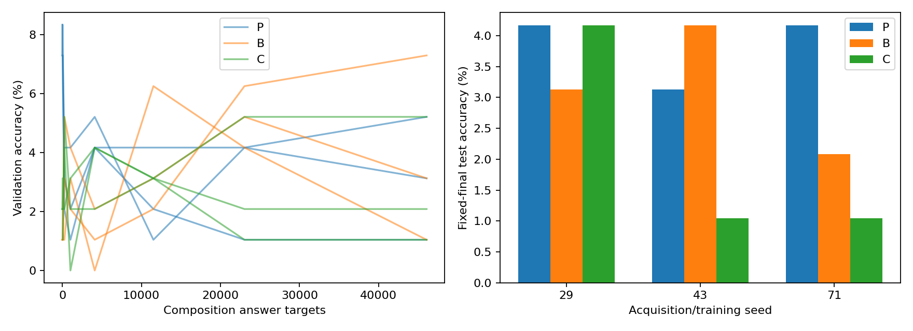

派生阅读副本；原件位置：`Projects/from-attention-to-search/main/experiments/A15/15_26_low_frequency_compositional_reuse/R01_controlled_operations/summary.md`。
[精确原始文件](../../../../../../../../sources/Projects/from-attention-to-search/main/experiments/A15/15_26_low_frequency_compositional_reuse/R01_controlled_operations/summary.md)；研究修改仍回到原件。

---

# A15_26 / R01: learning help and compositional reuse

**Atomic maps fit the original prompts, but did not yield qualified held-out composition.** Balanced U TEST means for relevant-operation parent P, untrained Base B and alternate-operation parent C are 3.82%, 3.13%, 2.08%. P−B and P−C are +0.69 and +1.74 percentage points. [Per-seed paired evidence](../../../../../../../../sources/Projects/from-attention-to-search/main/experiments/A15/15_26_low_frequency_compositional_reuse/R01_controlled_operations/tables/help.csv).

The factual reading has three paths: behavior and factor controls; representation and layer organization; functional interventions and measurement quality. Comparison analysis, causal conjectures and belief updates are separate records.

The purpose is to test whether learned components help rare compositions and actually participate in prediction. Complete freezing is a stronger hypothesis. Qwen3-0.6B Base keeps its first27 blocks fixed; the final block or an added adapter is trained.32 symbol names and four F/four G permutations define y=G_j(F_i(x)), without assuming an internal algorithm. Each pair has20/6/6 TRAIN/VAL/TEST inputs: TEST holds out pair-input mappings. Exposure arms match46,080 answer targets and operation/global input/output marginals, while finer operation–input joint exposure remains unmatched. [Task guide](dataset_guide.md).

| Seed | P TEST | B TEST | C TEST | P−B (pp) | P−C (pp) | VAL AUC P−B / P−C (pp) |
| --- | --- | --- | --- | --- | --- | --- |
| 29 | 4.17% | 3.13% | 4.17% | +1.04 | +0.00 | +1.09 / +1.76 |
| 43 | 3.13% | 4.17% | 1.04% | -1.04 | +2.08 | -2.20 / -0.17 |
| 71 | 4.17% | 2.08% | 1.04% | +2.08 | +3.13 | -1.44 / -0.89 |

Before composition training, all P seeds attain100% original-format atomic accuracy, but changed-format means are 33.98%, 36.72%, 38.28%; every seed fails the95%-per-operation guard. At that point explicit two-call composition is100% for every seed, adding calls and an intermediate interface. After composition training P-U original-format atomic accuracy is only 8.98%, 6.64%, 10.94%, while composition TRAIN is100% and TEST remains low. [Qualification/positives](../../../../../../../../sources/Projects/from-attention-to-search/main/experiments/A15/15_26_low_frequency_compositional_reuse/R01_controlled_operations/tables/factual_results.json), [retention](../../../../../../../../sources/Projects/from-attention-to-search/main/experiments/A15/15_26_low_frequency_compositional_reuse/R01_controlled_operations/tables/all_runs.csv).

Balanced rank32 frozen-adapter F and joint-adapter J TEST means are 2.08% and 4.17%. Neither qualifies at95%. The prespecified rank128 capacity check is retained. All36 revision trajectories produce18 edit/sham comparisons, 0 eligible. All36 confirmation intervention conditions across three parents were measured, with no eligible native-behavior starting point. [Freeze](../../../../../../../../sources/Projects/from-attention-to-search/main/experiments/A15/15_26_low_frequency_compositional_reuse/R01_controlled_operations/tables/freeze.csv), [revisions](../../../../../../../../sources/Projects/from-attention-to-search/main/experiments/A15/15_26_low_frequency_compositional_reuse/R01_controlled_operations/tables/revisions.csv), [interventions](../../../../../../../../sources/Projects/from-attention-to-search/main/experiments/A15/15_26_low_frequency_compositional_reuse/R01_controlled_operations/tables/factual_results.json).

Each left-panel line is one seed's validation trajectory against actual answer targets. The right panel shows every fixed-final TEST result. Low held-out performance does not reveal an internal mechanism; seeds share one task world.

The complete formal matrix has82 trajectories,111,744 updates and3,575,808 answer targets, separate from Smoke. Acquisition/capacity repairs, exposure, atomic revisions and state diagnostics all executed. [Detailed record](detailed.md), [artifact manifest](artifact_manifest.md), [output audit](../../../../../../../../sources/Projects/from-attention-to-search/main/experiments/A15/15_26_low_frequency_compositional_reuse/R01_controlled_operations/provenance/final_output_audit.json).

The registered experiments completed, but atomic-format and composition guards failed. This round cannot adjudicate reuse after acquiring callable component competence, natural-language benefit or an MoE architecture. Researcher mechanism judgment, next-round choice and question closure remain Unknown.

Read [result analysis](result_analysis.md), then [mechanism conjectures](mechanism_conjectures.md), then the separate [recognition update](recognition_update.md). The latter are delegated AI analysis, not researcher acceptance or authorization for another run.
