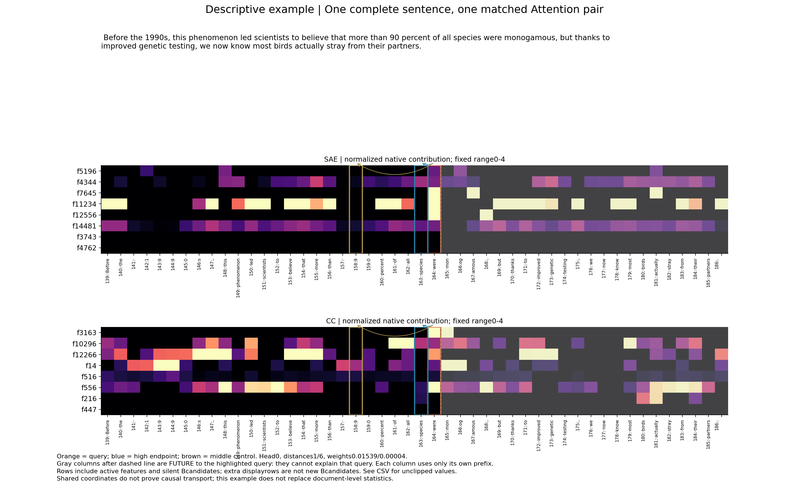

派生阅读副本；原件位置：`Projects/from-attention-to-search/main/experiments/A15/15_27_natural_language_feature_response/R05_distance_attention_20261028/examples_cn.md`。
[精确原始文件](../../../../../../../../sources/Projects/from-attention-to-search/main/experiments/A15/15_27_natural_language_feature_response/R05_distance_attention_20261028/examples_cn.md)；研究修改仍回到原件。

---

# 真实文本、数字与反例

以下例子是事前固定展示规则产生的说明／探索性读图，不是新增确认。所有前缀均为受控构造，不是原始自然语料。

## SAE f8194

### 局部正响应：S10，目标 organ

四版本最后层/本hook原空间贡献：{'X': 4.683053493499756, 'Y': 0.0, 'XU': 4.632839679718018, 'YU': 0.0}。家族两措辞平均超额1.103358；措辞一2.206716、措辞二0.000000。目标239−线索95＝144。

**X完整前缀：**

> This is a short record. A plain chair stood nearby. The sky was gray. The sky was gray. The sky was gray. The sky was gray. The sky was gray. The sky was gray. The sky was gray. The sky was gray. The sky was gray. The sky was gray. The sky was gray. The sky was gray. The sky was gray. The note was dated Monday. The musician played a large keyboard instrument with pipes in the church. A clock ticked nearby. A clock ticked nearby. A clock ticked nearby. A clock ticked nearby. A clock ticked nearby. A clock ticked nearby. A clock ticked nearby. A clock ticked nearby. A clock ticked nearby. A clock ticked nearby. A clock ticked nearby. A clock ticked nearby. A clock ticked nearby. A clock ticked nearby. A clock ticked nearby. A clock ticked nearby. A clock ticked nearby. A clock ticked nearby. A clock ticked nearby. A clock ticked nearby. A clock ticked nearby. A clock ticked nearby. A clock ticked nearby. The final report described the organ

**Y完整前缀：**

> This is a short record. Everyone waited. Nothing else happened. The sky was gray. The sky was gray. The sky was gray. The sky was gray. The sky was gray. The sky was gray. The sky was gray. The sky was gray. The sky was gray. The sky was gray. The sky was gray. The sky was gray. The sky was gray. The note was dated Monday. The surgeon examined a part of the body that pumps blood. A clock ticked nearby. A clock ticked nearby. A clock ticked nearby. A clock ticked nearby. A clock ticked nearby. A clock ticked nearby. A clock ticked nearby. A clock ticked nearby. A clock ticked nearby. A clock ticked nearby. A clock ticked nearby. A clock ticked nearby. A clock ticked nearby. A clock ticked nearby. A clock ticked nearby. A clock ticked nearby. A clock ticked nearby. A clock ticked nearby. A clock ticked nearby. A clock ticked nearby. A clock ticked nearby. A clock ticked nearby. A clock ticked nearby. The final report described the organ

**同一家族换说法的反例（仅摘出相关线索；完整前缀见冻结清单）：**

- X：At the cathedral, music came from the keyboard and its rows of pipes.

- Y：The doctor studied a bodily structure with a specific biological function.

这两个版本及其无关编辑的贡献均为0；不能用第一措辞宣称跨措辞复现。

### 跨家族不响应：S07，目标 plant

四版本最后层/本hook原空间贡献：{'X': 0.0, 'Y': 0.0, 'XU': 0.0, 'YU': 0.0}。家族两措辞平均超额0.000000；措辞一0.000000、措辞二0.000000。目标239−线索95＝144。

**X完整前缀：**

> This is a short record. A clock ticked nearby. It was quiet. It was quiet. It was quiet. It was quiet. It was quiet. It was quiet. It was quiet. It was quiet. It was quiet. It was quiet. It was quiet. It was quiet. It was quiet. It was quiet. It was quiet. It was quiet. The note was dated Monday. The gardener watered a living organism with green leaves and roots. Everyone waited. The light stayed on. The light stayed on. The light stayed on. The light stayed on. The light stayed on. The light stayed on. The light stayed on. The light stayed on. The light stayed on. The light stayed on. The light stayed on. The light stayed on. The light stayed on. The light stayed on. The light stayed on. The light stayed on. The light stayed on. The light stayed on. The light stayed on. The light stayed on. The light stayed on. The light stayed on. The light stayed on. The light stayed on. The light stayed on. The light stayed on. The light stayed on. The final report described the plant

**Y完整前缀：**

> This is a short record. The floor was dry. It was quiet. It was quiet. It was quiet. It was quiet. It was quiet. It was quiet. It was quiet. It was quiet. It was quiet. It was quiet. It was quiet. It was quiet. It was quiet. It was quiet. It was quiet. It was quiet. It was quiet. The note was dated Monday. The manager inspected a factory where workers assembled metal parts. Everyone waited. The light stayed on. The light stayed on. The light stayed on. The light stayed on. The light stayed on. The light stayed on. The light stayed on. The light stayed on. The light stayed on. The light stayed on. The light stayed on. The light stayed on. The light stayed on. The light stayed on. The light stayed on. The light stayed on. The light stayed on. The light stayed on. The light stayed on. The light stayed on. The light stayed on. The light stayed on. The light stayed on. The light stayed on. The light stayed on. The light stayed on. The light stayed on. The final report described the plant

## CC f447

### 局部正响应：S07，目标 plant

四版本最后层/本hook原空间贡献：{'X': 9.920237148212413, 'Y': 0.0, 'XU': 10.074951532166153, 'YU': 0.0}。家族两措辞平均超额0.975452；措辞一1.950903、措辞二0.000000。目标239−线索95＝144。

**X完整前缀：**

> This is a short record. A clock ticked nearby. It was quiet. It was quiet. It was quiet. It was quiet. It was quiet. It was quiet. It was quiet. It was quiet. It was quiet. It was quiet. It was quiet. It was quiet. It was quiet. It was quiet. It was quiet. It was quiet. The note was dated Monday. The gardener watered a living organism with green leaves and roots. Everyone waited. The light stayed on. The light stayed on. The light stayed on. The light stayed on. The light stayed on. The light stayed on. The light stayed on. The light stayed on. The light stayed on. The light stayed on. The light stayed on. The light stayed on. The light stayed on. The light stayed on. The light stayed on. The light stayed on. The light stayed on. The light stayed on. The light stayed on. The light stayed on. The light stayed on. The light stayed on. The light stayed on. The light stayed on. The light stayed on. The light stayed on. The light stayed on. The final report described the plant

**Y完整前缀：**

> This is a short record. The floor was dry. It was quiet. It was quiet. It was quiet. It was quiet. It was quiet. It was quiet. It was quiet. It was quiet. It was quiet. It was quiet. It was quiet. It was quiet. It was quiet. It was quiet. It was quiet. It was quiet. It was quiet. The note was dated Monday. The manager inspected a factory where workers assembled metal parts. Everyone waited. The light stayed on. The light stayed on. The light stayed on. The light stayed on. The light stayed on. The light stayed on. The light stayed on. The light stayed on. The light stayed on. The light stayed on. The light stayed on. The light stayed on. The light stayed on. The light stayed on. The light stayed on. The light stayed on. The light stayed on. The light stayed on. The light stayed on. The light stayed on. The light stayed on. The light stayed on. The light stayed on. The light stayed on. The light stayed on. The light stayed on. The light stayed on. The final report described the plant

**同一家族换说法的反例（仅摘出相关线索；完整前缀见冻结清单）：**

- X：In the garden, a leafy organism grew toward the sunlight.

- Y：The company opened an industrial factory to manufacture equipment.

这两个版本及其无关编辑的贡献均为0；不能用第一措辞宣称跨措辞复现。

### 跨家族不响应：S08，目标 pitch

四版本最后层/本hook原空间贡献：{'X': 0.0, 'Y': 0.0, 'XU': 0.0, 'YU': 0.0}。家族两措辞平均超额0.000000；措辞一0.000000、措辞二0.000000。目标239−线索95＝144。

**X完整前缀：**

> This is a short record. Nothing else happened. There was a wooden table. There was a wooden table. There was a wooden table. There was a wooden table. There was a wooden table. There was a wooden table. There was a wooden table. There was a wooden table. There was a wooden table. There was a wooden table. There was a wooden table. The note was dated Monday. The singer adjusted the frequency of her voice to match the musical note. A clock ticked nearby. It was quiet. It was quiet. It was quiet. It was quiet. It was quiet. It was quiet. It was quiet. It was quiet. It was quiet. It was quiet. It was quiet. It was quiet. It was quiet. It was quiet. It was quiet. It was quiet. It was quiet. It was quiet. It was quiet. It was quiet. It was quiet. It was quiet. It was quiet. It was quiet. It was quiet. It was quiet. It was quiet. It was quiet. It was quiet. It was quiet. It was quiet. It was quiet. It was quiet. The final report described the pitch

**Y完整前缀：**

> This is a short record. The window was closed. There was a wooden table. There was a wooden table. There was a wooden table. There was a wooden table. There was a wooden table. There was a wooden table. There was a wooden table. There was a wooden table. There was a wooden table. There was a wooden table. There was a wooden table. The note was dated Monday. The soccer teams walked onto the grass playing field before the match. A clock ticked nearby. It was quiet. It was quiet. It was quiet. It was quiet. It was quiet. It was quiet. It was quiet. It was quiet. It was quiet. It was quiet. It was quiet. It was quiet. It was quiet. It was quiet. It was quiet. It was quiet. It was quiet. It was quiet. It was quiet. It was quiet. It was quiet. It was quiet. It was quiet. It was quiet. It was quiet. It was quiet. It was quiet. It was quiet. It was quiet. It was quiet. It was quiet. It was quiet. It was quiet. The final report described the pitch

## A完整真实句子

> Before the 1990s, this phenomenon led scientists to believe that more than 90 percent of all species were monogamous, but thanks to improved genetic testing, we now know most birds actually stray from their partners.

原文出处与WARC、token IDs见A_document_manifest.csv及冻结A.jsonl；不是合成句。图中第139–186号token，查询164，强端点163，对照158。

