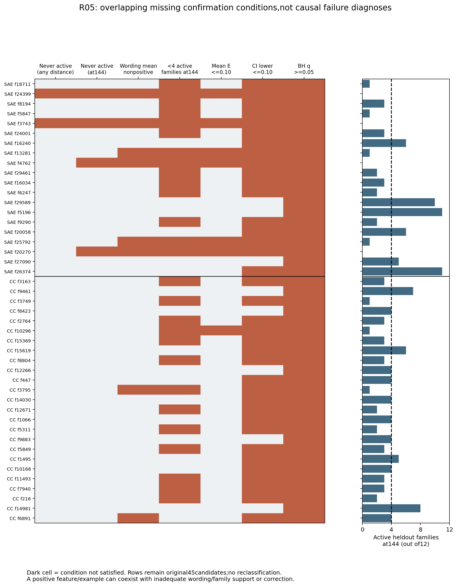
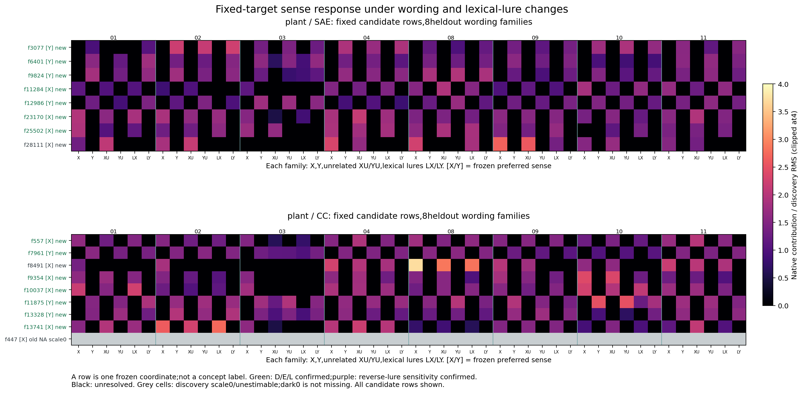
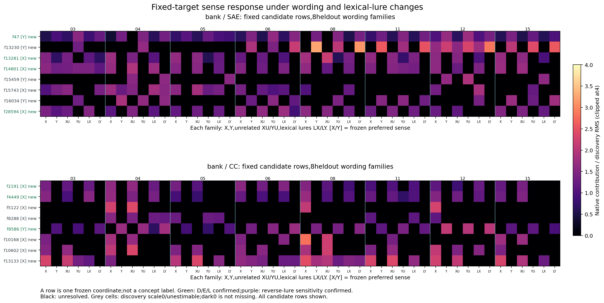
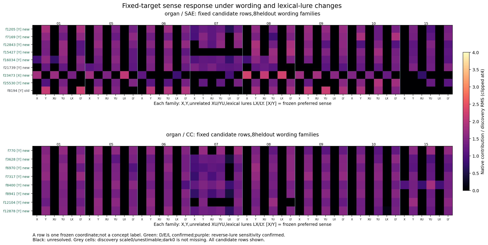
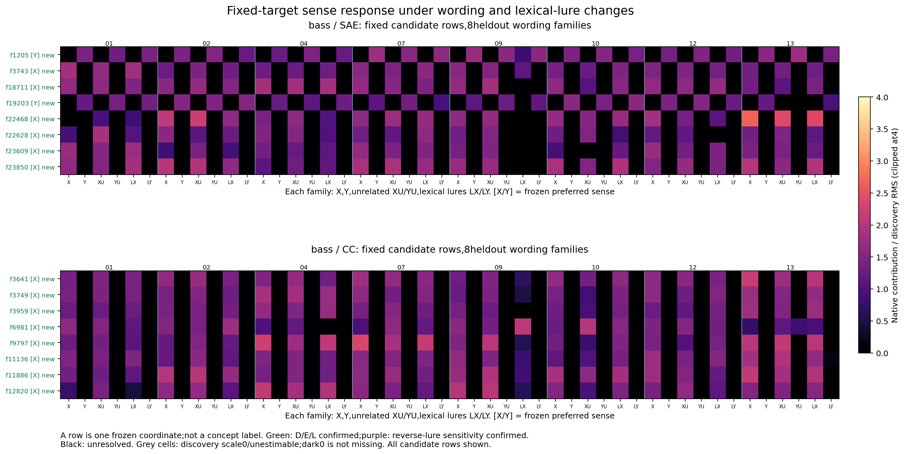
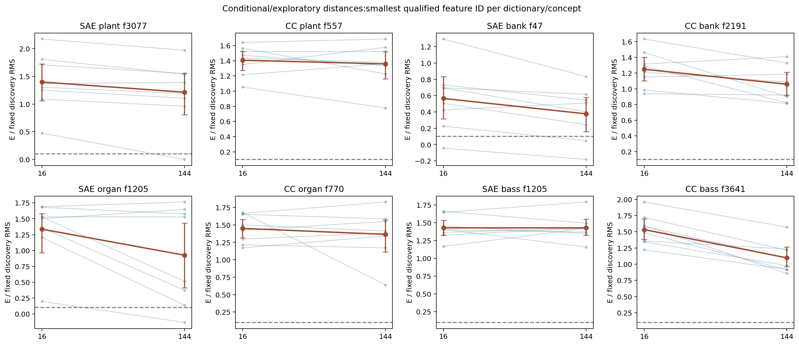

派生阅读副本；原件位置：`Projects/from-attention-to-search/main/experiments/A15/15_27_natural_language_feature_response/R06_fixed_target_semantics_20261028/figures_cn.md`。
[精确原始文件](../../../../../../../../sources/Projects/from-attention-to-search/main/experiments/A15/15_27_natural_language_feature_response/R06_fixed_target_semantics_20261028/figures_cn.md)；研究修改仍回到原件。

---

# 三张图怎样读

## 图一：旧候选缺了哪些确认条件
一个点/深色格是一个旧feature的一项条件，不是token，也不是聚类。行=20SAE+25CC，列=全距不激活、144不激活、措辞均值非正、<4家族支持、点效应、区间及校正不足；右轴支持数0–12。深色可重叠，不能加总为45，也不能直接叫失败原因的因果解释。f447虽然144有局部正例，但跨家族校正不足；换措辞的零响应与近处亦零是反例。允许：区分静默/表达支持/统计不足；不能：改判旧成功或归因为距离。

## 图二：固定feature在不同措辞与诱饵下怎样响应
每页一个目标词，上下分别SAE/CC；行=发现固定坐标（old单标），列=8留出家族各6版。X/Y是两含义，XU/YU是各自同义内编辑，LX/LY在相同含义前加入被明确排除的对侧代表词。颜色=原空间贡献/发现RMS，统一0–4截色、原值保留；这是逐行固定标尺，不是把贡献叫重要性。偏好[X/Y]在发现时固定；绿色行仅代表全部D/E/L确认，紫色是反向诱饵证据，黑色未分清，不是自然簇。

该看：同一行跨8家族是否方向一致，无关编辑是否也同样改变，以及诱饵是否翻转方向。X亮Y暗单独不够。全文与真实正反例见examples_cn.md，全部数值见CSV；不能从某一列推断整句含义或一般概念专属。

[全部四页](../../../../../../../../sources/Projects/from-attention-to-search/main/experiments/A15/15_27_natural_language_feature_response/R06_fixed_target_semantics_20261028/figures/figure2_semantic_wording_heatmaps.pdf)

## 图三：同一措辞家族的近远响应
若分支适用，横轴16/144、纵轴固定尺度的E，每条细线是一个留出措辞家族，粗线是均值；原数据表给家族区间和校正。对象先由近留出筛选，结果只能条件性/探索性，不能将筛选造成近处偏高解释为确认衰减。若无近合格，此图明确不适用且远未跑；不能造空曲线或推出远距无信息。

## 本轮直接数值与反例

图一：144处，SAE有14/20、CrossCoder13/25低于4个活跃家族；全45个q均未过，但只有SAE2个、CC1个是原p<.05而q没过。不能把全部未通过都归咎于多重校正。12个SAE、14个CC至少有一家族出现“一种措辞激活、另一种静默”，这是描述性不一致，不等同全局措辞均值条件失败。

图二：plant的CC f557首个留出家族X/Y=44.197/0，XU/YU=34.840/0，LX/LY=40.038/0；各色都使用该行同一个发现RMS26.838。全8家族D/E/L均值1.568/1.406/1.372，q均0.00852。反例为预指定f8194：原始方向与超无关编辑通过，但诱饵仅5/8正；尚未分清不等于反向词面已成立。灰色f447行是发现RMS=0不可估，不表示留出所有原激活都0，原贡献在可读表与例子中保留。

图三：细蓝线各为一个措辞家族，棕点为均值，误差棒为95%家族区间，灰虚线是0.10发现RMS。主图按“每概念/字典近距合格中最小ID”展示8对象，未按远距好坏筛选；[全部52对象曲线](../../../../../../../../sources/Projects/from-attention-to-search/main/experiments/A15/15_27_natural_language_feature_response/R06_fixed_target_semantics_20261028/figures/all_qualified_near_far.pdf)一并提供。f557近E1.406、远1.358，近减远0.048，区间[-0.080,0.176]，没有支持明显衰减。另一种表现是CC bass f3641近减远0.436，区间[0.313,0.555]、q0.00983，但它也只能是筛选后的探索性差异。SAE organ f16034远E0.468且区间正，q0.053仍未过，不能把正均值写成确认。
