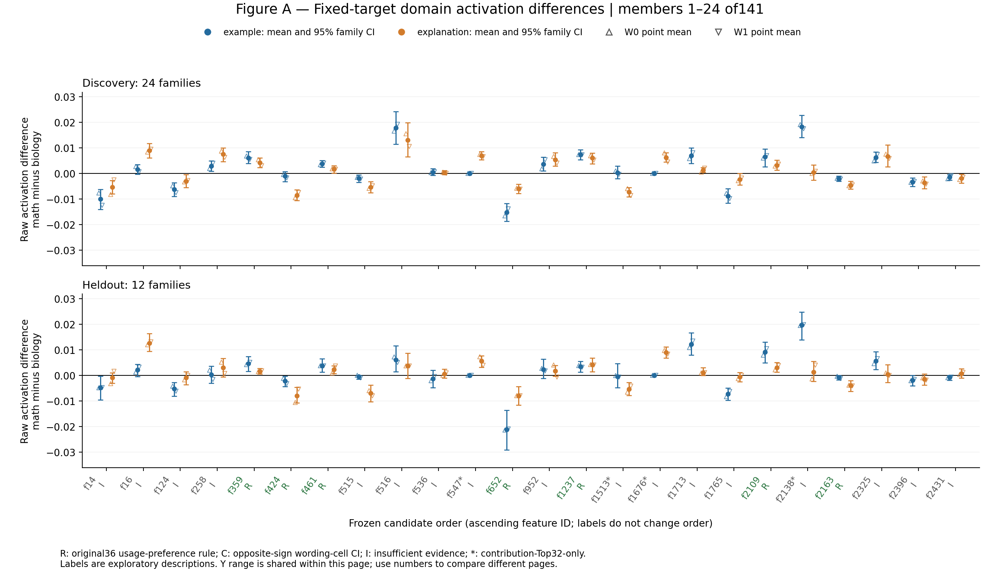
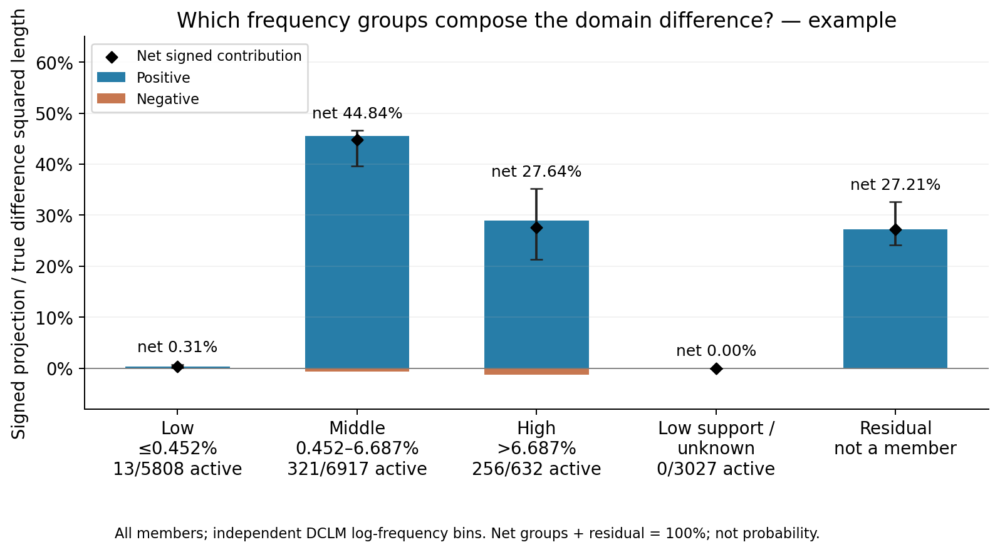
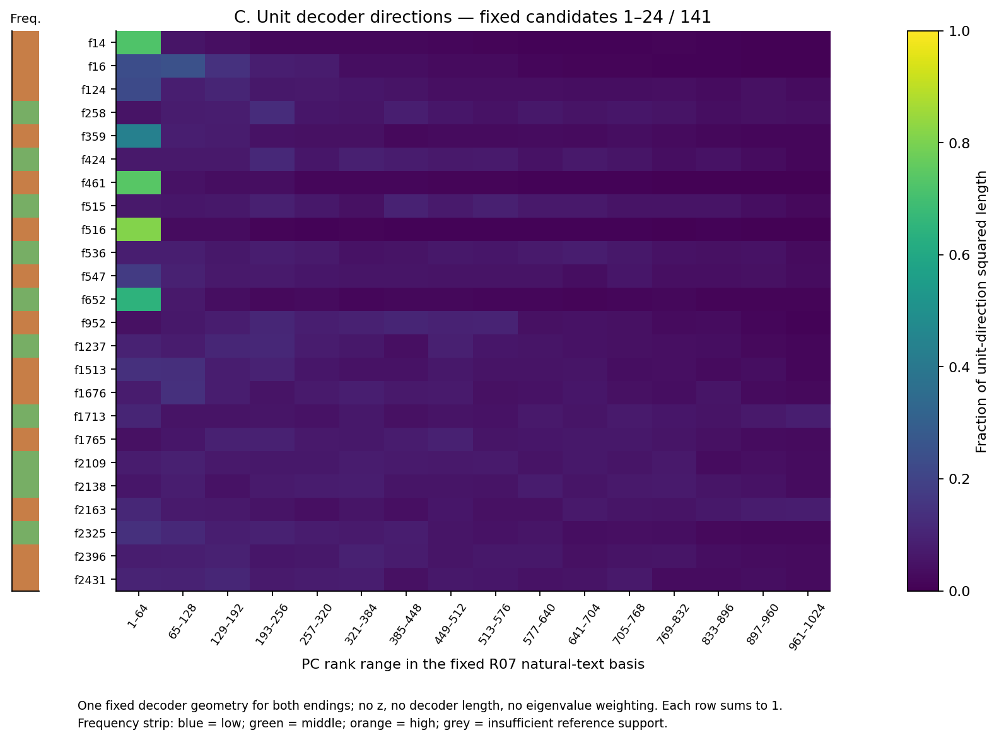
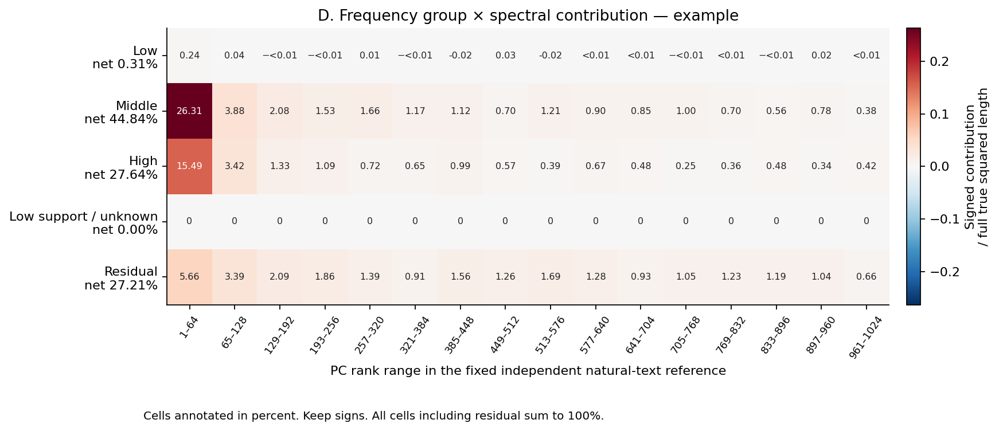
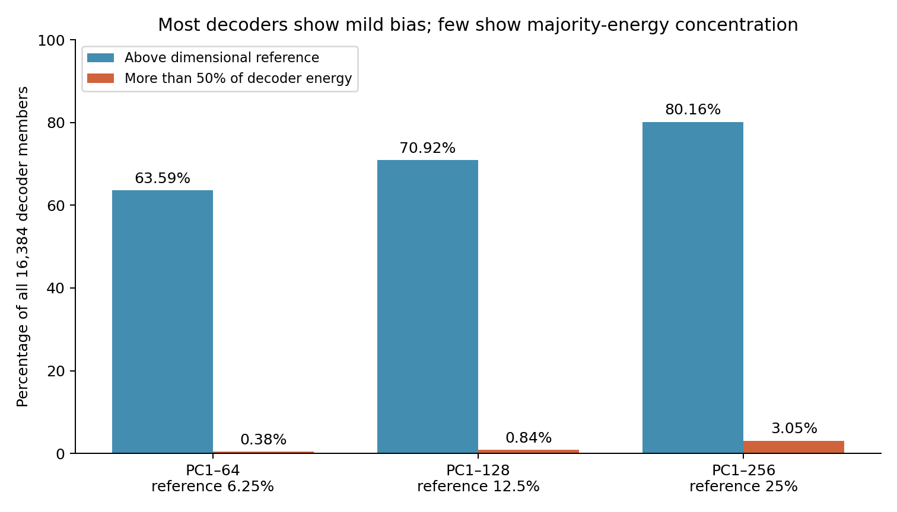

派生阅读副本；原件位置：`Projects/from-attention-to-search/main/experiments/A15/15_27_natural_language_feature_response/R09_domain_difference_decomposition_20261029/figures_cn.md`。
[精确原始文件](../../../../../../../../sources/Projects/from-attention-to-search/main/experiments/A15/15_27_natural_language_feature_response/R09_domain_difference_decomposition_20261029/figures_cn.md)；研究修改仍回到原件。

---

# R09逐图解释：从使用差异到频率与谱段贡献

[English](figures.md) · [结论与问题](summary_cn.md) · [计算关系与补充审计](supplement_ABCD_cn.md) · [完整方法和来源](detailed_cn.md)

**A先看成员的领域使用偏向能否复现，B问哪些频率组组成真实差异，C看成员decoder朝向哪里，D再把实际贡献与谱段连接起来。最后用全字典背景检查候选前偏有多少属于一般几何。** 目前能保留的读法是：部分成员的使用偏向复现；中高频参与这份面板的领域差异；候选平均更前偏。频率和decoder方向都不能单独给出语义或长短程功能标签。

本页完整链接38张图。A–D、背景和原主图使用R07/R08的384条原短文本缓存；距离图使用另外构造的240-token输入，不能混为同一组近远条件。图片是执行端原图的阅读副本，数表链接指向原产物；复制来源与哈希见[阅读副本清单](../../../../../../../../sources/Projects/from-attention-to-search/main/experiments/A15/15_27_natural_language_feature_response/R09_domain_difference_decomposition_20261029/payload_manifest.json)。

## 先分清四个对象

每条文本在最后目标token处得到一份A22原生14层联合编码的**共享激活z**，并得到Qwen3-0.6B的1024维block27真实表征。两种目标结尾`example`与`explanation`分别分析。

| 对象 | 实际计算 | 对应图 |
|---|---|---|
| 成员使用差 \(\Delta z_f\) | 数学平均z减生物平均z，包含零值 | A |
| 成员贡献向量 \(c_f\) | 使用差乘最后层decoder向量，再乘还原尺度：\(c_f=s\Delta z_f d_f\) | B、D |
| 单位decoder方向 | 每个decoder除以自身长度，不乘使用差、长度或特征值 | C、背景 |
| 真实领域差异 \(\delta\) | 数学真实表征均值减生物真实表征均值；残差为 \(r=\delta-\sum_f c_f\) | B、D及原图1、2、4 |

谱轴固定为R07独立自然文本参考PCA的16个64维谱段：PC1–64、65–128，直到961–1024。排名依据参考表征方差，不是领域辨别力或知识重要性。原留出12家族此前已使用，本轮是探索性续接；需要家族区间时整家族一起重采样500次，措辞不当独立样本。

## A：同一成员的领域使用差能否跨条件复现

**对象和轴。** 每个横轴位置是一名冻结候选，141人按原成员ID顺序展示，标签不改变顺序。纵轴为原始z单位的数学减生物均值差：正值偏数学，负值偏生物。上面板用24个发现家族，下面板用12个原留出家族。蓝／橙分别是两个结尾；实心圆与误差线为两措辞等权均值及95%家族区间，上／下三角为W0／W1点估计。同页上下图共用纵轴，不同页范围可能不同。

**两种读法。** 下图两种结尾和两种措辞均保留发现方向，并且合并措辞区间排零，支持原使用偏向的复现。某一单元改变方向时，要进一步看区间：反号点且区间跨零仍是不足；区间整体落在发现方向反面才属于此处的条件相关反向证据。

图中R继承原36人的复现规则；C为其余成员中至少一个原留出结尾×措辞区间完全反向的7人；I为98人证据不足。原128领域候选分成36／7／85，另13个仅由贡献Top32进入并集者全部为I，标星号。**48个成员出现过点估计反号，不等于48个有区间反向证据。** C标签使用逐单元探索性区间，未作多重检验校正；R也不要求每个措辞自己的区间都排零。

三个实际例子说明为何需要这些区别：

- f13473（第6页，R）的原留出差为`example` 0.005457〔0.002120, 0.008622〕、`explanation` 0.006877〔0.003360, 0.010456〕，两者都偏数学。
- f12179（第5页，C）的`explanation`发现差为−0.003026；原留出W1为＋0.003690〔0.002014, 0.005323〕，这个单元的区间也反向。
- f516（第1页，I）的发现差为0.017860／0.013018，原留出为0.006100／0.003670；后者`explanation`区间〔−0.001261, 0.008618〕跨零。正点估计不能代替复现证据，区间跨零也不表示激活消失。

完整六页：[1–24](../../../../../../../../sources/Projects/from-attention-to-search/main/experiments/A15/15_27_natural_language_feature_response/R09_domain_difference_decomposition_20261029/evidence/supplement_ABCD_20261029/figure_A/figure_A_page01.png) · [25–48](../../../../../../../../sources/Projects/from-attention-to-search/main/experiments/A15/15_27_natural_language_feature_response/R09_domain_difference_decomposition_20261029/evidence/supplement_ABCD_20261029/figure_A/figure_A_page02.png) · [49–72](../../../../../../../../sources/Projects/from-attention-to-search/main/experiments/A15/15_27_natural_language_feature_response/R09_domain_difference_decomposition_20261029/evidence/supplement_ABCD_20261029/figure_A/figure_A_page03.png) · [73–96](../../../../../../../../sources/Projects/from-attention-to-search/main/experiments/A15/15_27_natural_language_feature_response/R09_domain_difference_decomposition_20261029/evidence/supplement_ABCD_20261029/figure_A/figure_A_page04.png) · [97–120](../../../../../../../../sources/Projects/from-attention-to-search/main/experiments/A15/15_27_natural_language_feature_response/R09_domain_difference_decomposition_20261029/evidence/supplement_ABCD_20261029/figure_A/figure_A_page05.png) · [121–141](../../../../../../../../sources/Projects/from-attention-to-search/main/experiments/A15/15_27_natural_language_feature_response/R09_domain_difference_decomposition_20261029/evidence/supplement_ABCD_20261029/figure_A/figure_A_page06.png)。数表：[1,692行原始均值、差与区间](../../../../../../../../sources/Projects/from-attention-to-search/main/experiments/A15/15_27_natural_language_feature_response/R09_domain_difference_decomposition_20261029/evidence/supplement_ABCD_20261029/figure_A/raw_delta_z.csv) · [标签及点／区间反向记录](../../../../../../../../sources/Projects/from-attention-to-search/main/experiments/A15/15_27_natural_language_feature_response/R09_domain_difference_decomposition_20261029/evidence/supplement_ABCD_20261029/figure_A/candidate_labels.csv)。A不测decoder贡献和行为必要性；同向使用差也不自动等于正重建贡献。

## B：哪些频率组实际组成领域差异

**对象和轴。** 这是原图3的合格复用，统计全部16,384名成员。横轴为独立DCLM参考频率组，纵轴是成员贡献沿真实差异方向的有符号份额 \(a_f=\langle c_f,\delta\rangle/\|\delta\|^2\)。组内正份额相加为蓝柱，负份额相加为橙柱，黑菱形为净和，误差线为净和的95%家族区间。残差单列，不是一名成员。

频率指65,536个独立参考位置上原生门控后`z>0`的比例。至少20次命中者按log发生率等宽划为低／中／高：0.030518%–0.451726%、＞0.451726%–6.686506%、＞6.686506%–98.974609%；人数5,808／6,917／632。另3,027名参考支持不足者单列。图下同时写当前结尾的实际活跃人数，不用参考频率代替本面板覆盖。

**两种读法。** 某组正柱高且净值也高，说明它沿当前真实差异方向提供较大的同向贡献。若正负都大而净值小，说明成员抵消；若残差大，则字典仍漏掉一部分方向份额。不能只看正柱，也不能把图高解释为知识量。

| 原留出净方向份额 | 低频 | 中频 | 高频 | 参考支持不足 | 残差 |
|---|---:|---:|---:|---:|---:|
| example | 0.31% | 44.84% | 27.64% | 0 | 27.21% |
| explanation | 0.17% | 24.51% | 25.77% | −0.002% | 49.56% |

例如`example`中频正／负部分为45.54%／−0.71%，高频为28.89%／−1.25%；`explanation`相应为25.68%／−1.17%和28.32%／−2.55%。因此两结尾的主要净贡献都来自中高频，但构成不同。低频当前仅13／11名活跃，当前份额小不能推广成低频普遍无用。

[example完整图](../../../../../../../../sources/Projects/from-attention-to-search/main/experiments/A15/15_27_natural_language_feature_response/R09_domain_difference_decomposition_20261029/evidence/figures/figure3_frequency_example.png) · [explanation完整图](../../../../../../../../sources/Projects/from-attention-to-search/main/experiments/A15/15_27_natural_language_feature_response/R09_domain_difference_decomposition_20261029/evidence/figures/figure3_frequency_explanation.png) · [全部正／负／净贡献、人数及区间](../../../../../../../../sources/Projects/from-attention-to-search/main/experiments/A15/15_27_natural_language_feature_response/R09_domain_difference_decomposition_20261029/evidence/tables/frequency_signed_contributions.csv)。净组份额加残差为100%，但这是可加的方向账目，不是概率；垂直于真实差异的误差须另看原图1。频率边界敏感性见后面的两张对照图。

## C：这些成员的decoder方向位于哪些谱段

**对象和轴。** 每行一个冻结成员，与A同顺序；每列一个明确的64维谱段。格子颜色表示单位decoder投影到该段后的平方长度 \(e_{f,b}=\|P_b(d_f/\|d_f\|)\|^2\)，每行和为1。左侧频率条蓝／绿／橙／灰对应低／中／高／参考支持不足；热图颜色本身只表示方向能量，统一范围0到1。

**两种读法。** 某行第一格很亮，表示该decoder方向高度集中于PC1–64；多列分散表示它在多个谱段都有分量。跨行亮度不能解释为激活大或重建贡献大，因为所有行已去掉自身长度，也没有乘激活差。

第6页中，f13964有89.28%的方向能量在PC1–64，f13473只有9.61%。两者都在A的原使用复现名单中，因此领域使用偏向复现并不要求decoder主要集中在谱前部。平方投影也不保留decoder的方向符号，无法单独判断它对当前领域差异是强化还是抵消。

第1页还能与A直接对照：f516的PC1–64份额高达81.49%，但其`explanation`留出差区间跨零，标签为I；f424的该段份额仅6.97%，却以两结尾差−0.002230〔−0.004427, −0.000348〕、−0.008013〔−0.010813, −0.004608〕进入原复现R名单。谱前对齐与使用偏向复现不是同一个指标。

C只有一套几何图，因为固定decoder和固定PCA不随目标结尾改变。完整六页：[1–24](../../../../../../../../sources/Projects/from-attention-to-search/main/experiments/A15/15_27_natural_language_feature_response/R09_domain_difference_decomposition_20261029/evidence/supplement_ABCD_20261029/figures/figureC_unit_decoder_page1.png) · [25–48](../../../../../../../../sources/Projects/from-attention-to-search/main/experiments/A15/15_27_natural_language_feature_response/R09_domain_difference_decomposition_20261029/evidence/supplement_ABCD_20261029/figures/figureC_unit_decoder_page2.png) · [49–72](../../../../../../../../sources/Projects/from-attention-to-search/main/experiments/A15/15_27_natural_language_feature_response/R09_domain_difference_decomposition_20261029/evidence/supplement_ABCD_20261029/figures/figureC_unit_decoder_page3.png) · [73–96](../../../../../../../../sources/Projects/from-attention-to-search/main/experiments/A15/15_27_natural_language_feature_response/R09_domain_difference_decomposition_20261029/evidence/supplement_ABCD_20261029/figures/figureC_unit_decoder_page4.png) · [97–120](../../../../../../../../sources/Projects/from-attention-to-search/main/experiments/A15/15_27_natural_language_feature_response/R09_domain_difference_decomposition_20261029/evidence/supplement_ABCD_20261029/figures/figureC_unit_decoder_page5.png) · [121–141](../../../../../../../../sources/Projects/from-attention-to-search/main/experiments/A15/15_27_natural_language_feature_response/R09_domain_difference_decomposition_20261029/evidence/supplement_ABCD_20261029/figures/figureC_unit_decoder_page6.png)；另有[全部141人的长图](../../../../../../../../sources/Projects/from-attention-to-search/main/experiments/A15/15_27_natural_language_feature_response/R09_domain_difference_decomposition_20261029/evidence/supplement_ABCD_20261029/figures/figureC_unit_decoder_all141.png)。原始读数：[16,384名成员×16段方向能量表](../../../../../../../../UNAVAILABLE.md)。比较候选是否只是一般字典前偏，要继续看下文背景；判断实际贡献则需D。

## D：哪个频率组在什么谱段组成真实差异

**对象和轴。** 先把同一频率组的成员贡献向量相加为 \(v_g=\sum_{f\in g}c_f\)，再逐段计算 \(J_{g,b}=\langle P_bv_g,P_b\delta\rangle/\|\delta\|^2\)。横轴仍是16个谱段，纵轴为四频率组加残差。每格印百分数，红色同向、蓝色反向；两种结尾共用色标。所有格子分母都为**完整真实差异的平方长度**，每段没有另归一到100%。

**两种读法。** 沿一行横读，可看该组的净贡献由哪些谱段组成；沿一列竖读，可看该段真实差异由哪些组和残差组成。负格表示该组在该段抵消真实差异方向，不能删掉或取绝对值。每行和等于B净值，每列含残差之和等于真实差异在该段的平方投影份额，全图合计100%。这种闭合是计算核验，不是新增的机制发现。

| PC1–64对完整差异的份额 | 低频 | 中频 | 高频 | 参考支持不足 | 残差 | 列合计 |
|---|---:|---:|---:|---:|---:|---:|
| example | 0.24% | 26.31% | 15.49% | 0 | 5.66% | 47.70% |
| explanation | −0.03% | 10.41% | 9.60% | 0.005% | 9.88% | 29.87% |

本面板中，中高频的同向贡献在PC1–64最突出，也分布到后续谱段。`explanation`低频第一格为负，但整行净值为正0.17%，是“局部抵消与整体同向可以同时存在”的实际例子。两张D图是原留出点估计，不展示逐格家族区间，不能把颜色差异读成显著性结论。

[example完整图](../../../../../../../../sources/Projects/from-attention-to-search/main/experiments/A15/15_27_natural_language_feature_response/R09_domain_difference_decomposition_20261029/evidence/supplement_ABCD_20261029/figures/figureD_joint_example.png) · [explanation完整图](../../../../../../../../sources/Projects/from-attention-to-search/main/experiments/A15/15_27_natural_language_feature_response/R09_domain_difference_decomposition_20261029/evidence/supplement_ABCD_20261029/figures/figureD_joint_explanation.png) · [三划分、两结尾联合贡献表](../../../../../../../../sources/Projects/from-attention-to-search/main/experiments/A15/15_27_natural_language_feature_response/R09_domain_difference_decomposition_20261029/evidence/supplement_ABCD_20261029/tables/frequency_spectral_joint_contribution.csv)。D把B和谱段真正连接起来；把B与C并排本身不能得到D，因为C没有实际激活差、符号或成员间合成关系。

## 全字典背景：候选前偏有多少属于一般方向偏置

四张背景图都使用C的单位decoder能量。统计单位是字典成员或随机成员集合，不是文本家族；下述带状范围不能叫家族置信区间。每个64维段的6.25%水平线来自64／1024，是各向同性方向的维数参照，不是对实际字典拟合出的经验零假设。

### 全字典均值与成员分布

[全字典与候选图](../../../../../../../../sources/Projects/from-attention-to-search/main/experiments/A15/15_27_natural_language_feature_response/R09_domain_difference_decomposition_20261029/evidence/supplement_ABCD_20261029/background/figures/background_all_dictionary.png)横轴为16个谱段，纵轴为单位decoder平方投影份额。灰蓝线是16,384人的等权平均，浅带为成员之间25–75百分位，橙线为固定141候选平均。

若两条均值线接近，候选前偏可以主要由一般字典几何解释；若候选明显更高，还需匹配频率与是否活跃。实际PC1–64全字典均值8.85%、中位数7.14%，候选均值18.15%、中位数9.47%。候选均值更高，却不能说每名候选都强烈前偏。数表：[每段分布](../../../../../../../../UNAVAILABLE.md) · [累计前部范围分布](../../../../../../../../sources/Projects/from-attention-to-search/main/experiments/A15/15_27_natural_language_feature_response/R09_domain_difference_decomposition_20261029/evidence/supplement_ABCD_20261029/background/tables/member_head_distributions.csv)。

### 多数轻度前偏，与少数强集中

[数量图](../../../../../../../../sources/Projects/from-attention-to-search/main/experiments/A15/15_27_natural_language_feature_response/R09_domain_difference_decomposition_20261029/evidence/supplement_ABCD_20261029/background/figures/background_mild_vs_majority_concentration.png)横轴为PC1–64、1–128、1–256三个累计范围，纵轴为全字典成员比例。蓝柱统计高于各范围维数参照的成员，橙柱统计超过50%方向能量落在该范围的成员。

| 前部范围 | 高于维数参照 | 超过50%方向能量 |
|---|---:|---:|
| PC1–64，参照6.25% | 10,418／16,384＝63.59% | 63／16,384＝0.38% |
| PC1–128，参照12.5% | 11,619／16,384＝70.92% | 138／16,384＝0.84% |
| PC1–256，参照25% | 13,134／16,384＝80.16% | 499／16,384＝3.05% |

蓝柱高支持多数轻度前偏；橙柱高才支持许多成员把大部分方向能量集中在该范围。实际前者普遍，后者稀少。不能用“超过50%的少”否认一般前偏，也不能用“高于维数参照的多”宣称多数能量都在谱前。50%只是回答“大部分”的数量界线，不是新语义门槛。来源仍为[累计前部范围分布](../../../../../../../../sources/Projects/from-attention-to-search/main/experiments/A15/15_27_natural_language_feature_response/R09_domain_difference_decomposition_20261029/evidence/supplement_ABCD_20261029/background/tables/member_head_distributions.csv)。

### 同频率档的非候选背景

[同频率档背景图](../../../../../../../../sources/Projects/from-attention-to-search/main/experiments/A15/15_27_natural_language_feature_response/R09_domain_difference_decomposition_20261029/evidence/supplement_ABCD_20261029/background/figures/background_frequency_matched_non_candidates.png)保持相同谱轴与能量轴。每个随机集合从非候选中抽1名低频、62名中频、78名高频，与固定候选组成相同；共1,000组，每组内部不重复抽样。蓝线为随机集合均值的平均，蓝带为这些集合均值的2.5–97.5百分位，橙线仍为候选均值。

橙线落入蓝带时，这种频率组成可覆盖候选平均几何；明显高于蓝带时，三个频率档人数还不能覆盖差异。实际PC1–64候选为18.15%，背景为10.44%〔9.07, 11.98%〕；PC1–128为27.09%对18.72%〔17.18, 20.63%〕，PC1–256为41.75%对33.66%〔32.10, 35.62%〕。这里匹配的是档位，不是逐成员连续发生率。数表：[逐段随机集合分布](../../../../../../../../UNAVAILABLE.md) · [累计范围](../../../../../../../../sources/Projects/from-attention-to-search/main/experiments/A15/15_27_natural_language_feature_response/R09_domain_difference_decomposition_20261029/evidence/supplement_ABCD_20261029/background/tables/random_set_head_background.csv)。

### 发现集活跃且同频率档的背景

[活跃且同频率档背景图](../../../../../../../../sources/Projects/from-attention-to-search/main/experiments/A15/15_27_natural_language_feature_response/R09_domain_difference_decomposition_20261029/evidence/supplement_ABCD_20261029/background/figures/background_discovery_active_frequency_matched_non_candidates.png)进一步要求非候选在原192条发现文本目标处至少激活一次，其余轴、配额与1,000组统计不变。可用低／中／高频人数19／438／298，足以满足1／62／78配额，没有替换门槛。

若橙线接近新蓝带，是否在本任务目标处活跃可解释一部分差异；若仍高，则这个粗粒度活跃匹配还不够。实际PC1–64背景10.69%〔9.46, 11.92%〕，仍低于候选18.15%；前128维为19.39%〔17.91, 20.87%〕，前256维为35.07%〔33.56, 36.73%〕。来源：[匹配池人数](../../../../../../../../UNAVAILABLE.md) · [匹配集合范围](../../../../../../../../sources/Projects/from-attention-to-search/main/experiments/A15/15_27_natural_language_feature_response/R09_domain_difference_decomposition_20261029/evidence/supplement_ABCD_20261029/background/tables/random_set_head_background.csv)。

这四图缩小一般字典几何、频率档人数和是否曾活跃这三个解释，但没有排除原候选选择效应。候选部分按沿领域差异的贡献筛选，而领域差异本来偏谱前；这会使入选方向更前偏。候选第一段超过50%的也仅12／141。方向背景不能独立证明“领域知识位于主方向”。

## 原主图索引：整体遗漏、少数成员与合成谱

### 图1a、1b：字典是否已完整描述差异

[1a相对残差](../../../../../../../../sources/Projects/from-attention-to-search/main/experiments/A15/15_27_natural_language_feature_response/R09_domain_difference_decomposition_20261029/evidence/figures/figure1a_dictionary_relative_error.png)横轴为两个结尾，纵轴为残差长度／真实差异长度；低值表示较完整重建，高值表示遗漏。实际为53.68%〔52.12, 57.96%〕和72.14%〔68.40, 76.50%〕，误差线来自12家族重采样。不能写成46.32%／27.86%的信息已解释。

[1b方向余弦](../../../../../../../../sources/Projects/from-attention-to-search/main/experiments/A15/15_27_natural_language_feature_response/R09_domain_difference_decomposition_20261029/evidence/figures/figure1b_dictionary_cosine.png)使用同一横轴，纵轴为真实与重建差异的方向余弦。接近1表示方向相似，较低表示方向偏离；实际为0.844〔0.815, 0.854〕和0.693〔0.649, 0.732〕。高余弦可以与大残差并存，两图要合读。来源：[字典重建表](../../../../../../../../sources/Projects/from-attention-to-search/main/experiments/A15/15_27_natural_language_feature_response/R09_domain_difference_decomposition_20261029/evidence/tables/dictionary_reconstruction.csv)。

### 图2：按固定顺序加入少量成员，能否接近全字典

[example](../../../../../../../../sources/Projects/from-attention-to-search/main/experiments/A15/15_27_natural_language_feature_response/R09_domain_difference_decomposition_20261029/evidence/figures/figure2_cumulative_example.png) · [explanation](../../../../../../../../sources/Projects/from-attention-to-search/main/experiments/A15/15_27_natural_language_feature_response/R09_domain_difference_decomposition_20261029/evidence/figures/figure2_cumulative_explanation.png)。横轴为发现集固定顺序加入的1／4／8／16／32名成员，纵轴仍为相对残差。蓝线为原留出，绿虚线为选择用发现集，灰色为1,000个同人数随机集合，橙线为全字典。若少量固定成员已接近橙线，可描述相对于该字典的集中性；若仍远离，不能称少数已解释完整差异。

实际Top32原留出误差为71.96%〔69.14, 77.58%〕／82.89%〔77.31, 88.17%〕，随机集合约100%，全字典为53.68%／72.14%。固定名单比此随机参照好，但尚未接近完整解释。蓝带是家族区间，灰带是随机集合分布；后者不控制激活频率。向量先相加再算误差，不能累加成员长度，也不要求曲线单调。来源：[全部k与随机参照](../../../../../../../../sources/Projects/from-attention-to-search/main/experiments/A15/15_27_natural_language_feature_response/R09_domain_difference_decomposition_20261029/evidence/tables/cumulative_reconstruction.csv)。

### 图4：真实与重建合成向量的谱分布

[example](../../../../../../../../sources/Projects/from-attention-to-search/main/experiments/A15/15_27_natural_language_feature_response/R09_domain_difference_decomposition_20261029/evidence/figures/figure4_spectrum_example.png) · [explanation](../../../../../../../../sources/Projects/from-attention-to-search/main/experiments/A15/15_27_natural_language_feature_response/R09_domain_difference_decomposition_20261029/evidence/figures/figure4_spectrum_explanation.png)。横轴为16个64维谱段，蓝／橙柱分别是真实／重建**合成向量**的分段平方长度。两者均除以完整真实差异的平方长度；重建柱不必合计100%。某段两柱接近说明在该能量量上接近，差距大说明恢复不全；即使相近也不保证段内方向一致。

实际PC1–64的真实／重建值为47.70%／39.30%和29.87%／17.65%；PC961–1024为1.47%／1.12%和2.05%／1.06%。这不是C的逐成员单位方向图，也不是D的有符号内积；合成向量平方包含成员间交叉项。来源：[完整谱表，含残差](../../../../../../../../sources/Projects/from-attention-to-search/main/experiments/A15/15_27_natural_language_feature_response/R09_domain_difference_decomposition_20261029/evidence/tables/spectral_decomposition.csv)。

### 分箱敏感性：低中高的名字是否带来不同印象

[example](../../../../../../../../sources/Projects/from-attention-to-search/main/experiments/A15/15_27_natural_language_feature_response/R09_domain_difference_decomposition_20261029/evidence/figures/supplement_binning_sensitivity_example.png) · [explanation](../../../../../../../../sources/Projects/from-attention-to-search/main/experiments/A15/15_27_natural_language_feature_response/R09_domain_difference_decomposition_20261029/evidence/figures/supplement_binning_sensitivity_explanation.png)。横轴为低／中／高标签，纵轴为净方向贡献，三色分别为原等人数、主log等宽、原发生率等宽。若同名组结果接近，解释较少依赖边界；若结果改变，必须给出边界和连续发生率。

实际`example`的“高频”净值从等人数65.13%变为log等宽27.64%、原发生率等宽7.63%；`explanation`为48.58%／25.77%／4.74%。原因是组成员不同，不是重新测得了矛盾的同一对象。主分法人数为5,808／6,917／632，原发生率等宽为13,281／63／13；图不决定哪种分法普适正确。来源：[三种分法边界与人数](../../../../../../../../sources/Projects/from-attention-to-search/main/experiments/A15/15_27_natural_language_feature_response/R09_domain_difference_decomposition_20261029/evidence/frequency_family/tables/frequency_group_counts.csv) · [三种分法贡献](../../../../../../../../sources/Projects/from-attention-to-search/main/experiments/A15/15_27_natural_language_feature_response/R09_domain_difference_decomposition_20261029/evidence/tables/frequency_signed_contributions.csv)。

## 频率与家族补图：频率不等于领域专有性

[频率分布图](../../../../../../../../sources/Projects/from-attention-to-search/main/experiments/A15/15_27_natural_language_feature_response/R09_domain_difference_decomposition_20261029/evidence/frequency_family/figures/supp_frequency_distribution.png)横轴是独立参考发生率的log轴，纵轴是成员数，竖线为主分界。跨数个数量级时应读倍数差；若都挤在一端，原发生率等宽将分得很不均衡。实际合格范围0.030518%–98.974609%，参考不足者为749个零命中加2,278个1–19次命中。分布不表示贡献或功能重要性。来源：[全部成员频率](../../../../../../../../UNAVAILABLE.md)。

[example方差份额](../../../../../../../../sources/Projects/from-attention-to-search/main/experiments/A15/15_27_natural_language_feature_response/R09_domain_difference_decomposition_20261029/evidence/frequency_family/figures/supp_domain_family_variance_example.png)和[explanation方差份额](../../../../../../../../sources/Projects/from-attention-to-search/main/experiments/A15/15_27_natural_language_feature_response/R09_domain_difference_decomposition_20261029/evidence/frequency_family/figures/supp_domain_family_variance_explanation.png)横轴为频率组，纵轴是逐成员归一化后组内等权平均的激活方差份额。橙色B为两域中心差异，蓝色F为同域家族变化，灰色W为家族内措辞变化；每名有变化成员满足T＝B＋F＋W。T为零者保持NA，柱下写有变化／全部成员数。

若橙色高，领域中心差在该批成员自身变化中占比高；蓝灰较高，则家族与措辞占较多。实际低／中／高频B/T在`example`为8.94%／12.93%／11.23%，`explanation`为18.55%／10.07%／7.74%，没有跨结尾稳定排序。两幅图的低频均值只来自13／11人；`example`参考支持不足组无有变化成员，保持NA，`explanation`仅1人。多数变化属于家族和措辞，不等于没有B图中的领域重建贡献。来源：[组份额与区间](../../../../../../../../UNAVAILABLE.md) · [逐成员分解](../../../../../../../../UNAVAILABLE.md)。

## 距离六图：响应曲线与实际覆盖分别看

这组输入固定总长240、目标位置239；领域核心最后token到目标距离为16／32／64／96／144。跨距离移动相同填充库存，另用紧随核心的Monday→Tuesday作长度和位置匹配的无关编辑对照。**新的16条件也不同于原短文本。** 在新近距已变的偏向不能叫远距衰减。领域替换与单token日期替换的编辑规模不同，E比较保留这一限制。

### 两张候选方向图

[example](../../../../../../../../sources/Projects/from-attention-to-search/main/experiments/A15/15_27_natural_language_feature_response/R09_domain_difference_decomposition_20261029/evidence/distance/figures/distance_candidate_direction_example.png) · [explanation](../../../../../../../../sources/Projects/from-attention-to-search/main/experiments/A15/15_27_natural_language_feature_response/R09_domain_difference_decomposition_20261029/evidence/distance/figures/distance_candidate_direction_explanation.png)。横轴为实际距离；纵轴为数学减生物平均激活差除以原发现集固定RMS，再乘该结尾原发现方向。故图上正值是原方向保留，负值是方向反转。每色一名说明用成员，阴影为12家族的95%区间。

远处仍为正且措辞一致，支持该条件的关联保留；反向或区间不足应分别报告。`example`的中频f424五档为0.722／0.703／0.747／0.479／0.699，非单调；f8624为1.075→0.419；高频f9900为1.900→1.718；f14在新近距已反向。`explanation`中f424和f8624保留偏生物，其未翻成图上正方向前的D为−0.168→−0.192和−0.756→−0.502；f9900远处为零且近距比值分母不稳。相同频率标签不能推出相同曲线，区间重叠也不是等价证据。来源：[候选各距离原值](../../../../../../../../UNAVAILABLE.md) · [远近比与区间](../../../../../../../../UNAVAILABLE.md)。

### 两张频率组响应图

[example](../../../../../../../../sources/Projects/from-attention-to-search/main/experiments/A15/15_27_natural_language_feature_response/R09_domain_difference_decomposition_20261029/evidence/distance/figures/distance_frequency_response_example.png) · [explanation](../../../../../../../../sources/Projects/from-attention-to-search/main/experiments/A15/15_27_natural_language_feature_response/R09_domain_difference_decomposition_20261029/evidence/distance/figures/distance_frequency_response_explanation.png)。横轴为距离；纵轴为组内成员平均E。E先在每家族／措辞算绝对领域激活差，减去两域平均日期编辑幅度，再除以该成员原发现集固定RMS。RMS为零时不估计，图例明确有效／全部人数；阴影是家族重采样区间。

E在远处为正，表示相对此日期编辑，领域核心更换带来较大变化；贴近零或区间跨零则不足。E去掉了领域方向，反向后也可能为正，不能替代上一组图。

| 结尾 | 低频E：16→144 | 中频E：16→144 | 高频E：16→144 |
|---|---:|---:|---:|
| example | 0.0389→0.0286 | 0.2569→0.1863 | 0.3150→0.2261 |
| explanation | 0.0106→0.0326 | 0.1166→0.0990 | 0.1959→0.1791 |

`explanation`低频远距区间〔−0.0658, 0.1318〕跨零，不能把点估计抬升叫稳定增强。图中组均值不证明高频一般更长程，因为可归一化成员、活跃覆盖和分母资格不同。来源：[全字典频率组距离统计](../../../../../../../../UNAVAILABLE.md)。

### 两张频率覆盖图

[example](../../../../../../../../sources/Projects/from-attention-to-search/main/experiments/A15/15_27_natural_language_feature_response/R09_domain_difference_decomposition_20261029/evidence/distance/figures/distance_frequency_support_example.png) · [explanation](../../../../../../../../sources/Projects/from-attention-to-search/main/experiments/A15/15_27_natural_language_feature_response/R09_domain_difference_decomposition_20261029/evidence/distance/figures/distance_frequency_support_explanation.png)。横轴为四频率组，纵轴为成员数的log轴。灰柱为组总数，蓝柱为原192条发现输入曾激活人数，橙柱为新144条件原留出目标处曾激活人数。零柱用显示底线占位并标0。

覆盖较多才有较多成员可比较距离变化；几乎未激活时，主要结论是尚未测足。实际低／中／高频的“总数→原发现活跃→远距活跃”，`example`为5,808→20→4、6,917→500→198、632→376→195；`explanation`末项分别为6、156、181。参考支持不足组两结尾均为3,027→1→0。柱高不表示激活强度或因果作用，低频少被观察也不等于没有远距响应能力。来源：[覆盖与比值分母](../../../../../../../../sources/Projects/from-attention-to-search/main/experiments/A15/15_27_natural_language_feature_response/R09_domain_difference_decomposition_20261029/evidence/distance/tables/frequency_near_far_support.csv)。

整体远距结果使用141固定候选而非这四个示例：144处E校正通过且两措辞保留原方向者为37／26人，两结尾交集14人；再要求新16处两结尾也保留方向则为10人。原36复现名单相应交集为7／3人，而新近距双结尾保留者本来仅9人。完整实际文本、控制与统计在[距离结果](../../../../../../../../UNAVAILABLE.md)及[F06文本和原始值](../../../../../../../../UNAVAILABLE.md)。这些图描述冻结字典响应，不作Attention权重、功能必要性或分专家收益判断。
