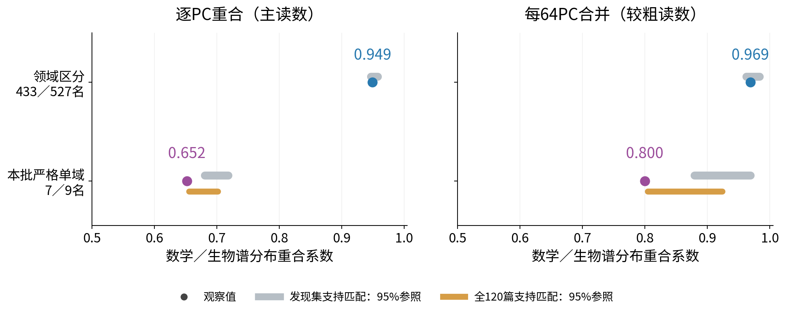
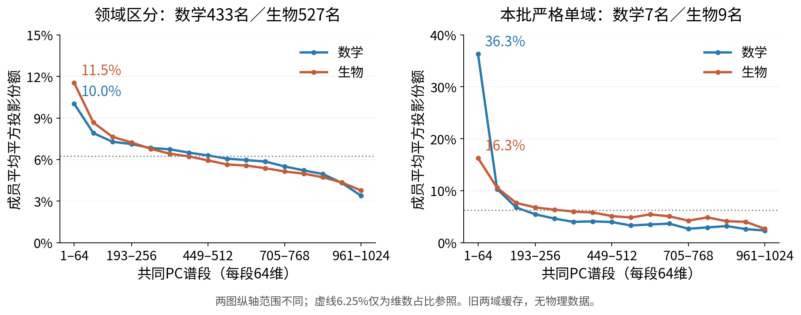

派生阅读副本；原件位置：`Projects/from-attention-to-search/main/experiments/A15/15_27_natural_language_feature_response/R11_three_domain_replication_20261030/summary.md`。
[精确原始文件](../../../../../../../../sources/Projects/from-attention-to-search/main/experiments/A15/15_27_natural_language_feature_response/R11_three_domain_replication_20261030/summary.md)；研究修改仍回到原件。

---

# R11 stage results: discriminative and observed-strict members in one spectrum

[中文](summary_cn.md) · [Detailed](detailed.md) · [Proposed protocol](../../../../../../../../UNAVAILABLE.md) · [Execution scope](execution_authorization_A01.md)

**Historical math/biology cache supplementation is complete; independent three-domain replication is NOT RUN. New model forwards: 0; training updates: 0.** Interpretations below are AI proposals; researcher acceptance and question closure remain Unknown.

## Knowledge update: domain discrimination does not imply separate spectral positions, but high whole-cohort overlap does not extend to the observed-strict subset

We compare unchanged R10 discriminators (433 math,527 biology) with the unchanged all-cache-strict16 (7 math,9 biology), using the same A22 block27 decoder and fixed common PCA. No cases were replaced.

The main cohort's per-PC overlap is **0.949**, within its size,reference-occurrence,and discovery-support matched range **0.947–0.958**. Strict16 overlap is **0.652**; discovery-support and full-panel support references are respectively **0.680–0.718** and **0.656–0.702**. Under the latter it is only0.00347 below the lower endpoint,with substantial forced inclusion of original members. This is insufficient to claim robust unusual separation. Raw overlap across differently sized cohorts alone is not a controlled comparison.

Read horizontally: larger means more similar mean squared-projection distributions. Rows are separate frozen cohorts;433/527 and7/9 denote math/biology counts. Points are observed coefficients; bars are central95% ranges from1,000 conditional dictionary draws,not document confidence intervals. Left is per-PC; right aggregates64PCs. The latter produces higher values0.969/0.800 by concealing within-band differences and cannot replace the primary resolution. Spectral similarity does not establish equal directions,semantics,or function.

## Knowledge update: front concentration differs within the strict subset, and its unusualness depends on support conditioning

X:16 common64-PC bands ordered by decreasing covariance variance. Y:equal-member mean squared projection of unit decoders;each complete mean profile sums to1. Blue:math;orange:biology. Panels have different labeled y ranges. The6.25% dotted line is only64/1024 dimensional share,not an empirical dictionary reference. The fixed PCA uses one common mean over60 historical discovery documents×160true block27 positions=9,600 positions;no physics data or new PCA fit was used.

| Cohort | Math/bio members | Math PC1–64 mean/median | Biology PC1–64 mean/median |
|---|---:|---:|---:|
| Discriminative |433/527|10.03%/6.84%|11.52%/8.79%|
| Observed strict |7/9|36.33%/42.46%|16.30%/16.56%|

All7strict math members and7/9strict biology members exceed6.25%;main counts are238/433 and390/527. The strict math mean is not driven solely by one member. PC1 contributes only0.206%/0.069% for strict math/biology;PC2–64 contributes36.12%/16.23%. Even36.33% is not most of the full decoder length;the remaining960directions retain63.67%.

Main per-domain head means both lie within discovery-matched references(math9.11%–10.21%;biology10.59%–11.76%). The pooled mean10.8498% exceeds its pooled upper bound10.8251% by only0.0248percentage point;this small deviation is retained rather than turned into a broad claim of special geometry.

For strict math,the discovery-matched range16.58%–28.77% lies below36.33%,but the post-hoc full120-document domain-specific support match gives25.84%–36.33%:the observation reaches the upper endpoint,not beyond it. Biology16.30% lies within both ranges12.49%–24.60% and15.79%–19.60%. Full-panel references include original members in65.4%/81.2% of math/biology draws;some strata have only1–3candidates. Independent background variation is limited. Thus front concentration is descriptive;unusualness relative to a well-supported dictionary reference remains uncertain.

## Objects and evidence boundaries

The entire dictionary has16,384coordinates;10,076meet discovery support in at least one domain(≥5documents). Frozen main selection uses mean z including zeros per document,domain-balanced cross-document pair probability with half-credit ties,and oriented score≥0.75. Strict16 additionally require no opposite-domain z>0 among all60old opposite documents×160positions=9,600positions. This uses development and old heldout data and is exploratory,not blind generalization or global exclusivity.

Math:f16195,f15426,f8693,f12030,f5234,f12960,f9638. Biology:f2635,f6270,f13691,f10395,f7238,f12630,f11516,f15401,f11960. [All member statistics](../../../../../../../../sources/Projects/from-attention-to-search/main/experiments/A15/15_27_natural_language_feature_response/R11_three_domain_replication_20261030/evidence/member_spectrum.csv) and the [16-member heatmap](../../../../../../../../sources/Projects/from-attention-to-search/main/experiments/A15/15_27_natural_language_feature_response/R11_three_domain_replication_20261030/evidence/appendix_strict16_members.png) retain counterexamples.

Geometry is squared inner product between a unit decoder and each PC,without z,eigenvalue,or decoder-norm weighting. It does **not** measure activation/reconstruction energy on real text. Strict cross-domain absolute-cosine mean0.0247 further distinguishes actual direction comparison from squared spectral distributions;no functional conclusion follows.

Existing inputs: R10members,PCA,projections,and whole-cohort matched draws. Newly computed here:strict16spectra,1,000 original-rule matched draws,post-hoc full-panel support sensitivity,actual-direction/subspace checks,two clear figures,and member tables. All6,000matching checks pass;direct projection reconstruction error≤8.33e-17;full spectra sum to1.

## Three-domain continuation remains data-gated

All59,812documents in the inspected local raw archive were scanned. Expanded topic prefiltering produced2,537candidate families,provisionally327math,1,890biology,337physics;labels can overlap. These are unreviewed candidates,not a qualified450-document corpus. Current labels yield math discrete/logic14 and analysis24;physics thermal/statistical16 and materials18,below25/topic. Physics has only2provisional new-source shared-platform QA candidates against7required. Labels need content review,so these are inventory limitations,not proof of universal data absence. M2D2physics archives were located,but original-document family boundaries remain unqualified.

Physics forwards,old16three-domain tests,new three-domain selection,new PCA,and independent heldout analyses are **NOT RUN**. Preserve quotas and splits;complete source qualification before dependent execution. See [data gate](data_gate.md) and [Detailed reproduction](detailed.md). This bounded cache analysis is complete;the three-domain research question remains open.
