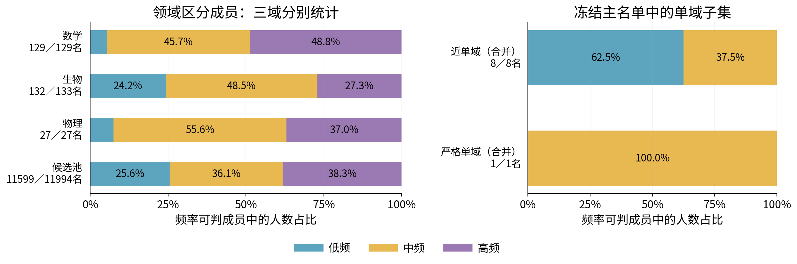
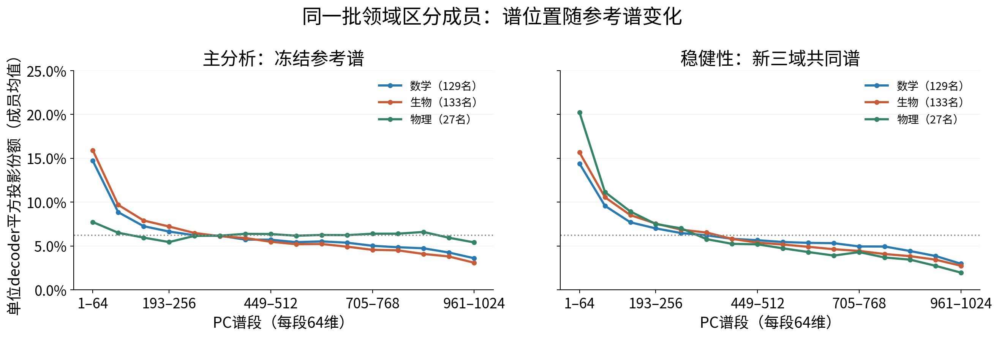
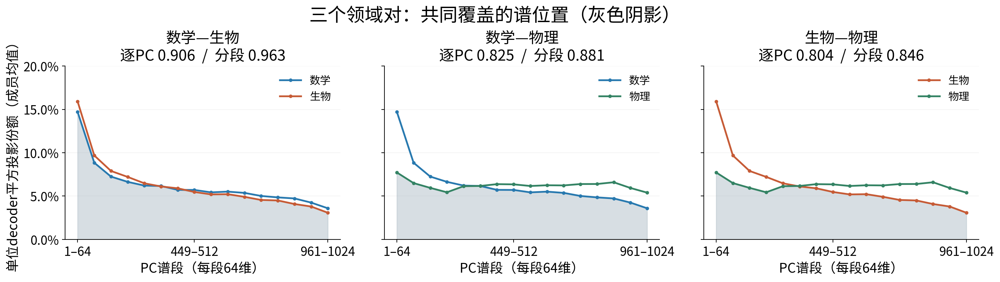
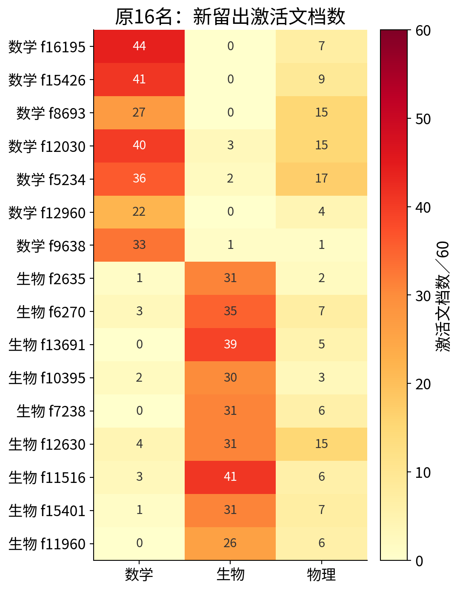
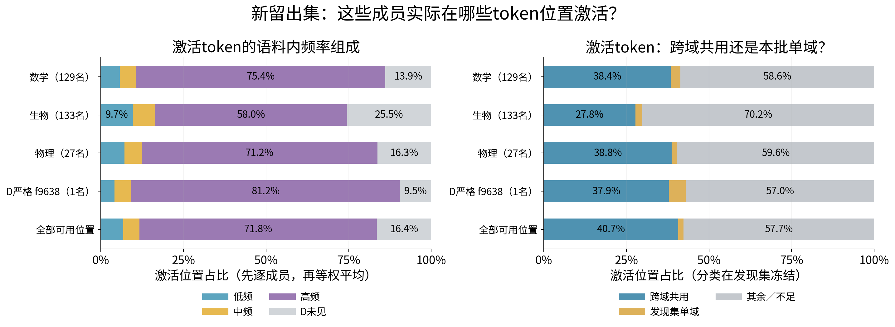
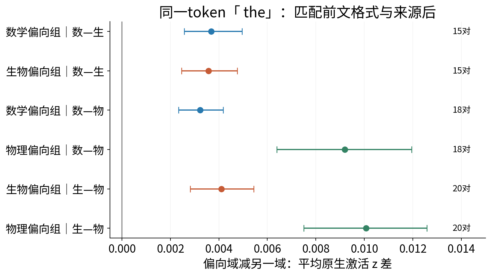

派生阅读副本；原件位置：`Projects/from-attention-to-search/main/experiments/A15/15_27_natural_language_feature_response/R11_three_domain_replication_20261030/summary_A02.md`。
[精确原始文件](../../../../../../../../sources/Projects/from-attention-to-search/main/experiments/A15/15_27_natural_language_feature_response/R11_three_domain_replication_20261030/summary_A02.md)；研究修改仍回到原件。

---

# R11 A02: completed math, biology and physics replication

[中文](summary_A02_cn.md) · [Detailed](detailed_A02.md) · [Definitions](definitions_A02.md) · [Data qualification](provenance/A02_qualified_data.md) · [Reproduction and tables](reproduce_A02.md)

**The 450-new-family experiment and bounded analyses are complete. The original aggregate intuitions did not fully replicate.** The belief updates below are AI interpretations for researcher review; scientific acceptance, mechanism judgment and closure remain Unknown. R04–R10 and R11 A01 are preserved.

Question: how do the strongest document-domain discriminators in one fixed A22 CrossCoder distribute across independent feature occurrence and a shared representation spectrum? Registered expectations were high-frequency enrichment, lower frequency among near-single-domain members, and substantial spectral overlap relative to matched dictionary groups. Source style, vocabulary, formulas, finite coverage and selection are credible rivals.

The fixed Qwen3-0.6B-Base and A22 retain native14-layer joint encoding, shared z, TRAIN normalization and the original gate. Geometry uses block27 residual-post decoder vectors. No training occurred. Each domain has150new original families:60discovery D,30development V,60heldout H. Each H is30familiar-platform new families and30new-platform families. Inputs contain192real tokens, analysis positions32–191:160/document,72,000total. D selects; V diagnoses; H never replaces members.

| Stage | Math | Biology | Physics | Total |
|---|---:|---:|---:|---:|
| D/V/H documents |60/30/60|60/30/60|60/30/60|450|
| Dictionary coordinates |—|—|—|16,384|
| Any D activation |—|—|—|14,873|
| Support-eligible:≥5Ddocuments in any domain |—|—|—|11,994|
| Frozen main |129|133|27|289|
| Near within main |2|5|1|8|
| Strict within main at D |1|0|0|1|
| Main members retaining H S≥.75 |48/129|76/133|22/27|146/289|
| D-strict members remaining strict in H |0/1|0/0|0/0|0/1|

For a preferred domain, S is the smaller of the two oriented pairwise document AUCs. AUC is the probability that a randomly drawn preferred-domain document has higher mean z than an opponent, with half credit for ties. Means include zeros. Main membership requires preferred support≥5Ddocuments and S≥.75. Strict means both opponent D supports are zero; near means each opponent≤3/60Ddocuments and preferred-domain share≥95%of positive positions. IDs and ordering were frozen before H.

## Belief update1: discriminative use cannot be summarized by occurrence alone; high-frequency enrichment depends on domain and selection

| Frozen set | Low | Middle | High | Frequency-classified/all |
|---|---:|---:|---:|---:|
| Math |7(5.4%)|59(45.7%)|63(48.8%)|129/129|
| Biology |32(24.2%)|64(48.5%)|36(27.3%)|132/133|
| Physics |2(7.4%)|15(55.6%)|10(37.0%)|27/27|
| Eligible pool |2,967(25.6%)|4,192(36.1%)|4,440(38.3%)|11,599/11,994|
| Near pooled |5(62.5%)|3(37.5%)|0|8/8|
| D-strict pooled |0|1(100%)|0|1/1|

Occurrence is native z>0 on65,536independent DCLM positions, not activation strength or spectral rank. Classification requires≥20hits; original rate boundaries are0.2593994%and1.3442993%, ties assigned downward. One biology member and395pool members remain reference-insufficient.

Read each horizontal row as member proportions conditional on frequency classification, with classified/all counts beside it. Compare high-frequency segments to the pool before calling enrichment. All domains have a middle/high majority, but only math exceeds the pool high share. Equal-domain F1 is−0.56percentage points,98.333%selection interval[−3.43,+13.63]points, crossing zero. Near groups2/5/1fail the required≥5classified members/domain for F2; its aggregate is insufficient. The sole strict member is middle-frequency and cannot establish a population pattern. Threshold.70/.80,Top16/64/128 and log-bin sensitivities vary; physicsTop64/128 include S<.75 and are not64/128reliable members.

## Belief update2: different domain biases can share spectral location; front bias depends on domain and reference basis

Each decoder is normalized to unit length; squared inner products with all1024orthonormal PCs sum to1. Group profiles average members equally. These are geometric squared-length shares, **not observed activation or reconstruction energy**.

| Group | Fixed-reference first64 mean/median | New three-domain D-PCA first64 mean/median |
|---|---:|---:|
| Math129 |14.71%/8.52%|14.39%/8.40%|
| Biology133 |15.91%/14.00%|15.66%/13.45%|
| Physics27 |7.72%/6.15%|20.23%/17.61%|

X is a64-PC band ordered by descending data variance; y is its fraction of full unit decoder squared length, averaged over the identical frozen groups. Both panels use0–25%. The dotted6.25%line is64/1024dimensions. The fixed R10basis is primary; the new three-domain D common-mean PCA is secondary. R07uses the same actual basis as R10and is not independent validation. Physics changes7.72%→20.23%; selecting the more favorable basis after observing this would alter the primary analysis.

Primary first64matched95%reference ranges are12.48–14.15%,14.32–16.17%,7.95–12.91%. Only math mean is slightly above its range; physics is below its range and its median6.15%is below the dimension reference. Mean front bias does not describe every member. PC1means are only.076%,.147%,.028%; PC2–64carry most head mass. PC65–1024still carry85.29%,84.09%,92.28%of length. [Mean/median/matched appendix](../../../../../../../../sources/Projects/from-attention-to-search/main/experiments/A15/15_27_natural_language_feature_response/R11_three_domain_replication_20261030/figures_A02/appendix_geometry_background.png).

Overlap O sums the per-PC minimum of the two group-average probability distributions. It is0for disjoint distributions and1for identical distributions.

| Pair | Primary per-PC O |64-PC O | Matched per-PC median | Secondary per-PC O |
|---|---:|---:|---:|---:|
| Math–biology |.906|.963|.913|.901|
| Math–physics |.825|.881|.859|.825|
| Biology–physics |.804|.846|.844|.841|

Each panel preserves one domain pair. The two curves are mean64-PCshares; shading is their per-band minimum and therefore depicts coarse overlap. Titles separately report finer per-PC overlap. Coarsening hides within-band differences and cannot replace the per-PC statistic. All three pairs share substantial mass, without exceeding matched dictionary reference overlap. Registered G=.00435,98.333%interval[−.02027,.03056],is uncertain. Mean absolute cross-member cosine is.025–.028and actual subspace overlap.141–.156; spectral mass similarity does not imply identical directions, semantics or functions.

Strict groups are1/0/0:all three strict pairwise overlaps are NA, not zero. The sole math member has42.46%head mass on the primary basis and39.14%on the secondary basis, a one-member description. Near2/5/1groups have per-PC overlaps.541/.352/.387, descriptive only.

## Belief update3: finite-panel zero response does not establish global domain exclusivity; strong bias can coexist with reuse

All16legacy two-domain strict members have positive physics H responses;12cover≥5physics documents and≥2platforms. None remains three-domain strict. Their original math-versus-biology oriented H AUCs remain approximately.683–.867:breaking exclusivity need not eliminate bias.

Rows are all original7math/9biology IDs, retaining original labels; columns are three new H domains, each cell active documents/60. Every physics cell is positive. All IDs,events,types and top tokens are saved.

The sole D-strict member, mathf9638, has H active documents33/1/1and positive positions1,148/1/1. H S=.769,pointwise95%interval[.702,.834]. Both opposing positives are preserved: biology token393「 P」and physics token26083「gebra」in a d’Alembert/wave-equation context. It remains biased but loses strictness under the fixed z>0rule.

### Evidence4: real input-token frequency and domain availability

H has180documents/28,800positions. For each member, normalize its native positive-event counts, then average members equally. Left:token-frequency composition; right:cross-domain shared,D-single-domain,remaining/insufficient. Bottom:all available positions. Classes and frequency boundaries were frozen on D. Shared means adequate occurrences across domains, not a semantic common-word label. D-single-domain is not automatically a technical term. D count-based type tertiles,ties unsplit,are low1,middle2,high≥3; type counts3,333/1,156/1,793,position counts3,333/2,312/23,155. H tokens absent in D remain unknown,not rare or zero-probability.

High-frequency token position shares are75.4%/58.0%/71.2%,versus71.8%all-position background. Member-specific document-exposure matched high shares are75.1%/68.9%/71.6%; math/physics raw high shares closely track availability rather than demonstrating special preference.

Mathf9638activates1,150times across35documents and434IDs:63shared IDs(14.5%)account for436positions(37.9%);14D-single IDs(3.2%)account for58positions(5.0%);357remaining IDs account for656positions. Type and position denominators differ. Top events include newline(ID198,58events/8docs),「 of」(315,52/17),「 the」(279,46/18),comma(11,27/13),「 a」(264,23/11),and「 prime」(10250,13/7). Their D corpus counts are299,737,1161,996,503,11. Full per-member native-token tables and fixed-p90 sensitivities are retained; p90does not replace native occurrence.

### Evidence5: identical target token across natural contexts

Target ID279「 the」is held fixed,with exact previous ID,genre,40-position bin,boundary,visible-prefix formula marker,and source platform matched without activation. Pairings are independent document pairs:15math–biology/18positions,18math–physics/24positions,20biology–physics/26positions. X is preferred-minus-opponent mean native z; points average all frozen members,intervals are95%document-pair bootstrap. All six group contrasts are positive,approximately.0032–.0101.

This supports natural-context association beyond target identity alone. Prefix terms,topic and syntax remain confounded; pure domain semantics is not identified. Activated matched-member coverage is73/129and63/133(math–bio),78/129and20/27(math–physics),75/133and22/27(bio–physics). Zero-supported members remain insufficient,not identity-coded. Examples use the first2D-ranked members/domain and first2hash-ranked pairs,including all-zero f14394;no favorable H cases replace them. Future text is separate post-hoc description. Visible-context labels lack independent human review; pure target-only replacements,controlled physics cross-wording tests,and long/short-range dependence remain unanswered.

## Heldout guards and the five answers

Familiar/new-platform H each has30documents/domain and must pass separately. Math new-platform median S=.678,only24.0%reach.75,below the registered50%guard; familiar-platform67.4%pass. Biology66.9%/51.9%and physics77.8%/85.2%pass their source guards. No members were replaced. F1andGremain uncertain,F2insufficient,and math new-source guard fails:overall replication is not established.

1. Frequency:middle/high are the bulk,without universal high-frequency enrichment;near/strict aggregate frequency remains insufficient.
2. Spectral location:math/biology mean front bias is visible;physics is basis-sensitive;these are geometric shares.
3. Overlap:main per-PC overlaps.906/.825/.804are substantial but below matched medians;strict pairwise overlap is unanswered.
4. Input tokens:activation spans shared words,format and D-biased IDs;availability is quantified without semantic exclusivity claims.
5. Context:matched「the」responses retain group differences;pure identity,semantic causality and distance mechanisms remain unresolved.

450study+12engineering=462/462forwards;4exact historical z replays(maxerror0),8isolated pilots passed. No training/intervention/new dictionary. All3,000selection bootstraps,1,000matched draws and300Monte Carlo audits completed. All352frozen hashes match. See reproduction for raw tables,frozen lists,old/new mappings and scripts. Work stops at this authorized bounded delivery.

### Fixed high-response sensitivity

New-member positive-D-p90 thresholds yield H≥5events/2docs support for129/129math,132/133biology,27/27physics. High-frequency token-position shares are75.83%/57.43%/72.49%,close to the native-primary descriptions;one biology member remains insufficient. All7math/9biology legacy members have usable H high-response support under their distinct historical thresholds. This is preregistered secondary cache analysis,not another independent replication.

Descriptive feature-occurrence versus D-seen-active-token median-frequency Spearman correlations are0.133/-0.337/0.081(math/bio/physics,n=129/132/27). Differing directions do not establish a common stable association;Hunknowns remain separate. [Scatter appendix](../../../../../../../../sources/Projects/from-attention-to-search/main/experiments/A15/15_27_natural_language_feature_response/R11_three_domain_replication_20261030/figures_A02/appendix_feature_token_frequency.png).
