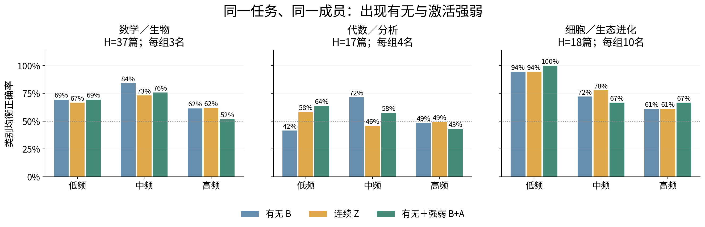
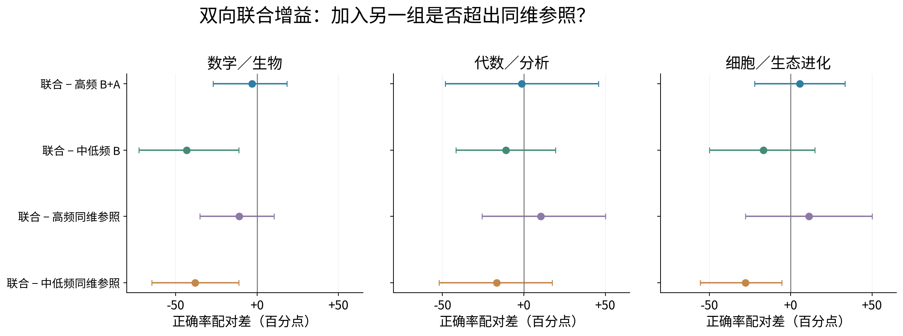
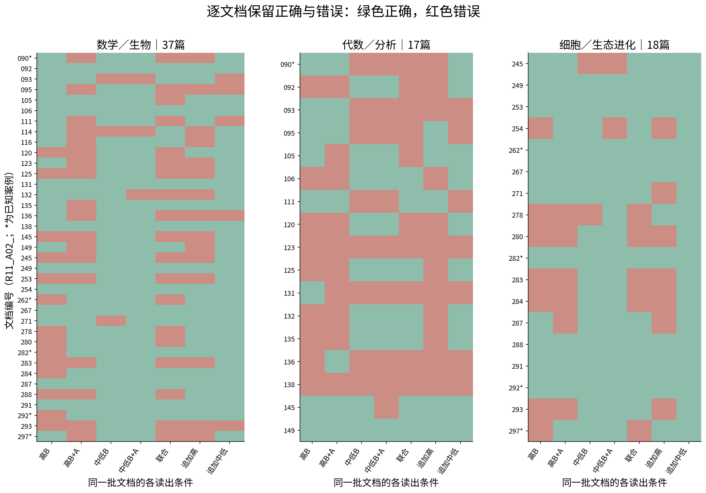
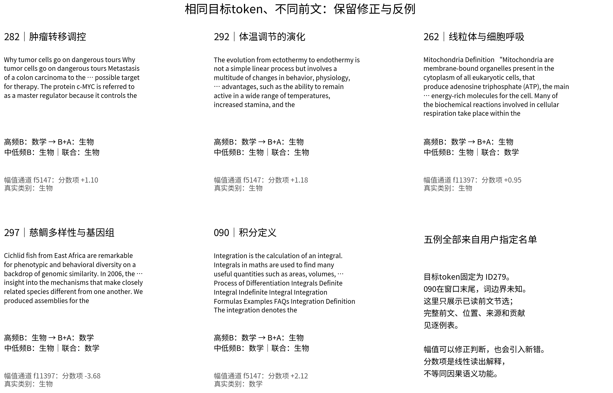
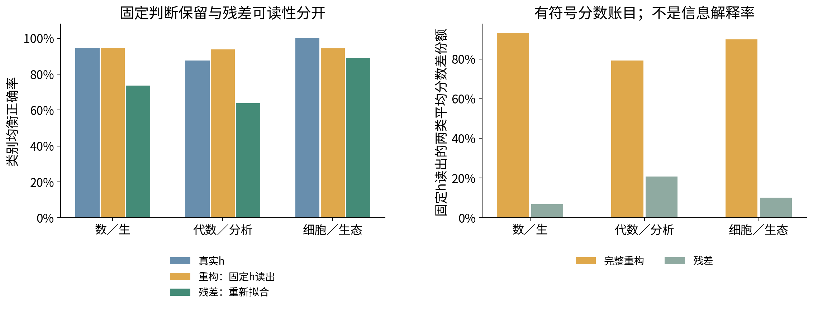

派生阅读副本；原件位置：`Projects/from-attention-to-search/main/experiments/A15/15_27_natural_language_feature_response/R13_feature_presence_amplitude_20261101/summary.md`。
[精确原始文件](../../../../../../../../sources/Projects/from-attention-to-search/main/experiments/A15/15_27_natural_language_feature_response/R13_feature_presence_amplitude_20261101/summary.md)；研究修改仍回到原件。

---

# R13: CrossCoder presence, conditional amplitude and complementarity

[中文](summary_cn.md) · [Frozen Protocol](protocol.md) · [Detailed](detailed.md) · [Cases](text_cases_cn.md) · [Reproduction](reproduce.md)

**Belief update: binary occurrence already carries category association. Conditional amplitude can distinguish identical occurrence patterns,but current evidence does not establish that high-frequency discrimination mainly relies on amplitude or that high and middle/low groups provide unique bilateral complementarity.** Probability-score improvement,hard classification and unique incremental information are distinct. These are AI interpretations for researcher review;acceptance,mechanism judgment and closure remain Unknown.

Reuse official Qwen3-0.6B-Base and A22native14joint residual-post blocks1,3,...27,shared16384-dimensional z,TRAIN normalization and gate. No Dense application,new LMforward,dictionary/LMtraining or GPU. R12primary frame has96documents;exact R12task training/development IDs use86unique families in total(D32/V17/H37). Each task has D8/class,V4/class;Hcoarse37(19math/18bio),mathfine17(8algebra/9analysis),biofine18(9cell/9ecology-evolution). One identical token279「 the」per document. Exposed R11/R12H means exploratory evaluation,not new confirmation.

Independent DCLMreference65,536positions,min20native positives;original low20–170/middle171–881/high≥882bins remain. TaskDsupport≥3positive documents yields low/mid/high pools3/45/448,4/54/472,10/42/397. Equal-members primary groups are k3/4/10,with label-blind hash selection,primary1101and9fixed sensitivity seeds. MLhas ktotal members,balanced low/middle where possible. Rare unsupported members remain descriptive. Full eligible-group models are secondary with unequal counts.

B=presence,Z=native z,A=absentzero or positive-D-centered/std-scaled deviation. BAconcatenates B,A;all columns then use D-only standardization. Mean z=occurrence×positive conditional mean,not pure strength. Identical readout family and4-Cdevelopment budget apply to all conditions;B+zero-channel scores match B. ZvsB is auxiliary rather than nested.

**Whole-word audit:**of86used documents,83have an observed standalone-the boundary. Case135is the prefix token of theorems;090and training197end at the192-token window with unobserved right boundaries. Targets/models/labels/statistics are unchanged,but full-word identity is not universally controlled. Future suffixes are post-hoc description,not information visible at the measurement point. See[word audit](../../../../../../../../UNAVAILABLE.md).

## Update1: amplitude changes,probability scoring and classification improvement differ

| 任务 | 高频B→B+A正确率 | 预测log loss：B→B+A | 幅值增量BA的95%区间（百分点） | 正差种子/10 |
|---|---:|---:|---:|---:|
|数学／生物|61.5%→51.8%|0.901→0.738|[-26.2, +6.6]|4/10|
|代数／分析|48.6%→43.1%|1.010→0.697|[-24.3, +12.5]|3/10|
|细胞／生态进化|61.1%→66.7%|0.693→0.684|[-11.1, +22.2]|6/10|

The table’s task labels are Chinese for math/biology,algebra/analysis,cell/ecology-evolution. Mathfine logloss improves by.313,pointwise95%paired interval[.102,.523],while BAfalls5.6points. Its BAmodel loss.697still does not beat the .5prior loss.693. Biology’s5.6point BAincrease is uncertain. No task meets predeclared simultaneous BA,logloss and seed-stability criteria;the mainly-amplitude logloss fraction has unstable bootstrap denominators and is not positive evidence.

Each panel holds one task/Hset fixed;groups are reference frequency and bars B,Z,BAusing identical members. Yis balanced accuracy,50%reference. Compare BAagainstBwithin a group,not absolute scores across tasks as granularity. Full-high groups448/472/397members yield B→BA86.7→62.7%,63.9→64.6%,88.9→88.9%;not a universal amplitude advantage. Unequal-count full-group comparisons cannot identify a frequency effect.

## Update2: a one-direction gain is not unique bilateral complementarity

Joint=[highBA,MLB],3kcolumns. Same-dimensional controls append kdisjoint highBto highBA,or2kdisjoint ML Bto MLB. MLreserve composition is reported rather than claimed perfectly frequency matched.

| 同一任务 | 高频B | 高频B+A | 中低频B | 中低频B+A | 高频B+A＋中低频B |
|---|---:|---:|---:|---:|---:|
|数学／生物|61.5%|51.8%|92.0%|92.1%|48.7%|
|代数／分析|48.6%|43.1%|52.8%|46.5%|41.7%|
|细胞／生态进化|61.1%|66.7%|88.9%|88.9%|72.2%|

BAchanges in percentage points:

| 任务 | 联合−高频B+A | 联合−中低频B | 联合−追加高频同维模型 | 联合−追加中低同维模型 |
|---|---:|---:|---:|---:|
|数学／生物|-3.1|-43.3|-11.1|-38.0|
|代数／分析|-1.4|-11.1|+10.4|-16.7|
|细胞／生态进化|+5.6|-16.7|+11.1|-27.8|

Biofine joint increases66.7→72.2%over highBA,correcting2and newly missing1,but MLBalone is88.9%and MLsame-dimension extension100%. Mathfine corrects4/newly misses4;coarse corrects4/newly misses5. All tasks fail unique bilateral criteria. This does not imply middle/low features are useless.

Xis joint-minus-baseline paired BAchange;rows cover both directions and both matched-column references. Intervals are99.6667%Bonferroni-adjusted percentile intervals for15primary BAcontrasts. Positive means jointbetter. Primary seed remains fixed;coarse joint spans48.7–83.6%across10seeds,showing small-group instability.

## Update3: actual objects and relations coexist with lexical,format and source explanations

Rows retain every Hdocument,columns readout conditions;green correct/redwrong,stars known cases. Repeated documents across tasks are not new independent samples.

All5user-specified cases are shown in fixed order. Text is visible-prefix excerpts,targettoken279fixed;full-word forms separately audited. Score terms are standardized linear-readout attribution,not decoder contributions or causal function. Case297’s body excerpt is for readability;its original navigation/publication residue remains in model inputs and full cases.

Tumor-regulation282,thermoregulatory-evolution292and mitochondria/respiration262are corrected by highBAversusB,but cichlid-genome297and integration090become wrong. 090/282/292have identical3-high-member Bpatterns and Bscore−.003. Their f5147Aterms are about+2.12/+1.10/+1.18:amplitude distinguishes the pattern while also pushing mathematics toward biology. Changed scores therefore do not establish stable semantics.

All joint-corrected/new-error texts are saved. Corrections include algebra/calculus prerequisite relations,calculus definitions,holomorphic-function/polynomial analogy,representation weight spaces,Darwin’s facial-expression argument,and ice-age climate/extinction. Newly wrong cell and high-order-polynomial texts remain. These are descriptions of visible inputs,not blinded functional labels.

Fixed target identity rules out target-token identity alone. A post-evaluation heading-field provenance audit preserved the original document-metadata reference and added a visible-prefix-only format reference;see[amendment](protocol_amendments.md). Prefix words,syntax,position and platform still vary. Same-budget lexicalTFIDFbaseline80.6/66.0/66.7%,visibility-qualified source/format62.0/70.1/33.3%. Strict same-platform/same-genre position±32matching only5/1/3pairs,fine tasks insufficient. Source/lexical explanations remain.

## Supplement: orientation,use,class differences and residual are separate

R12fixed1024PCbasis is exactly matched. All16384features partition into reference L/M/H/insufficient groups,including readout-unsupported members. Actual groupvectors sum z*d before squaring,retaining cross terms. Signed per-PCclass differences,fixed-h-head signed contributions,amplification/cancellation and reconstruction residual are saved. Constant+groups+residual reproduce original scores to3.6e−15;unit decoder q is not actual activation energy.

A newly fitted original-h coordinate-standardized head retains93.1/79.2/89.8%of its own mean class-score gap in full reconstruction;residual6.9/20.8/10.2%,not information-explanation fractions. Full NMSE11.6/14.0/9.4%. Fixed-head original→reconstruction BA94.6→94.6%,87.5→93.8%,100→94.4%;shared14-layer encoding can yield a reconstruction better for a particular final-layer head without creating new last-layer information. Separately refitted residual BA73.7/63.9/88.9%only establishes residual readability.

R12used PCA-coordinate standardization and a different tuning policy;these new fractions do not overwrite its historical≈82%gap retention. Additional replay of the existing R12heads exactly reproduces its old BAand retention tables,qualifying object compatibility.

[Actual spectral energy](../../../../../../../../sources/Projects/from-attention-to-search/main/experiments/A15/15_27_natural_language_feature_response/R13_feature_presence_amplitude_20261101/figures/appendix_actual_spectral_energy.png) and[signed spectral contribution](../../../../../../../../sources/Projects/from-attention-to-search/main/experiments/A15/15_27_natural_language_feature_response/R13_feature_presence_amplitude_20261101/figures/appendix_signed_spectral_contributions.png) supplements distinguish frequency groups from PCbands and retain negative score contributions.

A:no established mainly-amplitude mechanism;metric-specific amplitude changes exist. B:category associations in MLB,but no stable unique bilateral complement beyond dimensional controls. C:concrete input contents traced,lexical/source/style explanations not eliminated. No expert allocation or native-routing conclusion.

**One AI-suggested next question:**on a new source/genre-crossed panel with sufficient positive low-frequency training documents,do amplitude/MLincrements generalize across sources and exceed same-dimensional same-pool additions? No new panel is launched.

Completion:651saved readout conditions(642main/supplementary+6original confound references+3visibility-repaired references),4Cs each=2604small readout fits,10fixed member seeds,5000document bootstrap replicates. LM/dictionary updates0,new LMforwards0,GPU0. All conditions,seeds,negative outcomes,class counts,predictions and code retained. Scientific acceptance/closure Unknown.
