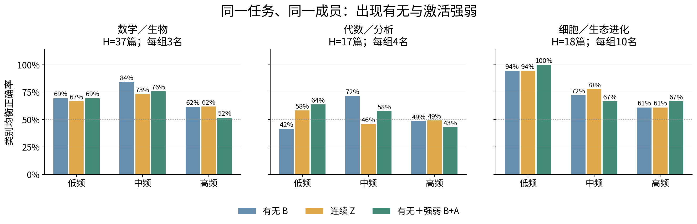
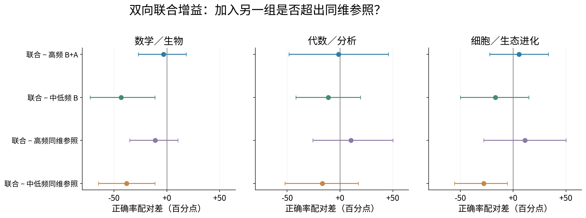
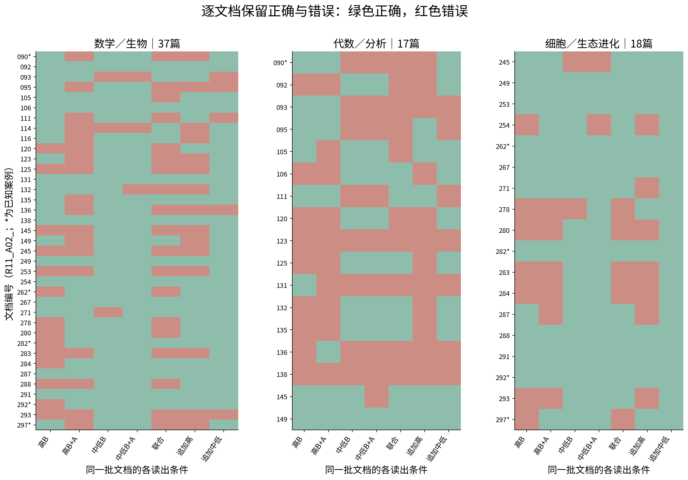
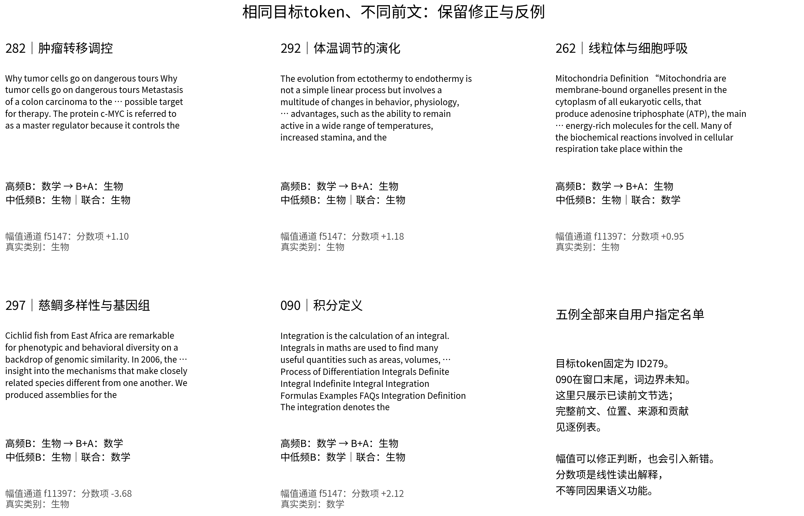
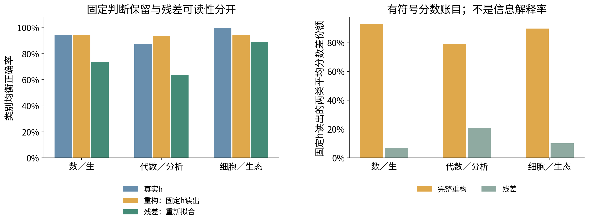

派生阅读副本；原件位置：`Projects/from-attention-to-search/main/experiments/A15/15_27_natural_language_feature_response/R13_feature_presence_amplitude_20261101/summary_cn.md`。
[精确原始文件](../../../../../../../../sources/Projects/from-attention-to-search/main/experiments/A15/15_27_natural_language_feature_response/R13_feature_presence_amplitude_20261101/summary_cn.md)；研究修改仍回到原件。

---

# R13：CrossCoder的出现、强弱与互补性

[English](summary.md) · [冻结协议](protocol_cn.md) · [完整过程与审计](detailed_cn.md) · [真实前文与分数项](text_cases_cn.md) · [全部结果与复现](reproduce.md)

**认识更新：出现有无已经携带类别关联；激活强弱可以改变同一出现模式下的判断，但当前证据不足以把高频区分主要归于幅值，也未建立高频与中低频的独有双向互补。** 增加通道既能纠正文本，也会产生新错；概率评分改善、硬分类改善和独有新增信息需要分别检验。

以下是本轮实测与AI认识解释，供研究者审阅。科研接受、机制判断及问题关闭仍Unknown。原R12与本轮H早已被查看，因此全部结论是探索性读出证据。

## 问题、对象与分母

A问高频是否依赖激活后的强弱；B问中低频有无是否补高频、反过来是否也补；C问哪些真实内容被修正，以及词面／格式／来源能否解释。沿用官方Qwen3-0.6B-Base和A22；z联合读取14个block1,3,…,27，不是单层编码。没有Dense应用、语言模型／字典训练、新前向或GPU使用。

主面板复用R12的96篇候选及外部可见前文标签，三个任务按R12冻结ID各用每类8篇训练、4篇开发。实际跨任务使用86个不同文档家族：训练32、开发17、H37；各任务文档重复不能相加。每篇只读一个固定token279「 the」，位置96–191中最后一次；H为粗任务37篇（数学19/生物18）、数学细17篇（代数8/分析9）、生物细18篇（细胞9/生态进化9）。

feature频率来自独立DCLM65,536位置，z>0、至少20次；低20–170、中171–881、高≥882次，原界0.2593994%与1.3442993%。每任务训练至少3篇激活才入主读出候选。低/中/高候选数为3/45/448、4/54/472、10/42/397，因此等成员数只能取3/4/10名；高与中低联合池也保持相同人数。成员按无标签固定hash选，主种子1101，另九种子全保留，不换赢家。少支持成员另表，不称无作用。这些读出池只代表在当前训练面板有足够响应的子集，不代表全部低频／高频成员。

B是有无，Z是连续z，A在未激活时为0、激活时为训练侧正值中心化和标准化偏离，B+A同时保留两者。之后每列只用训练均值与标准差缩放。总体平均z=出现率×条件正值均值，不能直接当强度。各组全部交叉三种编码，同一逻辑回归、同一C网格、同一开发选择预算；附加全零通道的预测与B一致，排除“只是增加列数改变惩罚实现”的错误。

**完整词形核查：**实际86篇中，83处能确认是独立the；135的完整词为theorems，模型测点只读到其前缀token「 the」；090与训练文档197在192token窗口末尾，右边界不可见。原位置、模型、标签和主统计不改，但不能宣称全部完整词形相同。后缀词形是事后描述，不能用于解释测点当时的激活。详见[词形审计](../../../../../../../../UNAVAILABLE.md)。

## 认识更新一：强弱变化、概率评分改善与分类改善是不同层次，当前不能说高频主要靠幅值

这修正了“高频成员两边常出现，因此类别差主要由强度决定”的直觉。若幅值稳定增加可读信息，B+A应优于同成员B，而不只是Z偶然胜B。

| 任务 | 高频B→B+A正确率 | 预测log loss：B→B+A | 幅值增量BA的95%区间（百分点） | 正差种子/10 |
|---|---:|---:|---:|---:|
|数学／生物|61.5%→51.8%|0.901→0.738|[-26.2, +6.6]|4/10|
|代数／分析|48.6%→43.1%|1.010→0.697|[-24.3, +12.5]|3/10|
|细胞／生态进化|61.1%→66.7%|0.693→0.684|[-11.1, +22.2]|6/10|

数学细任务的预测log loss改善0.313，点式95%配对区间[0.102,0.523]，但正确率下降5.6个百分点。它说明概率评分和阈值判别可以不同步；B+A虽然包含B的可表达集合，有限训练、正则和开发选参并不保证新文档表现单调；该B+A的log loss约0.697，仍未优于0.5常数先验的0.693。生物幅值正确率点估计提高5.6点，但区间跨零；三个任务均未达到预登记的同时区间、log loss和种子稳定标准。“主要由幅值承担”的比例在重采样中分母不稳定，未作为正结果报告。

**如何读图：** 三图分别固定同一任务和H文档，不比较任务间绝对正确率来定义粗细粒度。横轴为独立参考频率组，蓝／黄／绿分别B、Z、B+A；纵轴是两类正确率等权平均，灰线50%。同一个频率组的三柱使用完全相同成员。主比较为绿减蓝，误差与全部逐类正确数见表；图上100%也只对应18篇，并不表示高精度确认。

完整支持组另列：高频成员448/472/397名时，B→B+A正确率分别86.7%→62.7%、63.9%→64.6%、88.9%→88.9%。它同样没有给出普遍幅值优势；完整组人数不同，不能拿它们与小组之差归因于频率。[完整组图](../../../../../../../../sources/Projects/from-attention-to-search/main/experiments/A15/15_27_natural_language_feature_response/R13_feature_presence_amplitude_20261101/figures/appendix_full_groups_encoding.png)与全部条件保留。

## 认识更新二：一组能补另一组，不等于双方都有独有增量；本轮尚无独有互补证据

以下主联合是“高频B+A＋中低频B”。中低频池与高频池各含k名；联合3k列。参照一为高频B+A再加k名高频B，参照二为中低频B再加2k名中低频B，均3k列，额外成员与各自基组不重叠。中低参照的内部低/中构成按剩余联合池固定抽样，未强行冒充比例完全匹配。

| 同一任务 | 高频B | 高频B+A | 中低频B | 中低频B+A | 高频B+A＋中低频B |
|---|---:|---:|---:|---:|---:|
|数学／生物|61.5%|51.8%|92.0%|92.1%|48.7%|
|代数／分析|48.6%|43.1%|52.8%|46.5%|41.7%|
|细胞／生态进化|61.1%|66.7%|88.9%|88.9%|72.2%|

变化单位为百分点：

| 任务 | 联合−高频B+A | 联合−中低频B | 联合−追加高频同维模型 | 联合−追加中低同维模型 |
|---|---:|---:|---:|---:|
|数学／生物|-3.1|-43.3|-11.1|-38.0|
|代数／分析|-1.4|-11.1|+10.4|-16.7|
|细胞／生态进化|+5.6|-16.7|+11.1|-27.8|

生物细任务加入中低频后，66.7%→72.2%，修正2篇、新错1篇；但中低频B单独88.9%，追加同数中低成员达到100%。所以正的单方向点差不足以支持双方缺一不可。数学细任务联合修正4篇又新错4篇，均衡正确率仍下降1.4点；粗任务修正4篇、新错5篇。全部任务双向及同维主判据均未通过，结论是“尚无独有互补证据”，不是“中低频无用”。

**如何读图：** 每行用同一批H文档，把联合模型减去不同基线。点在右侧才是联合更好；横线是15项主BA对比的99.6667%调整分位区间。前两行分别检查两个方向，后两行检查同输入列数的参照。不能只拿第一行较好的种子宣布互补。主种子之外，粗任务联合正确率跨十种子约48.7%–83.6%，表明3名一组的估计很不稳定。

## 认识更新三：当前响应关联到具体对象与关系，也暴露格式和来源；这些证据尚不能变成专家分工

**如何读图：** 每行一个H文档，每列一种条件，绿色正确、红色错误；星号为用户指定的已知案例。所有文档都在，三个任务中的同文档不是独立新样本。联合改对哪些、又改错哪些，都能逐行核对。

**如何读图：** 五张卡片按用户指定顺序展示，不按漂亮响应挑选。文字仅是目标之前已读前文的节选，目标token均为ID279，完整词形另行核查；分类行显示高频B、B+A、中低频B和联合的判断。分数项指当前线性读出的归一化通道项，非decoder重构量或因果重要性。297卡片节选正文以便阅读，完整输入中的导航、作者与期刊格式没有从模型数据里删除。

282的肿瘤转移调控、292的体温调节演化、262的线粒体／细胞呼吸，都被高频B+A从粗类错误修正；但297的慈鲷多样性与比较基因组、090的积分定义被改错。090、282、292在三个高频成员上的B模式完全相同，B读出分数同为−0.003；f5147的A分数项分别约+2.12、+1.10、+1.18。幅值确实能区分同有无模式，但这里把数学积分也推向生物，不能由“分数改变”推出稳定语义识别。

全部联合相对高频B+A改对的内容也保留：粗任务包括代数方法与微积分先修关系、微积分定义、全纯函数与多项式类比、表示的权空间；生物细任务包括Darwin对表情的演化解释和冰期气候／巨型动物灭绝。与此同时也出现细胞文本和高次多项式文本的新错。这些涉及对象、关系、说明体裁和公式，但本轮没有将其盲标为纯语义功能。

目标token ID已严格相同；原文档级标题标记并非严格前文量，原基线保留且另补前文可见版本，见[执行修订](protocol_amendments.md)。前文词汇、句法、位置和来源仍不同。相同训练预算的词面TFIDF基线约80.6%/66.0%/66.7%，仅由可见前文计算文本格式标记的来源／格式基线62.0%/70.1%/33.3%。严格同平台、同体裁且位置差≤32时，只能匹配5/1/3对，两个细任务不足；尚未排除词面／来源解释。不能因固定the就把响应命名为领域语义。

## 谱与重构补充：固定朝向、实际使用和当前分数差分开

R12固定1024PC基逐值相同，只有匹配的Qwen/block27被用于投影。全部16,384成员按参考低／中／高／参考不足四组重构，不只用读出候选；先求向量和再平方，保存逐PC带符号类别差、实际能量、交叉项与抵消。完整重构＋残差逐样本复现原h分数，最大误差3.6e−15。类差的正／负贡献都保留，不用单位decoder投影冒充实际贡献。

本轮在原始h坐标标准化并重新拟合一次固定h读出，得到重构保留当前两类平均分数差的93.1%/79.2%/89.8%；残差对应6.9%/20.8%/10.2%。这是该读出方向的分数账目，不是信息解释率。整体平方重构误差11.6%/14.0%/9.4%；固定h读出在原h→重构的正确率为94.6%→94.6%、87.5%→93.8%、100%→94.4%，重构后更好也不是最后层凭空新增信息，因为z来自14层。

另在残差重新拟合读出，正确率73.7%/63.9%/88.9%，只说明残差仍可读。所有组重构、残差和固定判断交换表另存。原R12使用PCA坐标标准化与不同选参规则；本轮没有用这些新百分比覆盖其旧82%左右结论。额外重放原R12固定头，原表的正确率和保留比例均精确复现，证实模型／测点对齐。

[实际谱能量补充](../../../../../../../../sources/Projects/from-attention-to-search/main/experiments/A15/15_27_natural_language_feature_response/R13_feature_presence_amplitude_20261101/figures/appendix_actual_spectral_energy.png)按类展示真实组向量投影；[有符号谱贡献补充](../../../../../../../../sources/Projects/from-attention-to-search/main/experiments/A15/15_27_natural_language_feature_response/R13_feature_presence_amplitude_20261101/figures/appendix_signed_spectral_contributions.png)将频率组与谱段交叉列出。后者的负值保留抵消，不把频率分组叫作谱分组。

## 对A、B、C的直接回答与唯一后续问题

- **A：** 未建立高频主要依赖幅值。幅值可改变同B模式下的分数，数学细任务有概率评分改善；准确率与种子稳定证据不足，不能说幅值无信息。
- **B：** 中低频有无能读出类别关联，但未证明它与高频有稳定、双向、超过同维参照的独有互补。反方向同样必须保留失败结果。
- **C：** 已定位到肿瘤调控、体温演化、线粒体、积分、权空间、气候／灭绝等前文；词面、格式与来源仍未被有效排除。错误交换比单看正确率更能说明当前读出如何失败。

**AI建议的唯一后续问题：**在全新的、来源与体裁交叉均衡且给低频更多训练正文档的确认面板上，幅值或中低频增量能否跨来源保留并胜过同维追加成员？本轮不自动构建或运行该面板，不推出样本应分给不同专家。

完成：资产／协议先行，651个已保存读出条件模型（642条主体条件＋6条原混杂基线＋3条可见格式修正基线），各4个C候选，共2,604次小型读出拟合；10固定成员种子、5,000次文档配对重采样；新模型前向0，语言模型／字典训练0，GPU0。全部条件、负结果、逐类正确数、概率、成员与代码见复现入口。科研接受与问题关闭Unknown。
