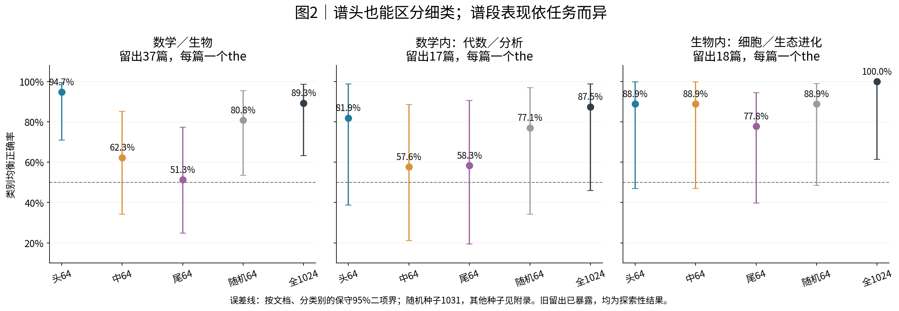
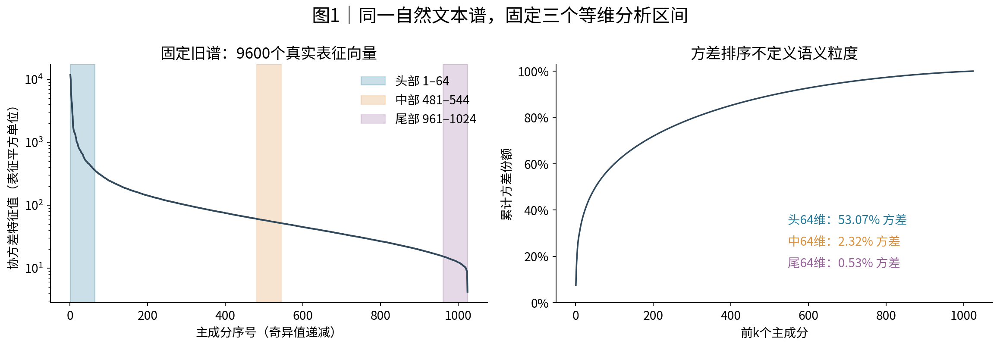
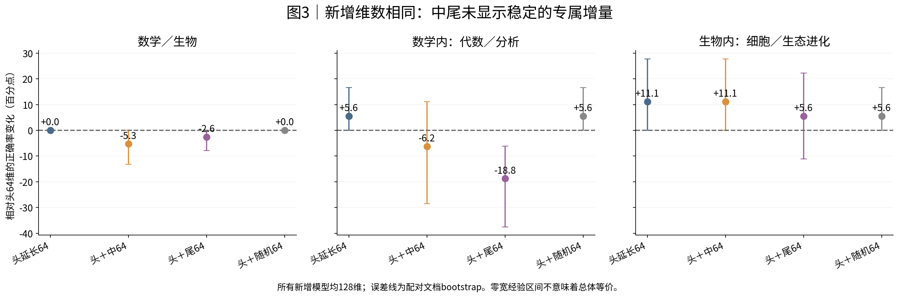
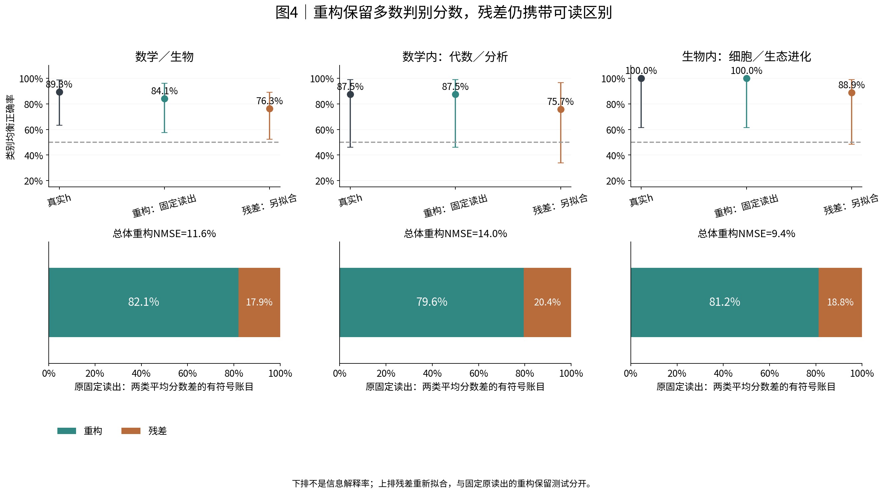
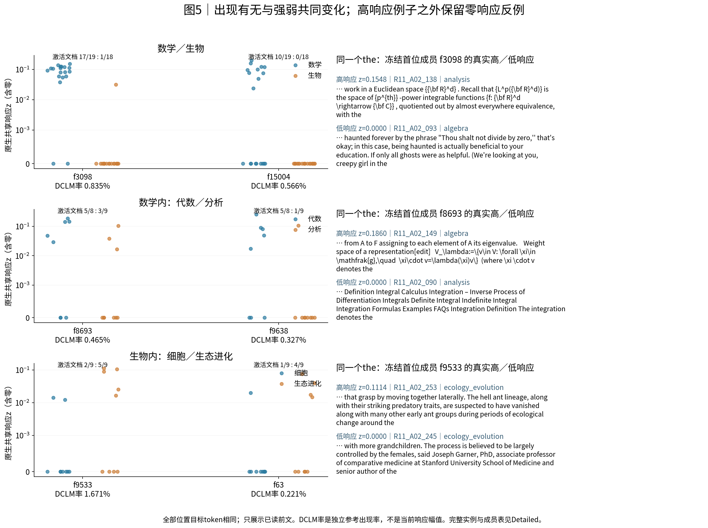

派生阅读副本；原件位置：`Projects/from-attention-to-search/main/experiments/A15/15_27_natural_language_feature_response/R12_spectral_semantic_granularity_20261031/summary.md`。
[精确原始文件](../../../../../../../../sources/Projects/from-attention-to-search/main/experiments/A15/15_27_natural_language_feature_response/R12_spectral_semantic_granularity_20261031/summary.md)；研究修改仍回到原件。

---

# R12: spectral position and semantic granularity

[中文](summary_cn.md) · [Protocol](protocol.md) · [Detailed evidence](../../../../../../../../UNAVAILABLE.md) · [Actual text cases](../../../../../../../../UNAVAILABLE.md) · [Asset/data bindings](assets_and_data.md)

**Recognition update: this small natural-text panel does not establish a stable coarse-to-fine spectral ordering. The head reads both domains and within-domain topics; biological fine categories are also readable in the middle. Middle/tail augmentation has no established benefit beyond matched-dimensional controls. CrossCoder preserves about80–82% of the current between-class mean fixed-readout score difference, while residuals retain readable class association. This fraction is not an information-explained percentage.**

This is a bounded AI interpretation for researcher review; scientific acceptance, mechanism judgment and closure remain Unknown. R11 H was exposed previously. R12 froze new choices before numeric H access, but its evaluation remains exploratory.

The three reading paths are prediction/factor controls; representation organization; measurement quality. Predictions here are classifier readouts, not native LM answers. Functional interventions were NOT RUN.

## Objects, tasks and evidence scope

Use frozen Qwen3-0.6B-Base, zero-based block27 residual-post before final norm,1024 dimensions. The fixed old R04/R10 basis is pooled PCA of9600 centered discovery vectors. R07 used the same basis: reuse is not independent replication. Prespecified64D bands are1–64,481–544,961–1024. They carry53.07%,2.32%,0.53% of reference variance.

External labels are algebra/analysis within math and cell/ecology-evolution within biology. Select the last token279, leading-space the, at position96–191, one observation per document, and review only its visible prefix. Of100 candidate documents,96have this token:39D/20V/37H. Ambiguous fine labels remain in the coarse task but are excluded from primary fine tasks. Each task fits8D and selects on4V documents per class. Fine H sizes are17and18; overlapping tasks are not additional independent documents.

## Bands do not form an established granularity hierarchy

| Task / heldout documents | Head64 | Middle64 | Tail64 | Full1024 |
|---|---:|---:|---:|---:|
| Math / biology · n=37 | 94.7% | 62.3% | 51.3% | 89.3% |
| Algebra / analysis · n=17 | 81.9% | 57.6% | 58.3% | 87.5% |
| Cell / ecology-evolution · n=18 | 88.9% | 88.9% | 77.8% | 100.0% |

Balanced accuracy averages the two class recalls; chance is50%. Error bars are conservative classwise exact document intervals, including uncertainty when18/18are correct. Math-fine full-space87.5% has a conservative interval about46.0–98.9%; strong claims remain sample-limited. A fitted full-space model losing to head64does not mean the containing space has less information; finite-sample estimation and regularization differ.

The relevant granularity interaction compares middle/tail-minus-head within each task and then fine-minus-coarse, sharing document resamples. Biology interactions are+32.5/+32.3pp, paired intervals[+7.6,+57.2]/[+2.2,+65.2], but Holm4p=.076/.117. Math intervals cross zero. No general hierarchy is confirmed. Weak tail domain readout here does not refute R07: that study used constructed contexts and example/explanation targets,whereas this uses natural prefixes at the,with different training counts/dimensions. This is not an independent replication changing only granularity.

The curve shows covariance eigenvalues, proportional to squared singular values, and cumulative variance. All1024values are positive, but924adjacent relative gaps are<1%; interpret bands/classifier axes, not stable individual-root semantics.

## Augmentation is not a middle/tail-specific increment

All additions have128dimensions: head+next64, head+middle64, head+tail64 and head+orthogonal-random64. Biology head+middle rises88.9→100%, but head extension also reaches100%. Math middle/tail additions change head accuracy by−6.2/−18.8pp, while head extension adds5.6pp. Main comparisons establish no positive increment beyond equal-dimensional controls.

Ten fixed training-subset seeds show math head/middle medians70.5/69.8%, with changing ordering. Biology head/middle are more stable. Original-scale, all-random-seed, nearby-boundary and quantization checks are retained without selecting replacements.

## Reconstruction retains most fixed score contrast, not all distinctions

Freeze the projection, training scaler and readout fitted on actual h, then apply them to complete reconstruction. Coarse accuracy89.3→84.1%, math-fine87.5→87.5%, biology-fine100→100%. Yet reconstructed mean class-score contrasts retain82.1/79.6/81.2%; residual contributions are17.9/20.4/18.8%. Overall normalized squared errors11.6/14.0/9.4% are a different quantity.

Unchanged math-fine87.5%actually comprises one corrected and one newly wrong document. R11_A02_136,the higher-degree polynomial-solving prefix,is originally correct for both domain and algebra but becomes wrong under both fixed reconstructed readouts. Scores and full prefixes remain in the case record.

Separately refitted residual classifiers reach76.3/75.7/88.9%. This is re-accessibility, not fixed-readout preservation. A22 z jointly encodes 14 layers: refitted reconstruction outperforming actual-h fitting cannot show that last-layer information was created. Full signed feature+bias+residual accounting reproduces original scores within about1.8e−15.

## Features, text hypotheses and relations

Each dot is one document at the same the, including zeros. f3098activates in17/19math and1/18biology documents, with within-math high/zero counterexamples. f8693activates in5/8algebra and3/9analysis documents; positive means are.110/.053, illustrating both occurrence and amplitude differences. Conditional-positive amplitude interpretation requires>=3positive documents in BOTH classes; zero-filled algebraic splits do not identify amplitude effects otherwise.

Independent DCLM rates for f3098/f8693/f9533/f63are.835/.465/1.671/.221%, middle/middle/high/low under inherited cuts. These are neither panel response counts nor spectral ranks. All16384features enter the signed accounting, including cancellation and reference-insufficient members.

D-selected12features/task have same-direction Hpoint preferences11/12,9/12,12/12. Holm36leaves4coarse features and0in either fine task under exploratory rules. D-derived lexical hypotheses generalize for coarse head and biological head/middle (Holm9p≈.0007/.022/.035), not mathematical bands. These are lexical/object associations, not a semantic ontology. f9533responds.1114to an ancient-ant morphology/predation prefix but0to another ecology-evolution prefix about mammalian offspring sex strategy: category membership does not ensure feature use.

None of18prespecified frequency/source-adjusted pairs has BHq<.05(min≈.782). Pair products versus equally parameterized single-feature additions give−7.9/0/−11.1pp. There is no reliable combination increment or functional-interaction evidence.

## Rivals, boundaries and next decision

Fixed token identity does not fix prefix vocabulary, source, style or length. Strict same-platform/genre/within32positions matching supplies5coarse,1math-fine and3bio-fine pairs. Fine semantic attribution remains insufficient. Math source/format-only accuracy69.4% retains a credible rival. Exposed H, few documents, overlapping subject definitions and conditional readout fitting limit generalization.

Head readability of fine labels does not itself refute a relative coarse preference. The relevant fine-minus-coarse interactions and matched-control increments are NOT_ESTABLISHED;this is not disproof of the conjecture. Complete dictionary explanation is weakened by residual accounting/readout. No native causal, training-dynamic or MoE benefit claim follows.

**One AI-proposed next decision:** whether to collect a fresh source/genre-crossed four-leaf common-token confirmation panel. Improve independent-document support before expanding layers, classifiers or band search. It is not automatically started here.

All computation used CPU. New model forwards0,LM/dictionary updates0,GPU usage0. Five main figures,one sensitivity appendix and all applicable measurements/insufficiency records are complete; scientific acceptance remains Unknown.
