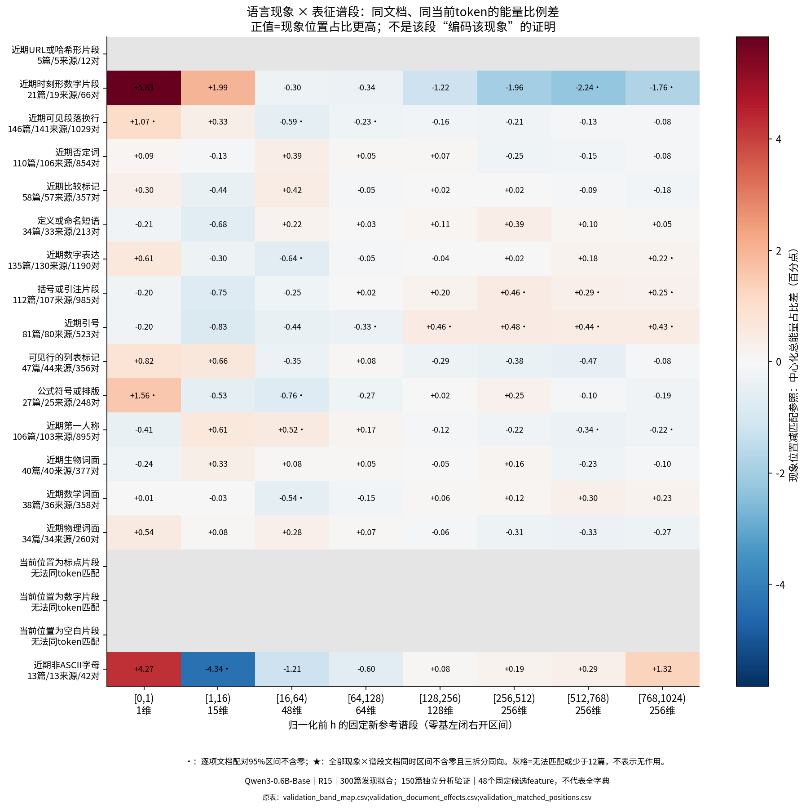
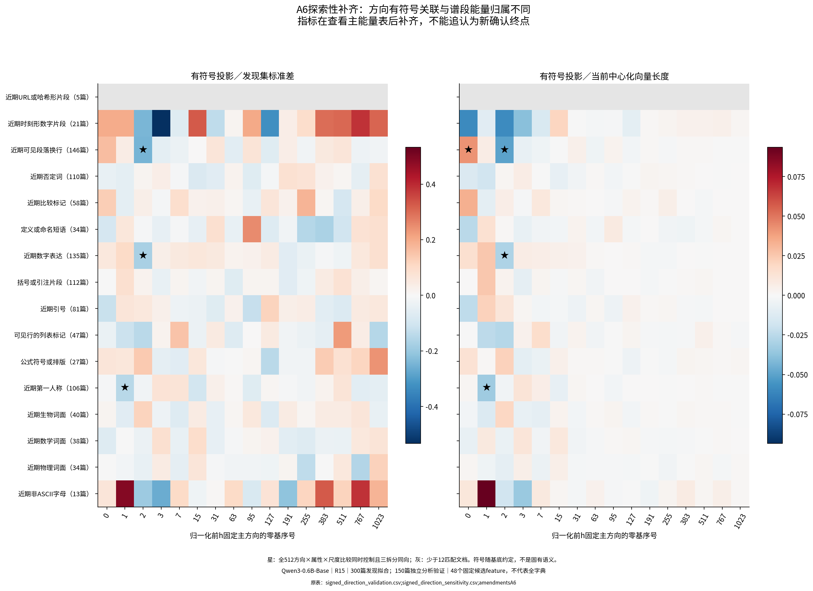
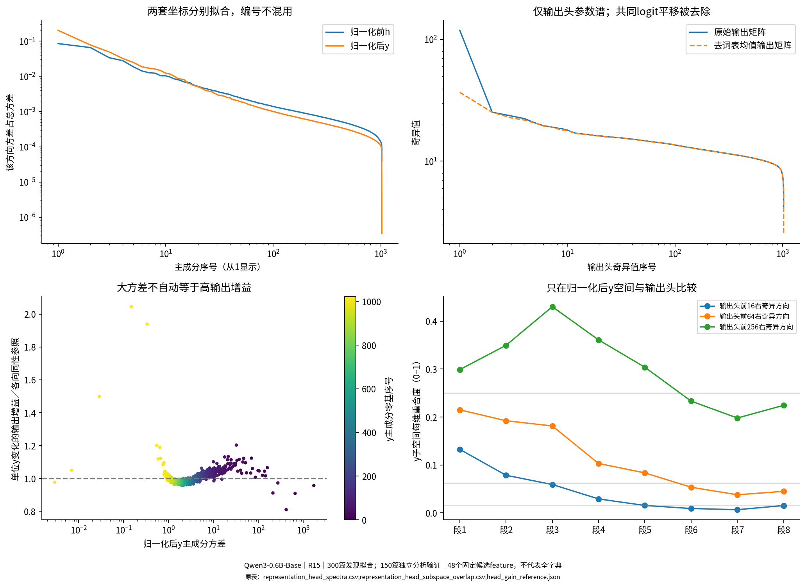
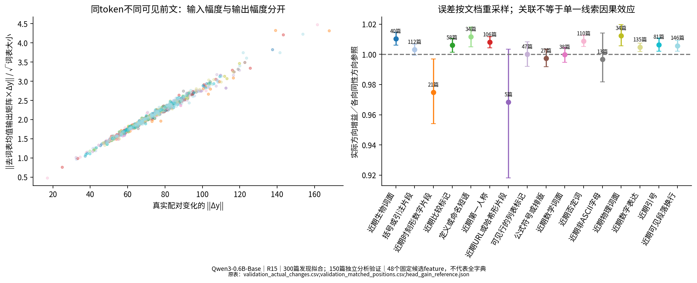

派生阅读副本；原件位置：`Projects/from-attention-to-search/main/experiments/A15/15_27_natural_language_feature_response/R15_20261102_natural_phenomena_output_geometry_v1/report_cn.md`。
[精确原始文件](../../../../../../../../sources/Projects/from-attention-to-search/main/experiments/A15/15_27_natural_language_feature_response/R15_20261102_natural_phenomena_output_geometry_v1/report_cn.md)；研究修改仍回到原件。

---

# 自然文本语言现象、表征谱与输出头：R15

## 目的

先在较广的真实网页文本中找可复查的语言现象，再检验其表征变化位于哪些谱段，以及冻结输出头对这些变化的响应。允许得到跨段混合分布、主要是词面／格式、只有几何关联或证据不足；不预设头部粗、中尾细。

## 机制直觉与待检验假设

每个位置先经过28个冻结块，得到最终归一化前的1024维状态h；真实最终归一化得到y，原生输出为W乘y（本模型无偏置）。本轮分别从发现文本拟合h和y两套中心化主成分，之后冻结。按方差排序只是参考语料的变化大小，并不定义语义层级。h空间的方向不能直接送入W当作精确输出效应。

可检验的假设是：一个只依赖已见前文的文本属性，可以预测新文档中的某种谱投影或feature响应。竞争解释是当前片段、总体范数、位置、来源、格式和共现词。先用同文档同token配对，再看位置四分位敏感性与新来源；它仍是观察关联，不是最小语义干预。

去词表均值的输出矩阵是Wc=W−各词行向量的均值。对实际变化Δy，WcΔy排除所有logit共同平移；输出增益定义为其均方根长度除以||Δy||，并与同幅度各向同性方向参照比较。中心化均值是300篇发现文本、38400个位置各坐标的平均；h与y分别估计。它不等于A22训练时的归一化均值，也不是平均预测。输出增益是以实际BF16权重值转FP64计算的线性logit敏感度；原生BF16乘法另有量化舍入，真实配对直接核查表同时保留两者差异，不能把FP64代数精度说成原生概率精度。它不自动是预测质量或语义重要性。

## 结论／认识更新

**这轮没有建立按谱段划分语言功能的确认性分界；较强的发现是形式属性的方向关联，而不是“某段专属某种语义”。** 必须按证据等级读：预先冻结的能量分布检验未通过；有符号方向补充发现了可继续检验的空行／数字等候选；输出头对这些实际变化的单位增益差异很小；48个候选成员没有产生通过本轮验证的解释。

1. **描述性词面／格式观察。** 同文档、同位置四分位下，当前纯空白片段在h谱[1,16)的能量占比，比其它片段高17.293个百分点，138篇、670对，逐项95%区间[15.933,18.489]；当前数字片段在第一方向高5.968个百分点，125篇、774对，[4.038,7.825]。这里当前token身份按定义不同，不能称为上下文语义选择性，但说明发现端的强投影确实有可复查的词面／排版成分，不应硬命名为粗细语义。原表：`descriptive_token_category_summary.csv`。

2. **预先冻结的主检验没有确认谱段专属。** 对16个有同token匹配支持的文本属性×8谱段，共128项比较，0项同时通过全族控制、三拆分同向和支持规则。23项逐项95%区间不含零，不能挑其中几项升级为分工。例：近期数字字符在h谱[16,64)的能量占比差是−0.640个百分点，135篇、1190对，逐项95%区间[−1.027,−0.260]，全族同时区间[−1.357,+0.076]。这不证明没有信息；当前属性可能跨段、效应较小，也可能是位置／词面与统计分辨率共同限制。原表：`validation_band_map.csv`。

3. **有符号补充出现共享谱头方向的探索性候选。** 能量检验不能替代投影正负号。补齐的512项固定方向×属性×尺度比较中，7个尺度条目对应4个属性—方向对、3种属性；不是7个独立功能。近期空行与零基方向2（第三方向）的差为−0.249个发现集标准差，146篇、141网站、1029对，同时区间[−0.389,−0.109]；余弦归一化后同向。近期数字也沿该方向负移，第一人称词形则关联零基方向1。**这些是A6在查看主能量表后补齐的探索性结果，不追认为新确认终点。** 空行候选较稳：同位置四分位仍为−0.163[−0.241,−0.078]，135篇472对；再要求数字属性相同，为−0.149[−0.239,−0.057]，124篇343对。后两组是探索性逐项区间。相反，第一人称候选在位置匹配后区间跨零，数字候选的同位置四分位区间也跨零。不能一并包装成稳定分工。第三方向发现文档重抽样后的平方重合度均值0.992、最小0.987，减弱了该方向纯由抽样旋转产生的解释，但没有消除其它文字／句法共变。原表：`signed_direction_validation.csv`、`signed_direction_sensitivity.csv`、`h_direction_document_bootstrap_stability.csv`。

4. **真实文本变化没有出现强的现象专属输出放大。** 固定参数确实存在不同敏感方向：y主方向单位增益从0.02329到0.05881，后者为各向同性参照的2.045倍。但实际同token前文配对的各现象平均增益，多在参照附近：空行1.0057倍，146篇，逐项95%区间[1.0021,1.0092]；近期数字1.0046倍，135篇；时刻形数字0.9748倍，21篇，[0.9541,0.9969]。时刻形前文配对的平均Δh长度510、Δy长度88.9，输出logit均方根2.472；定义／命名短语对应322、66.0、1.914。较大的表征变化有较大的输出幅度，却未有较高的单位方向增益。这里是实际上下文变化的读出几何，不是属性的因果效应、概率改善或语义重要性排名。原表：`phenomenon_output_gain_summary.csv`、`postnorm_band_readout_geometry.csv`。

5. **CrossCoder解释仍未获支持。** 开发阶段固定的4项成员解释在验证中全部未通过，按门槛未触发任何确认干预。非ASCII字母—成员11424在13篇42对里差值为0，实际没有非零差异支持；定义／命名—成员7007反向，34篇中只有5篇有非零差；近期数字—成员10064为+0.014标准差，95%[−0.033,+0.064]，135篇中22篇有非零差；公式排版—成员6723为+0.456[−0.065,+1.120]，27篇中11篇有非零差。匹配文档多不等于该成员响应支持充分。不能把它们写成这些语言现象的功能成员，也不能外推48个候选为整个字典无解释。没有可靠开发解释时，本轮按协议不补自编题、不换成员寻阳性。原表：`validation_selected_verdicts.csv`、`selected_feature_document_support.csv`。

**保留、收窄与修改：** 保留“不同自然文本变化占据重叠谱空间”的观察；将“明显高投影即可给谱段命名功能”收窄为词面／排版描述；将本轮较有希望的解释限定为“空行与固定谱头有符号方向的探索性关联”。本轮没有测试外部粗细语义层级，也没有建立任何频率组的普遍分工、成员唯一编码或因果机制。

## 实验分析

### 1．实际数据、拆分和冻结顺序

600篇真实网页，发现300、开发150、验证150；每篇128个有效位置，共76800。整页来源有URL、WARC记录和哈希；模型只读每页最前257—512个token的连续窗口。发现／开发／验证的统计单位都是文档，不把同页128位置当128独立样本。四个候选来源组各150篇，来自557网站；验证145网站，其中131不在发现／开发中。它们是技术词筛选的来源候选组，并非人类学科金标：例如金融网页也可含“力、能量”等词，不宣称有150篇纯物理说明文。原始长度和逐站覆盖见[来源长度表](../../../../../../../../sources/Projects/from-attention-to-search/main/experiments/A15/15_27_natural_language_feature_response/R15_20261102_natural_phenomena_output_geometry_v1/evidence/source_and_length_coverage.csv)。

| 来源候选组 | 发现篇数 | 开发篇数 | 验证篇数 | 窗口最短 | 窗口最长 | 完整原页token中位数 |
| --- | --- | --- | --- | --- | --- | --- |
| mathematics | 75 | 37 | 38 | 271 | 512 | 1729 |
| biology | 75 | 38 | 37 | 285 | 512 | 1156 |
| physics | 75 | 37 | 38 | 311 | 512 | 1375.5 |
| general | 75 | 38 | 37 | 257 | 512 | 836 |

原holdout缓存中的旧候选暴露过多，按A1改用已登记的另一份固定DCLM缓存；没有下载、换模型或按预测成功筛选。新验证与本轮解释发现按页面独立，但该缓存是A22训练候选来源，不能称字典训练外验证，也不能证明Qwen预训练未见。旧60数学生物文档谱仅作[历史参照](../../../../../../../../sources/Projects/from-attention-to-search/main/experiments/A15/15_27_natural_language_feature_response/R15_20261102_natural_phenomena_output_geometry_v1/evidence/historical_basis_comparison.csv)，不是通用自然语言谱。

所有文字标签由不读取激活、谱位置或成员编号的固定Python规则产生，没有标签语言模型。末尾片段不能冒充完整词；A2更正了988个位置的词边界标签，冻结原件仍保留。来源支持规则A3和全谱同时区间A4在任何关联结果前记录；未改文档、划分和模型输入。解释候选与少量干预选择在打开验证响应统计前另行冻结，记录见[选择冻结](../../../../../../../../sources/Projects/from-attention-to-search/main/experiments/A15/15_27_natural_language_feature_response/R15_20261102_natural_phenomena_output_geometry_v1/provenance/validation_selection_frozen.json)。

### 2．现象关联与真实变化的谱分布

图1的每个格子是同文档、相同当前token的现象位置减参照位置的中心化能量占比差，单位百分点。行旁给文档、来源和位置对数；宽度不同的段不能凭总能量排名，正文采用比例差并保留总量、每维和同秩随机参照。灰格是无法同token匹配或少于12篇支持，不是没有作用。星号还要求发现／开发／验证同向和整个预定谱比较集合的同时控制；点式95%区间与同时区间分开。位置四分位更严格匹配可能减少支持；完整敏感性未删。

以下为通过冻结支持与全谱多重比较规则的格子；完整正、负、未通过结果均在[全部现象谱表](../../../../../../../../sources/Projects/from-attention-to-search/main/experiments/A15/15_27_natural_language_feature_response/R15_20261102_natural_phenomena_output_geometry_v1/evidence/validation_band_map.csv)。

当前没有符合这一条件的结果；不补造通过项。

实际配对变化的各段投影另外保存：[变化分布](../../../../../../../../sources/Projects/from-attention-to-search/main/experiments/A15/15_27_natural_language_feature_response/R15_20261102_natural_phenomena_output_geometry_v1/evidence/validation_actual_changes.csv)。它描述两个前文全部差异的向量，不把它归因为一个词或一个纯语义因素。数值同时报告原量、每维量、占比和等秩随机方向参照。

### 2补充．方向的正负号不能由能量表代替（A6，探索性）

这张图保留投影正负：左侧以发现集标准差缩放，右侧除以当前中心化向量长度。两种尺度连同全部16固定方向、全部冻结属性共512比较一起控制。符号由最大载荷为正的固定约定决定，不是固有语义。该定量分支在查看主能量结果后补齐，A6保留这一事实，因此星号仅是探索性一致关联，不能追认为前置冻结确认。

| phenomenon | PC_index0 | metric | effect | low_simultaneous | high_simultaneous | documents | pairs |
| --- | --- | --- | --- | --- | --- | --- | --- |
| first_person | 1 | signed_cosine | -0.0329674 | -0.0623868 | -0.00354802 | 106 | 895 |
| first_person | 1 | signed_trainSD | -0.147098 | -0.285493 | -0.00870248 | 106 | 895 |
| quantity | 2 | signed_cosine | -0.0286018 | -0.0526536 | -0.00455004 | 135 | 1190 |
| quantity | 2 | signed_trainSD | -0.17427 | -0.302618 | -0.0459223 | 135 | 1190 |
| recent_paragraph | 0 | signed_cosine | 0.0422404 | 0.00417252 | 0.0803083 | 146 | 1029 |
| recent_paragraph | 2 | signed_cosine | -0.0499946 | -0.0761867 | -0.0238025 | 146 | 1029 |
| recent_paragraph | 2 | signed_trainSD | -0.249228 | -0.389335 | -0.10912 | 146 | 1029 |

有符号关联不等于相对任意同秩随机方向的独有信息。随机等维参照在本轮用于能量诊断，没有把这些符号关联确认为超出全部随机背景的功能专属性。关键候选另做同位置四分位、数字／空行共现限制、新来源子集及发现文档方向重抽样。完整敏感性包括失败项，不只展示空行候选：[有符号敏感性](../../../../../../../../sources/Projects/from-attention-to-search/main/experiments/A15/15_27_natural_language_feature_response/R15_20261102_natural_phenomena_output_geometry_v1/evidence/signed_direction_sensitivity.csv)、[方向稳定性](../../../../../../../../sources/Projects/from-attention-to-search/main/experiments/A15/15_27_natural_language_feature_response/R15_20261102_natural_phenomena_output_geometry_v1/evidence/h_direction_document_bootstrap_stability.csv)。

当前数字／标点／空白片段按定义不能控制当前token身份，另有同位置四分位的描述性比较：[词面附图](../../../../../../../../sources/Projects/from-attention-to-search/main/experiments/A15/15_27_natural_language_feature_response/R15_20261102_natural_phenomena_output_geometry_v1/figures/A01_word_form_descriptive.png)、[原始计数与差值](../../../../../../../../sources/Projects/from-attention-to-search/main/experiments/A15/15_27_natural_language_feature_response/R15_20261102_natural_phenomena_output_geometry_v1/evidence/descriptive_token_category_summary.csv)。它解释发现样例中的形式成分，不替代上下文功能检验。

### 3．CrossCoder候选解释能否预测新文本

A22联合读取14个选定块1、3、…、27，使用一套共享系数。本轮按旧独立参考频率固定抽取低／中／高组各16个成员，共48个，不根据当前效果换成员。低参考组20—170次、中171—881次、高至少882次，分母65536参考位置；不能用本轮出现次数冒充全局频率。

每个固定成员、固定主方向和谱段均保存发现文本的高、中、低及随机跨文档位置。无响应和无法解释候选保留。候选解释从观察中提出，再以开发支持筛选，最终固定不超过4项；不能外推为全字典解释比例。

[固定解释的新文本验证图](../../../../../../../../sources/Projects/from-attention-to-search/main/experiments/A15/15_27_natural_language_feature_response/R15_20261102_natural_phenomena_output_geometry_v1/figures/04_frozen_explanations_validation.png)；原始文档支持与零差异一并报告。

| 可见文本属性 | 成员编号 | 标准化响应差 | 95%下界 | 95%上界 | 独立文档数 | 网站数 | 四项Holm校正p | 证据等级 |
| --- | --- | --- | --- | --- | --- | --- | --- | --- |
| non_ascii_letters | feature_11424 | 0 | 0 | 0 | 13 | 13 | 1 | NOT_SUPPORTED_AFTER_MULTIPLICITY |
| definition | feature_7007 | 0.310404 | -0.326566 | 1.2421 | 34 | 33 | 1 | NOT_SUPPORTED_AFTER_MULTIPLICITY |
| quantity | feature_10064 | 0.0142392 | -0.0326684 | 0.0637505 | 135 | 130 | 1 | NOT_SUPPORTED_AFTER_MULTIPLICITY |
| math_notation | feature_6723 | 0.45611 | -0.0645253 | 1.11958 | 27 | 25 | 0.495752 | NOT_SUPPORTED_AFTER_MULTIPLICITY |

同文档匹配固定来源与文档长度，当前token身份完全相同；仍存在位置和其它前文差异。另列[来源与位置敏感性](../../../../../../../../sources/Projects/from-attention-to-search/main/experiments/A15/15_27_natural_language_feature_response/R15_20261102_natural_phenomena_output_geometry_v1/evidence/validation_source_robustness.csv)，包括排除最大网站、仅新网站以及同位置四分位。跨来源池化结果不能替代每个网站内的精确估计。

三种几何对象分别在[三视图表](../../../../../../../../sources/Projects/from-attention-to-search/main/experiments/A15/15_27_natural_language_feature_response/R15_20261102_natural_phenomena_output_geometry_v1/evidence/three_feature_geometry_views.csv)：decoder方向本身、实际系数乘方向、真实匹配系数差乘方向。单成员的系数只是缩放同一方向，非零时其谱比例相同是代数事实，不是新的使用发现；响应强弱决定绝对幅度。完整原始表征还包括其它成员和原始残差；[交叉项与残差账本](../../../../../../../../sources/Projects/from-attention-to-search/main/experiments/A15/15_27_natural_language_feature_response/R15_20261102_natural_phenomena_output_geometry_v1/evidence/nonadditive_residual_ledger.csv)保留相加与抵消，不把成员平方能量加成解释百分比。

### 4．输出头参数谱与真实变化

图2左上分别显示norm前h和norm后y的方差谱；右上仅比较固定输出头的原始与词表去均值奇异谱。左下在y坐标比较同一主方向的方差和单位方向输出增益；右下是y子空间与去均值输出头右奇异子空间的每维重合度，随机参照随秩变化。它不把h轴当y轴。

| 坐标 | 拟合篇数 | 拟合位置 | 数值秩 | 熵有效秩 | 最小特征值 |
| --- | --- | --- | --- | --- | --- |
| h | 300 | 38400 | 1024 | 320.466 | 5.99572 |
| y | 300 | 38400 | 1024 | 134.213 | 0.00293328 |

输出头形状151936×1024，embedding绑定、无bias；原始及去均值右谱数值秩均1024。各向同性单位Δy参照增益为0.028752828；y各主方向增益范围0.023288407—0.058807509。去共同平移去除的参数平方范数比例0.092014879。这些是固定参数的读出几何，不是单独的语言功能结论。

图3每个点是一个文档的同token前文配对平均变化；横轴是实际归一化后向量差长度，纵轴是去共同平移后的logit均方根。右图是各现象方向增益相对同幅度各向同性方向的比例，区间按文档重采样；颜色在左右两图一致。两个前文仍有其它差异，所以不能将全部输出变化归因于现象标签。

| phenomenon | 文档 | 归一化前变化长度 | 归一化后变化长度 | 输出变化均方根 | 单位方向增益 |
| --- | --- | --- | --- | --- | --- |
| bio_terms | 40 | 355.208 | 74.0361 | 2.1407 | 0.0290493 |
| citation | 112 | 351.736 | 73.1803 | 2.09932 | 0.0288421 |
| clock_fragment | 21 | 510.03 | 88.929 | 2.47171 | 0.0280285 |
| comparison | 58 | 338.864 | 71.0952 | 2.04779 | 0.0289263 |
| definition | 34 | 321.745 | 65.9935 | 1.91366 | 0.0290856 |
| first_person | 106 | 345.391 | 71.8907 | 2.07284 | 0.0289835 |
| identifier_fragment | 5 | 608.673 | 100.745 | 2.79305 | 0.0278425 |
| list_marker | 47 | 384.262 | 79.8855 | 2.27407 | 0.0287518 |
| math_notation | 27 | 373.82 | 78.7133 | 2.2422 | 0.0286753 |
| math_terms | 38 | 334.656 | 69.9547 | 2.00265 | 0.0287456 |
| negation | 110 | 326.855 | 68.1547 | 1.96728 | 0.0290065 |
| non_ascii_letters | 13 | 397.026 | 75.9829 | 2.16614 | 0.0286586 |
| physics_terms | 34 | 353.333 | 73.0774 | 2.11725 | 0.0291071 |
| quantity | 135 | 354.922 | 74.4518 | 2.14049 | 0.0288865 |
| quotation | 81 | 344.027 | 71.572 | 2.06245 | 0.0289367 |
| recent_paragraph | 146 | 365.118 | 75.6093 | 2.17486 | 0.0289181 |

关键子空间的稳定性以发现文档重抽样30次检查，两个坐标分别拟合；[完整稳定性表](../../../../../../../../sources/Projects/from-attention-to-search/main/experiments/A15/15_27_natural_language_feature_response/R15_20261102_natural_phenomena_output_geometry_v1/evidence/pca_document_bootstrap_stability.csv)保留近重根旋转。它仍不是来自另一独立参考语料的复现。

### 5．少量冻结干预与完整文本证据

干预只在开发有支持时执行，选择依据在验证结果之前固定。最多两项解释、每项最多64对同文档同当前token的位置，使用真实final norm之后的输出。目标成员、相同频率组随机成员、同秩随机方向、范数匹配及其零向量异常分别保存；它们不负责裁决全局不可替代性。

[按纯输入规则固定的谱现象配对原文](band_text_cases_cn.md)与[成员响应支持、反例及未获解释例](text_cases_cn.md)包含系数、当前文字片段编号、位置、来源及真实Δh→Δy→输出变化。诊断案例按公开的最大／最小响应规则选择，不能冒称总体代表性或独立显著性。

本轮干预状态：{"status": "NOT_RUN_BY_PROTOCOL", "reason": "no development-supported explanation;no replacement synthetic task"}

## 边界与下一决策

研究范围是这600篇网页前512个token、当前checkpoint、最后层和48个预先抽取的成员。领域筛选不等于学科真值；标签是可见词面和格式规则，不是纯语义盲标。验证相对本轮发现独立，不证明字典或底模训练未见。上下文配对不能排除全部词面／位置／语体差异；功能重叠不等于失败，区间跨零不等于无作用。谱近重根时优先子空间，单方向语义命名保持探索性。

**唯一优先的下一步（AI建议，未执行）：** 预先冻结“近期空行→第三方向负向偏移”的有符号指标，在另一批未查看的真实文本上复核，同时固定当前token、位置区间和数字属性。这将区分可转移的排版关联与本轮后补指标／上下文共变造成的模式。新面板通过前，不扩大成员、层或模型，也不将这一探索性结果称为谱段功能机制。

### 执行与数值核验

本轮CPU两线程，GPU0，未占用H100、未修改训练任务；76800位置分文档原子缓存，耗时1238.6秒。没有训练或新分类器。全部位置真实final norm重放最大误差0；发现均值独立核对最大误差0；验证文档汇总误差2.22e-16；真实变化直接输出头乘法与Gram法相对误差7.07e-16。实现检查只保护结果资格，不是机制发现。

[最初冻结协议](protocol.md)与[全部修订](../../../../../../../../UNAVAILABLE.md)分开保留。[Manifest](../../../../../../../../sources/Projects/from-attention-to-search/main/experiments/A15/15_27_natural_language_feature_response/R15_20261102_natural_phenomena_output_geometry_v1/manifest.json)、[完整可读表及代码入口](reproduce.md)提供版本、原始位置和计算公式。科学接受、机制确认和闭题仍Unknown。
