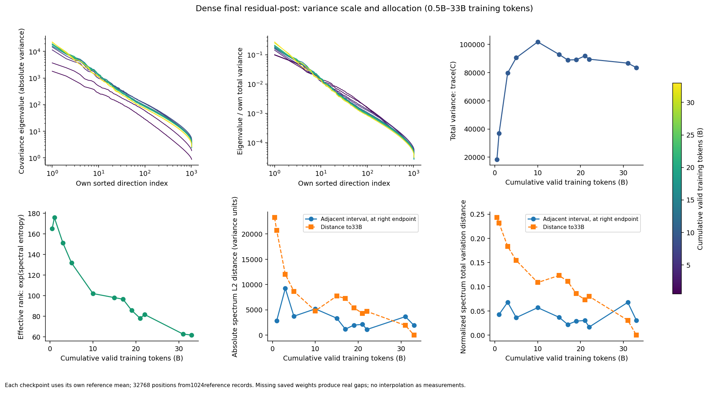
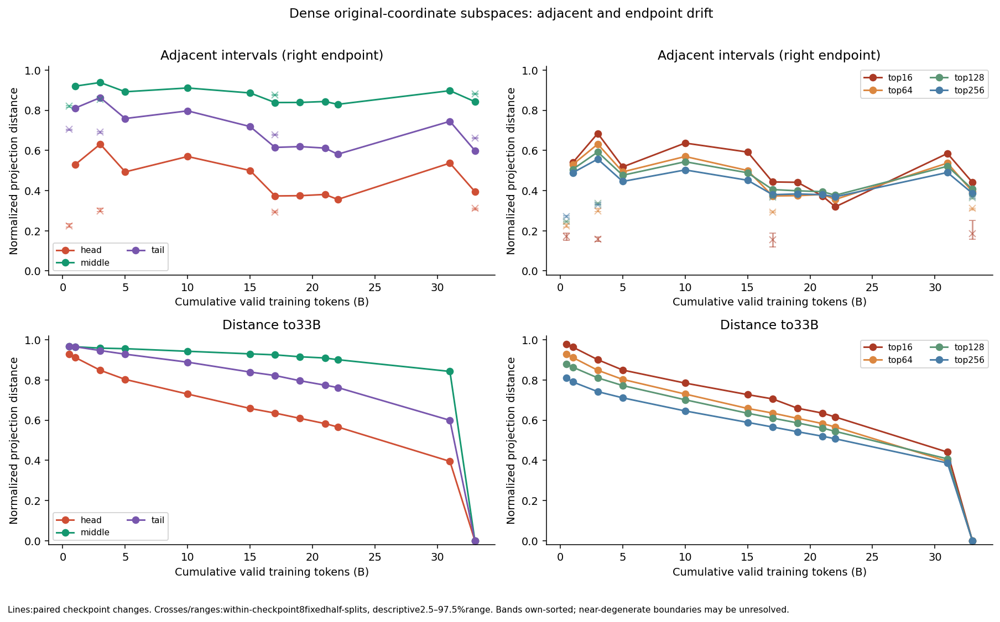
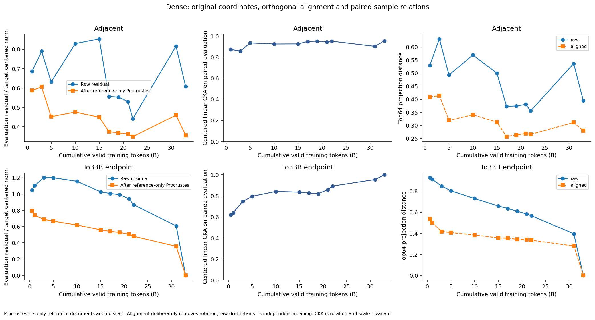
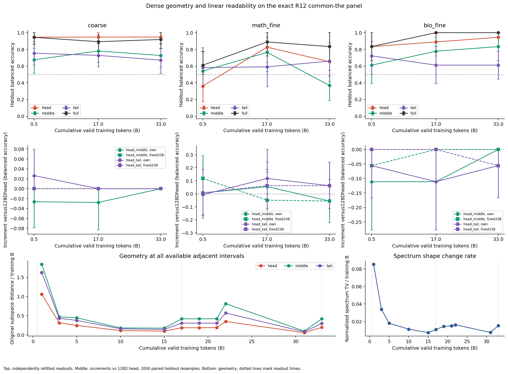

派生阅读副本；原件位置：`Projects/from-attention-to-search/main/experiments/A15/15_27_natural_language_feature_response/checkpoint_spectral_dynamics/20261101/summary.md`。
[精确原始文件](../../../../../../../../../sources/Projects/from-attention-to-search/main/experiments/A15/15_27_natural_language_feature_response/checkpoint_spectral_dynamics/20261101/summary.md)；研究修改仍回到原件。

---

# Dense 0.5B–33B: spectral, directional and representation dynamics

The complete bounded analysis covers 12 readable states from one 281,431,040-parameter Dense trajectory. **Spectrum shape and some original-coordinate directions still change at the window end; external-label readability can already be present earlier. A head-first, middle/tail-later stabilization order is not established.** 33B is an observation endpoint, not a known convergence truth. Researcher scientific acceptance and question closure remain Unknown.

## Five separate answers

| Question | Direct evidence | Bounded answer |
| --- | --- | --- |
| Variance scale | trace rises from 18,462.4 at 0.5B to 101,796.8 at 10B, then 83,565.4 at 33B; 31→33B changes by -3.65%. | Scale rises then falls and still changes late. |
| Spectrum shape | Entropy effective rank 165.11/96.60/61.84 at 0.5/17/33B; late normalized-spectrum TV=0.03068, split-reference median=0.00721. | Allocation remains in motion; late change is 4.25 times the half-split reference. |
| Directions | Late top 16/top 64 projection distances=0.4409/0.3948; middle/tail=0.8425/0.5991. | Head coordinates still drift; middle/tail estimates have insufficient sampling resolution for a stable temporal order. |
| Text relations | Late evaluation CKA=0.95503; raw/aligned residual=0.60855/0.35742. | Relations are fairly similar; rotation explains part, not all, of drift. No stability onset is identified. |
| Classification availability | Domain and biology-fine readouts already succeed at 0.5B; math-fine full-space 88.9% at 17B and 83.3% at 33B, with insufficient 0.5B evidence. | These are earliest sampled readable states, not exact formation times or native semantic mastery. |

The times are not established as coincident. Domain head accuracy is 94.6/94.7/94.7% while covariance and raw directions still change. Readability can precede geometric fixation; different fine tasks also have different sampled availability.

## Purpose, system and comparison

The purpose is to test the tacit assumption that variance scale, allocation, directions, text relations and accessible class information stabilize together, and to give the proposed spectral temporal division a falsifier. Rotation and finite text sampling are live rivals; vocabulary/source associations remain rivals to semantic interpretation.

The native Dense has 8 blocks, hidden 1024, MLP3072,16 query/8KVheads and tied 151936-vocabulary embeddings. B means 10^9 saved cumulative valid prediction tokens, not parameter billions. The main interface is final_raw_h, lastblock residual-post before final norm. All states receive the exact same 2048 natural 256-token sequences,32 fixed positions per record. Reference/evaluation each have 1024 records and 32768 vectors, equal document mass. Only 0.5/17/33B receive block 0/3 supplements and the exact 96-document R12 common-the bridge.

Each checkpoint is centered with its own reference mean. For the centered row matrix\(X_t\), covariance is\(C_t=X_t^\top X_t/(N-1)\). Singular values\(s_i\) and covariance eigenvalues\(\lambda_i=s_i^2/(N-1)\) are separately saved. Total variance\(\mathrm{trace}(C_t)\) measures scale; normalized\(p_i=\lambda_i/\mathrm{trace}(C_t)\) measures allocation; effective rank is\(\exp[-\sum_i p_i\log p_i]\). Original coordinates, fixed 33B coordinates and rotation-tolerant diagnostics retain separate meanings.

## Scale, shape and mean drift

The 0.5/17/33B reference statistics are:trace 18,462.4/88,975.5/83,565.4; effective rank 165.11/96.60/61.84; 95%-variance dimensions 513/543/489; mean norms 76.55/196.17/161.65. Complete values:[checkpoint table](../../../../../../../../../sources/Projects/from-attention-to-search/main/experiments/A15/15_27_natural_language_feature_response/checkpoint_spectral_dynamics/20261101/tables/checkpoint_statistics.csv),[singular/eigenvalue table](../../../../../../../../../sources/Projects/from-attention-to-search/main/experiments/A15/15_27_natural_language_feature_response/checkpoint_spectral_dynamics/20261101/tables/spectrum.csv). The entropy dimension and 95%-variance dimension are different definitions.

Late absolute-spectrum L2 distance is 1916.10, compared with 33B half-split median 484.01. Normalized TV also exceeds the sampling reference, so the change is not only a global scale factor. Mean norm changes from 167.37 to 161.65, but the mean-vector drift is 131.26; similar norms do not mean a fixed mean direction. Each covariance removes its own mean.

Figure 1 uses own-ordered spectra and actual training-token colors; the two spectrum panels use log axes. Other panels show trace, entropy rank and separate absolute/normalized spectral distances. Endpoint self-distance is trivially zero. Lines join observations; missing checkpoints are not interpolated measurements.

Normalized-spectrum rates first decrease, then rebound after 15B. The final two rates are 0.00753/B and 0.01534/B, not a sustained monotone decline. Their token gaps are 8.9813B and 2B. [Rates/mean/gaps](../../../../../../../../../sources/Projects/from-attention-to-search/main/experiments/A15/15_27_natural_language_feature_response/checkpoint_spectral_dynamics/20261101/figures/figure1b_rates_mean_gaps.png) and [complete pair table](../../../../../../../../../sources/Projects/from-attention-to-search/main/experiments/A15/15_27_natural_language_feature_response/checkpoint_spectral_dynamics/20261101/tables/pair_metrics.csv) retain both distance and actual interval.

## Directions and sampling resolution

Head 1–64, middle 481–544, tail 961–1024 are each checkpoint's own newly ordered directions, not fixed semantic identities. Projection distance 0 means equal subspaces and 1 orthogonal subspaces. Late top 16/head/middle/tail distances are 0.4409/0.3948/0.8425/0.5991. Their 33B within-checkpoint half-split medians are 0.1855/0.3107/0.8800/0.6617. Top 16 late drift exceeds the observed split range; middle/tail temporal distances do not exceed their large reference fluctuations.

Figure 2 top compares adjacent states, bottom compares with 33B; crosses/ranges are 8 fixed 512/512 document splits, paired across time. Each half contains 16384 positions. These are descriptive smaller-reference sampling ranges, not calibrated full-sample population confidence intervals. Tail sensitivity means insufficient direction estimation here, not permanent nonconvergence. Full 1024D identity-space distance is excluded as evidence. Isolated-vector cosines require both adjacent relative eigengaps>=0.05 at both states; other directions are UNIDENTIFIABLE. [Band gaps](../../../../../../../../../sources/Projects/from-attention-to-search/main/experiments/A15/15_27_natural_language_feature_response/checkpoint_spectral_dynamics/20261101/tables/band_boundary_gaps.csv) and the execution-side full principal-angle table retain identifiability detail.

Fixed 33B projected variances are separately named in the [table](../../../../../../../../../sources/Projects/from-attention-to-search/main/experiments/A15/15_27_natural_language_feature_response/checkpoint_spectral_dynamics/20261101/tables/fixed_endpoint_projected_variance.csv) and [supplement](../../../../../../../../../sources/Projects/from-attention-to-search/main/experiments/A15/15_27_natural_language_feature_response/checkpoint_spectral_dynamics/20261101/figures/figure1c_fixed_basis.png). They are not early checkpoint eigenvalues.

## Rotation, relations and remaining change

CKA centers paired evaluation vectors and uses crossmoments without a large sample Gram. Reference-only Procrustes is restricted to proper rotations det(R)=+1 under amendmentA01; it fits no scale. Evaluation residuals use each checkpoint's reference mean. Late raw residual 0.6085 falls to 0.3574 after alignment; top 64 distance 0.3948 falls to 0.2794. Rotation explains a component, with residual changes left. CKA to 33B is 0.8283 from 17B and 0.9550 from 31B. Greater similarity does not identify a stability onset or imply learning stopped. CKA sampling intervals were not estimated.

Figure 3 keeps raw and aligned results side by side. Alignment intentionally removes rotation and cannot erase the original-coordinate observation. This pre-final-norm amplitude change does not by itself establish output change.

## Readability and matched-dimension increments

The bridge reuses the exact R12 the texts and external visible-prefix labels, with new Dense forwards and independently refitted readouts. Each task retains 16TRAIN/8DEVand 37/17/18 heldout records. All three checkpoints use the same capacity, Cgrid and selection. Evaluation never fits PCA, standardization or hyperparameters. The full English/Chinese numeric [readout table](../../../../../../../../../sources/Projects/from-attention-to-search/main/experiments/A15/15_27_natural_language_feature_response/checkpoint_spectral_dynamics/20261101/tables/readout_metrics.csv) includes both own/current and fixed 33B bases.

In own coordinates, head/middle/tail/full balanced accuracies at 0.5/17/33B are:

| Task |0.5B|17B|33B|
| --- | --- | --- | --- |
| Domain |94.6/67.5/75.4/94.4%|94.7/78.1/72.8/89.2%|94.7/72.7/67.1/91.8%|
| Math fine |36.1/54.2/58.3/61.1%|82.6/76.4/59.0/88.9%|65.3/36.8/66.0/83.3%|
| Biology fine |83.3/61.1/72.2/83.3%|88.9/77.8/61.1/100%|94.4/83.3/61.1/100%|

Full-space math-fine bootstrap intervals are 50.0–77.8%,72.2–100%,66.7–100%.0.5B evidence is insufficient; 17B and 33B are more clearly readable. A lower 33B head score cannot be called forgetting when full-space information remains accessible. Intervals condition on these fitted readouts and resample finite heldout records; they omit label/source and training-panel uncertainty. All-correct test predictions give a degenerate bootstrap interval, not certainty about population accuracy.

At0.5B, domain middle 64 accuracy is 67.5% in its own basis and 94.7% in the fixed 33B middle. The same early vectors and labels can therefore yield a different band reading solely through coordinate selection. Fixed 33B axes contain future geometric information and are a diagnostic, not an early deployable policy. [Coordinate-sensitivity figure](../../../../../../../../../sources/Projects/from-attention-to-search/main/experiments/A15/15_27_natural_language_feature_response/checkpoint_spectral_dynamics/20261101/figures/figure4b_readout_basis_sensitivity.png).

Adding middle/tail to head must beat the equal 128D head control. **0/36 prespecified primary increments establish a positive gain after paired intervals and Holm correction.** A positive point estimate that fails:17B math-fine head+tail 83.3% versus head 12871.5%, difference 11.81 percentage points, interval[-11.11,34.03], including 0. It does not establish reproducible middle/tail benefit.

Figure 4 shows own-basis accuracies, matched 128D increments for own/fixed 33B bases, and complete adjacent geometry rates underneath. Dotted lines mark the three readout times. No formation time is interpolated between them.

## Bounded recognition update and delivery

AI interpretation:this evidence weakens an already-established head-first/middle-tail-later dynamics explanation for fixed staged routing. Late head drift, poor middle/tail direction resolution and unestablished incremental readability prevent that inference. It neither proves that temporal specialization is impossible nor judges benefit in unfinished training experiments.

This is one trajectory on academic natural text, with record-level independence approximating unavailable paper families; R12 heldout was historically exposed, small and imperfectly source-matched. No stabilization onset is fitted. Curves, real gaps, sampling references and 0.5/1/2-times-reference sensitivity are retained. All 12 states,18 layer-states,126 readout conditions and 36 primary contrasts are complete; language-model updates 0. Eight historical manifested states lack weights and remain missing.

Read [Detailed](detailed.md),[Protocol](protocol.md),[manifest](../../../../../../../../../sources/Projects/from-attention-to-search/main/experiments/A15/15_27_natural_language_feature_response/checkpoint_spectral_dynamics/20261101/manifest.json),[asset/data guide](assets_and_data.md),[cache index](../../../../../../../../../sources/Projects/from-attention-to-search/main/experiments/A15/15_27_natural_language_feature_response/checkpoint_spectral_dynamics/20261101/cache_index.json) and [coverage ledger](../../../../../../../../../sources/Projects/from-attention-to-search/main/experiments/A15/15_27_natural_language_feature_response/checkpoint_spectral_dynamics/20261101/tables/coverage_ledger.csv). Artifacts are local; no commit or push was performed.
