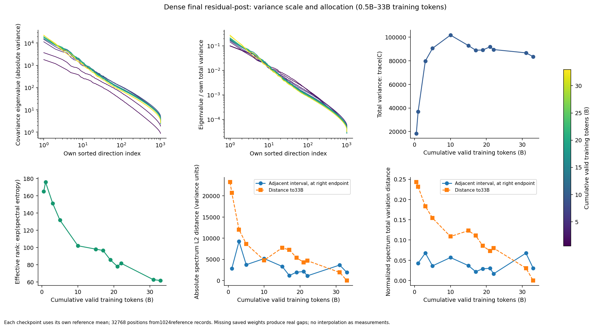
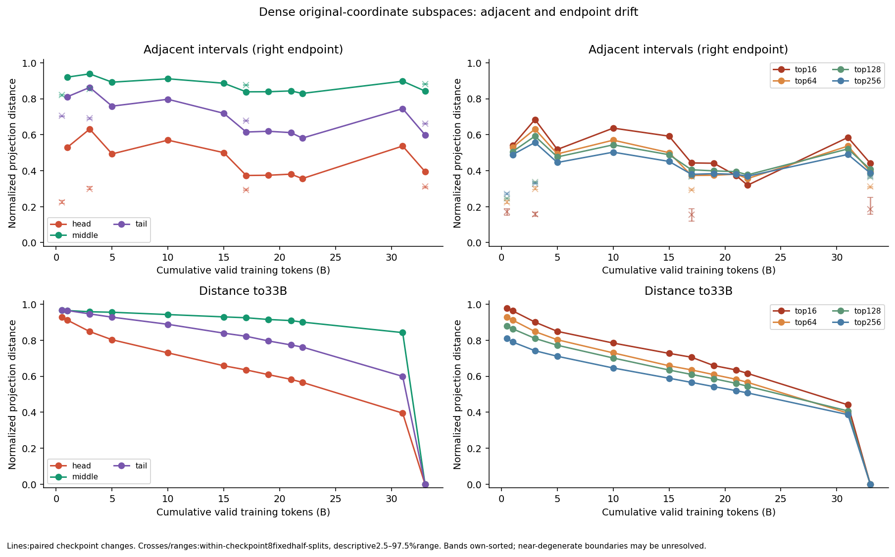
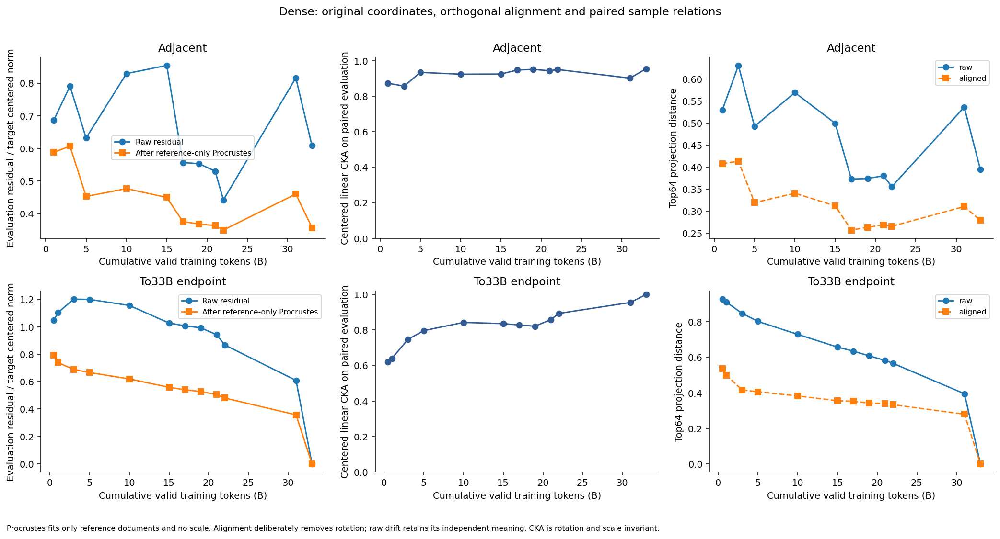
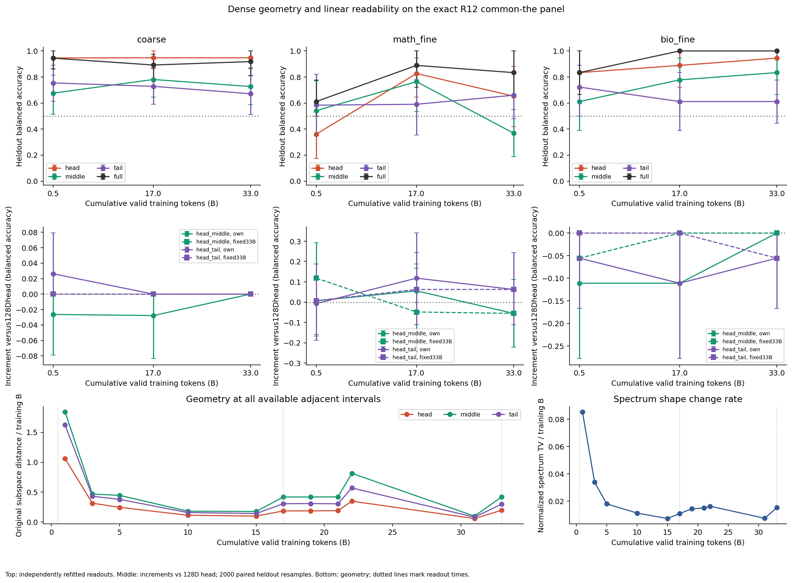

派生阅读副本；原件位置：`Projects/from-attention-to-search/main/experiments/A15/15_27_natural_language_feature_response/checkpoint_spectral_dynamics/20261101/summary_cn.md`。
[精确原始文件](../../../../../../../../../sources/Projects/from-attention-to-search/main/experiments/A15/15_27_natural_language_feature_response/checkpoint_spectral_dynamics/20261101/summary_cn.md)；研究修改仍回到原件。

---

# Dense 0.5B–33B：谱、方向与表征训练动态

本轮完成同一条约2.81亿参数Dense轨迹的12个可读checkpoint分析。**到观察末端，谱形状和部分原始方向仍在变化；分类信息的可读性已经可以更早出现。当前没有建立头部先稳定、中尾随后稳定的统一顺序。** 33B只是观察末端，不是已知最终收敛真值。中尾方向的抽样敏感性较高，不能把它解释成尾部永不稳定。研究者科学接受和问题闭合保持Unknown。

## 五个问题的直接回答

| 问题 | 本轮直接观测 | 可以作出的区间内判断 |
| --- | --- | --- |
| 方差规模是否稳定？ | 总方差从0.5B的18,462.4升至10B的101,796.8，33B为83,565.4；31→33B下降3.65%。 | 规模先升后降，末段仍有变化；不能称已固定。 |
| 谱形状是否稳定？ | effective rank从165.11降至96.60、61.84（0.5/17/33B）；31→33B归一化谱TV为0.03068，33B拆分参照中位数0.00721。 | 方差继续向更少方向集中；末段形状变化约为拆分参照的4.25倍。 |
| 方向是否稳定？ | 31→33B前16维距离0.4409、前64维0.3948；中/尾为0.8425/0.5991。 | 头部原始坐标仍有漂移；中尾变化与较大的估计波动混在一起，尚不能可靠排出稳定时间。 |
| 文本关系是否稳定？ | 31→33B评估CKA=0.95503；原始/旋转对齐后残差=0.60855/0.35742。 | 文本关系较相似，漂移中有旋转成分；对齐后仍有残差，未识别稳定时点。 |
| 分类信息何时可用？ | 数学/生物领域和生物细类在0.5B已有高于机会水平的读出；数学细类0.5B证据不足，17B全空间达到88.9%，33B为83.3%。 | 这是最早已测点的线性可读性，不能精确定位形成时刻；不能替代“语义已掌握”。 |

这些时间没有被证明一致。领域头部准确率约94.6/94.7/94.7%，同时协方差和原始方向仍变；可读类别信息无需等待几何固定。不同细任务也没有统一出现时间。

## 为什么这样测

目的在于检验“谱规模、方差分配、方向、文本关系和类别信息同步稳定”这一隐含假设，并给头/中/尾的时间分工猜测一个可反驳的观察。竞争解释是：几何变化含坐标旋转，或者某些方向主要受有限文本抽样影响；类别关联也可能来自词汇与来源，而非原生模型使用该语义。

对象是原生8block、1024隐藏维、281,431,040参数Dense模型的同一训练轨迹。B表示十亿累计有效预测token，直接读保存状态，不用文件名或step乘固定批量替代。主张量为最后block residual-post、final norm之前的final_raw_h。所有checkpoint输入完全一致：2,048条256token自然文本、每条32个固定位置；参考与独立评估各1,024条、32,768向量，文档等权。早/中/晚0.5/17/33B另补block0/3及R12的96条同the语义面板。

每点用自己的参考均值中心化，并把向量按行排成矩阵\(X_t\)。奇异值\(s_i\)来自该矩阵，协方差为\(C_t=X_t^\top X_t/(N-1)\)，特征值为\(\lambda_i=s_i^2/(N-1)\)。总方差\(\mathrm{trace}(C_t)\)描述规模，归一化特征值\(p_i=\lambda_i/\mathrm{trace}(C_t)\)描述分配；effective rank明确取\(\exp[-\sum_i p_i\log p_i]\)。原始坐标、固定33B基、旋转容忍关系诊断分别保留。

## 规模、谱形状与均值

| 训练token B | 总方差 trace | effective rank | 95%方差所需维数 | 均值范数 |
| --- | --- | --- | --- | --- |
| 0.5 | 18,462.4 | 165.11 | 513 | 76.55 |
| 17 | 88,975.5 | 96.60 | 543 | 196.17 |
| 33 | 83,565.4 | 61.84 | 489 | 161.65 |

来源：[逐checkpoint统计](../../../../../../../../../sources/Projects/from-attention-to-search/main/experiments/A15/15_27_natural_language_feature_response/checkpoint_spectral_dynamics/20261101/tables/checkpoint_statistics.csv)、[全部奇异值/特征值](../../../../../../../../../sources/Projects/from-attention-to-search/main/experiments/A15/15_27_natural_language_feature_response/checkpoint_spectral_dynamics/20261101/tables/spectrum.csv)。95%方差所需维数与effective rank的定义不同，不能互换。31→33B的绝对谱L2距离为1916.10，33B半集拆分参照中位数484.01；归一化谱TV也超出参照范围，变化不只来自全局尺度。

均值范数31→33B从167.37降至161.65，但**均值向量本身漂移131.26**；范数变化小不等于均值方向固定。中心化协方差已去掉每点自身均值，未把均值漂移混成方差。

图①左上与中上按各点自身谱排序，颜色为实际训练token；两张谱图用对数坐标。右上是总方差，左下是熵effective rank；下方另列绝对谱与归一化谱距离。距33B为零的末点只是自身比较。连线仅连接已测点，缺失点没有被插值为测量。

相邻距离必须除以真实token间隔。归一化谱变化率在早期先下降，但15B之后出现反弹；末两段为0.00753/B、0.01534/B，未保持单调减小。22.0187→31B跨度8.9813B，31→33B仅2B，不能按等间隔图读训练速度。完整曲线见[变化率与均值图](../../../../../../../../../sources/Projects/from-attention-to-search/main/experiments/A15/15_27_natural_language_feature_response/checkpoint_spectral_dynamics/20261101/figures/figure1b_rates_mean_gaps.png)和[所有区间表](../../../../../../../../../sources/Projects/from-attention-to-search/main/experiments/A15/15_27_natural_language_feature_response/checkpoint_spectral_dynamics/20261101/tables/pair_metrics.csv)。

## 方向与抽样分辨率

我们比较子空间而不逐根追踪任意奇异向量。归一化投影距离为0表示同一子空间、1表示完全正交；主夹角见执行侧完整表。头为1–64、中为481–544、尾为961–1024，均为各点重新排序后的方向，并非固定语义。全1024维距离天然为0，没有被用作稳定性证据。

| 子空间 | 31→33B原始投影距离 | 33B拆分中位数 | 拆分2.5–97.5%范围 |
| --- | --- | --- | --- |
| top16 | 0.4409 | 0.1855 | [0.1578, 0.2507] |
| head | 0.3948 | 0.3107 | [0.3051, 0.3119] |
| middle | 0.8425 | 0.8800 | [0.8780, 0.8828] |
| tail | 0.5991 | 0.6617 | [0.6586, 0.6642] |

这里拆分范围来自同一批参考文档的8次固定512/512拆分，每半集16,384位置，跨checkpoint保持配对。它是**小一半参考集的描述性抽样参照，不是完整样本估计的总体置信区间**。中/尾的晚期距离没有超过其拆分参照，因此当前无法可靠估计它们的时间稳定性。前16维变化高于所测拆分范围，前64维也仍有原始漂移；这组结果不支持把头部称为已固定。

图②上排为相邻距离、下排为距33B距离；叉号与范围为同checkpoint拆分参照。右列前16/64/128/256维与左列等64维谱带回答不同问题。谱带边界间隙与可识别性见[间隙表](../../../../../../../../../sources/Projects/from-attention-to-search/main/experiments/A15/15_27_natural_language_feature_response/checkpoint_spectral_dynamics/20261101/tables/band_boundary_gaps.csv)。只有左右相对eigengap均至少0.05的孤立方向才报告符号不变余弦，其余明确UNIDENTIFIABLE。

固定33B基的投影方差另外保存在[投影表](../../../../../../../../../sources/Projects/from-attention-to-search/main/experiments/A15/15_27_natural_language_feature_response/checkpoint_spectral_dynamics/20261101/tables/fixed_endpoint_projected_variance.csv)与[补充图](../../../../../../../../../sources/Projects/from-attention-to-search/main/experiments/A15/15_27_natural_language_feature_response/checkpoint_spectral_dynamics/20261101/figures/figure1c_fixed_basis.png)。它保持末端方向不动，展示早期方差如何投到这些方向；它不是早期自身特征值谱。

## 旋转、关系与剩余变化

CKA在完全配对的独立评估记录上，各自中心化后比较样本关系；用交叉矩实现，没有保存巨大Gram矩阵。Procrustes只用参考记录拟合，并按修订A01限定R的行列式为+1，不学习缩放；评估残差用各点参考均值中心化后计算。

31→33B原始残差0.6085降至0.3574，前64维原始投影距离0.3948降至对齐后的0.2794。可见旋转解释了一部分漂移，对齐后仍有剩余变化。17→33B的CKA为0.8283，31→33B为0.9550；关系更相似不等于已经找到稳定起点，也不能解释成“没有学习”。本轮未给CKA计算抽样区间，稳定时点因此保持未确定。

图③始终并列原始与对齐结果。对齐主动删除旋转，不能用它覆盖原始坐标变化；final norm前的幅度变化也不能直接解释成原生输出变化。

## 类别信息可读性及中尾增量

这部分重用R12的相同the文本和外部可见前缀标签，在Dense上重新前向与拟合。每任务16TRAIN/8DEV，三点使用相同名单、线性分类器容量、C网格和DEV选参规则；评估集不参与PCA、标准化或选参。三任务留出数为37/17/18。下表全空间栏给平衡准确率和2,000次分层配对留出重采样区间；它们只衡量有限留出记录的波动，不包括标签/来源偏差或TRAIN选择不确定性。全对时bootstrap区间退化为100%，不代表总体准确率已无不确定性。

| 任务 / 留出数 | 训练token B | 自身头64 | 自身中64 | 自身尾64 | 全1024 |
| --- | --- | --- | --- | --- | --- |
| 数学/生物 / 37 | 0.5 | 94.6% | 67.5% | 75.4% | 94.4% [86.1%, 100.0%] |
| 数学/生物 / 37 | 17 | 94.7% | 78.1% | 72.8% | 89.2% [78.2%, 97.4%] |
| 数学/生物 / 37 | 33 | 94.7% | 72.7% | 67.1% | 91.8% [81.0%, 100.0%] |
| 代数/分析 / 17 | 0.5 | 36.1% | 54.2% | 58.3% | 61.1% [50.0%, 77.8%] |
| 代数/分析 / 17 | 17 | 82.6% | 76.4% | 59.0% | 88.9% [72.2%, 100.0%] |
| 代数/分析 / 17 | 33 | 65.3% | 36.8% | 66.0% | 83.3% [66.7%, 100.0%] |
| 细胞/生态演化 / 18 | 0.5 | 83.3% | 61.1% | 72.2% | 83.3% [66.7%, 100.0%] |
| 细胞/生态演化 / 18 | 17 | 88.9% | 77.8% | 61.1% | 100.0% [100.0%, 100.0%] |
| 细胞/生态演化 / 18 | 33 | 94.4% | 83.3% | 61.1% | 100.0% [100.0%, 100.0%] |

数学细类在0.5B全空间区间接触50%，不能确认此时已形成可靠读出；17B和33B有更清楚的全空间读出。17→33B自身头部由82.6%降为65.3%，同时全空间仍83.3%，不能把谱带坐标中的下降直接称为模型忘记类别。

固定末端基同样重新拟合，并完整列于[读出表](../../../../../../../../../sources/Projects/from-attention-to-search/main/experiments/A15/15_27_natural_language_feature_response/checkpoint_spectral_dynamics/20261101/tables/readout_metrics.csv)。例如0.5B领域分类中，当前自身中段为67.5%，固定33B中段为94.7%；输入向量和标签完全相同，改变的是选择的方向。该差异直接说明，谱段可读性的变化可能混有坐标选择效应。固定33B基含未来几何信息，是分析诊断，不是当时可部署的策略。[基选择补充图](../../../../../../../../../sources/Projects/from-attention-to-search/main/experiments/A15/15_27_natural_language_feature_response/checkpoint_spectral_dynamics/20261101/figures/figure4b_readout_basis_sensitivity.png)并列两种结果。

中/尾增加到头部后，必须超过相同128维head128对照，才能排除普通扩维。在36个预定主增量对比中，**0/36通过正向区间与Holm校正**。一个正向点估计的失败例是17B数学任务：head+tail83.3%，head12871.5%，差11.81个百分点，配对区间[-11.11, 34.03]个百分点，仍跨0。不能从这一个点推导可复现中尾收益。

图④上排是自身基64维谱带与全空间分类，中排是对128维头部的增量（实线自身基，虚线固定33B基），下排是全部可用区间的几何变化率。竖虚线标记仅有的三个读出时点，不在它们之间插值类别形成时刻。

## 有界认识更新与交付

**AI有界解释：** 本轮削弱了“已有证据表明头部先固定、中尾随后才稳定，因此固定分阶段路由有动力学依据”的说法。头部晚期仍漂移，中尾方向又受估计分辨率限制，且未建立中尾的匹配维数增量。当前证据也不证明该时间分工永远不存在，更不裁定尚未完成训练实验的效益。

主几何面板为学术自然文本，论文级家族身份不可用，只能按记录近似独立；R12留出历史已暴露、细类样本小且来源匹配不足。结论限于此轨迹、语料、测点和流程。没有拟合“趋稳起点”，只保留曲线、真实间隔、抽样参照及0.5/1/2倍参照敏感性。

已完成12个checkpoint、18个层位状态、126个读出条件和36个主增量对比；语言模型更新0次。8个历史有manifest但缺权重的状态单列，不插值。继续阅读：[Detailed](detailed_cn.md)、[Anchor](../../../../../problem_anchors/15_spectral_representation_and_functional_routing/15_27_natural_language_feature_response/subanchors/subanchors/15_27_05_01_checkpoint_spectral_dynamics_anchor_cn.md)、[Protocol](protocol_cn.md)、[精确清单](../../../../../../../../../sources/Projects/from-attention-to-search/main/experiments/A15/15_27_natural_language_feature_response/checkpoint_spectral_dynamics/20261101/manifest.json)、[数据/资产说明](assets_and_data_cn.md)、[缓存索引](../../../../../../../../../sources/Projects/from-attention-to-search/main/experiments/A15/15_27_natural_language_feature_response/checkpoint_spectral_dynamics/20261101/cache_index.json)、[覆盖账本](../../../../../../../../../sources/Projects/from-attention-to-search/main/experiments/A15/15_27_natural_language_feature_response/checkpoint_spectral_dynamics/20261101/tables/coverage_ledger.csv)。全部为本地交付，未commit或push。
