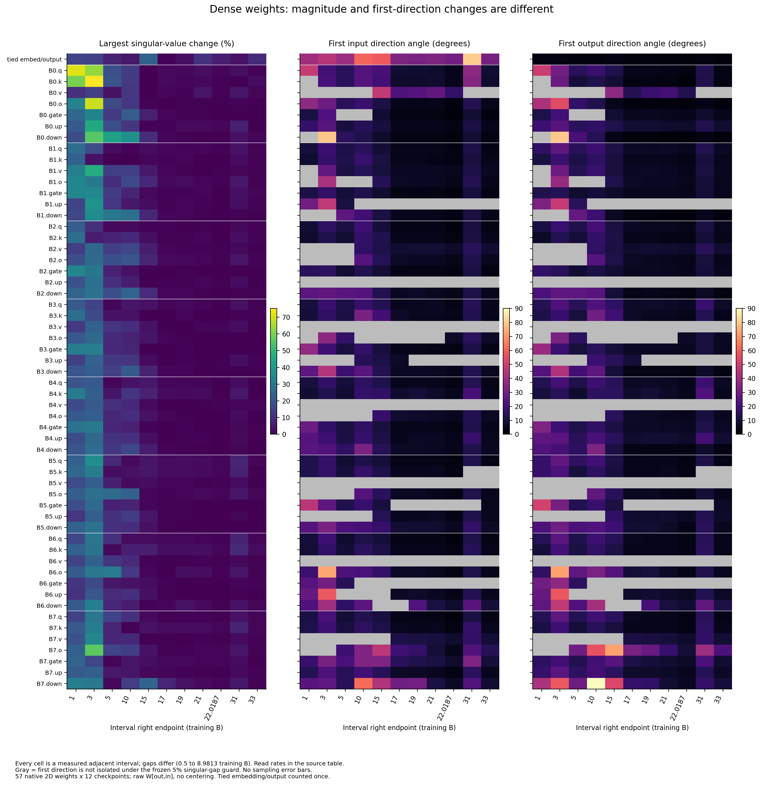
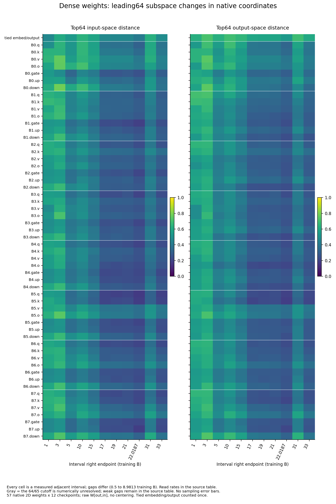

派生阅读副本；原件位置：`Projects/from-attention-to-search/main/experiments/A15/15_27_natural_language_feature_response/checkpoint_spectral_dynamics/20261101/weight_spectral_dynamics/summary.md`。
[精确原始文件](../../../../../../../../../../sources/Projects/from-attention-to-search/main/experiments/A15/15_27_natural_language_feature_response/checkpoint_spectral_dynamics/20261101/weight_spectral_dynamics/summary.md)；研究修改仍回到原件。

---

# Dense native weight spectral dynamics

All57unique2Dweightmatrices were measured at12compatible saved states:684decompositions. Magnitude,first input/output directions and leading64subspaces are separate quantities. Scientific acceptance and question closure remain Unknown.

Late31-to33B:identifiable first directions 47/57 modules;input median angle4.997degrees(range2.586–31.01),output median5.246(range1.833–22.03). Top64input projection distance median0.2951,range0.1914–0.4878;output median0.2909,range0.2138–0.6032. Across57modules,s1symmetric relative change median0.5265percent,range0.03859–9.394. See tables/late_interval.csv,not a pooled convergence verdict.

All57modules by11observed adjacent intervals;right-endpoint trainingB labels have unequal gaps. Percent s1change uses sqrt(s1_a*s1_b)denominator;angles are arccos absolute vector cosine,degrees. Gray means first vectors fail the predeclared5percent singular-gap guard,not zero motion. No sampling error bars:the object is a full saved weight matrix.

Input/right and output/left projection distance is sqrt(mean(sin²principal_angles)),0–1. Internal basis rotations do not count as subspace drift;weak64/65boundaries and numerical identifiability are retained. Full pair distances and perB rates are in tables/pair_metrics.csv.

Convergence timing is not identified by a unique scientific tolerance. All nine predeclared raw-displacement×perB-rate combinations per metric/side/module remain in tables/tolerance_onsets.csv. A conditional onset requires at least three consecutive observed intervals satisfying both bounds through33B,with identifiable directions where applicable. This does not certify unobserved intervals or final convergence. tables/onset_sensitivity_summary.csv distinguishes all-grid-pass,threshold-dependent and no-grid onset. The illustrative middle-grid table is navigation only.

Weights are uncentered native W[out,in],not text activations. All8blocks Q/K/V/O and gate/up/down plus tied embedding/output are included;33one-dimensional norm gains per state are explicitly excluded. Tied output/input embedding is counted once and reverses mapping orientation when used as input lookup. No model forward,training,GPU,text split or old representation fit enters this new run. Eight missing-weight states remain missing. Same native281431040-parameter Dense trajectory0.5–33B;33B is not a convergence truth. Parameter movement does not establish behavior/semantic change or router utility. See detailed.md,protocol.md and artifact_manifest.json;researcher interpretation remains pending.
