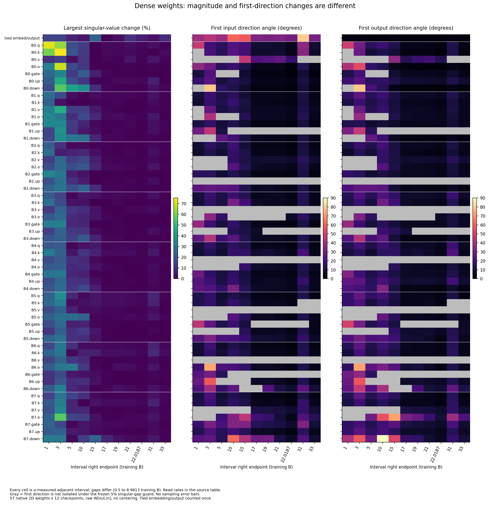
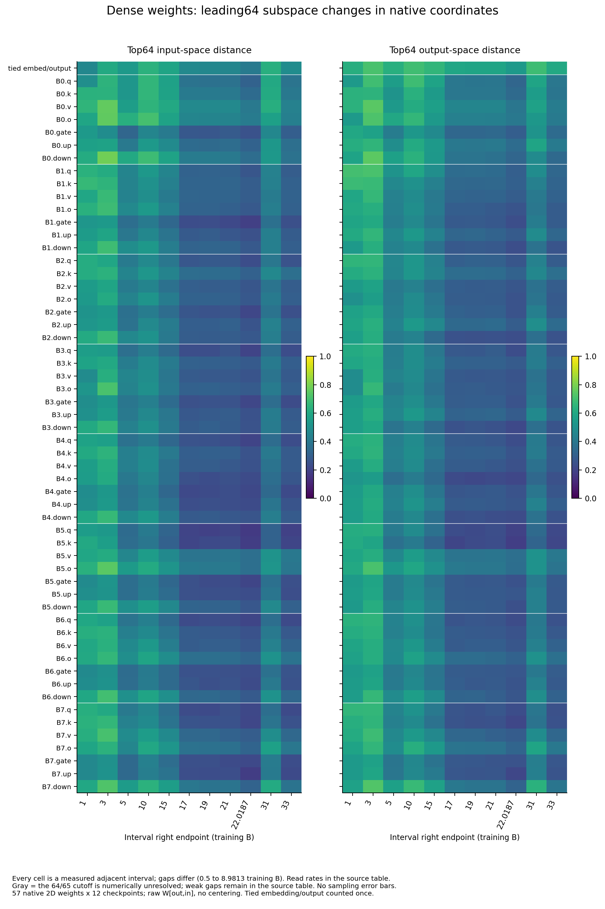

派生阅读副本；原件位置：`Projects/from-attention-to-search/main/experiments/A15/15_27_natural_language_feature_response/checkpoint_spectral_dynamics/20261101/weight_spectral_dynamics/summary_cn.md`。
[精确原始文件](../../../../../../../../../../sources/Projects/from-attention-to-search/main/experiments/A15/15_27_natural_language_feature_response/checkpoint_spectral_dynamics/20261101/weight_spectral_dynamics/summary_cn.md)；研究修改仍回到原件。

---

# Dense权重谱动态：第一方向与前64维

本轮完成同一Dense轨迹12个可读checkpoint的全部57个独立二维权重，即684个矩阵状态。**权重幅度、第一方向、前64维子空间必须分开回答；不存在由最大奇异值变平直接推导方向收敛的关系。**以下为已核事实与有界AI解释，研究者接受和问题关闭仍为Unknown。

## 先看最后31→33B的实际变化

|指标|输入侧（右奇异空间）|输出侧（左奇异空间）|
|---|---|---|
|第一方向满足预定间隔要求的模块数|47/57|47/57|
|上述模块第一方向夹角，中位数；范围|4.997°；2.586–31.01°|5.246°；1.833–22.03°|
|前64维投影距离，中位数；范围|0.2951；0.1914–0.4878|0.2909；0.2138–0.6032|

全57模块的最大奇异值对称相对变化为0.03859%–9.394%，中位0.5265%。以上均是同一2B区间；其它区间必须同时看per_B列，不能按原始距离排名学习快慢。范围和中位数不替代逐模块结果，原值在[末区间表](../../../../../../../../../../sources/Projects/from-attention-to-search/main/experiments/A15/15_27_natural_language_feature_response/checkpoint_spectral_dynamics/20261101/weight_spectral_dynamics/tables/late_interval.csv)，全部相邻与距33B结果在[配对表](../../../../../../../../../../sources/Projects/from-attention-to-search/main/experiments/A15/15_27_natural_language_feature_response/checkpoint_spectral_dynamics/20261101/weight_spectral_dynamics/tables/pair_metrics.csv)。

## 两张主图

每行一个模块，所有57个矩阵均保留；每列为相邻实测区间，横轴标该区间右端训练B，间隔不相等。左图为s1对称相对变化百分比，分母sqrt(s1_a*s1_b)；中/右图为输入/输出第一方向符号不变夹角，单位度。灰色表示两端任一(s1−s2)/s1未达到预定5%单方向解读要求，不是零旋转。颜色只编码测量大小，无抽样误差条。该5%是保守的方向解释条件，不是数值上必然不可计算的证明。

同样全部57模块和11相邻区间，左为输入、右为输出前64维归一化投影距离，范围0–1；等于sqrt(mean(sin²(64个主角度)))，不受子空间内部基向量旋转影响。它比较各点重新排序的前64空间，不追踪永久语义对象。64/65边界弱间隔在原表保留；接近数值误差时标无法分辨。没有文本样本或文档bootstrap，也没有独立训练重复区间。

## 何时趋稳：只给带容差的答案

没有科学依据选择一个唯一普适容差。批量前冻结三档原始变化阈值×三档每B变化阈值；全部九种组合都报告。条件起点是至少连续三个可测区间满足两条件、且一直保持到33B的最早实测起点；不是数学收敛时间，也不保证缺失checkpoint之间无反弹。

|对象|输入侧：九档都给起点/仅部分给起点/都不给起点|输出侧：九档都给起点/仅部分给起点/都不给起点|
|---|---|---|
|最大奇异值幅度|7/43/7|7/43/7|
|可辨识第一方向|0/33/24|0/30/27|
|前64维子空间|0/0/57|0/0/57|

这些计数只是容差敏感性，不是模型收敛比例。每模块、每方向和每阈值的准确起点见[全部3078条容差结果](../../../../../../../../../../sources/Projects/from-attention-to-search/main/experiments/A15/15_27_natural_language_feature_response/checkpoint_spectral_dynamics/20261101/weight_spectral_dynamics/tables/tolerance_onsets.csv)和[敏感性汇总](../../../../../../../../../../sources/Projects/from-attention-to-search/main/experiments/A15/15_27_natural_language_feature_response/checkpoint_spectral_dynamics/20261101/weight_spectral_dynamics/tables/onset_sensitivity_summary.csv)；[中档示例表](../../../../../../../../../../sources/Projects/from-attention-to-search/main/experiments/A15/15_27_natural_language_feature_response/checkpoint_spectral_dynamics/20261101/weight_spectral_dynamics/tables/illustrative_grid_onsets.csv)仅方便定位，不能替代全部网格。对前64维，中档阈值是距离≤0.1且每B≤0.01；换阈值会改变起点，这是必须保留的认识边界。

## 对象、实际范围与限制

原生Dense约2.81亿参数，8层hidden1024；12个点为0.5/1/3/5/10/15/17/19/21/22.018691584/31/33B。全部AttentionQ/K/V/O、MLPgate/up/down及共享embedding/output权重均纳入；共享权重计一次，33个一维norm增益/点排除。每个W[输出,输入]不中心化分解W=U diag(s)Vᵀ，左右空间分开。共享矩阵按输出投影看左为词表、右为hidden，输入embedding使用转置方向。

原8个缺权重状态未恢复或插值。没有使用文本或旧表征/PCA/readout拟合，模型更新和前向均为0；本次没有使用GPU。全684缓存的哈希/维度/标量通过复核，全部末区间左右空间的114个投影距离由等价公式复核；真实早/晚Q权重与直接SVD/奇异方程交叉检查。完整独立SVD未对684个矩阵全部再跑，不能把这些检查夸为重复训练确认。

该研究只描述同一训练轨迹的原生参数坐标。坐标重参数化、头或通道的协同变化可改变权重方向而不产生相同幅度的功能变化；反之权重较稳也不证明语义或输出稳定。第一方向不隔离的模块保留不足，不能把灰色算成稳定或失稳。33B只是末端观察点。原表征实验、其protocol和数值没有被本扩展替换。

[协议](protocol_cn.md) · [实际执行与纠错](detailed_cn.md) · [资产/对象](assets_and_data_cn.md) · [数据与代码身份](../../../../../../../../../../sources/Projects/from-attention-to-search/main/experiments/A15/15_27_natural_language_feature_response/checkpoint_spectral_dynamics/20261101/weight_spectral_dynamics/artifact_manifest.json)。当前仍等研究者逐图讨论，不将这里的AI解释记成已确认机制。
