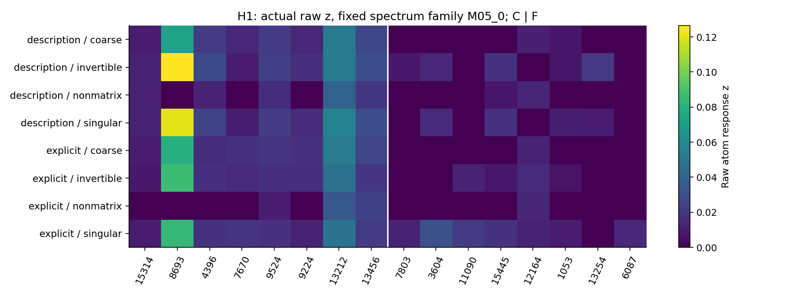
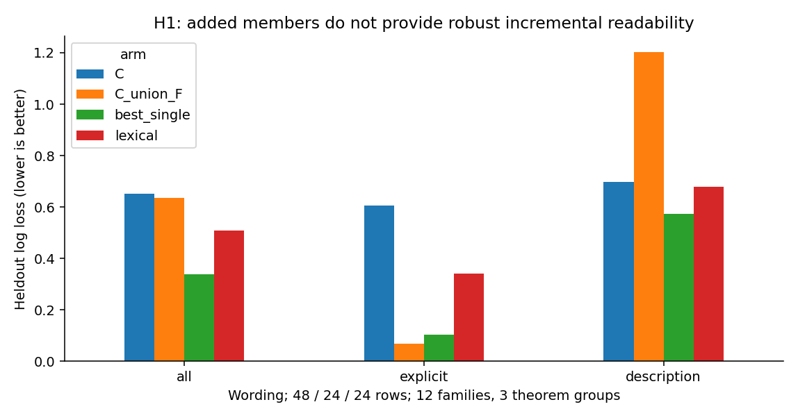
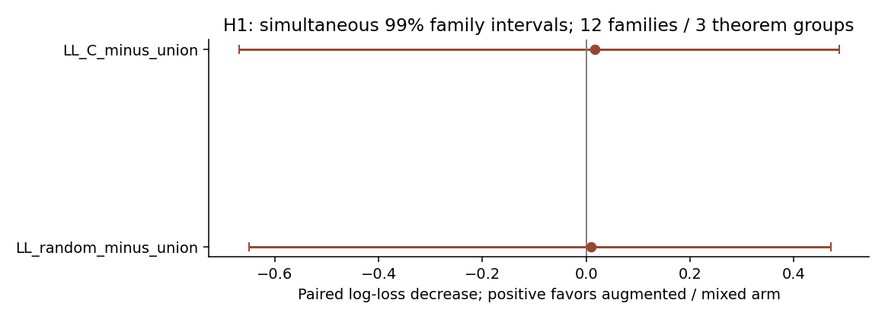

派生阅读副本；原件位置：`Projects/from-attention-to-search/main/experiments/A15/15_27_natural_language_feature_response/R17_20261102_feature_composition_v02/H1/summary_cn.md`。
[精确原始文件](../../../../../../../../../sources/Projects/from-attention-to-search/main/experiments/A15/15_27_natural_language_feature_response/R17_20261102_feature_composition_v02/H1/summary_cn.md)；研究修改仍回到原件。

---

# H1：共同内容复用与额外成员

执行分支：`COMPLETED_INSUFFICIENT`；科学接受及下一研究决策：`Unknown`。修订版留出已暴露。

## 1. 一句话更新

共同矩阵条件有可复现响应；新增活跃成员的事实没有转化为稳定的额外语义可读性。

## 2. 观察

三条件共同差1.7526／1.6369／1.6427，99%区间均为正。C的8原子为15314、8693、4396、7670、9524、9224、13212、13456。F为7803、3604、11090、15445、12164、1053、13254、6087，均不在C及共同前16／32名。留出122／384个粗→细比较发生0→正；34／384正→0。联合损失0.635533，C为0.651751，改善0.016217，99%[−0.669567,0.487186]；匹配随机增量改善0.009832，[−0.650294,0.472273]。单原子0.338238。描述版联合1.203777，显式版0.067289。

## 3. 完整性

20个随机种子均匹配完成；二值、归一化、整体活跃数／范数、C16／32、词面和完整字典对照均已执行。无术语子集、原始z与decoder尺度保留。C16／32加入F的整体损失分别0.354229／0.352682，但描述版相对各自C仍稍差，不能升格替代主规则。

## 4. 竞争解释

粗共同响应的词面和对象类别解释仍可成立。F中原子7803在显式标签与描述中的方向翻转。单原子优于联合削弱“组合必需”。候选截断解释因F仍不在共同前32名而变弱，但不意味着F在粗条件完全不活跃。

## 5. 结论与边界

保留当前面板的共同响应和部分新增活跃事实；完整的共同加细节成员假设未获支持。不能命名真实语义成员、建立层级或推断因果依赖。

## 6. 假设更新

AI修正倾向：把“细概念增加独立成员”改成“共同响应之外可能出现措辞依赖的成员和强度变化；只有跨表达且优于单原子与匹配随机后才称稳定增量”。

## 7. 下一决策

AI建议先解释7803等原子的方向翻转，以及联合描述版的高置信错误。研究者是否继续该路线、选择何种竞争解释与后续实验，均Unknown。

## 图与原始证据

Real responses show wording-dependent changes, not a stable one-atom semantic dictionary.

H1: added members do not provide robust incremental readability

H1: simultaneous 99% family intervals; 12 families / 3 theorem groups

[指标原表](../../../../../../../../../sources/Projects/from-attention-to-search/main/experiments/A15/15_27_natural_language_feature_response/R17_20261102_feature_composition_v02/tables/H1_readout_metrics.csv) · [全部响应、预测、调参与失败](../../../../../../../../../UNAVAILABLE.md) · [方法和修订](../detailed_cn.md) · [具体案例](../casebook_cn.md)
