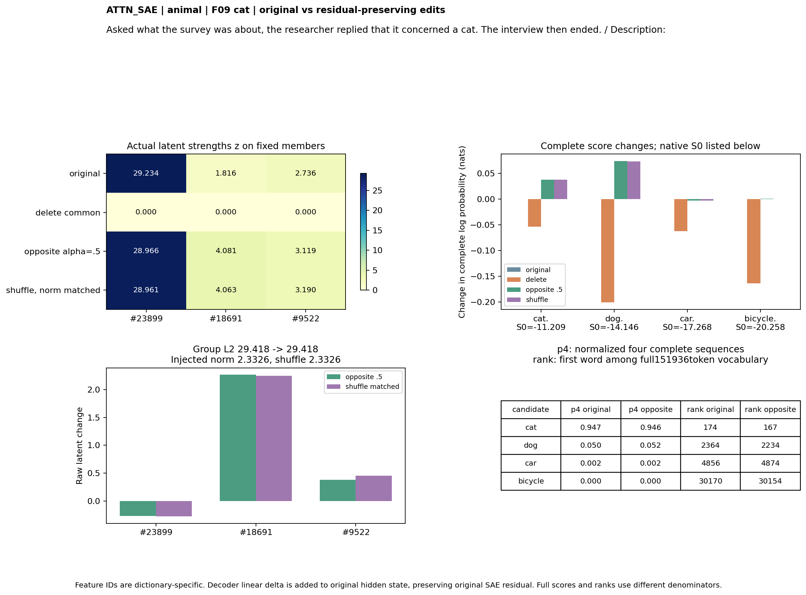
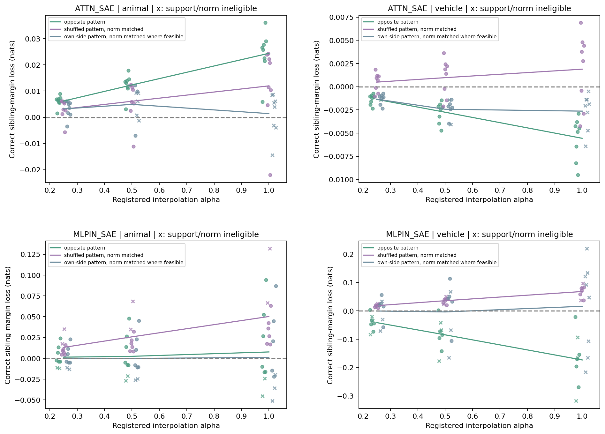

派生阅读副本；原件位置：`Projects/from-attention-to-search/main/experiments/A15/15_27_natural_language_feature_response/R17_20261102_feature_composition_v02/diagnostics/R17_D1/controlled_steps/S07_feature_interventions_1104/summary_cn.md`。
[精确原始文件](../../../../../../../../../../../../sources/Projects/from-attention-to-search/main/experiments/A15/15_27_natural_language_feature_response/R17_20261102_feature_composition_v02/diagnostics/R17_D1/controlled_steps/S07_feature_interventions_1104/summary_cn.md)；研究修改仍回到原件。

---

# SAE组合干预：有局部分数作用，尚未得到普遍语义转换

本补充研究的是前向临时干预后的输出作用。主S06已先完成并保存；本次不覆盖主实验候选、数据、结果和3.96MB原包。行为与控制、表征改变量、输出功能与数值质量三条路径分开；以下结论是AI有边界的认识更新，科学接受和机制判断仍由研究者保留Unknown。

## 最重要的认识更新

**可复现的组合关联，不能直接解释为维持正确分类所必需。** 删除共同大组通常让正确候选对兄弟的边际增大，同时改变其他类别分布。MLP输入动物／交通工具的平均边际增大约0.849／1.493 nats。共同组的完整频率／强度匹配失败，且扰动很大；因此不能把该变化归给类别专属成员，更不能把“删除后更好”命名为已识别的语义机制。

**共同成员的强弱方向可以对候选分数有小的局部作用。** Attention动物组在alpha=.5反侧移动下，8/8家族的正确边际下降，平均0.01236 nats；同成员、等表征范数打乱对照平均下降0.00613，差0.00623，95%家族区间[0.00135,0.01340]，Holm p=.03125。该条件16/16文本仍选正确。它支持当前方向对受限候选分数的局部敏感性，没有实现猫狗判断转换。

**作用依赖字典、类别和控制。** Attention交通工具反侧移动在8/8家族反而增强正确边际，未支持预期的反侧偏移；MLP动物相对打乱对照未支持，MLP交通工具只有5/8合格家族，证据不足。动物Attention强弱编辑也影响无关交通候选，不能称为纯语义定向。

| SAE | 大类 | 干预 | 原始边际损失 | 相对对照差[95%区间] | 合格家族/8 | Holm p | 裁决 |
| --- | --- | --- | --- | --- | --- | --- | --- |
| ATTN_SAE | animal | strength | 0.01236 | 0.00623 [0.00135, 0.01340] | 8 | 0.03125 | LOCAL_DIRECTION_SPECIFIC_EFFECT |
| MLPIN_SAE | animal | strength | 0.00241 | -0.00597 [-0.01571, 0.00405] | 6 | 1.00000 | NOT_SUPPORTED_BY_PRIMARY |
| ATTN_SAE | animal | delete | -0.04532 | NA [NA, NA] | 0 | 1.00000 | INSUFFICIENT_MATCH_OR_SUPPORT |
| ATTN_SAE | vehicle | delete | -0.07467 | NA [NA, NA] | 0 | 1.00000 | INSUFFICIENT_MATCH_OR_SUPPORT |
| ATTN_SAE | vehicle | strength | -0.00276 | -0.00373 [-0.00541, -0.00197] | 8 | 1.00000 | NOT_SUPPORTED_BY_PRIMARY |
| MLPIN_SAE | animal | delete | -0.84929 | NA [NA, NA] | 0 | 1.00000 | INSUFFICIENT_MATCH_OR_SUPPORT |
| MLPIN_SAE | vehicle | delete | -1.49317 | NA [NA, NA] | 0 | 1.00000 | INSUFFICIENT_MATCH_OR_SUPPORT |
| MLPIN_SAE | vehicle | strength | -0.08476 | -0.11220 [-0.14623, -0.06980] | 5 | 1.00000 | INSUFFICIENT_MATCH_OR_SUPPORT |

“边际损失”=原正确候选对兄弟分数差减去干预后的差，正号才是削弱原答案；“相对对照差”=候选损失−对照损失。主判断按8个家族(每家族两子类)而非按feature／token计独立样本。删除0/8表示缺合格匹配，不表示没执行；全部删除和其他参照仍实际运行。

## 真实文本、feature和解码分布

```text
Asked what the survey was about, the researcher replied that it concerned a cat. The interview then ended.
Description:
```

ATTN_SAE，共同ID `[23899, 18691, 9522]`；z原 `[29.2344, 1.8162, 2.7362]`，反侧alpha.5后 `[28.9664, 4.0809, 3.1192]`。完整候选顺序cat/dog/car/bicycle，原S `[-11.20893, -14.14577, -17.26775, -20.25848]`，反侧S `[-11.17121, -14.07189, -17.27081, -20.25774]`。原首词全词表rank `[174, 2364, 4856, 30170]`，反侧rank `[167, 2234, 4874, 30154]`。

```text
Asked what the survey was about, the researcher replied that it concerned a car. The interview then ended.
Description:
```

MLPIN_SAE，共同ID `[14481, 29342, 29506, 16240, 20696, 11190, 21902]`；z原 `[91.0472, 56.1531, 28.6633, 7.729, 5.1575, 8.4296, 10.3696]`，反侧alpha.5后 `[90.4975, 56.3213, 29.3355, 9.0547, 5.4684, 9.3346, 10.3821]`。完整候选顺序cat/dog/car/bicycle，原S `[-17.37926, -17.19339, -10.44462, -17.17792]`，反侧S `[-17.28568, -17.11861, -10.41734, -17.08533]`。原首词全词表rank `[12375, 11601, 69, 12176]`，反侧rank `[12288, 11611, 66, 12087]`。

F09猫的Attention例子尤其直观：cat首词rank174→167，dog2364→2234，但四候选归一化cat概率0.94743→0.94577。两词都上升时，猫仍可相对狗变弱。排名、全词表概率和候选间偏好必须分开解释。全词表首选通常不是这些强制候选，完整top20与其余质量在逐例记录中。


热图给原始／删除／反侧／打乱后的同一组真实z，右侧是完整两token候选的log概率；下方并列范数和全词表排名，不把两种概率分母混合。


散点是8个家族两子类平均边际损失，线是均值；每个alpha及反例都保留。主要条件没有改变16/16的二选一正确数，分数作用强度须如实看待。

## 操作、检查与边界

两套原生SAE在各自hook临时注入h新=h原+Wdecoder(z新−z原)，decoder偏置在差里抵消，原重构残差保留。没有把h替换成SAE重构，也没有训练或永久写权重。共同模式来自8个显式发现家族；96条原始输入=64显式留出(含父类／负类／跨域)+32属性细类。全部14976条件保留实际活跃成员数、旧新z、实际扰动范数和超范围标记。

完整前向校准最大分数误差6.44e-6 nats，无操作重放最大9.54e-6；96条原模型重测与主实验分数和z完全一致。该最后一层单位置干预不改变后续候选token的句号项；批量计算重新经过全部剩余非线性MLP／RMSNorm／输出头，不是一阶近似。

严格共同组删除匹配不足；等范数随机组合是其他活跃成员的正向添加，另标操作，不能冒充相同删除。强弱主对照在相同成员上打乱发现典型模式并按实际decoder扰动范数匹配。属性猫原行为3/8，仍仅作探索；不可用它把主结论升级为抽象语义因果机制。重编码诊断表明，编辑后的目标坐标与再编码结果也未必完全一致，结论因此限定为这些decoder方向的作用。

本轮同时保留未支持、反向和匹配不足。没有证据表明这些方向是自然计算的唯一机制、真实概念替换或MoE router的专家分工。AI建议的下一项判断是：能否在词面受控且扰动局部、匹配足够的条件下保留这个很小的方向差；本轮不自动启动下一轮。

[详细报告](detailed_cn.md) · [完整文本／排名／分布及反例](../../../../../../../../../../../../UNAVAILABLE.md) · [协议](protocol_cn.md) · [复算和数据](../../../../../../../../../../../../UNAVAILABLE.md)

## 追加控制几何审核（事后测量诊断）

交通工具Attention固定共同组只有2个正成员，固定L2范数后只有1个角度自由度。实际alpha.5目标／打乱注入向量的余弦既有接近+1也有接近−1；F09汽车中两改动几乎相同。因此原检验只识别这些实际选择的有限方向对比，不证明对任意打乱都特异。动物Attention的16个逐文本余弦中位数约.8164，部分也近乎同向。两大类的不同结果还可能来自列表维数／控制能力，不应唯一归因类别组织。完整逐文本数据与范围见results/control_delta_geometry*.csv。本诊断未新增干预、筛选或改变主判定，也不救回未支持结果。
