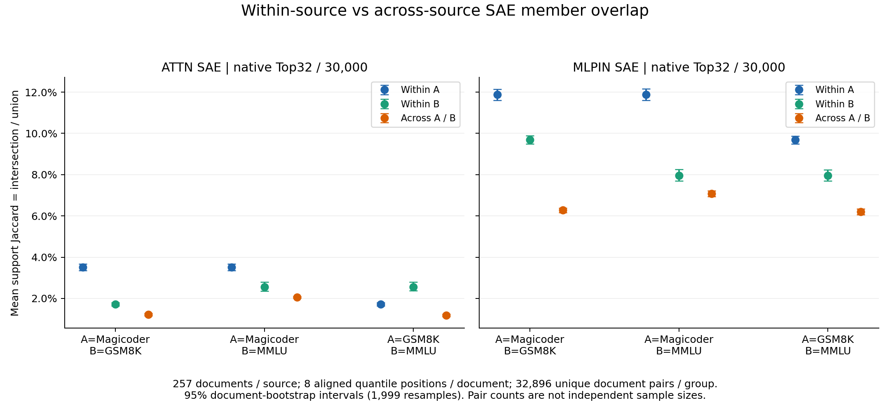
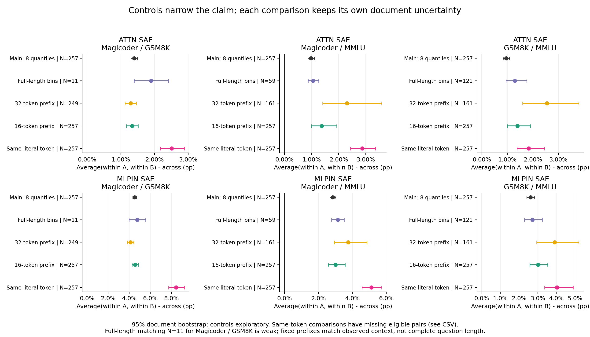

派生阅读副本；原件位置：`Projects/from-attention-to-search/main/experiments/A15/15_27_natural_language_feature_response/R17_20261102_feature_composition_v02/diagnostics/R17_D1/controlled_steps/S08_dataset_support_overlap_1104/summary.md`。
[精确原始文件](../../../../../../../../../../../../sources/Projects/from-attention-to-search/main/experiments/A15/15_27_natural_language_feature_response/R17_20261102_feature_composition_v02/diagnostics/R17_D1/controlled_steps/S08_dataset_support_overlap_1104/summary.md)；研究修改仍回到原件。

---

# S08: Are SAE support sets more similar within natural datasets?

Across the three readable sources with257 questions each, 6/6 native-SAE/source-pair comparisons meet the frozen both-sides-higher criterion. Passing conditions: ATTN_SAE:Magicoder/GSM8K; ATTN_SAE:Magicoder/MMLU; ATTN_SAE:GSM8K/MMLU; MLPIN_SAE:Magicoder/GSM8K; MLPIN_SAE:Magicoder/MMLU; MLPIN_SAE:GSM8K/MMLU. Other conditions: none. This is dataset-conditioned member similarity, not an identification of domain knowledge or a functional mechanism.

Factual paths: behavior/factor controls describe length, format and literal tokens without answer scoring; representation analysis compares binary supports in the frozen model; functional intervention and training are NOT_RUN. Hook and numerical checks concern measurement quality. Scientific acceptance and closure remain Unknown.

| SAE | pair | A_within | B_within | cross | pooled_difference_95CI | Holm_p | both_sides |
|---|---|---|---|---|---|---|---|
| ATTN_SAE | Magicoder/GSM8K | 0.0351 | 0.0171 | 0.0122 | 0.0139 [0.0129,0.0149] | 0.006 | BOTH_WITHIN_HIGHER |
| ATTN_SAE | Magicoder/MMLU | 0.0351 | 0.0256 | 0.0206 | 0.0098 [0.0086,0.0111] | 0.006 | BOTH_WITHIN_HIGHER |
| ATTN_SAE | GSM8K/MMLU | 0.0171 | 0.0256 | 0.0118 | 0.0096 [0.0084,0.0109] | 0.006 | BOTH_WITHIN_HIGHER |
| MLPIN_SAE | Magicoder/GSM8K | 0.1187 | 0.0968 | 0.0627 | 0.0450 [0.0433,0.0468] | 0.006 | BOTH_WITHIN_HIGHER |
| MLPIN_SAE | Magicoder/MMLU | 0.1187 | 0.0796 | 0.0707 | 0.0284 [0.0268,0.0302] | 0.006 | BOTH_WITHIN_HIGHER |
| MLPIN_SAE | GSM8K/MMLU | 0.0968 | 0.0796 | 0.0620 | 0.0262 [0.0242,0.0282] | 0.006 | BOTH_WITHIN_HIGHER |

A/B order follows the pair column. Each document-pair value averages8 aligned-quantile Jaccards, intersection/union of strictly positive native coordinates. Within A, within B and cross use32,896 distinct pairs each at257 documents/source, not32,896 independent units. Pooled difference is mean(within A,within B)-cross.1,999 document-count bootstrap samples;999 whole-document label permutations; Holm across six main pooled tests. Individual side intervals remain in [full statistics](../../../../../../../../../../../../sources/Projects/from-attention-to-search/main/experiments/A15/15_27_natural_language_feature_response/R17_20261102_feature_composition_v02/diagnostics/R17_D1/controlled_steps/S08_dataset_support_overlap_1104/tables/overlap_summary.csv).

Full-question-length bin matching leaves11/59/121documents per source for the three source pairs. Fixed32prefix samples are249/161/161; fixed16uses all257. Equal observed context length does not equal matching complete question length. Literal-token comparisons condition on preselected frequent tokens and retain missing eligible pairs; no permutation inference is claimed for this conditional control. Controls are exploratory and do not rescue failed primary outcomes.

Use only Magicoder-OSS problem(train), GSM8K question(train), MMLU question(test), no solutions/answers/choices/seeds. Uniform seeded sampling after normalized exact dedup and>=16token eligibility; max128visible tokens, no prompt/suffix/special tokens. Full lengths have medians252/56/50; code fences158/257,0/257,0/257; newlines257/257,0/257,27/257. Source, task, syntax, current token, topic and near duplicates remain live rivals. MMLU stems can depend on omitted options. No contamination-free or heldout-pretraining claim.

Numina was not found in the recorded bounded locations. The exact senior SFT legacy path is unavailable; these are verified existing versions, not an exact replication. Native dictionaries are independent; feature IDs do not correspond. Top32constraints and raw amplitude do not enter the semantic claim. See [Detailed](detailed.md), [raw amplitude supplement](../../../../../../../../../../../../sources/Projects/from-attention-to-search/main/experiments/A15/15_27_natural_language_feature_response/R17_20261102_feature_composition_v02/diagnostics/R17_D1/controlled_steps/S08_dataset_support_overlap_1104/tables/amplitude_supplement.csv), [quality diagnostics](../../../../../../../../../../../../sources/Projects/from-attention-to-search/main/experiments/A15/15_27_natural_language_feature_response/R17_20261102_feature_composition_v02/diagnostics/R17_D1/controlled_steps/S08_dataset_support_overlap_1104/tables/SAE_diagnostics.csv), [source identities](../../../../../../../../../../../../sources/Projects/from-attention-to-search/main/experiments/A15/15_27_natural_language_feature_response/R17_20261102_feature_composition_v02/diagnostics/R17_D1/controlled_steps/S08_dataset_support_overlap_1104/data/sources.json) and [reproduction](reproduce.md). Execution completed; scientific interpretation beyond these conditions is pending researcher review.

Frequent visible-body token counts (count/visible-token denominator): Magicoder: ' the' 1885/32675, ' a' 1265/32675, ' `' 778/32675, '.' 757/32675, ' and' 718/32675; GSM8K: ' ' 855/15667, '.' 723/15667, ' the' 494/15667, ',' 414/15667, '0' 405/15667; MMLU: ' the' 927/15828, ' of' 512/15828, ',' 475/15828, '.' 463/15828, ' to' 372/15828. Sampled examples are English questions, without comprehensive language detection; Magicoder lang denotes programming language, not a natural-language label.

Recognition update: the overlap subprediction generalizes from constructed families to these three natural question sources. Both-side95% intervals remain positive in the four limited controls; none removes the observed association. This does not test semantic parent/child recruitment or adjudicate H2. Group means do not describe every document:57/257 MMLU documents have lower same-source neighbor means than cross-Magicoder means in MLPIN;48/257 GSM8K documents do so against Magicoder in Attention. A posthoc descriptive counterexample is MMLU:test:row6874, text: 'Statement 1| The softmax function is commonly used in mutliclass logistic regression. Statement 2| The temperature of a nonuniform softmax distribution affects its entropy.'. Its within-MMLU mean=0.071092, cross-Magicoder=0.086829. These are dependent descriptive points, not new confirmatory tests. Same-token MLPIN MMLU-minus-cross-Magicoder is only.005388[.000601,.011027], closer to the boundary than main.008862. Control subsets/token distributions differ; their change from main is not a causal effect estimate.
