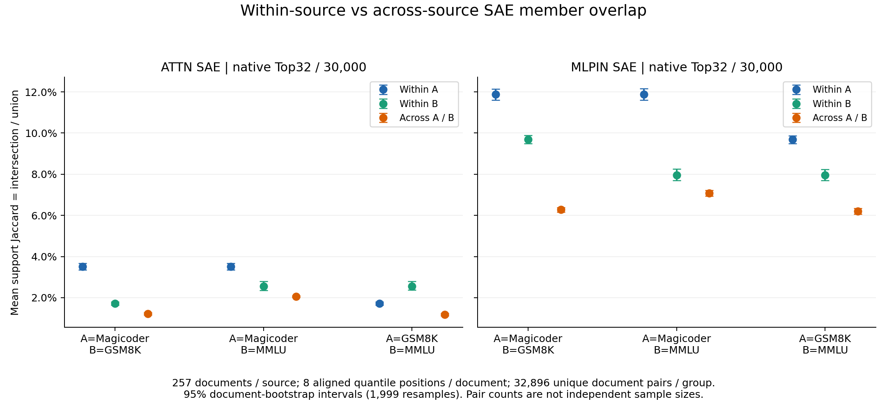
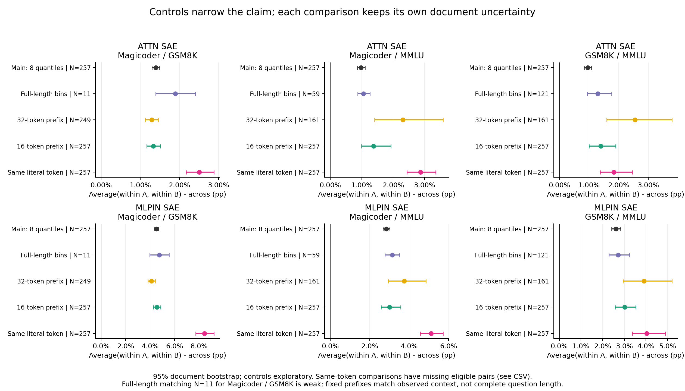

派生阅读副本；原件位置：`Projects/from-attention-to-search/main/experiments/A15/15_27_natural_language_feature_response/R17_20261102_feature_composition_v02/diagnostics/R17_D1/controlled_steps/S08_dataset_support_overlap_1104/summary_cn.md`。
[精确原始文件](../../../../../../../../../../../../sources/Projects/from-attention-to-search/main/experiments/A15/15_27_natural_language_feature_response/R17_20261102_feature_composition_v02/diagnostics/R17_D1/controlled_steps/S08_dataset_support_overlap_1104/summary_cn.md)；研究修改仍回到原件。

---

# S08：自然数据集内部的 SAE 成员是否更相似？

在本轮3个可读数据集、每组257篇问题、两套原生 SAE 的6个比较中，6/6 满足预设的“双侧内部高于跨域”判据。成立条件：ATTN_SAE:Magicoder/GSM8K; ATTN_SAE:Magicoder/MMLU; ATTN_SAE:GSM8K/MMLU; MLPIN_SAE:Magicoder/GSM8K; MLPIN_SAE:Magicoder/MMLU; MLPIN_SAE:GSM8K/MMLU。其余比较：无。这描述数据集条件下的激活成员相似性；来源、格式、题型与词面仍可能参与形成差异，不能直接归因于领域知识，也不证明功能机制。

本轮事实分析路径：行为与因素控制只检查文本长度、格式和词面，没有答案正确率；表征分析比较固定 Qwen3-0.6B 的二值激活成员；功能干预与训练均 NOT_RUN，本轮只审核采集接口和数值可信度。科研接受与问题关闭 Unknown。

| SAE | pair | A_within | B_within | cross | pooled_difference_95CI | Holm_p | both_sides |
|---|---|---|---|---|---|---|---|
| ATTN_SAE | Magicoder/GSM8K | 0.0351 | 0.0171 | 0.0122 | 0.0139 [0.0129,0.0149] | 0.006 | BOTH_WITHIN_HIGHER |
| ATTN_SAE | Magicoder/MMLU | 0.0351 | 0.0256 | 0.0206 | 0.0098 [0.0086,0.0111] | 0.006 | BOTH_WITHIN_HIGHER |
| ATTN_SAE | GSM8K/MMLU | 0.0171 | 0.0256 | 0.0118 | 0.0096 [0.0084,0.0109] | 0.006 | BOTH_WITHIN_HIGHER |
| MLPIN_SAE | Magicoder/GSM8K | 0.1187 | 0.0968 | 0.0627 | 0.0450 [0.0433,0.0468] | 0.006 | BOTH_WITHIN_HIGHER |
| MLPIN_SAE | Magicoder/MMLU | 0.1187 | 0.0796 | 0.0707 | 0.0284 [0.0268,0.0302] | 0.006 | BOTH_WITHIN_HIGHER |
| MLPIN_SAE | GSM8K/MMLU | 0.0968 | 0.0796 | 0.0620 | 0.0262 [0.0242,0.0282] | 0.006 | BOTH_WITHIN_HIGHER |

表中 A/B 顺序见 pair 列。Jaccard=两位置共同激活成员数÷两位置并集成员数；每个文档对平均8个相同分位位置。pooled difference=两侧内部均值的平均−跨域均值。每组257篇，内部与跨域各32896个不同文档对，但独立统计单位是文档。区间来自1999次文档级 bootstrap；999次整篇标签置换，6个主要合并差检验 Holm 校正。每侧差值及95%区间、实际比较数在[完整统计表](../../../../../../../../../../../../sources/Projects/from-attention-to-search/main/experiments/A15/15_27_natural_language_feature_response/R17_20261102_feature_composition_v02/diagnostics/R17_D1/controlled_steps/S08_dataset_support_overlap_1104/tables/overlap_summary.csv)，不能只用合并差替代两侧判断。

图1三个点依次为A内、B内和跨A/B，误差线是文档级95%区间；两套字典独立读图，不对齐 feature ID。所有主要配对均展示。

图2横轴是合并内部−跨域差。完整题干长度分箱后，各配对仅11、59、121篇/侧；Magicoder/GSM8K的匹配不足，区间宽不能写成无差异。固定32-token上下文各249、161、161篇/侧；固定16-token上下文全部257篇/侧。它们固定已见上下文长度，不能替代完整题干长度匹配。相同 token 对照只比较事前固定的最多3种高频 token，许多文档对没有匹配位置；其区间描述这些可比较的对，不做置换显著性判断。

数据使用 Magicoder-OSS75K 的 problem(train)、GSM8K 的 question(train)、MMLU 的 question(test)，排除答案、解答、代码 seed 和 MMLU 选项。规范化精确去重后用固定种子20261104从题干长度≥16token的候选均匀抽样，保留每篇原文和ID。读取前128token，不加指令或后缀；每篇8个正文分位位置，同时保存第16/32token。三组题干长度中位数252/56/50；代码围栏比例158/257、0/257、0/257；换行比例257/257、0/257、27/257。这些明显差异使“领域知识”的单一解释不成立。见[长度和格式图](../../../../../../../../../../../../sources/Projects/from-attention-to-search/main/experiments/A15/15_27_natural_language_feature_response/R17_20261102_feature_composition_v02/diagnostics/R17_D1/controlled_steps/S08_dataset_support_overlap_1104/figures/03_format_and_length.png)、[高频 token](../../../../../../../../../../../../sources/Projects/from-attention-to-search/main/experiments/A15/15_27_natural_language_feature_response/R17_20261102_feature_composition_v02/diagnostics/R17_D1/controlled_steps/S08_dataset_support_overlap_1104/data/top_tokens.csv)与[完整报告](detailed_cn.md)。

Numina在指定缓存与已记录搜索范围未找到；不把三组分析冒充四组结果。学长精确SFT路径当前不可读，使用可信现有缓存版本，不声称完全复现其设置。MMLU混合学科，省略选项的题干有时不独立完整；语料公开且与预训练可能重叠，未验证去污染或训练未见。仅做精确去重，近重复仍是竞争解释。不同 token 有不同因果上下文；本轮不是整篇语义向量的比较。

共同成员幅值另列[补充表](../../../../../../../../../../../../sources/Projects/from-attention-to-search/main/experiments/A15/15_27_natural_language_feature_response/R17_20261102_feature_composition_v02/diagnostics/R17_D1/controlled_steps/S08_dataset_support_overlap_1104/tables/amplitude_supplement.csv)；全向量激活规模和重构误差见[SAE质量表](../../../../../../../../../../../../sources/Projects/from-attention-to-search/main/experiments/A15/15_27_natural_language_feature_response/R17_20261102_feature_composition_v02/diagnostics/R17_D1/controlled_steps/S08_dataset_support_overlap_1104/tables/SAE_diagnostics.csv)，均不进入 Jaccard。两字典实际激活数的范围：ATTN_SAE:32–32; MLPIN_SAE:32–32，Top32的名额约束不是语义发现。

已完成采集、全部主要比较、文档不确定性、长度/格式/词面对照、幅值补充及独立集合运算复核。认识更新限于上表和对照实际覆盖的条件；下一步科学判断由研究者审核。本轮没有模型、SAE或读出训练，没有功能干预。

可见正文高频token（次数/该源可见token总数）：Magicoder: ' the' 1885/32675, ' a' 1265/32675, ' `' 778/32675, '.' 757/32675, ' and' 718/32675; GSM8K: ' ' 855/15667, '.' 723/15667, ' the' 494/15667, ',' 414/15667, '0' 405/15667; MMLU: ' the' 927/15828, ' of' 512/15828, ',' 475/15828, '.' 463/15828, ' to' 372/15828。这些是token计数，不是独立文档数。抽查原文均为英文题干；未做全面语言识别，Magicoder的lang字段指编程语言，不是自然语言标签。

认识更新：H1中“同条件文本的成员更相似”这一重叠子预测，从构造家族扩展到了三种自然题干来源。四类对照的两侧差值95%区间也都大于0；未观察到这些有限对照消除差异。它没有验证父子成员换入换出的语义规律。共同成员幅值只是补充，不构成本轮H2裁决。

均值规律不覆盖每篇文档。事后描述性检查中，MLPIN的MMLU文档相对Magicoder有57/257篇自身内部邻居均值低于跨域；Attention的GSM8K相对Magicoder有48/257篇。例子 MMLU:test:row6874：Statement 1| The softmax function is commonly used in mutliclass logistic regression. Statement 2| The temperature of a nonuniform softmax distribution affects its entropy. 其MMLU内部均值0.071092，跨Magicoder均值0.086829，差-0.015738。这是事后展示的反例，不重新筛选数据或变更主要检验，也不能仅凭词语为其指定feature语义。见[逐文档反例图](../../../../../../../../../../../../sources/Projects/from-attention-to-search/main/experiments/A15/15_27_natural_language_feature_response/R17_20261102_feature_composition_v02/diagnostics/R17_D1/controlled_steps/S08_dataset_support_overlap_1104/figures/05_document_counterexamples.png)与[tables/per_document_counts.csv](../../../../../../../../../../../../sources/Projects/from-attention-to-search/main/experiments/A15/15_27_natural_language_feature_response/R17_20261102_feature_composition_v02/diagnostics/R17_D1/controlled_steps/S08_dataset_support_overlap_1104/tables/per_document_counts.csv)。

相同token后MLPIN的MMLU相对Magicoder这一侧差仅0.005388，95%区间[0.000601,0.011027]，比主分析0.008862更接近边界；不能将有限词面控制写成彻底排除词面。控制使用不同token分布；长度/32token控制还改变文档子集，不能将其相对主分析的数值变化解释为某个因素的因果贡献。
