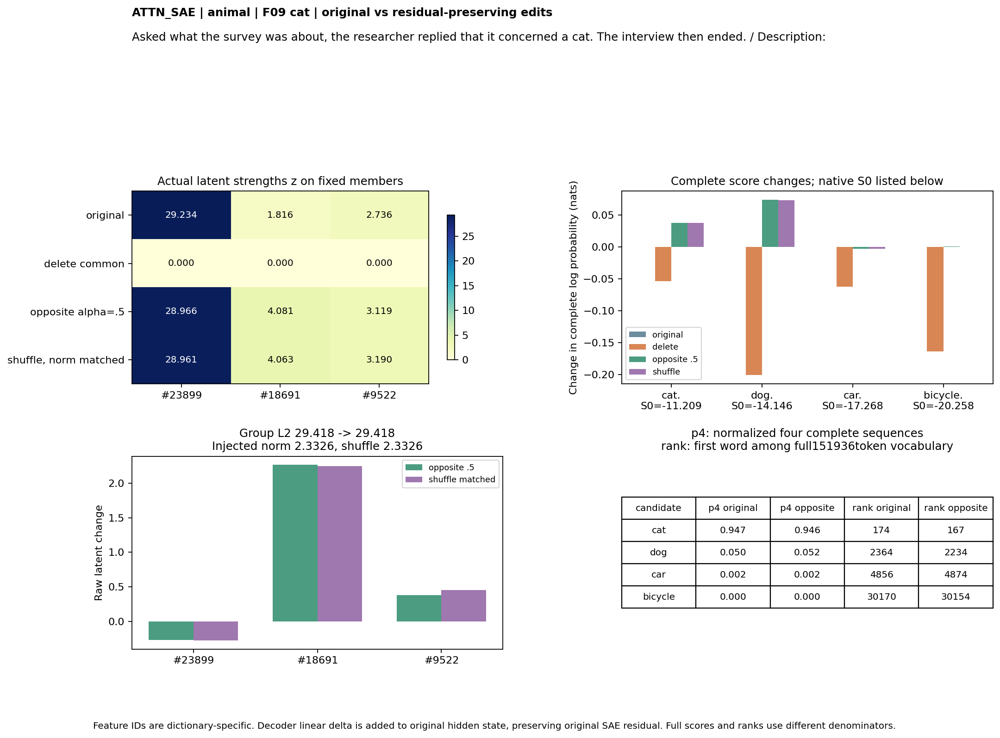
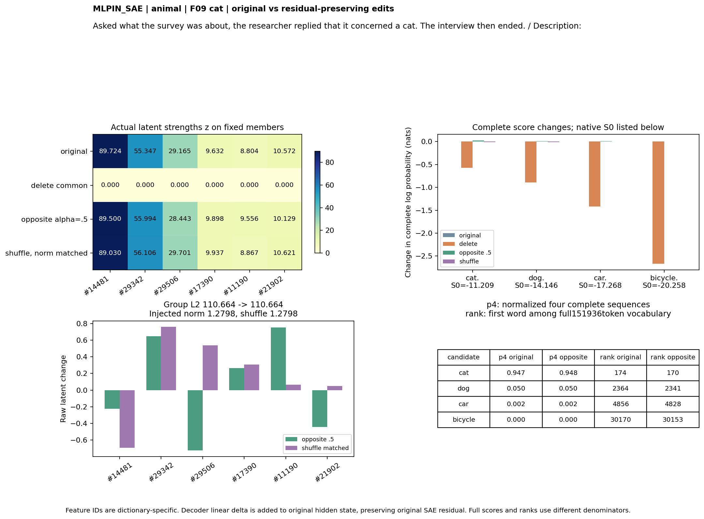
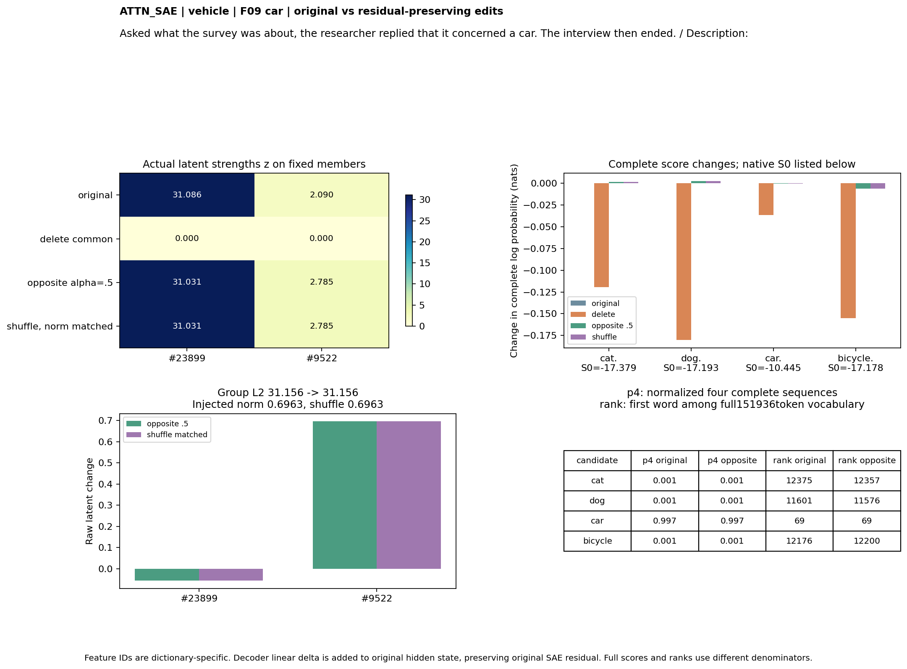
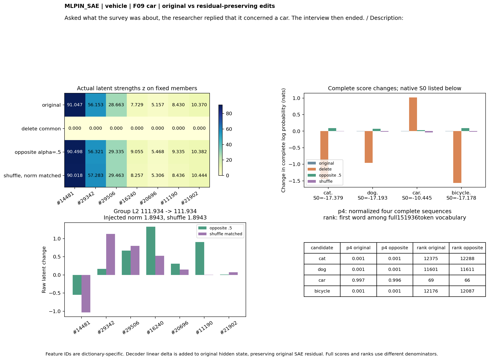
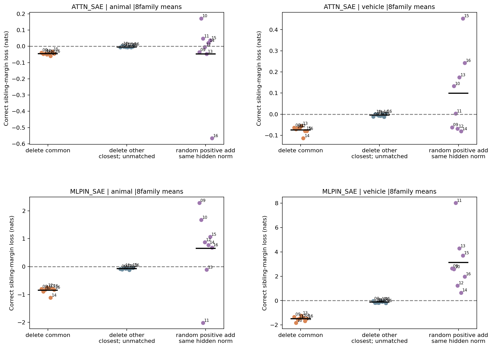
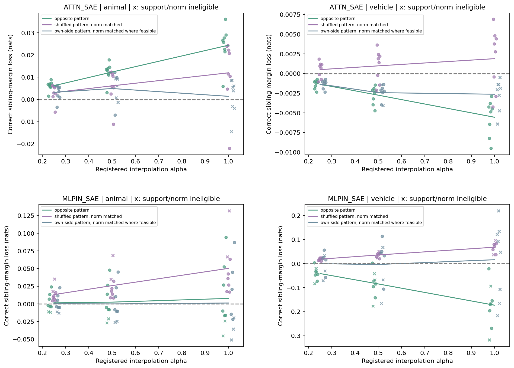

派生阅读副本；原件位置：`Projects/from-attention-to-search/main/experiments/A15/15_27_natural_language_feature_response/R17_20261102_feature_composition_v02/diagnostics/R17_D1/controlled_steps/S07_feature_interventions_1104/detailed_cn.md`。
[精确原始文件](../../../../../../../../../../../../sources/Projects/from-attention-to-search/main/experiments/A15/15_27_natural_language_feature_response/R17_20261102_feature_composition_v02/diagnostics/R17_D1/controlled_steps/S07_feature_interventions_1104/detailed_cn.md)；研究修改仍回到原件。

---

# Detailed：残差保留的SAE成员组合干预

本补充研究的是前向临时干预后的输出作用。主S06已先完成并保存；本次不覆盖主实验候选、数据、结果和3.96MB原包。行为与控制、表征改变量、输出功能与数值质量三条路径分开；以下结论是AI有边界的认识更新，科学接受和机制判断仍由研究者保留Unknown。

## 研究问题、假设与竞争解释

问题：改变发现组合后，原模型对同样候选的解码偏好是否出现跨留出家族复现、超出匹配参照的变化？预期分开为共同组删除和反侧强弱重组；删除不预设所有共同成员都是必需，强弱反侧预期削弱原正确候选。竞争解释是任意扰动范数、活跃删除数不匹配、泛化输出分布变化、超出发现范围、未保持共同支持和显式词复述。主S06的观察结果已知，故这是“观察已见、干预未见”的预登记补充，不称完全未见语义确认。

## 来源、候选和实际输入

在主实验完整结果、609项核验及3.96MB包保存后才固定S07。所有候选只来自原64条显式发现响应：共同组=原H2列表；非空换入／换出列表=原排名前3个。没有按主留出成功重选。共16个非空组，其中11个有发现频率／正幅值合格的逐坐标匹配名单，5个缺匹配；所有共同组在这5个中。每域／每字典各自IDs，不求一致。无非空候选的组不生造。

沿用64条显式留出和32条属性细类原文，未调整提示结构。每模板8类别或属性4细类；父类／负类仅偏好无正确答案。每份文本仍以Description:冒号ID25结束。主解释以显式16细类/域为主；跨域和父／负类检验一般扰动，属性是探索。每个SAE是同一个冻结1024宽、30000/ReLU-Top32模型资产，实际hook及参数哈希见frozen_plan。

## 干预计算与原始残差

decoder(hat)=b+Wz。定义原残差e=h−b−Wz。编辑得到z新后，注入h新=h+W(z新−z)=b+Wz新+e。W列不重新归一化，偏置不重复加；从原hidden出发，保留原残差。Attention输出在block27.self_attn.o_proj残差相加前；MLP输入在block27.mlp的实际输入、残差和post_attention_layernorm之后。后者不得再归一化才进MLP。权重全部冻结。原始h、重构误差、decoder列范数、实际注入向量及旧新坐标均保留。

删除将组内z设0，其余不变。强弱操作先求原组r=L2(v)，w=(1−alpha)v/r+alpha t目标，再v新=r*w/L2(w)。t是8发现文本逐条归一化向量平均后再单位化。alpha固定0/.25/.5/1。原r=0时不救样本；若原某坐标为零而目标为正，编辑会招入成员，单列身份改变。没有重新执行TopK来把改变量截掉；这里控制的是目标潜在坐标，不预设再编码器输出完全等于它。

## 对照质量：同数量不等于同扰动

| SAE | 大类 | 对照 | 条件数 | 发现频率/强度合格 | 同成员支持保持 | 实际范数比合格 |
| --- | --- | --- | --- | --- | --- | --- |
| ATTN_SAE | animal | delete_matched | 80 | 64 | 54 | 1 |
| ATTN_SAE | animal | norm_random_add | 80 | 80 | 80 | 39 |
| ATTN_SAE | animal | strength_shuffle | 16 | 16 | 16 | 16 |
| ATTN_SAE | animal | strength_own | 16 | 16 | 16 | 11 |
| ATTN_SAE | animal | strength_other | 16 | 0 | 4 | 12 |
| ATTN_SAE | vehicle | delete_matched | 48 | 32 | 21 | 2 |
| ATTN_SAE | vehicle | norm_random_add | 48 | 48 | 48 | 35 |
| ATTN_SAE | vehicle | strength_shuffle | 16 | 16 | 16 | 16 |
| ATTN_SAE | vehicle | strength_own | 16 | 16 | 16 | 13 |
| ATTN_SAE | vehicle | strength_other | 16 | 0 | 12 | 10 |
| MLPIN_SAE | animal | delete_matched | 64 | 48 | 23 | 4 |
| MLPIN_SAE | animal | norm_random_add | 64 | 64 | 64 | 52 |
| MLPIN_SAE | animal | strength_shuffle | 16 | 16 | 13 | 16 |
| MLPIN_SAE | animal | strength_own | 16 | 16 | 13 | 16 |
| MLPIN_SAE | animal | strength_other | 16 | 0 | 5 | 15 |
| MLPIN_SAE | vehicle | delete_matched | 64 | 32 | 26 | 1 |
| MLPIN_SAE | vehicle | norm_random_add | 64 | 64 | 64 | 43 |
| MLPIN_SAE | vehicle | strength_shuffle | 16 | 16 | 13 | 16 |
| MLPIN_SAE | vehicle | strength_own | 16 | 16 | 13 | 16 |
| MLPIN_SAE | vehicle | strength_other | 16 | 0 | 0 | 13 |

固定其他成员按发现频率计数±2/64、正激活均值比[.5,2]逐坐标匹配。找不到合格成员就记录最近但不合格，而不是放宽定义。实际删除活跃数和候选不同时也不能通过主比较。随机范数参照使用相同数量的其他活跃成员、正组合系数，缩放使表征扰动范数相同；这是正向添加，不把它称作同方向删除。两种参照分别报告。

强弱主对照在相同组中循环打乱发现典型分量；同侧典型及其他匹配成员是额外参照。按65点beta网格、20次二分匹配decoder空间范数，只看表征不看输出。每条控制范数比和是否在.9–1.1都保存；匹配失败不丢弃数据，但失去特异主判断资格。单个成员定位也已运行，只改发现典型差最大的那个成员；联合比单个强不等于已证明非线性交互。

## 完整输出计分、词语排名和精确末层计算

四候选cat./dog./car./bicycle.均2token，词和句号完整条件log概率求和，FP32 logsoftmax后FP64相加，无长度／先验校正。全词表rank=1+首词logit严格更高的词数；p_vocab以输出151936词为分母。p4以4完整序列分数softmax为分母。top20未列质量另存，不谎称只显示top20就是完整全词表分布。完整四候选分布、熵/KL、逐候选排名及top20对所有条件均保留。

实际源代码中，最后block27的Attention输出之后只剩逐位置MLP、RMSNorm、head。对冒号的修改不能再流到下一个candidate位置的注意力K/V；K/V已由未改的block输入形成，之后没有另一层注意力。因此句号项保持不变。Attention干预重算残差加法→RMSNorm→MLP→残差；MLP输入干预直接改该归一化输入→MLP→原残差；随后统一final norm/head。预选F09猫／汽车、两接口、identity/delete/alpha.5的12次完整hook前向校验先于批量效应，最大完整分数差6.44e-6。每条原生基线也与主实验完全相等。

## 主要判断和全部分支

| SAE | 大类 | 干预 | 原始边际损失 | 相对对照差[95%区间] | 合格家族/8 | Holm p | 裁决 |
| --- | --- | --- | --- | --- | --- | --- | --- |
| ATTN_SAE | animal | strength | 0.01236 | 0.00623 [0.00135, 0.01340] | 8 | 0.03125 | LOCAL_DIRECTION_SPECIFIC_EFFECT |
| MLPIN_SAE | animal | strength | 0.00241 | -0.00597 [-0.01571, 0.00405] | 6 | 1.00000 | NOT_SUPPORTED_BY_PRIMARY |
| ATTN_SAE | animal | delete | -0.04532 | NA [NA, NA] | 0 | 1.00000 | INSUFFICIENT_MATCH_OR_SUPPORT |
| ATTN_SAE | vehicle | delete | -0.07467 | NA [NA, NA] | 0 | 1.00000 | INSUFFICIENT_MATCH_OR_SUPPORT |
| ATTN_SAE | vehicle | strength | -0.00276 | -0.00373 [-0.00541, -0.00197] | 8 | 1.00000 | NOT_SUPPORTED_BY_PRIMARY |
| MLPIN_SAE | animal | delete | -0.84929 | NA [NA, NA] | 0 | 1.00000 | INSUFFICIENT_MATCH_OR_SUPPORT |
| MLPIN_SAE | vehicle | delete | -1.49317 | NA [NA, NA] | 0 | 1.00000 | INSUFFICIENT_MATCH_OR_SUPPORT |
| MLPIN_SAE | vehicle | strength | -0.08476 | -0.11220 [-0.14623, -0.06980] | 5 | 1.00000 | INSUFFICIENT_MATCH_OR_SUPPORT |

主8项做Holm；家族均值由两子类组成，至少6个合格家族，4096bootstrap百分位区间和精确家族符号置换。不将14976条件或多个token当作独立N。删除同频强度匹配不足，所以主特异判定都是不足；这不抹去实际输出变化。所有替换组、单成员、剂量、属性和跨域是次分析，不救回主判断。

## 不同类别的结果与剩余解释

Attention动物alpha.5有小的同成员方向差，8家族一致，支持受限候选分数对当前方向的局部作用；其余同成员参照和跨域仍约束语义定向。Attention交通工具的反侧平均变化与预期相反；MLP动物未超过打乱，MLP交通工具有效样本不足。不同结果可能来自类别、字典／重构、典型模式代表性及样本能力，尚未以功效匹配唯一归因为不同概念组织。

| SAE | 干预组 | 操作 | 文本组 | 条件数 | 四候选平均绝对分数变化 | 全词表KL |
| --- | --- | --- | --- | --- | --- | --- |
| ATTN_SAE | animal | delete | target | 16 | 0.13748 | 0.00285 |
| ATTN_SAE | animal | delete | offdomain | 16 | 0.11431 | 0.00342 |
| ATTN_SAE | animal | delete | parent_negative | 32 | 0.12055 | 0.00300 |
| ATTN_SAE | animal | strength | target | 16 | 0.01353 | 0.00002 |
| ATTN_SAE | animal | strength | offdomain | 32 | 0.04468 | 0.00004 |
| ATTN_SAE | animal | strength | parent_negative | 64 | 0.03559 | 0.00003 |
| ATTN_SAE | vehicle | delete | target | 16 | 0.11431 | 0.00342 |
| ATTN_SAE | vehicle | delete | offdomain | 16 | 0.09510 | 0.00275 |
| ATTN_SAE | vehicle | delete | parent_negative | 32 | 0.11628 | 0.00300 |
| ATTN_SAE | vehicle | strength | target | 16 | 0.00259 | 0.00001 |
| ATTN_SAE | vehicle | strength | offdomain | 32 | 0.00150 | 0.00000 |
| ATTN_SAE | vehicle | strength | parent_negative | 64 | 0.00191 | 0.00000 |
| MLPIN_SAE | animal | delete | target | 16 | 1.28979 | 0.63604 |
| MLPIN_SAE | animal | delete | offdomain | 16 | 1.27909 | 0.67765 |
| MLPIN_SAE | animal | delete | parent_negative | 32 | 1.55395 | 0.68583 |
| MLPIN_SAE | animal | strength | target | 16 | 0.07662 | 0.00345 |
| MLPIN_SAE | animal | strength | offdomain | 32 | 0.06524 | 0.00233 |
| MLPIN_SAE | animal | strength | parent_negative | 64 | 0.08892 | 0.00400 |
| MLPIN_SAE | vehicle | delete | target | 16 | 1.12103 | 0.67686 |
| MLPIN_SAE | vehicle | delete | offdomain | 16 | 1.22881 | 0.62803 |
| MLPIN_SAE | vehicle | delete | parent_negative | 32 | 1.39488 | 0.68460 |
| MLPIN_SAE | vehicle | strength | target | 16 | 0.24639 | 0.00953 |
| MLPIN_SAE | vehicle | strength | offdomain | 32 | 0.11173 | 0.00518 |
| MLPIN_SAE | vehicle | strength | parent_negative | 64 | 0.14235 | 0.00754 |

无关域效应没有按范数独立匹配，所以此表只显示广泛敏感性，不能单凭大小比较得出类别专属性。动物Attention强弱目标文本四候选平均绝对变化约.01353，其他域约.04468；因此局部相对对照差不等于只动动物语义。MLP共同删除目标及无关文本的KL均约.63–.68，原大共同组存在广泛输出作用。主要候选仍16/16正确，不能说分类能力被破坏或概念被转换。

## 具体例子、失败和图

[完整F09猫／汽车、两SAE、原新z与全部候选分数、top词、反例](casebook_cn.md)给出每个值与原文的对应。F09猫cat首词rank变好但相对dog略弱，说明排名和判别边际不是同一量。

每个家族散点保留两子类平均效应；正值才表示正确边际损失，反向点不删除。删除图中的最近其他名单明确为不合格；等范数正添加也明确命名。图面已检查，来源表在figure_provenance.json。

## 数值、保真与追加诊断

14976条件的实际注入向量与decoder线性差映射最大坐标舍入3.81e-06；原残差代数闭合最大误差3.55e-14。离线完整候选概率复算误差6.15e-8，固定组范数误差2.85e-14。原始FP32总概率质量有舍入，KL最小约−1.66e-6，保留原值不剪零；它远小于主分数差。复算曾因用float64读取FP32 norm／剩余质量而失败，已改为重放原精度运算，未放宽1e-10/1e-12阈值、未改任何原响应或分析标准。amendments保留该工程记录。

事后测量诊断重新编码固定F09 edited hidden：删除目标在一些例中确实为0，而重组目标与再编码数值并不完全一致。例如Attention猫反侧目标[28.9664,4.0809,3.1192]，再编码约[28.9919,3.7747,3.0773]。这限制“精确控制了自然feature状态”的说法，但不改变原已验证的decoder方向注入。该表未用于筛选、原阈值或主裁决。

## 边界、认识更新与下一判断

观察到的功能作用是这些SAE decoder方向在给定模型、最后层、冒号位置和强度下改变候选解码分数。稳定响应、必要性、特异作用和真实概念转换是不同层次。本轮支持一个很小的Attention动物方向差；不支持把所有观察组合当作语义单元或真实router分工。大共同组删除的普遍提升与无关词变化，使“共同响应越稳定就越必要”的直觉不再可直接沿用。科学接受、机制判断、关闭和下一研究者决策Unknown。

AI建议：下一项决策应聚焦该小方向差能否在词面和位置受控、局部幅度和充分匹配下复现。这里不自动启动后续。

[复算／索引](reproduce.md) · [冻结协议](protocol.md) · [数值检查](../../../../../../../../../../../../sources/Projects/from-attention-to-search/main/experiments/A15/15_27_natural_language_feature_response/R17_20261102_feature_composition_v02/diagnostics/R17_D1/controlled_steps/S07_feature_interventions_1104/evidence/verification.json)

## 追加控制几何审核（事后测量诊断）

交通工具Attention固定共同组只有2个正成员，固定L2范数后只有1个角度自由度。实际alpha.5目标／打乱注入向量的余弦既有接近+1也有接近−1；F09汽车中两改动几乎相同。因此原检验只识别这些实际选择的有限方向对比，不证明对任意打乱都特异。动物Attention的16个逐文本余弦中位数约.8164，部分也近乎同向。两大类的不同结果还可能来自列表维数／控制能力，不应唯一归因类别组织。完整逐文本数据与范围见results/control_delta_geometry*.csv。本诊断未新增干预、筛选或改变主判定，也不救回未支持结果。
