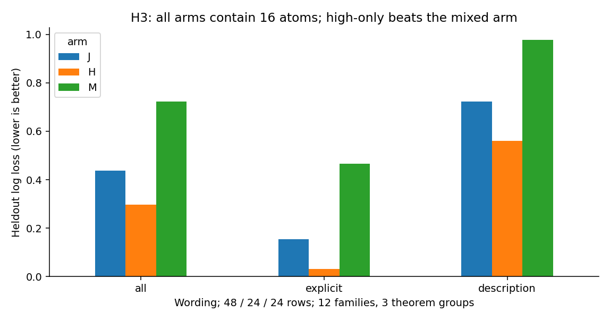
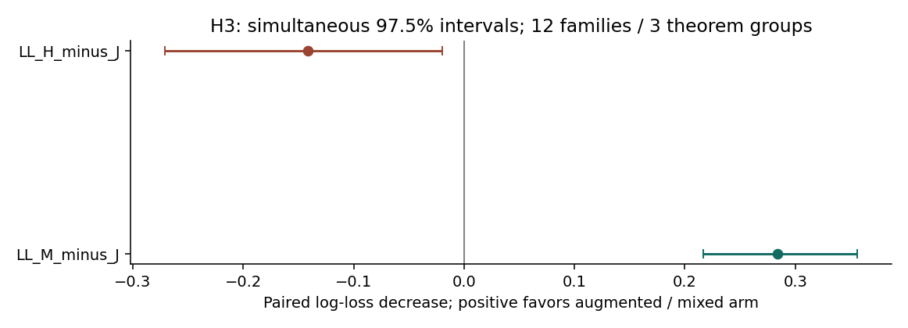
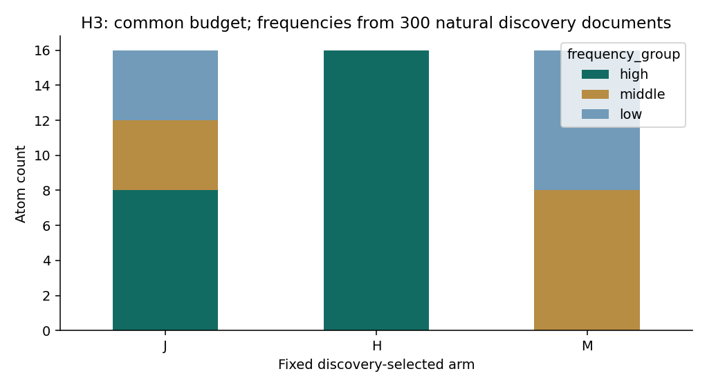

派生阅读副本；原件位置：`Projects/from-attention-to-search/main/experiments/A15/15_27_natural_language_feature_response/R17_20261102_feature_composition_v02/H3/summary_cn.md`。
[精确原始文件](../../../../../../../../../sources/Projects/from-attention-to-search/main/experiments/A15/15_27_natural_language_feature_response/R17_20261102_feature_composition_v02/H3/summary_cn.md)；研究修改仍回到原件。

---

# H3：等预算跨频率组合

执行分支：`COMPLETED_NOT_SUPPORTED`；科学接受及下一研究决策：`Unknown`。修订版留出已暴露。

## 1. 一句话更新

本轮目标和候选规则下，高频组优于跨频率组；频率混合本身没有提供双比较优势。

## 2. 观察

300自然发现文档、38400位置定义频率。可用低／中／高4059／4051／4067成员，边界127和579次，同值不拆。K=16：J=8高4中4低；H=16高；M=8中8低。留出J0.438300、H0.296957、M0.722162。H−J=−0.141343，97.5%[−0.270792,−0.019888]；M−J=+0.283862，[0.216359,0.355903]。

## 3. 完整性

三臂预算相同、发现选择规则及正则网格相同。20个J匹配随机种子完成。归一化、全字典活跃数／范数、原z、纯中频、纯低频、词面敏感性完成。J归一化损失0.415564、H0.341984、M0.726048，排序一致。频率只来自自然发现，不由语义面板计数。

## 4. 竞争解释

高频原子有较强信号的解释变强。中低频可能覆盖不足、信号弱或不适合当前目标。等数量不等于等信息／最优子集；当前选取规则不能代表所有潜在组合。

## 5. 结论与边界

声明的正向双优势假设在当前设计下不支持。J优于M但差于H，不能只报道前者。不能推断所有长尾成员无用或自然稀有概念无需中低频。

## 6. 假设更新

AI修正倾向：放弃“跨频率天然更好”的普遍预期，改为“哪些具体目标在控制高频信号后仍需要某些中低频成员的互补”。

## 7. 下一决策

AI建议只有出现清楚的目标级互补证据才扩大跨频率搜索；暂不据此修改训练或路由。研究者下一决策Unknown。

## 图与原始证据

H3: all arms contain 16 atoms; high-only beats the mixed arm

H3: simultaneous 97.5% intervals; 12 families / 3 theorem groups

J contains8 high+4 middle+4 low; H16 high; M8 middle+8 low.

[指标原表](../../../../../../../../../sources/Projects/from-attention-to-search/main/experiments/A15/15_27_natural_language_feature_response/R17_20261102_feature_composition_v02/tables/H3_readout_metrics.csv) · [全部响应、预测、调参与失败](../../../../../../../../../UNAVAILABLE.md) · [方法和修订](../detailed_cn.md) · [具体案例](../casebook_cn.md)
