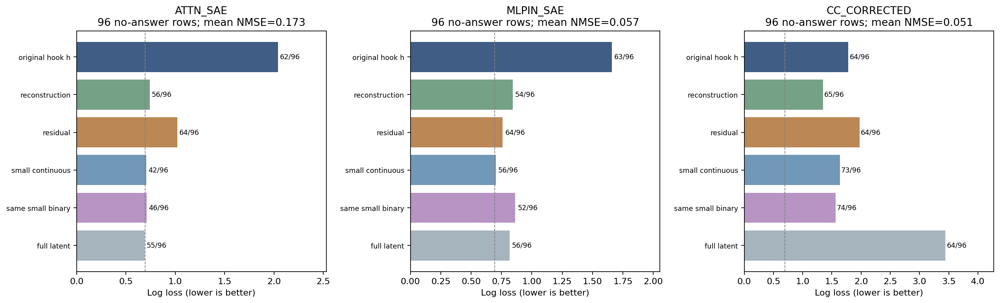

派生阅读副本；原件位置：`Projects/from-attention-to-search/main/experiments/A15/15_27_natural_language_feature_response/R17_20261102_feature_composition_v02/diagnostics/R17_D1/summary_cn.md`。
[精确原始文件](../../../../../../../../../../sources/Projects/from-attention-to-search/main/experiments/A15/15_27_natural_language_feature_response/R17_20261102_feature_composition_v02/diagnostics/R17_D1/summary_cn.md)；研究修改仍回到原件。

---

# R17_D1：Feature组合与自然语言关系，双SAE四假设重测

[English](summary.md) · [完整方法与审计](detailed_cn.md) · [逐例全文、token和响应](casebook_cn.md) · [核验](verification.md)

本轮按三个分析路径阅读：①行为和文本因素控制：同一数学证书在答案提示／改写／外壳变化时怎样改变预测；②表示和位置组织：两处真实hook及各自字典是否保留可读信号；③功能干预和质量：本轮没有实施因果干预，完成的是冻结前向、轻量读出、数值和标注质量核验。

## 目的

弄清粗概念到细概念的成员组织是否来自新增成员、相对强弱、跨频率互补或罕见搭配。此次完成两处SAE各H1–H4，以及独立CrossCoder参照。认识更新是：**粗类别共同响应可以复用，但从这种复用推到稳定的细概念组织，需要跨答案词和读出语境的证据；本轮尚未完成这座桥。**

## 假设

H1问新增成员是否在共同成员之外提供细分信息；H2问固定成员身份和总幅值后比例是否有贡献；H3要求等预算混合组同时优于纯高频和纯中低频；H4把搭配少见、内容明确和跨语境复现分开，额外辨别作用再对照同成员加性模型。

两处位置均为第28块（零基27）：ATTN是attention `o_proj`输出、尚未残差相加；MLPIN是残差相加并经RMSNorm后的实际MLP输入。均使用自己的30000成员Top32 SAE。CrossCoder联合14层、16384成员，单列block27重建目标。不同编号不作对应，结果也不能识别纯位置因果差异。

## 实验

旧384条只用于训练、开发和错误定位。全部候选、频率边界和可选分支先冻结，再读取新288主面板（192细标签）及48单因素附表。新细标签含24家族、12定理组、2等义改写、答案有／无，每种答案条件96条。自然频率分别从相同600文档的76800位置计算；只用300发现文档38400位置定界。FP32主精度预先固定；24旧例定向检查BF16。

实际5090双卡作业`pt-viic7g4p`于2026-11-03 02:30:02 UTC完成；没有更新底模／SAE／CC参数。CPU只拟合L2线性逻辑读出。原R17文件哈希保持。旧48、修正后旧48、新192的三列对照在每条路线中，避免把样本变化叫作修正效应。

## 分析

### 1. 新增成员收益和比例收益不能脱离答案条件

表中C是8个共同候选，C_union_F是与8个细类候选F合并后的16个坐标。b_r只使用激活身份b和总幅值r；q_b_r再加入归一化相对强度q。H、M、J分别为高频、中低频、跨频率的等16成员集合。每套字典各自选择这些坐标，不能把相同列名理解为相同原子。

无答案新文本的关键原始数据如下。LL为log loss（越低越好）；正确数只描述分类，不能替代主指标。随机均猜的LL为0.693147。

| site         | H   | arm       |       LL | correct   |
|:-------------|:----|:----------|---------:|:----------|
| ATTN_SAE     | H1  | C         | 0.706420 | 44/96     |
| ATTN_SAE     | H1  | C_union_F | 0.706364 | 42/96     |
| ATTN_SAE     | H2  | b_r       | 0.925955 | 45/96     |
| ATTN_SAE     | H2  | q_b_r     | 1.210693 | 45/96     |
| ATTN_SAE     | H3  | H         | 0.733004 | 48/96     |
| ATTN_SAE     | H3  | M         | 0.984849 | 49/96     |
| ATTN_SAE     | H3  | J         | 0.734410 | 46/96     |
| MLPIN_SAE    | H1  | C         | 0.695204 | 50/96     |
| MLPIN_SAE    | H1  | C_union_F | 0.703452 | 56/96     |
| MLPIN_SAE    | H2  | b_r       | 0.693579 | 50/96     |
| MLPIN_SAE    | H2  | q_b_r     | 0.705954 | 49/96     |
| MLPIN_SAE    | H3  | H         | 0.757480 | 52/96     |
| MLPIN_SAE    | H3  | M         | 0.710831 | 57/96     |
| MLPIN_SAE    | H3  | J         | 0.709414 | 54/96     |
| CC_CORRECTED | H1  | C         | 0.719244 | 49/96     |
| CC_CORRECTED | H1  | C_union_F | 1.638051 | 73/96     |
| CC_CORRECTED | H2  | b_r       | 0.703962 | 47/96     |
| CC_CORRECTED | H2  | q_b_r     | 0.720911 | 51/96     |
| CC_CORRECTED | H3  | H         | 1.562467 | 66/96     |
| CC_CORRECTED | H3  | M         | 0.698096 | 51/96     |
| CC_CORRECTED | H3  | J         | 0.569979 | 75/96     |

H1在混合192条上的共同→联合收益为ATTN 0.07205、MLPIN 0.14041；但去答案后变为0.00006和−0.00825。虽然两处都优于匹配随机新增，**没有同时优于共同集合**。共同候选相对非矩阵对照的响应在三种矩阵条件下都为正；真实开关变化也已测到：无答案96条×8新增候选的768次比较中，ATTN 67次从零出现、19次已有激活；MLPIN 42次从零出现、286次已有激活。出现与增强已分开记账，不能把所有连续值差都叫新增。

H2无答案收益分别为−0.28474、−0.01238；MLPIN定理组区间[−0.01792,−0.00609]。两处同支持子集也为负：29对−0.31529、31对−0.01308。MLPIN在混合条件的小正收益不能提升为跨措辞稳定的比例编码。

### 2. H3两处均未完成双优势；H4卡在实测门槛

ATTN混合组在192条上反而比纯高频差0.03819；MLPIN虽优于纯中低频，优于纯高频的定理组区间跨零。无答案子集也各自未完成双优势。CrossCoder混合组在总体192条有双优势，但无答案时相对纯中低频区间跨零；它是独立参照，不能代替两个SAE的结论。

H4 ATTN验证配置11/19200位置、6文档，低于最低30位置／10文档；MLPIN为75/19200、37文档，但稀有率上界0.005156略超过0.005。两处配置与加性模型比较均完成，匹配配置的20次对照尝试均未过冻结池门槛，保留失败。旧CC的10配置和208自然配对保留；FP32校正CC另有10配置、228对。

文本规则控制从9/20修至20/20，所有适用盲前缀已重标；这不是总体召回的估计。旧49条、两SAE6／40条由本处理agent逐条阅读，未发现可明确的细标签。600篇完整源文档600/600 SHA匹配，自动规则也无明确细标签。最多10万源行的一次有界检索补出48个自然文档前缀，只有2可逆、0奇异，仍不足每类10篇。**H4的内容对应和跨语境复现无法裁定；不能把未知当阴性，不能把零检测叫作语义不存在。**

### 3. 我们已定位到读出语境和小集合／字典保留断点

原生两候选完整序列评分，在无答案96条上续写73/96，问答50/96；问答甚至未通过“直接告诉答案”的可逆控制。序列得分受外壳和候选先验影响，不能据此说模型不会数学。

把观测改到固定问答前缀末尾，并仅用原旧训练／开发拟合，得到：

| site         | representation   |   N |       LL |   correct |
|:-------------|:-----------------|----:|---------:|----------:|
| ATTN_SAE     | h                |  96 | 0.507074 |        79 |
| ATTN_SAE     | reconstruction   |  96 | 0.654091 |        60 |
| ATTN_SAE     | residual         |  96 | 0.501927 |        73 |
| ATTN_SAE     | selected_union   |  96 | 0.746670 |        48 |
| CC_CORRECTED | h                |  96 | 0.504878 |        76 |
| CC_CORRECTED | reconstruction   |  96 | 0.511335 |        70 |
| CC_CORRECTED | residual         |  96 | 0.850660 |        75 |
| CC_CORRECTED | selected_union   |  96 | 0.489588 |        74 |
| MLPIN_SAE    | h                |  96 | 0.520332 |        76 |
| MLPIN_SAE    | reconstruction   |  96 | 0.744264 |        59 |
| MLPIN_SAE    | residual         |  96 | 0.732017 |        73 |
| MLPIN_SAE    | selected_union   |  96 | 0.679760 |        54 |

两处原表示LL约0.51／0.52、79／76正确，而相应SAE重建较弱，冻结小集合更弱。这同时改变了可见上下文与观测位置，**不是位置单因素因果实验**。它削弱“整个表示没有信号”的解释，增强读出语境、字典保留和小集合选择的解释；仍不能区分所有非线性或迁移因素。描述专用K16/32/64分支已经按旧数据门槛实际执行，未出现足以改判上述主结论的稳定改善。

两位置用同一重采样索引直接作效应差检验。例如无答案H2差为0.27236、校正定理组区间[−0.13304,0.60590]，不足以判位置不同；H3“中低频减混合”差为−0.24902、区间[−0.40718,−0.10161]，是当前方案效应差，仍混有字典训练和hook差异。

## 结论

| 原命题 | 本轮AI判断 | 真正多确定的内容 |
|---|---|---|
| H1 | 证据不足；共同响应与真实成员变化可保留 | 粗响应复用不等于新增成员提供稳定细分信息；收益主要依赖答案条件 |
| H2 | ATTN总体正增量被反对；MLPIN总体小正但无答案反向，稳定命题不支持 | 成员比例并非跨答案条件通用的细化器 |
| H3 | 两SAE均不支持双等预算优势 | 频率混合可赢单一对照，尚不能叫互补 |
| H4 | 支持／稀有界和内容覆盖不足；不是机制反证 | 罕见搭配与罕见细概念之间的语义桥仍未建立，断点已有计数定位 |

**AI假设修正倾向**：保留共同响应的较弱观察，把细化命题收紧到“相同数学对象、无答案词、跨改写和定理仍有效”；H3保留双优势判据，H4保留内容和覆盖门槛。原四正命题没有被偷偷改成诊断性命题。

**唯一下一决策，交由研究者**：是否优先研究“同一无答案任务在问答语境下原表示可读，而当前字典／小集合较弱”的保留与选择断点，再决定是否追求组合机制。本轮不启动后续实验，也不替研究者关闭问题。强度校准、非线性信息、有限定理覆盖和训练语料重叠仍是竞争解释。

[修正台账](corrections_cn.md)逐项列原问题、影响H、实际改动、重算结果。所有T1/S1/P1/R1/L1已生效；旧版结果保留。科学接受、机制归因和问题关闭仍为Unknown；此处AI判定用于辅助阅读和决策。

- ATTN_SAE：[H1](../../../../../../../../../../UNAVAILABLE.md) · [H2](../../../../../../../../../../UNAVAILABLE.md) · [H3](ATTN_SAE/H3/conclusion_update_cn.md) · [H4](../../../../../../../../../../UNAVAILABLE.md)
- MLPIN_SAE：[H1](../../../../../../../../../../UNAVAILABLE.md) · [H2](../../../../../../../../../../UNAVAILABLE.md) · [H3](MLPIN_SAE/H3/conclusion_update_cn.md) · [H4](../../../../../../../../../../UNAVAILABLE.md)
- CC_CORRECTED：[H1](../../../../../../../../../../UNAVAILABLE.md) · [H2](../../../../../../../../../../UNAVAILABLE.md) · [H3](CC_CORRECTED/H3/conclusion_update_cn.md) · [H4](../../../../../../../../../../UNAVAILABLE.md)

图3读法：条长是无答案96条的log loss，条边是正确数；虚线为均猜。不同hook分别重建，CC单列。重建误差小不等于任务信息被完整保留，分类率较高也可能因少数极高置信错误而损失较差。其余四图和完整读法见[Detailed](detailed_cn.md)。

### 最终断点核对：有响应、有效对照与输出语境

H4的原始配置事件计数进一步定位了问题。MLPIN主配置11234强+47强在旧发现、开发、旧诊断和新细标签中均为0次；它的20个随机配置又与主配置在面板上有完全相同的指示值，因此全部IDENTICAL_INDICATOR_FAILED。ATTN没有合格距离匹配池，20次均MATCH_FAILED；新无答案中主配置只在可逆48条的2条、奇异48条的2条出现。这里分别卡在当前配置的内容响应、可区分的对照，以及自然语料目标覆盖，不能把0增量解释为没有组合机制。没有因此重选配置。

描述专用K曲线并非全部毫无变化。ATTN K16/32/64无答案LL为0.6840/0.6716/0.6854，K32比原联合0.7064更好、58/96正确，但其相对匹配随机收益0.02203、定理组同时区间[−0.00539,0.04949]仍不足。ATTN K64随机匹配0/20成功，故没有匹配增量估计；K16/32各20/20。MLPIN三个K均20/20，LL0.8213/0.8245/0.7433，未优于原联合0.7034。有限选择可以改变结果，尚未给稳定或单调的结构结论。

问答位置诊断中的“无答案”指正文未直接给出正确答案。追加问句同时包含invertible和singular两个选项词，但不揭示哪个正确；它不是“整个可见前缀不含选项词”的重现。这进一步限制了跨语境迁移的解释。

[H4逐条件事件数](../../../../../../../../../../sources/Projects/from-attention-to-search/main/experiments/A15/15_27_natural_language_feature_response/R17_20261102_feature_composition_v02/diagnostics/R17_D1/tables/H4_semantic_panel_event_counts.csv) · [K匹配成功数](../../../../../../../../../../sources/Projects/from-attention-to-search/main/experiments/A15/15_27_natural_language_feature_response/R17_20261102_feature_composition_v02/diagnostics/R17_D1/tables/optional_K_matching_status.csv) · [K条件效应](../../../../../../../../../../sources/Projects/from-attention-to-search/main/experiments/A15/15_27_natural_language_feature_response/R17_20261102_feature_composition_v02/diagnostics/R17_D1/tables/optional_K_conditioned_effects.csv)。这些表从冻结缓存/预测读取，没有新前向、重选、拟合或额外搜索。
