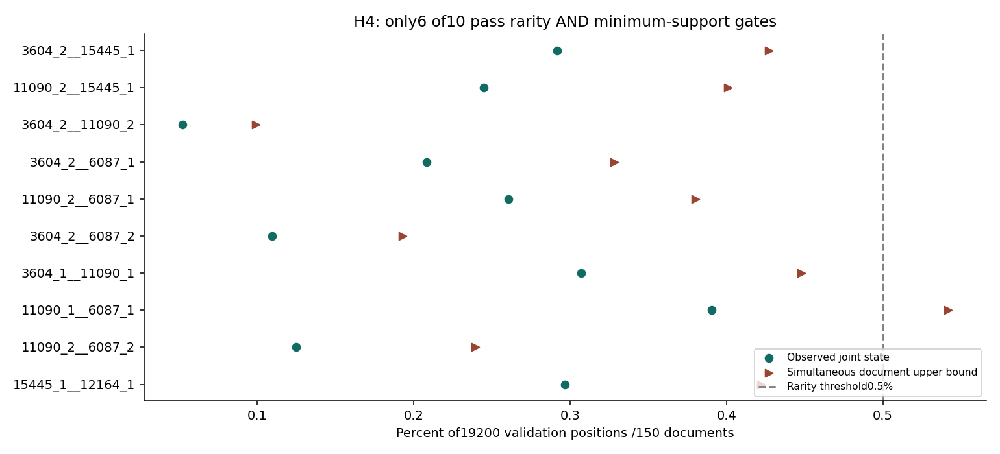
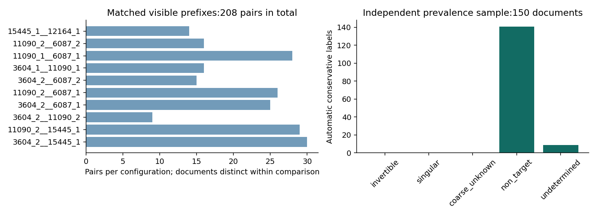
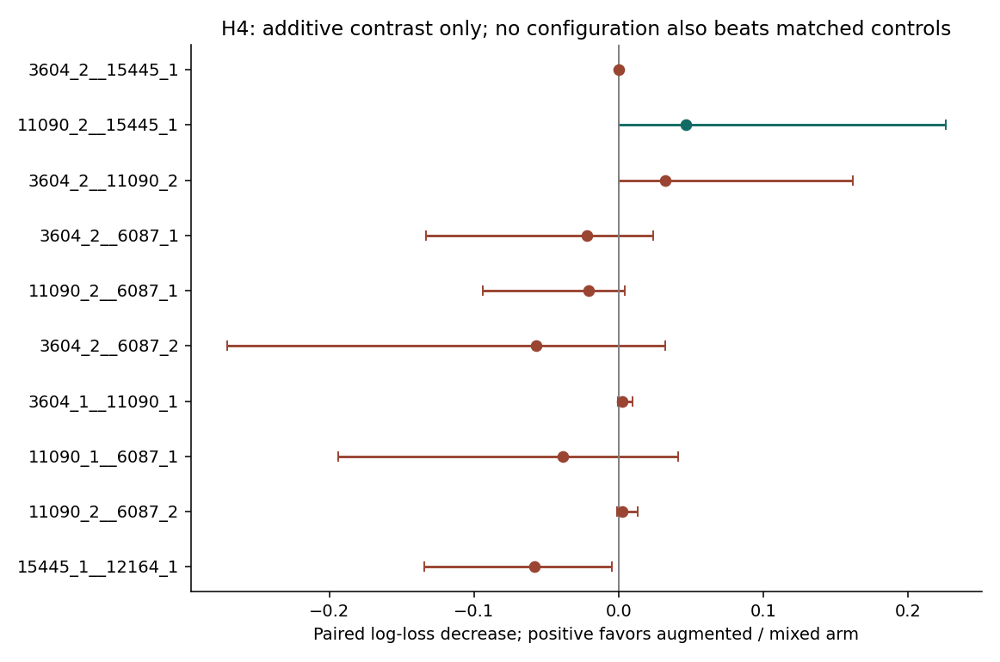

派生阅读副本；原件位置：`Projects/from-attention-to-search/main/experiments/A15/15_27_natural_language_feature_response/R17_20261102_feature_composition_v02/H4/summary_cn.md`。
[精确原始文件](../../../../../../../../../sources/Projects/from-attention-to-search/main/experiments/A15/15_27_natural_language_feature_response/R17_20261102_feature_composition_v02/H4/summary_cn.md)；研究修改仍回到原件。

---

# H4：罕见配置与具体内容

执行分支：`COMPLETED_INSUFFICIENT`；科学接受及下一研究决策：`Unknown`。修订版留出已暴露。

## 1. 一句话更新

常见单状态确能组成部分可验证的稀有配置；当前语料和读出尚未证明它们对应稀有语义或独特交互。

## 2. 观察

8个高频候选、20原子对、80状态配置，29种发现合格，10种冻结，6种验证同时合格。例3604强+15445弱：56／19200位置、35／150文档，0.2917%，同时上界0.4271%；单状态1.4427%和18.4531%，乘积0.2662%，实测比值1.0956。自然匹配208对，两侧均0细标签，配置／对照未定9／15；另91命中无匹配。独立150文档前缀141非目标、9未定。

## 3. 完整性

状态边界、候选与目标方向仅用发现冻结。自然开发／验证频率、支持、文档区间均完成；文本去响应后自动标注。匹配保持同关键词cohort／位置四分位、长度比0.5–2，配置内文档不重复且两侧互斥。不是人工独立盲标。9种配置完成20种子配置匹配；15445弱+12164弱的20个匹配均失败并保留失败。

## 4. 竞争解释

罕见联合事件可由普通单状态概率乘积解释。低目标内容覆盖及自动规则漏标仍是主要竞争解释。不能把未定归为阴性。自然网页是既有关键词面板，目标丰富度不足；验证样本零标签的bootstrap退化区间不证明真实发生率为零。

## 5. 结论与边界

自然稀有性支持6种固定配置，另外4种因支持或上界失败。没有配置同时通过加性及匹配配置双增量门槛；11090强+15445弱对加性改善0.046278，同时区间[0.000260,0.226475]，对匹配配置改善0.049217，[−0.049735,0.245629]，仍不合格。无目标语义对应结论，也无非线性证明。

## 6. 假设更新

AI修正倾向：把“高频feature组合构成稀有语义”拆成“联合响应稀有”“文本内容稳定对应”“配置超出成员加性”三条；目前保留第一条的部分实例，后两条保持开放。

## 7. 下一决策

AI建议先补足和人工核查目标自然内容，再决定是否值得独立配置检验；不先扩大搜索。研究者的目标选择与新实验授权Unknown。

## 图与原始证据

Low point frequency is insufficient when the upper bound or support gate fails.

Zero invertibility labels in matched groups gives insufficient target coverage, not proof of no semantic relation.

H4: additive contrast only; no configuration also beats matched controls

[指标原表](../../../../../../../../../sources/Projects/from-attention-to-search/main/experiments/A15/15_27_natural_language_feature_response/R17_20261102_feature_composition_v02/tables/H4_readout_metrics.csv) · [全部响应、预测、调参与失败](../../../../../../../../../UNAVAILABLE.md) · [方法和修订](../detailed_cn.md) · [具体案例](../casebook_cn.md)
