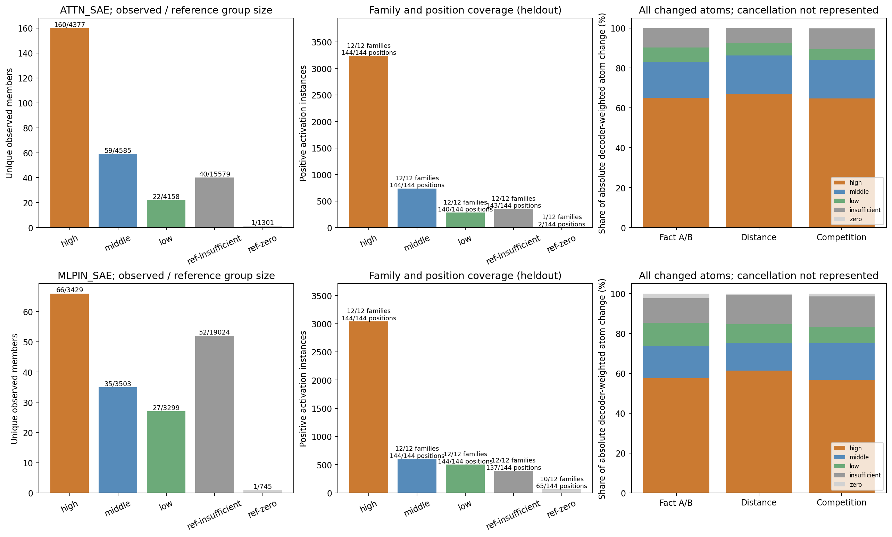

派生阅读副本；原件位置：`Projects/from-attention-to-search/main/experiments/A15/15_27_natural_language_feature_response/R19_20261104_remote_target_near_competitor_composition/summary_cn.md`。
[精确原始文件](../../../../../../../../sources/Projects/from-attention-to-search/main/experiments/A15/15_27_natural_language_feature_response/R19_20261104_remote_target_near_competitor_composition/summary_cn.md)；研究修改仍回到原件。

---

# R19 认识更新：共同成员保留事实差异，竞争下的强弱变化尚不能完整解释错误

## 这轮回答了什么

**在这批构造英语文本和固定位置上，MLP 输入 SAE 的同一组六成员同时呈现远处目标与近处物品的影响；事实差异在新家族和近远条件间保持。竞争下的组合变化伴随候选偏好下降，但完整的跨家族行为解释未通过预定门槛。** Attention SAE 的主要六成员覆盖不足，结论为证据不足。没有训练、激活干预或 feature 语义命名；科学接受和下一实验选择待共同审阅。

目的来自 R18：先前主任务 d16/64/128 各24/24成对正确，旧近处相反物品17/24。本轮要区分远目标内容、距离和近处物品对同一批 feature 的影响。仅比较旧主任务与旧竞争条件会混入填充/条款差异；旧竞争的A/B还同时改变两个词。因此原件保持不动，补96条，使每家族有远目标A/B×近处不明物品/A/B的匹配矩阵。

冻结模型为 Qwen3-0.6B Base。两个已有 SAE 分开分析：第28层 Attention o_proj 输出，以及残差与归一化之后的实际 MLP 输入。各30000成员、Top32；ID不能跨字典相认。每条前缀320tokens，观察同一个末尾冒号 p319、token ID25。距离 d=p−e−1排除两端，主e302/254/190对应16/64/128；物品多token取最后一个。24家族按模板组内拆12发现/12表征留出，整家族全部条件同侧；模板共享、旧行为已接触。全292条前向含4smoke，196条旧文本评分逐候选重放误差0。

## 行为参照：先看模型确实遇到了什么变化

| 条件 | 留出成对正确/12 | 留出正确前缀/24 | 留出平均正确分差nat | 全部24家族成对正确 |
|---|---|---|---|---|
| main16 | 12 | 24 | 6.4209 | 24 |
| main64 | 12 | 24 | 6.6187 | 24 |
| main128 | 12 | 24 | 6.8925 | 24 |
| matched_neutral | 11 | 23 | 5.9946 | 23 |
| matched_congruent | 12 | 24 | 6.7230 | 24 |
| matched_opposite | 9 | 21 | 2.1802 | 17 |

表内“全部”合并发现与留出，不能称作新确认。匹配中性是近处有未指明物品，并非删除近处句子。留出中性11/12、相反9/12；平均正确分差从5.9946降到2.1802nat，家族平均下降3.8144nat，95%家族区间[2.8466,4.9116]。相反条件失败为F23/F27/F28；F28在中性条件已失败，不能把它的错误起点归于竞争。所有失败保留。一致条件12/12，支持近处词内容值得区分，但不单独证明模型采用何种策略。

## 第一层：复用与成员更换同时存在

| SAE | 比较 | 家族数 | 平均共同成员 | 平均换入=换出 | 平均Jaccard | 95%家族区间 |
|---|---|---|---|---|---|---|
| ATTN_SAE | main128 | 12 | 20.8333 | 11.1667 | 0.4943 | [0.4220, 0.5787] |
| ATTN_SAE | 16_to_128 | 12 | 24.7917 | 7.2083 | 0.6374 | [0.5988, 0.6826] |
| ATTN_SAE | neutral_to_opposite | 12 | 23.7917 | 8.2083 | 0.5988 | [0.5451, 0.6478] |
| MLPIN_SAE | main128 | 12 | 25.4167 | 6.5833 | 0.6637 | [0.6140, 0.7166] |
| MLPIN_SAE | 16_to_128 | 12 | 27.9167 | 4.0833 | 0.7774 | [0.7394, 0.8168] |
| MLPIN_SAE | neutral_to_opposite | 12 | 27.8750 | 4.1250 | 0.7747 | [0.7376, 0.8113] |

固定事实从16到128，Attention平均共同24.79/32、MLP输入27.92/32；有竞争时仍有23.79和27.88个共同成员。固定32预算下，换入数与换出数必然相等，这个相等不是机制发现。事实互换参照中，16→128同事实Jaccard比错配事实分别高0.1973和0.1575（12家族）；所以重叠不全是固定问句的普遍公共成员。该参照仍未分离词形与物品身份。

## 第二层：哪些共同成员，以及它们怎样一起改变

发现侧固定的 Attention C=[2520,26235,29969,23899,772,2254]；MLP输入 C=[17390,25508,3011,4700,16240,27076]。对每条记录保留原始激活，并以同一C内向量的L2范数归一，描述相对搭配；每家族以自己的A−B差为参照，不把不同物品对当成同一语义方向。

H1固定近处词后看远目标A/B差与中性A/B差是否同向；H2看同族16与128的A/B差是否同向。MLP输入H1均值cos=0.7449，12/12家族严格共同激活；H2cos=0.9713，11/12家族，均通过预定区间与Holm条件。H2未纳入的F23是低频#25508在main16_A实际为0；不补换成员。Attention远矩阵仅5/12、近远仅6/12，未达8个家族。#772近远完整支持7/12，#2254远矩阵7/12；多个缺失取交集后进一步减少。第一批三个成员虽覆盖较好，按协议仅作敏感性，不能救回六成员主判断。

### 一个直观例子：抽屉里的 magnet，被近处 battery 干扰

F23原句为`The drawer was packed with the magnet.`，之后近处句为`The other container holds the object.`或`... battery.`，最终问题始终是`What was stored in the drawer?\nAnswer:`。远目标末token在190，近词末token在309，p319，实际间隔分别128与9。完整320token原文、全部候选token、未舍入分数在[原文案例](casebook_cn.md)，没有用省略版代替原始证据。

同样远处是magnet，仅把近处object换成battery，MLP输入的真实成员从#17390=7.417934、#25508=3.940733、#16240=15.728086、#27076=13.515182，变为9.967296、3.272244、18.058294、11.246584。这些成员同时激活，却分别变强/变弱。两个完整候选分数从battery −14.919217、magnet −10.370538，变成battery −8.837065、magnet −9.626400；正确分差由+4.548679变为−0.789335nat。

固定近处battery再把远目标从magnet换成battery，#16240从18.058294到19.557859；固定近处magnet时同一远目标改变使其从15.844104到18.563541。这个成员仍有目标条件差异，但其他成员的方向与幅度也在变。不能把单个激活上升直接命名为“记忆增强”。

把两种固定近处条件的目标差平均记为T，把固定远目标下的近词差平均记为N；以中性目标差为投影参照，F23在MLP输入的T=0.6001、N=0.6631，相反对角保留=T−N=−0.0631。Attention相应为0.4903、0.4823、0.0080。**这是所选坐标中的两项接近、作差后方向很弱；T−N等式本身是代数恒等式。** 两个位置都还可见正的目标分量，不能说远处事实被完全擦除。

### 反例阻止我们把这个例子讲成统一机制

MLP输入F11(ball/die)相反对角保留−0.0234，但A/B仍正确，较难的die分差仍+0.3512nat；F19也是保留−0.0391却成对正确。F27(map/chart)保留+0.5307，目标T=0.8376，却有一条误判（−0.2278nat）。F28保留+0.7148，但中性已失败，说明候选/模板难度与行为底线也重要。原文案例保留F23和全部留出失败F27/F28，以及第一个上述成功反例F11。案例展示规则的实现修正另有时间记录，不改变任何候选、指标或检验。

## 第三层：联合模式超出单成员频率了吗

分别固定发现侧4个二元组合与4个强度组合。二元重排在每个条件内保持全部30000成员出现数和每位置32成员；强度重排保持实际成员支持与每个成员正激活值的完整多重集。每侧256次参照，二元链Rhat≤1.023、ESS≥209，6144次度约束检查全部通过。

二元联合方向在留出未通过（两侧Holm p=1）。强度联合在固定留出面板相对边际重排都偏离，Holm p=0.0156；但家族区间分别[−1.0481,1.6578]和[−0.5500,0.7673]跨0，未满足预定的稳定家族推广条件，故H4主要判断仍为证据不足。不能删去条件重排的阳性，也不能只凭该p值宣称跨家族组合已经确认。幅值参照未保持每位置总范数，通用幅值协变仍是竞争解释。

## 频率组：低频参与可见，支持与语义要分开

MLP固定C含高频#17390/#3011/#16240/#27076、中频#4700、低频#25508；Attention的#772为低频，其余C为高频。完整留出中，Attention高/中/低组实际出现160/59/22个成员，MLP为66/35/27；三组均覆盖12家族，低频位置覆盖分别140/144与144/144。频率不足和参考零次组独立保留，例如MLP#24506在旧参考为零、本任务65位置/10家族阳性；这不能推出新概念或新训练能力。

图中右侧是逐成员绝对改变量乘decoder列范数后的总量占比，未表示成员间向量抵消，更不是隐藏空间能量或因果贡献。频率来自独立旧参考300文档/38400位置，分组在本次留出读取前固定。

## 逐条判定与认识边界

| SAE | 假设 | 合格家族/12 | 均值或ρ | 95%家族区间 | Holm p | 判定 |
|---|---|---|---|---|---|---|
| ATTN_SAE | H1 | 5 | 0.8092 | [0.6858, 0.9326] | 1.0000 | 证据不足 |
| ATTN_SAE | H2 | 6 | 0.9678 | [0.9353, 0.9900] | 1.0000 | 证据不足 |
| ATTN_SAE | H3 | 5 | 0.4000 | [-1.0000, 1.0000] | 1.0000 | 证据不足 |
| MLPIN_SAE | H1 | 12 | 0.7449 | [0.6362, 0.8430] | 0.0015 | 支持（本面板） |
| MLPIN_SAE | H2 | 11 | 0.9713 | [0.9632, 0.9794] | 0.0024 | 支持（本面板） |
| MLPIN_SAE | H3 | 12 | 0.6364 | [0.0397, 0.9077] | 0.0568 | 局部支持；完整关联未通过 |

| SAE | 联合层 | 固定对数 | 家族数 | 留出投影 | 95%家族区间 | Holm p | 判定 |
|---|---|---|---|---|---|---|---|
| ATTN_SAE | binary | 4 | 12 | -0.0046 | [-0.3391, 0.3064] | 1.0000 | 证据不足 |
| ATTN_SAE | amplitude | 4 | 12 | 0.1809 | [-1.0481, 1.6578] | 0.0156 | 证据不足 |
| MLPIN_SAE | binary | 4 | 12 | -0.0438 | [-0.2827, 0.1869] | 1.0000 | 证据不足 |
| MLPIN_SAE | amplitude | 4 | 12 | 0.1117 | [-0.5500, 0.7673] | 0.0156 | 证据不足 |

H3的MLPρ=0.6364，95%区间[0.0397,0.9077]，原始p=0.0142，Holm p=0.0568；模板内交换p=0.25。去句号只计物品词时ρ=0.5944，区间[−0.0771,0.9070]。因此支持组合与偏好都改变这一局部现象，尚不支持完整、稳健的跨家族行为解释。Attention的H1/H2/H3均因共同成员支持不足而证据不足，不能把MLP通过、Attention未通过当成两者存在显著差异。

原始数据支持：同一批成员可同时随远目标与近词改变；部分事实差异跨距离保持；组合可观察性与最终选择存在分离反例。可能原因包括目标/近词同时投影到复用成员、其他未选成员、输出读出、候选先验、句号及模板。旧无事实基线在d128偏好battery/ball/map/card，A−B分别+1.7512/+5.1302/+1.9900/+2.5590nat；它与竞争后错误方向相容，但旧基线不是新竞争框架的精确中性消融，不能拿来扣除因果先验。候选同长度并不能消除词先验。

这里没有连续时间追踪“竞争信息到来之前与之后”的同一次生成过程；观察的是同一答案位置在配对前缀下的表征。共同激活、联合幅值结构、与行为关联也不等于模型因果使用这些成员。主距离还混有绝对位置/填充顺序；两字典重建留出相对误差中位数约0.4793/0.2878；只取6成员更不代表全部信息。模型自由生成、一般理解、训练/路由价值和跨任务泛化均未验证。

所有逐家族结果、缺失、原始向量、原始评分与联合参照均保留。[数值附录](numeric_evidence.md)、[执行记录](detailed_cn.md)、[数据定义](dataset_guide_cn.md)、[资产与复算入口](artifacts_cn.md)。**本轮已停止，等待共同审阅，再决定是否设计功能干预或训练。**
