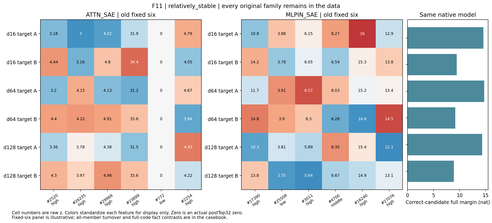

派生阅读副本；原件位置：`Projects/from-attention-to-search/main/experiments/A15/15_27_natural_language_feature_response/R20_20261104_distance_composition/cases/F11_cn.md`。
[精确原始文件](../../../../../../../../../sources/Projects/from-attention-to-search/main/experiments/A15/15_27_natural_language_feature_response/R20_20261104_distance_composition/cases/F11_cn.md)；研究修改仍回到原件。

---

# F11：ball/die

选择角色：relatively_stable。这是两套字典平均成员保留最多的一族，但保留较多成员也没有保证事实差异幅度精确不变：两处的相对事实差异都略小于近距。三个距离仍成对答对，它是总体均值不减弱之下保留的局部反例。

| 字典 | 共同/32 | 换入/换出 | 原始差异比 | 相对差异比 | 差方向cos |
|---|---|---|---|---|---|
| ATTN_SAE | 27.0000 | 5.0000 | 0.8923 | 0.9133 | 0.7546 |
| MLPIN_SAE | 30.5000 | 1.5000 | 0.9537 | 0.9690 | 0.8969 |

原始完整候选在三个距离均成对正确。全部原文、token位置、逐候选分数、成员并集、逐成员频率与三档强度保存在[完整原始案例](F11.md)。

