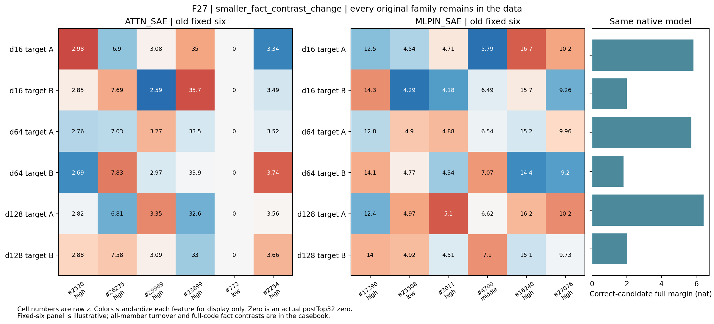

派生阅读副本；原件位置：`Projects/from-attention-to-search/main/experiments/A15/15_27_natural_language_feature_response/R20_20261104_distance_composition/cases/F27_cn.md`。
[精确原始文件](../../../../../../../../../sources/Projects/from-attention-to-search/main/experiments/A15/15_27_natural_language_feature_response/R20_20261104_distance_composition/cases/F27_cn.md)；研究修改仍回到原件。

---

# F27：map/chart

选择角色：smaller_fact_contrast_change。两字典的相对事实差异变化很小且方向不同，完整事实差的方向也没有像预选六成员那样接近完全一致。这里的幅度、方向与答题成功是三件事，不能互相替代。

| 字典 | 共同/32 | 换入/换出 | 原始差异比 | 相对差异比 | 差方向cos |
|---|---|---|---|---|---|
| ATTN_SAE | 26.0000 | 6.0000 | 1.0077 | 1.0617 | 0.6093 |
| MLPIN_SAE | 27.5000 | 4.5000 | 0.9352 | 0.9493 | 0.5408 |

原始完整候选在三个距离均成对正确。全部原文、token位置、逐候选分数、成员并集、逐成员频率与三档强度保存在[完整原始案例](F27.md)。

