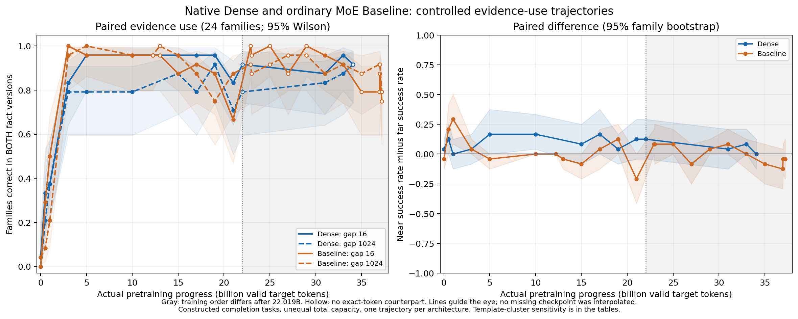

派生阅读副本；原件位置：`Projects/from-attention-to-search/main/experiments/A15/15_30_checkpoint_evidence_use/R01_behavior/summary_cn.md`。
[精确原始文件](../../../../../../../../sources/Projects/from-attention-to-search/main/experiments/A15/15_30_checkpoint_evidence_use/R01_behavior/summary_cn.md)；研究修改仍回到原件。

---

# Dense 与 Baseline：逐 checkpoint 的近远证据使用

**两条轨迹都曾出现近远差距，但持续时间不同。** Dense 在5B与10B仍为近程23/24、远程19/24；Baseline 在3B的近16／中256／远1024间隔已分别达到24/23/23个家族成对成功（各24家族），Dense 同点为20/18/19。当前对照尚未充分排除词面复制，因此曲线先称为“远距离词面事实调用”。这里只描述两条实际轨迹的受控候选排序；机制判断和科学接受保持 `Unknown`。

三条分析路径：①行为与因素对照，本轮全部测量；②表征与层间组织，本轮 `NOT RUN`；③功能干预本轮 `NOT RUN`，测量质量由哈希、原生严格加载、CE校准、冻结和token核查支持。

## 会议目标

导师要求解释分类为何可能改善学习效率，并质疑“距离更远，某个feature量就必然衰减”的先验。学长讨论强调匹配短程对照，并把通用能力、领域知识与具体信息分开。本轮先测其中的前置行为：模型是否随远处事实正确改变候选，近远差距是否随预训练进度改变。最新学长要点来自本次请求和附件晚间整理，独立原始晚间转写未找到；旧10月27日原始记录已完整阅读，不能替代最新原话。详见[来源与既有证据](prior_context_cn.md)。

## 资产核验

实际核查并严格加载 **Dense14个、Baseline23个，共37个不同底模状态**，包括初始化、里程碑和真实恢复点。按文件哈希去重三处Dense别名；另保留十个缺权重路径，其中19B在归档找到相同进度权重并实际评测，其余九个缺失状态不补造。完整范围和每条路径在[Detailed](detailed_cn.md)与[checkpoint清单](../../../../../../../../UNAVAILABLE.md)。Dense实际可加载末点34.076363264B，Baseline末点37.221773824B；不是声称这就是日志中最后一次更新。

两者均为8层、隐藏维1024、上下文2048，使用同一Qwen tokenizer及DCLM配对数据视图，AdamW、相同有效batch和已核实学习率历史。Dense总／常规激活参数281431040；Baseline普通MoE为8专家top2，总507988992、常规激活281496576。激活矩阵规模接近，总容量不等，也不是等实耗FLOP或wall-clock控制。训练样本顺序仅核实一致至22.018691584B；之后Dense历史续训采样器发生偏离。图中灰色区域保留该限制。

已有Dense跨时间CrossCoder绑定1／5／15／31B底模的各8层，现存字典恢复状态为624947200个配对位置；Baseline已有33B底模最后router输入的SAE，字典实际训练1000001536个原始激活位置。这些字典计数不是底模预训练token。官方Qwen28层与S7的SAE属于其他模型。[绑定与当前访问](dataset_guide_cn.md)只登记资产，本轮没有加载或训练任何字典。

## 任务与对照

24个内容家族分属六种措辞，物品、颜色、目的地各八家族。主前缀固定1152token，把证据值最后token与前缀最后token之间的间隔设为16、256、1024，即2048上下文的0.78%、12.5%、50%。每个家族只替换事实A/B，问题和候选不变；两侧都选对才算成对成功。因此固定偏好某个候选无法单独使一家族通过。

每状态评384提示：主距离的A/B事实、无有效证据、另一实体的无关事实，以及1024间隔的填充反序和固定间隔回答后移对照。填充token多重集合和主回答位置匹配，但事实绝对位置、填充顺序与attention竞争仍会变化。错误实体／无证据没有正确标签，只报告候选偏好。单条事实回忆不等于多条事实组合或任意长文理解。

完整候选为前导空格＋词语＋句号，逐token对数概率相加，单位nat；本面板每个候选恰为两个token。另报只计词汇token和去句号分数，两者在本面板相同。以内容家族统计，95%Wilson区间和10000次家族配对bootstrap；六模板聚类敏感性另列，不能把改写、token或checkpoint当作独立训练重复。全部文本在首个模型行为分数之前冻结，未按结果改测试集。[全文、位置与字段](dataset_guide_cn.md)。

## 学习曲线

主图是注册的BF16结果。左图横轴为真实预训练有效目标token，纵轴为24家族中两侧都选对的比例；蓝／橙区分Dense／Baseline，实／虚线区分16／1024间隔，阴影为家族95%Wilson区间。右图是同一家族的近减远成功率及配对bootstrap区间。空心点没有另一模型的真实同token状态；线段只引导视线，未插值补checkpoint。灰区是22.019B后的训练顺序差异。[图源数值](../../../../../../../../sources/Projects/from-attention-to-search/main/experiments/A15/15_30_checkpoint_evidence_use/R01_behavior/data/main_figure_data.csv)。

下表只比较双方真实共同token点；其他实际点全部保留在Detailed与原始表。

| 真实预训练 B token | Dense 近16 /24 | Dense 远1024 /24 | Baseline 近16 /24 | Baseline 远1024 /24 |
|---|---|---|---|---|
| 0 | 1 | 0 | 0 | 1 |
| 0.5 | 8 | 5 | 7 | 2 |
| 1 | 9 | 9 | 12 | 5 |
| 3 | 20 | 19 | 24 | 23 |
| 5 | 23 | 19 | 23 | 24 |
| 10 | 23 | 19 | 23 | 23 |
| 15 | 23 | 21 | 21 | 23 |
| 17 | 23 | 19 | 22 | 21 |
| 19 | 23 | 22 | 21 | 18 |
| 21 | 20 | 17 | 16 | 21 |
| 31 | 21 | 20 | 23 | 21 |
| 33 | 23 | 21 | 22 | 22 |

“何时学会”不能由一个任意门槛唯一确定。下面是在事先冻结的60／80／90%描述口径下，首次采样达标和下一采样点仍达标的进度；它不是精确出现时刻，也不是研究者确认的通用能力标准。

| 模型 | 阈值（仅描述） | 近16首次 B | 远1024首次 B | 远程连续下一点仍达标的起点 B |
|---|---|---|---|---|
| Dense | 60% | 3 | 3 | 3 |
| Dense | 80% | 3 | 15 | 31 |
| Dense | 90% | 5 | 19 | 未达到 / NOT REACHED |
| Baseline | 60% | 3 | 3 | 3 |
| Baseline | 80% | 3 | 3 | 3 |
| Baseline | 90% | 3 | 3 | 3 |

若只看80%口径，Baseline近远首次观测达标均在3B，只能把跨越时间约束在(1,3]B，不能证明区间内同时发生；Dense近程首次为3B，远程首次为15B，但17B又低于80%。换成60%时，Dense近远首次都在3B。因此“15B学会”不是门槛无关的结论。

例如Dense1024间隔在15B为21/24，17B回落到19/24，近程均为23/24。不能删掉17B，也不能把首次跨80%写成已经稳定掌握。33B时Dense三个间隔为[23, 22, 21]，Baseline为[22, 23, 22]（顺序16／256／1024，分母均24）；每个点的区间、分差、内容与模板见Detailed。

## 结论与反例

直接观察是：Baseline在3B就同时有较高的近远成对成功，Dense的远程残余失败在若干后续状态仍存在；因此需要分别描述两条轨迹，不能预设统一的长程学习延迟。初始化也有极少量成对成功，提醒我们单个通过案例不足以定义普遍“学会”。

反方向的实际点同样存在：Baseline21B近程16/24，远程21/24，远程高于近程；Dense最新可加载34.076B两者均22/24。不能把这些点删去，也不能将远程偶尔更高解释为更远有益。33B平均正确分差也不随距离单调下降：Dense近／远约4.372／4.984nat，Baseline约4.366／5.198nat。准确率、分差和模板结果需要一起看。

33B的计分与位置／填充敏感性如下。近远关系可能随具体家族与计分口径改变，全部反例保留。[真实案例及分数](cases_cn.md)。

| 模型33B | 间隔 | 完整含句号 /24 | 只计词汇token /24 | 填充反序 /24 | 固定间隔、回答后移 /24 |
|---|---|---|---|---|---|
| Dense | 16 | 23 | 23 | — | — |
| Dense | 256 | 22 | 23 | — | — |
| Dense | 1024 | 21 | 21 | 21 | 21 |
| Baseline | 16 | 22 | 23 | — | — |
| Baseline | 256 | 23 | 23 | — | — |
| Baseline | 1024 | 22 | 22 | 22 | 21 |

## 边界

本轮只有一条训练轨迹／模型，内容家族共享模板；区间描述这些构造家族的重采样变化，不覆盖训练种子或任意自然语言总体。训练见过何种任务模式未知。近远对照没有单独识别纯距离因果效应；两模型总容量和后段数据顺序也不同。MoE smoke的原生CE与批量候选评分最大差约0.026nat，处于预设0.03nat容差内；接近零的分差须与精度及标点敏感性一起读。候选排序不是开放生成准确率。错误实体事实仍可能通过复制词面影响答案，故成对切换本身尚不足以证明完整实体绑定或语义组合。

完整阶段用现有H100 MIG切片，耗时约22.1分钟（包括加载与哈希），处理33,701,376个非padding输入token（两候选前缀重复）、评分56,832个答案token，额外工程smoke约62秒。没有新申请作业，训练更新为0。[成本与执行记录](../../../../../../../../UNAVAILABLE.md)。

数值复核补充：对所有绝对分差<0.06nat的主提示及配对事实，24状态共122提示做FP32复核，11条偏好翻转、11个状态×距离计数各变化1/24。本子集敏感性下，主要60/80/90%首次达标点与Dense5／10／15／17B关键比较不变；最新Dense34.076B的主BF16近22／远22在补充中为近21／远22。主图和表均保留注册BF16，不把子集补充称为完整FP32曲线。[完整精度记录](numerical_audit_cn.md)。

## 下一步与定义建议

**AI建议：保留“实际证据距离＋反事实行为检查”的组合，先用更窄的名称“远距离词面事实调用”。** 距离描述任务条件；两侧正确切换描述该状态是否利用事实。不要把答错或学得慢本身写进长程定义，否则会循环定义“长程更难”。

对更强的“长程依赖”判断，再要求目标关系特异性。33B的无关实体远程条件仍使Dense21/24、Baseline19/24偏向被写出的A候选，分别高于中性条件的15/24和13/24；这尚未充分排除见到哪个词就接哪个词。现有无关条件只有A值、没有正确标签，不能单凭它证明实体绑定失败。更有区分力的下一轮对照是在目标事实与竞争实体同时存在时，只替换目标值或只交换查询实体，检查答案选择性。把信息类型与组合深度另列：本轮均为一条明确事实的检索／续写，不代表通用能力、领域知识和多条具体信息的组合。若以后增加多条关系任务，应另冻数据，并为每种组合深度保留匹配短程对照；本轮测试集保持原样。

后续状态选择建议：先看Dense1→3B的共同能力提升，再看Dense5／10／15／17B的近远分离与回落；以Baseline1→3B作同期行为参照。已有Dense CrossCoder可在其已绑定的1／5／15／31B上做有边界的复用核查，不能假装包含3／10／17B。Baseline33B已有SAE只适用于该底模／层，不提供早期字典。先共同审阅行为和关系特异性，再决定解释工具；本轮不启动后续分析或训练。

|覆盖|实际状态|证据|
|---|---|---|
|全部37不同底模、每状态384提示|DONE_EXPLORATORY|逐状态严格加载、全部分数／家族表／区间|
|缺失十路径、归档恢复19B、三相同哈希别名|完整保留|checkpoint清单、coverage ledger|
|控制、反例、主图、脚本／配置／成本|已交付|Detailed、原始执行manifest|
|新SAE／CrossCoder／router／底模训练|NOT RUN，排除在本轮范围外|训练更新0|

本轮科学解释与是否修订正式定义待研究者审阅；以上定义和后续选择是AI建议。

[Training assets, optimizer/data provenance and comparison limits](training_assets.md) · [训练资产和预算边界](training_assets_cn.md).

成本口径补充：主结果记录的是非padding输入token，两候选前缀分别计数；右侧padding另有2,727,936位置，物理前向共36,429,312位置。smoke、完整阶段和精度复核的记录耗时合计约26.0分钟，CPU准备／写报告未单独计时；不是整卡账单。[完整分项](../../../../../../../../UNAVAILABLE.md)。
