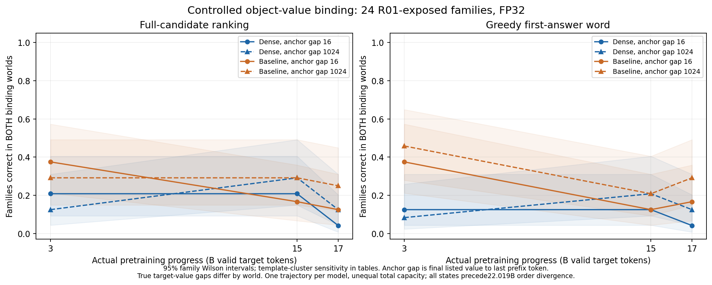

派生阅读副本；原件位置：`Projects/from-attention-to-search/main/experiments/A15/15_30_checkpoint_evidence_use/R02_relation_binding/summary.md`。
[精确原始文件](../../../../../../../../sources/Projects/from-attention-to-search/main/experiments/A15/15_30_checkpoint_evidence_use/R02_relation_binding/summary.md)；研究修改仍回到原件。

---

# Near/far definitions and minimal binding validation

**Near performance is also weak in the binding control.** Complete-candidate success in both counterfactual worlds ranges from 1 to 9 of 24 families. Preference usually moves in the binding-consistent direction, which shows some relation sensitivity; it does not establish reliable selection of the queried object's value. These observations do not isolate a distance-specific learning failure.

## Definitions and comparison

[Operational definitions](definitions.md) separate answer-word retrieval, object–attribute selection, independent paraphrase transfer and multifact composition. R01 measures the first level through candidate ranking; R02 tests the second. The latter two are NOT RUN. Input distance and training exposure are distinct variables; neither long-tail exposure nor an internal mechanism is inferred here.

All 37 original raw-score files were freshly hashed and their paired counts recomputed. The unchanged 80% first-sampled descriptions are Dense near 3 B / far 15 B, and Baseline both 3 B. They are descriptive crossings with later regressions, not exact onset or stable mastery. [Asset/data guide](assets_and_data.md) retains the original 60/90% sensitivity and actual checkpoint identities.

Both native models were actually loaded at exactly 3, 15 and 17 billion valid training target tokens, with matched optimizer steps 11,446, 57,224 and 64,854. Dense has 281,431,040 total parameters; ordinary MoE Baseline has 507,988,992. Conventional active counts are 281,431,040 and 281,496,576, which do not establish equal realized compute. Each model has one training trajectory. Family intervals are not seed uncertainty. These six states precede the historical data-order divergence at 22.018691584 B; the later divergence still limits the older full-trajectory comparison.

## Frozen control and measurements

Reuse 24 R01-exposed families across six templates, two worlds and two distances: 96 binding prefixes per state, 576 total. Six further R01-exposed engineering families supply 48 smoke prefixes across the two 3 B models. There is no independent new-family confirmation. Swap only the two one-token entity names. Values retain counts, order and positions; query, filler and all other prefix bytes remain fixed across worlds. The correct answer must flip.

Every prefix has 1,152 tokens. The last prefix token p=1151 predicts the first answer token at index 1152. The fixed anchor e is the last token of the final listed value; gap=p−e−1 is 16 or 1024. Correct-value gaps are separately 16–24 and 1024–1032 because the queried value changes world. Relation blocks span 10–16 tokens. R01 instead anchored its sole correct value, so the endpoint semantics differ across rounds. Near/far movement transfers 1,008 filler tokens to the other side of the relation block, preserving total length and token multiset. Absolute position and attention competition remain confounded. No prefix is truncated.

Score the complete leading-space word plus period by summed FP32 conditional log probabilities, with TF32 disabled. Both worlds must strictly prefer their respective correct candidates; ties fail. All candidates have two tokens. First-token, no-period and length-mean sensitivities are retained. Unrestricted greedy generation is a separate measurement: at most eight tokens, punctuation/EOS stopping, exact first lexical word after at most one initial article. Every OTHER output remains a failure. [Frozen protocol](protocol.md).

## All measured states

Every entry below requires both worlds to be correct; the denominator is 24 families, not 48 independent prompts.

| Model | Actual B tokens | Candidate near | Candidate far | Generation near | Generation far |
|---|---|---|---|---|---|
| Dense | 3 | 5/24 | 3/24 | 3/24 | 2/24 |
| Dense | 15 | 5/24 | 7/24 | 3/24 | 5/24 |
| Dense | 17 | 1/24 | 3/24 | 1/24 | 3/24 |
| Baseline | 3 | 9/24 | 7/24 | 9/24 | 11/24 |
| Baseline | 15 | 4/24 | 7/24 | 3/24 | 5/24 |
| Baseline | 17 | 3/24 | 6/24 | 4/24 | 7/24 |

Only actual 3/15/17 B points are shown; connecting lines guide the eye. Color distinguishes model trajectories and line/marker style distinguishes anchor gaps. The left panel measures full candidates; the right measures the generated first answer word. Shading gives 95% family Wilson intervals. All six paired near-minus-far candidate intervals touch or cross zero. Higher far rates at some later states do not establish a causal distance benefit. [Complete intervals and family/template results](detailed.md), [figure data](../../../../../../../../sources/Projects/from-attention-to-search/main/experiments/A15/15_30_checkpoint_evidence_use/R02_relation_binding/data/figure_data.csv).

Let dA be candidate A−B preference in world A and dB the same preference in world B. Binding response Δ=dA−dB measures graded movement; it does not require both correct margins to be positive. Baseline 15 B far has positive Δ in all 24 families, mean 1.552 nat, while only 7/24 families pass both rankings. Dense 17 B near has mean Δ=0.127 nat with a family interval crossing zero and paired success 1/24. Generation can first emit an article and then choose a noun, following a different conditional path from the word-first candidates. The resulting rates can differ. [Actual positive, negative and OTHER examples](cases.md).

## Updating the R01 interpretation

While each model was loaded, 576 old prefixes were rescored in FP32 as candidate-only references, saved exclusively under R02. The 12 paired counts match their original R01 counterparts. Dense 15 B near changes from 23/24 in the old task to 5/24 here; Baseline 3 B far changes from 23/24 to 7/24. Each condition has 14–22 old-pass/new-fail families. Added competitor facts, filler and correct-value distance differ, so this does not identify the strategy used in R01.

**AI proposal:** retain R01 as simpler lexical fact retrieval and describe R02's partial relation sensitivity separately from reliable paired correctness. Audit the weak near baseline, prompt and output format before attributing failures to distance. The query entity was fixed within each family; query role and entity lexical preference are not fully crossed. Neither this control nor the observed differences prove general semantic ability or architecture causation. No threshold is changed to remove regressions.

## Cost, remaining work and stop

The full stage took 275.6 seconds and smoke 71.5 seconds, approximately 5.8 minutes on the existing H100 MIG 3g.40gb partition. Peak allocated memory was 2.797 GiB. All 576 binding prefixes and 576 old-task references completed, with 1,375 generated tokens and zero training updates or new jobs. CPU preparation/reporting was not separately timed; stage time is not a full-GPU bill. [Actual costs](../../../../../../../../UNAVAILABLE.md).

Independent paraphrase transfer, new-family confirmation, multihop composition, seed replication, feature analysis and checkpoint expansion are NOT RUN. No LM, SAE, CrossCoder or router is trained. All protected R01 bytes and file-set identities remain unchanged. Scientific acceptance and the expansion decision remain with the researcher. Another Base-student knowledge-learning experiment's startup eligibility is NOT ASSESSED by this round. [Reproduction](reproduce.md), [artifact manifest](../../../../../../../../sources/Projects/from-attention-to-search/main/experiments/A15/15_30_checkpoint_evidence_use/R02_relation_binding/artifact_manifest.json).
