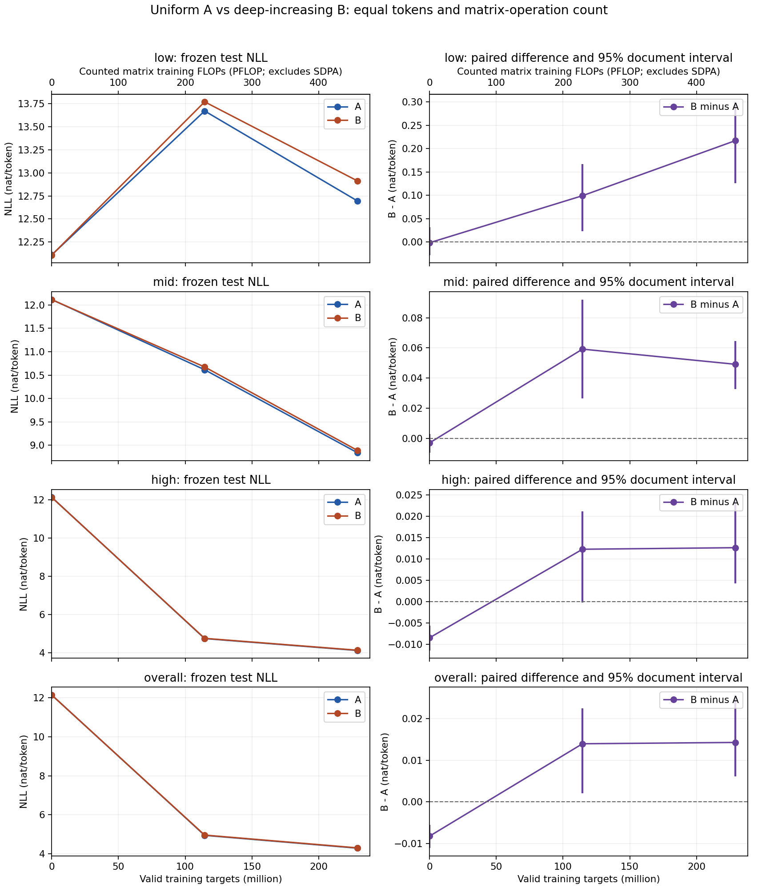

派生阅读副本；原件位置：`Projects/from-attention-to-search/main/experiments/A15/15_31_depth_expert_allocation/R01_paired_token_frequency/detailed_cn.md`。
[精确原始文件](../../../../../../../../sources/Projects/from-attention-to-search/main/experiments/A15/15_31_depth_expert_allocation/R01_paired_token_frequency/detailed_cn.md)；研究修改仍回到原件。

---

# Detailed：R01 专家跨深度分配与 token 频率

**状态：A／B完整预算与规定评估均完成，最终成对分析已产生；独立最终审计PASS，正式资产登记与strict访问PASS。**本轮B低频与整体终点NLL均更高。科学接受、机制归因及研究者下一判断仍为Unknown。

[Summary](summary_cn.md) · [English](detailed.md) · [Protocol](protocol_cn.md) · [共同冻结](joint_freeze_cn.md) · [执行时序](execution_record_cn.md) · [审计](audit_review_cn.md)

## 实验逻辑与对象

本轮研究同量专家放在不同深度的效果。模型按给定前缀预测下一token，所有模型参数可训练；未用教师、SAE损失或预训练权重。均匀A与递增B只改变逐层专家数，不改变hidden、每专家宽度、attention、top-2或绑定词表头。低频类型由实际监督目标曝光决定，测试只测预测损失，不能把它解释为事实或语义标签。

主估计为终点低频token的NLL差B−A，单位nat/token；负值表示B更好。零是无差异参照，无人为实用收益或非劣阈值。高频与整体差异同时报告。两组相同token数可排除数据量优势，参数清点排除额外容量；实测开销仍单列，路由变化只作观察。

一个真实频率例是训练文档中的token62204，文本片段为`esktop`，本轮监督曝光22次，归低频≤49；可见前缀包含`dbus-monitor`与`org.freed`。这是子词片段的频率，不能称实体／知识标签。原始逐例记录在[frequency_sample_spotcheck.json](../../../../../../../../UNAVAILABLE.md)。该例的明确Codex阅读发生正式A开始后，时序偏差见下。

## 架构、逐层参数与计算

无bias的SwiGLU有gate／up／down三个矩阵，每专家参数3×1024×1536＝4,718,592。attention为Q16／KV8 heads、head dim128，Q输出2048、K／V各1024；四个主矩阵6,291,456加QK norm256＝6,291,712。每层两个block norm共2,048。所有层E>top-2；没有共享专家。

| 组 | 层号 | hidden | FFN宽度 | E | top-k | attention | 每专家 | 专家合计 | router | 其他norm | 层合计 |
| --- | --- | --- | --- | --- | --- | --- | --- | --- | --- | --- | --- |
| A | 1 | 1024 | 1536 | 8 | 2 | 6291712 | 4718592 | 37748736 | 8192 | 2048 | 44050688 |
| A | 2 | 1024 | 1536 | 8 | 2 | 6291712 | 4718592 | 37748736 | 8192 | 2048 | 44050688 |
| A | 3 | 1024 | 1536 | 8 | 2 | 6291712 | 4718592 | 37748736 | 8192 | 2048 | 44050688 |
| A | 4 | 1024 | 1536 | 8 | 2 | 6291712 | 4718592 | 37748736 | 8192 | 2048 | 44050688 |
| A | 5 | 1024 | 1536 | 8 | 2 | 6291712 | 4718592 | 37748736 | 8192 | 2048 | 44050688 |
| A | 6 | 1024 | 1536 | 8 | 2 | 6291712 | 4718592 | 37748736 | 8192 | 2048 | 44050688 |
| A | 7 | 1024 | 1536 | 8 | 2 | 6291712 | 4718592 | 37748736 | 8192 | 2048 | 44050688 |
| A | 8 | 1024 | 1536 | 8 | 2 | 6291712 | 4718592 | 37748736 | 8192 | 2048 | 44050688 |
| B | 1 | 1024 | 1536 | 6 | 2 | 6291712 | 4718592 | 28311552 | 6144 | 2048 | 34611456 |
| B | 2 | 1024 | 1536 | 6 | 2 | 6291712 | 4718592 | 28311552 | 6144 | 2048 | 34611456 |
| B | 3 | 1024 | 1536 | 6 | 2 | 6291712 | 4718592 | 28311552 | 6144 | 2048 | 34611456 |
| B | 4 | 1024 | 1536 | 8 | 2 | 6291712 | 4718592 | 37748736 | 8192 | 2048 | 44050688 |
| B | 5 | 1024 | 1536 | 8 | 2 | 6291712 | 4718592 | 37748736 | 8192 | 2048 | 44050688 |
| B | 6 | 1024 | 1536 | 10 | 2 | 6291712 | 4718592 | 47185920 | 10240 | 2048 | 53489920 |
| B | 7 | 1024 | 1536 | 10 | 2 | 6291712 | 4718592 | 47185920 | 10240 | 2048 | 53489920 |
| B | 8 | 1024 | 1536 | 10 | 2 | 6291712 | 4718592 | 47185920 | 10240 | 2048 | 53489920 |

绑定embedding／输出矩阵151,936×1024＝155,582,464，仅计一次；额外输出头0，最终norm1,024。两组均总／可训练507,988,992，专家301,989,888，router65,536，其余205,933,568。差额为0（0%）。传统理论激活281,496,576＝全部共享唯一参数＋全部router参数＋各层top-2完整专家；输出矩阵全计，输入embedding查表不代表每次读取整矩阵。[实际参数源](../../../../../../../../UNAVAILABLE.md)

专家前向矩阵跨层150,994,944FLOPs/token，前反向主要矩阵452,984,832FLOPs/token。profiler按实际执行`aten::mm`矩阵形状计得2,000,027,648FLOPs/token，等于6×(281,496,576−19,456norm)+2×155,582,464（checkpointed CE重算输出一次）。它缺融合SDPA的QK／AV／反向、非矩阵kernel与通信；完整训练FLOPs另作明确假设的估计，不能称完整硬件实测。[矩阵核验](../../../../../../../../sources/Projects/from-attention-to-search/main/experiments/A15/15_31_depth_expert_allocation/R01_paired_token_frequency/supporting_sources/matrix_flops_formula_check.json)

正式A／B吞吐、峰值显存、通信／dispatch与墙钟详见下方实测系统表。profiler首步不进入预算吞吐中位数；注册IO背景的影响未量化。

## 数据、频率与训练

| 项目 | 实际冻结值 |
| --- | --- |
| 来源 | 既有DCLM pair view首文件前67,108,864token，不是全库 |
| tokenizer | 原Qwen3词表151,936；指纹由执行侧tokenizer_identity持有 |
| 文档／去重 | `<|im_end|>`151645边界恢复；丢8,827碎片／短token；全局精确文档字节SHA去16重复；近重复未查 |
| split | 文档SHA前64bits mod100：dev0／test1／train2..99 |
| train | 53,813文档；65,766,910token，循环packed |
| dev | 528文档；630,980token；630,979预测目标 |
| test | 544文档；700,308token；700,307预测目标 |
| 通用验证 | 完整冻结dev与test的整体NLL／PPL，原115M holdout未用 |
| 真实频率 | 正式训练流1..229,113,856监督目标的精确计数 |
| 桶 | 已见低≤49／中50–447／高>447，0为未见；正类型三分位保留ties |
| token类型数 | 低30,259／中29,950／高30,056／未见61,671 |
| 测试目标数 | 低1,481／中20,752／高677,902／未见172 |
| 实体／关系／事实 | NOT RUN，无可靠独立频率与切分合同 |

[数据字节manifest](../../../../../../../../sources/Projects/from-attention-to-search/main/experiments/A15/15_31_depth_expert_allocation/R01_paired_token_frequency/supporting_sources/data_manifest.json)；[正式频率manifest](../../../../../../../../sources/Projects/from-attention-to-search/main/experiments/A15/15_31_depth_expert_allocation/R01_paired_token_frequency/supporting_sources/frequency_manifest_formal.json)。smoke与formal频率目录独立保留，不能混用分桶。

| 训练项 | 共同冻结值 |
| --- | --- |
| 初始规则／种子 | 全新semantic-name SHA派生；seed20261106；normal(0,.02)矩阵；norm来源规则 |
| 全局batch | 262,144有效目标＝world4×micro16×acc2×seq2048 |
| 总预算 | 每组874update／229,113,856目标，训练token顺序相同 |
| optimizer | AdamW fused；lr3e-4；beta(.9,.95)；eps1e-8 |
| decay／clip | 矩阵0.1、norm／标量0；global grad clip1 |
| warmup／schedule | 87update／22,806,528目标，之后常数；首update lr0 |
| 精度 | BF16 autocast；FP32优化器状态 |
| router | 无辅助loss；load-bias .001 sign(期望−实际)；无capacity drop |
| checkpoint／eval | 0／437／874步，即0／114,556,928／229,113,856token；完整dev／test |
| 选择 | 主终点固定；不以test挑模型、桶、预算或checkpoint |
| 资源 | 单节点4H100 reserved，pt-ds9bdaxb；实际GPU已核验 |
| 第二种子／C | 本轮未安排，优先完整A／B；单种子保留为限制 |

[完整配置](../../../../../../../../sources/Projects/from-attention-to-search/main/experiments/A15/15_31_depth_expert_allocation/R01_paired_token_frequency/supporting_sources/common_frozen.json)SHA`dd768489b9a58a49c09b85fedb9009bb80d7530a63dd235a9bb960265e16f3d5`。预算来自非首步smoke中位2.0798338661秒A／2.0384610565秒B；按已注册even-step规则冻结874，不根据测试改预算。每组874步为约3.484次65,766,910token流长度的监督目标曝光，不等于独立新语料。

## 协议符合性与偏差

| 注册项 | 实际事实 | 资格与边界 |
| --- | --- | --- |
| 参数／top-k／宽度公平 | 实际清点精确匹配；公共结构初值exact | PASS；不证明初始函数相同 |
| 真实种子初态 | actual_initial_weight_match检查seed20261106的已保存初态 | PASS；初版seed17哈希仅实现资格，未改名混用 |
| 双短测与恢复 | A/B实际step3、786,432目标；A外部恢复／dev重载exact | PASS于该范围；不能泛化所有B／formal恢复 |
| 名义4步smoke | 编排stop在step3；保留total_steps4字段与实际step3区别 | 工程范围记录，不计正式预算；不是本轮终点 |
| 样例检查 | 正式前原文／边界、自动bucket例；Codex明确逐例读bucket在formalA后 | 时序偏差保留；外部人类review未进行；没有改规则 |
| 系统时间背景 | formalA初期外部顺序读取34,545,588,066bytes用于烟测SHA注册 | IO影响未测；不改变token／模型更新，但削弱纯系统速度解释 |
| FLOPs | mm实测exact；SDPA等未全量计 | 不将矩阵部分冒充全模型实测 |
| 去重／频率代理 | exact文档去重，近重复未查；仅前缀和循环本轮目标 | 不声称全库代表性／语义长尾 |
| 最终两组完成／分析 | A／B各874步、229,113,856目标；分析COMPLETE | 完成原定有界训练；科学判断Unknown |

## 主要结果与学习曲线

两组各874更新／229,113,856目标完成，规定的起点／中点／终点dev、test共12个条件评估完成。每个评估含低／中／高／未见与整体；完整原值、差和区间如下。主检验为终点test低频，其余用于已注册的代价／曲线说明，不能挑最好项替换主结果。

| Split | Step | 训练token | 桶 | 目标数 | A NLL | B NLL | B−A | 95%区间 |
| --- | --- | --- | --- | --- | --- | --- | --- | --- |
| dev | 0 | 0 | 低频已见（主指标） | 1253 | 12.123834 | 12.114659 | -0.009175 | [-0.031376,+0.019469] |
| dev | 0 | 0 | 中频已见 | 17259 | 12.127657 | 12.126628 | -0.001029 | [-0.007823,+0.005774] |
| dev | 0 | 0 | 高频已见 | 612343 | 12.135714 | 12.129492 | -0.006222 | [-0.008683,-0.003649] |
| dev | 0 | 0 | 训练未见 | 124 | 11.977433 | 11.936586 | -0.040847 | [-0.105953,+0.016510] |
| dev | 0 | 0 | 整体 | 630979 | 12.135439 | 12.129346 | -0.006093 | [-0.008520,-0.003532] |
| dev | 437 | 114556928 | 低频已见（主指标） | 1253 | 13.799341 | 13.888605 | +0.089265 | [-0.009011,+0.217701] |
| dev | 437 | 114556928 | 中频已见 | 17259 | 10.724088 | 10.758403 | +0.034314 | [+0.019149,+0.050036] |
| dev | 437 | 114556928 | 高频已见 | 612343 | 4.730196 | 4.748679 | +0.018483 | [+0.015772,+0.021281] |
| dev | 437 | 114556928 | 训练未见 | 124 | 16.217555 | 16.165173 | -0.052382 | [-0.721564,+0.453996] |
| dev | 437 | 114556928 | 整体 | 630979 | 4.914412 | 4.933455 | +0.019043 | [+0.016352,+0.021768] |
| dev | 874 | 229113856 | 低频已见（主指标） | 1253 | 12.708120 | 12.912340 | +0.204220 | [+0.133821,+0.292902] |
| dev | 874 | 229113856 | 中频已见 | 17259 | 9.048440 | 9.102330 | +0.053890 | [+0.031540,+0.075349] |
| dev | 874 | 229113856 | 高频已见 | 612343 | 4.126327 | 4.132331 | +0.006004 | [+0.003548,+0.008805] |
| dev | 874 | 229113856 | 训练未见 | 124 | 16.039734 | 16.326879 | +0.287146 | [+0.041870,+0.558622] |
| dev | 874 | 229113856 | 整体 | 630979 | 4.280343 | 4.288106 | +0.007763 | [+0.005433,+0.010421] |
| test | 0 | 0 | 低频已见（主指标） | 1481 | 12.110444 | 12.108813 | -0.001631 | [-0.028095,+0.031923] |
| test | 0 | 0 | 中频已见 | 20752 | 12.116739 | 12.113862 | -0.002877 | [-0.009434,+0.002924] |
| test | 0 | 0 | 高频已见 | 677902 | 12.140313 | 12.131890 | -0.008423 | [-0.011397,-0.005619] |
| test | 0 | 0 | 训练未见 | 172 | 12.197198 | 12.202816 | +0.005617 | [-0.063097,+0.053312] |
| test | 0 | 0 | 整体 | 700307 | 12.139565 | 12.131325 | -0.008241 | [-0.011128,-0.005502] |
| test | 437 | 114556928 | 低频已见（主指标） | 1481 | 13.670386 | 13.769560 | +0.099174 | [+0.023346,+0.166672] |
| test | 437 | 114556928 | 中频已见 | 20752 | 10.614290 | 10.673496 | +0.059206 | [+0.026605,+0.092060] |
| test | 437 | 114556928 | 高频已见 | 677902 | 4.751133 | 4.763442 | +0.012309 | [-0.000218,+0.021132] |
| test | 437 | 114556928 | 训练未见 | 172 | 15.787790 | 16.038730 | +0.250939 | [+0.080628,+0.391998] |
| test | 437 | 114556928 | 整体 | 700307 | 4.946447 | 4.960389 | +0.013941 | [+0.002069,+0.022456] |
| test | 874 | 229113856 | 低频已见（主指标） | 1481 | 12.694702 | 12.911912 | +0.217210 | [+0.125969,+0.300351] |
| test | 874 | 229113856 | 中频已见 | 20752 | 8.837688 | 8.886862 | +0.049174 | [+0.032819,+0.064679] |
| test | 874 | 229113856 | 高频已见 | 677902 | 4.129341 | 4.142017 | +0.012677 | [+0.004328,+0.024499] |
| test | 874 | 229113856 | 训练未见 | 172 | 15.847674 | 16.134700 | +0.287026 | [+0.027684,+0.433047] |
| test | 874 | 229113856 | 整体 | 700307 | 4.289854 | 4.304112 | +0.014258 | [+0.006160,+0.025677] |

终点test低频B−A为+0.217210[+0.125969,+0.300351]，整体为+0.014258[+0.006160,+0.025677]；dev相应差+0.204220与+0.007763。两组test低频均起点→中点升高、终点回落但未回到起点：A12.110444→13.670386→12.694702，B12.108813→13.769560→12.911912；起点到终点分别恶化+0.584258／+0.803100。未见桶也高于各自起点。中频、高频、整体明显改善。此非单调与组间差属于观察，原因Unknown。

每行对应低／中／高／整体，左为A／B NLL、右为B−A与文档95%区间；下方横轴是共同训练目标token，上方是已计矩阵FLOPs。终点低频区间在零线上方，整体亦然；起点B在整体上略好，不能把终点B劣势简单说成一开始就更差。来源[learning_curve_coordinates.csv](../../../../../../../../sources/Projects/from-attention-to-search/main/experiments/A15/15_31_depth_expert_allocation/R01_paired_token_frequency/supporting_sources/learning_curve_coordinates.csv)与[figure origin](../../../../../../../../sources/Projects/from-attention-to-search/main/experiments/A15/15_31_depth_expert_allocation/R01_paired_token_frequency/supporting_sources/all_frequency_curves_origin.json)。三处token坐标0／114,556,928／229,113,856对应计入的矩阵操作0／229,117,023,269,945,344／458,234,046,539,890,688FLOPs，A/B相同；这个算力轴没有融合SDPA等全量计算，不能叫完整等硬件FLOPs证据。

区间使用seed20261106、2,000次文档成对重采样，每次同抽文档、以损失差总和除有效token总数；它描述评估采样，不捕捉训练种子不确定性，也不消除packed上下文相关。低频仅1,481测试token、0.2115%覆盖，分布在246／544文档；bootstrap仍同抽全部544文档并保留零计数文档。未见仅172，保留小样本边界。

## 实际系统开销与逐层负载

| 系统量 | A | B |
| --- | --- | --- |
| 训练step目标/s | 131723.8 | 130933.4 |
| 训练step累计秒 | 1739.351 | 1749.851 |
| 进程墙钟秒（含初始化／全部eval／save） | 1893.533 | 1898.450 |
| 完成计时秒（含中间／最终eval／save，起点不同） | 1852.186 | 1861.293 |
| 峰值allocated GiB | 37.568640 | 37.573787 |
| 峰值reserved GiB | 45.343750 | 45.253906 |
| 梯度reduce累计秒 | 15.351152 | 15.433329 |
| 首步forward route/dispatch/combine CUDA ms | 102.766496 | 100.925632 |
| smoke部分已计operator FLOPs/token | 2000648805.794 | 2000649829.184 |

两组理论全图训练估计均2,201,354,240至2,402,680,832FLOPs/token，即每组5.04360758e17至5.50487470e17，范围来自因果attention交互工作量及反向／重算假设，不是硬件指令实测。主要矩阵`aten::mm`实测相同；smoke部分operator统计含已识别add／mul但仍缺融合SDPA，不能用其差判断全模型FLOPs差。

专家rank本地，无expert all-to-all，梯度reduce仍实测约15.35／15.43秒。首步route/dispatch/combine是profiler诊断，与正式完整step总时并非同一口径。B的正式step吞吐低约0.6000%，step累计多10.50秒，全进程多4.92秒；只描述本次顺序运行，未测背景IO的因果影响，不作稳定速度优劣结论。

下表CV为专家接收量标准差／均值；熵为router原概率分布的token均值，单位nat；H/log(E)只去除类别数上限。每层合计assignment均458,227,712＝229,113,856×top-2。Dead指整轮接收0，不等于每个短窗口都不死；Drop为0。Expert receipts按该层专家ID从0起排列，表示接收次数，不是独立信息量或梯度信噪比。

| Arm | Layer | E | CV | Entropy nats | H/log(E) | Dead | Drop | Expert receipts in ID order |
| --- | --- | --- | --- | --- | --- | --- | --- | --- |
| A | 1 | 8 | 0.207975 | 0.888744 | 0.427396 | 0 | 0 | 58186759, 50158660, 88060697, 54118635, 49176328, 51874353, 53083566, 53568714 |
| A | 2 | 8 | 0.108555 | 1.055738 | 0.507703 | 0 | 0 | 54743419, 56408325, 54195260, 54527585, 55319526, 53972217, 73615812, 55445568 |
| A | 3 | 8 | 0.113318 | 1.198620 | 0.576415 | 0 | 0 | 57118008, 73175059, 60393772, 54542675, 53647123, 52997949, 54165252, 52187874 |
| A | 4 | 8 | 0.132666 | 1.313775 | 0.631792 | 0 | 0 | 54998821, 54510134, 77118701, 55009909, 52894263, 53425089, 53258319, 57012476 |
| A | 5 | 8 | 0.122035 | 1.256925 | 0.604453 | 0 | 0 | 60945689, 53140246, 74513504, 54243252, 55095350, 55169290, 52167385, 52952996 |
| A | 6 | 8 | 0.111561 | 1.234520 | 0.593679 | 0 | 0 | 50976062, 54380560, 53498764, 56772244, 54639481, 60218205, 72856331, 54886065 |
| A | 7 | 8 | 0.066468 | 1.393800 | 0.670276 | 0 | 0 | 57378931, 65162093, 53068311, 60908216, 53631411, 55966226, 54493680, 57618844 |
| A | 8 | 8 | 0.142634 | 1.411101 | 0.678596 | 0 | 0 | 56506854, 54214747, 53741015, 53838474, 78452695, 55965858, 50676353, 54831716 |
| B | 1 | 6 | 0.195729 | 0.724248 | 0.404210 | 0 | 0 | 73042437, 69003238, 109088048, 63940923, 70090021, 73063045 |
| B | 2 | 6 | 0.050900 | 0.824676 | 0.460261 | 0 | 0 | 74178472, 83910114, 72717866, 72675579, 77452905, 77292776 |
| B | 3 | 6 | 0.097592 | 0.929748 | 0.518902 | 0 | 0 | 70578947, 91690502, 79489733, 72983799, 71028352, 72456379 |
| B | 4 | 8 | 0.147334 | 1.277991 | 0.614584 | 0 | 0 | 52793535, 55769061, 79441397, 52813783, 53780100, 54650089, 53618323, 55361424 |
| B | 5 | 8 | 0.117947 | 1.282186 | 0.616601 | 0 | 0 | 54644436, 56235224, 74560759, 58242567, 54430045, 54917661, 52638483, 52558537 |
| B | 6 | 10 | 0.068411 | 1.438987 | 0.624944 | 0 | 0 | 41819507, 44759159, 42985504, 45751857, 50000310, 45110310, 47746561, 52098057, 45592688, 42363759 |
| B | 7 | 10 | 0.087022 | 1.489640 | 0.646942 | 0 | 0 | 53217524, 43252927, 42586820, 45557766, 39744468, 50569623, 47140705, 49472955, 43754010, 42930914 |
| B | 8 | 10 | 0.162835 | 1.594438 | 0.692456 | 0 | 0 | 40997414, 40756107, 42837304, 43900506, 43824038, 46521360, 42716229, 46198894, 42916841, 67559019 |

例如B第2层CV更低、第8层更高，不能概括“递增都更均衡”。E更多导致平均每专家接收量变化属于计数恒等，不证明有效信号质量；没有路由强制／删除／交换干预，所以H3仅留下相关描述。[原始routing](../../../../../../../../sources/Projects/from-attention-to-search/main/experiments/A15/15_31_depth_expert_allocation/R01_paired_token_frequency/supporting_sources/routing.json)

## 真实相反样例与失败记录

最终结果并非每篇文档都同向。test文档`8bf0f4a06d1d4d99bdf0e2c9cdb0c0e66b138d5c3adfc7e39932a15449d560bb`的前缀为一篇选举新闻，含1个低频目标，该文档低频NLL的B−A为+3.031697，B更差。`ed988b8735f2a459a06d01139d928a9c3bd9a394a1cb7899ffe5e15fc9bc8d96`是有关匿名编辑建议的问答，含1个低频目标，差为−3.366316，B更好。这是按效应极值事后展示的个例，不代表主题性知识、事实准确性或总体典型性；不能凭文档前缀判定哪个具体token出错。[全部6例](../../../../../../../../sources/Projects/from-attention-to-search/main/experiments/A15/15_31_depth_expert_allocation/R01_paired_token_frequency/supporting_sources/document_examples.json)

观察端曾在远端文件刚创建、尚未close／完整可读时读到临时NUL与JSONDecodeError；等待落盘后读取正常，未据此修改任何生产数据、模型或指标。此为文件可见性／读取时序异常，不能改写成训练数值故障。GPU短测及正式有限性／计数审计另有独立证据。

## 证据链、产物与未完成范围

| 结果或检查 | 原始证据与计算 | 状态／资格 |
| --- | --- | --- |
| 参数完全匹配 | 实际parameter_ledger张量numel、绑定去重 | DONE_VALID；507,988,992各组，差0 |
| 实际正式初态／共同顺序 | formal_initial_weight_match及正式batchhash | DONE_VALID；seed20261106，874更新batchhash一致 |
| 短测恢复 | actual_smoke_audit；A exact外部恢复／dev重算 | DONE_VALID于实际范围 |
| 正式完成 | A／B completion与audit/pipeline_completion | DONE_VALID；874／229,113,856各组，12条件评估 |
| 低频／整体主观察 | frequency_results及raw文档sum/count | DONE_VALID；独立最终数值／统计审计PASS |
| 代码与输入freeze | 实际source/provenance SHA检查 | DONE_VALID；冻结与旧复用源哈希PASS |
| 已保存资产 | smoke strict已注册，formal生命周期回执 | DONE_VALID；正式A／B与分析资产strict PASS |
| 完整硬件FLOPs | profiler未覆盖融合SDPA等 | BLOCKED；保留部分实测／显式估计 |
| 事实／实体、C、seed2、表征／因果、变宽训练 | 无本轮执行 | NOT RUN；不可补为阴性结果 |

原始结果与来源小副本的哈希见[result_metadata_manifest.json](../../../../../../../../sources/Projects/from-attention-to-search/main/experiments/A15/15_31_depth_expert_allocation/R01_paired_token_frequency/supporting_sources/result_metadata_manifest.json)。完整代码、日志、checkpoint和原始数组位于执行根`/data/250010109/MoE_Router/experiments/20261106_depth_expert_allocation`；最终正式checkpoint／资产入口由root维护的artifact manifest与实际注册回执持有，此处不重复建立第二账本。

## 观察、解释与研究者下一决定

**观察：**本轮B低频、中频、高频与整体终点NLL均高于A；低频两组各自终点仍差于起点。按注册方向，本轮未出现低频优势，且没有“牺牲整体换得低频”的正收益。总参数、理论激活量、训练曝光与数据顺序都匹配，不存在给B额外容量／数据而解释出的收益。

**未识别解释：**不同路由候选集合、优化动力学、实际初始化敏感性、频率代理适用性等仍未被因果区分；不替负结果选择一个未经测原因。单种子与小前缀循环、近重复未查、低频覆盖小和上下文相关保留。此结果不能推广为全部分层架构无效，也没有建立语义长尾表征或SNR因果机制。

**研究者决定Unknown。AI建议**先审阅本轮负结果与低频桶对应关系，再决定是否值得更可靠的实体／关系或表征／功能验证。本轮不自动训练下一版。[浅窄深宽393,283,584参数账本](next_width_sketch_cn.md)未实现／训练，是否继续训练没有被本轮确认。UI改名工具不可用，界面名未改；任务名与append-only记忆已建立。外部人类样例review未做。

[覆盖台账](coverage_ledger_cn.md)保留所有完成、探索、阻塞和NOT RUN项；[单一组会入口](../../../../../../../../UNAVAILABLE.md)提供短讲稿。工程完成不关闭Focus，科学接受与机制判断仍Unknown。

## 最终独立复核与正式资产入口

独立最终数值、source／旧源哈希、成对统计及正式初态审计均PASS；30项NLL／差精确复算，区间独立归约最大差6.94e-18，低频／整体区间逐值一致。正式A／B家族与分析资产已注册且strict PASS，具体入口见Detailed。

独立方法以文档multiplicity矩阵重加权同一2,000抽样，所有30项raw NLL／Δ逐位一致；所有区间最大差6.938893903907228e-18（归约次序差），主低频与整体完全相同。正式step0在同时strict检查A／B家族后重新加载并全文件SHA核对，seed20261106下242共有参数、252共有状态与异形router／bias共有行exact，优化器空、bias0、计数0。初版seed17与smoke初态证据未被当作正式状态替代。

[最终数值](../../../../../../../../sources/Projects/from-attention-to-search/main/experiments/A15/15_31_depth_expert_allocation/R01_paired_token_frequency/supporting_sources/final_numeric_audit.json) · [冻结／旧源](../../../../../../../../sources/Projects/from-attention-to-search/main/experiments/A15/15_31_depth_expert_allocation/R01_paired_token_frequency/supporting_sources/final_source_freeze_and_legacy_audit.json) · [独立统计](../../../../../../../../sources/Projects/from-attention-to-search/main/experiments/A15/15_31_depth_expert_allocation/R01_paired_token_frequency/supporting_sources/independent_final_statistics.json) · [正式初态](../../../../../../../../sources/Projects/from-attention-to-search/main/experiments/A15/15_31_depth_expert_allocation/R01_paired_token_frequency/supporting_sources/formal_initial_weight_match.json) · [先行双家族strict](../../../../../../../../sources/Projects/from-attention-to-search/main/experiments/A15/15_31_depth_expert_allocation/R01_paired_token_frequency/supporting_sources/formal_initial_both_families_access.json)。

| 正式资产ID | 实际内容 | 当前访问 |
| --- | --- | --- |
| checkpoint_family_depth_expert_allocation_A_20261106 | A steps0／437／874完整状态 | strict PASS |
| checkpoint_family_depth_expert_allocation_B_20261106 | B steps0／437／874完整状态 | strict PASS |
| analysis_depth_expert_allocation_20261106 | 本轮最终分析、指标／曲线与来源 | strict PASS |

当前strict快照：[20261106T175506021038Z_depth_expert_allocation_full_outputs.json](../../../../../../../../sources/assets/checks/20261106T175506021038Z_depth_expert_allocation_full_outputs.json)。平台已核验SUCCEEDED；科学接受仍Unknown。完整artifact_manifest与最终本地reading sync由root维护；本报告不预先声称尚未生成的交接回执已完成。

[产物manifest](../../../../../../../../sources/Projects/from-attention-to-search/main/experiments/A15/15_31_depth_expert_allocation/R01_paired_token_frequency/artifact_manifest.json) · [交付检查](../../../../../../../../sources/Projects/from-attention-to-search/main/experiments/A15/15_31_depth_expert_allocation/R01_paired_token_frequency/delivery_completion_checks.json) · [选定证据payload manifest](../../../../../../../../sources/Projects/from-attention-to-search/main/experiments/A15/15_31_depth_expert_allocation/R01_paired_token_frequency/selected_evidence_payload_manifest.json)
