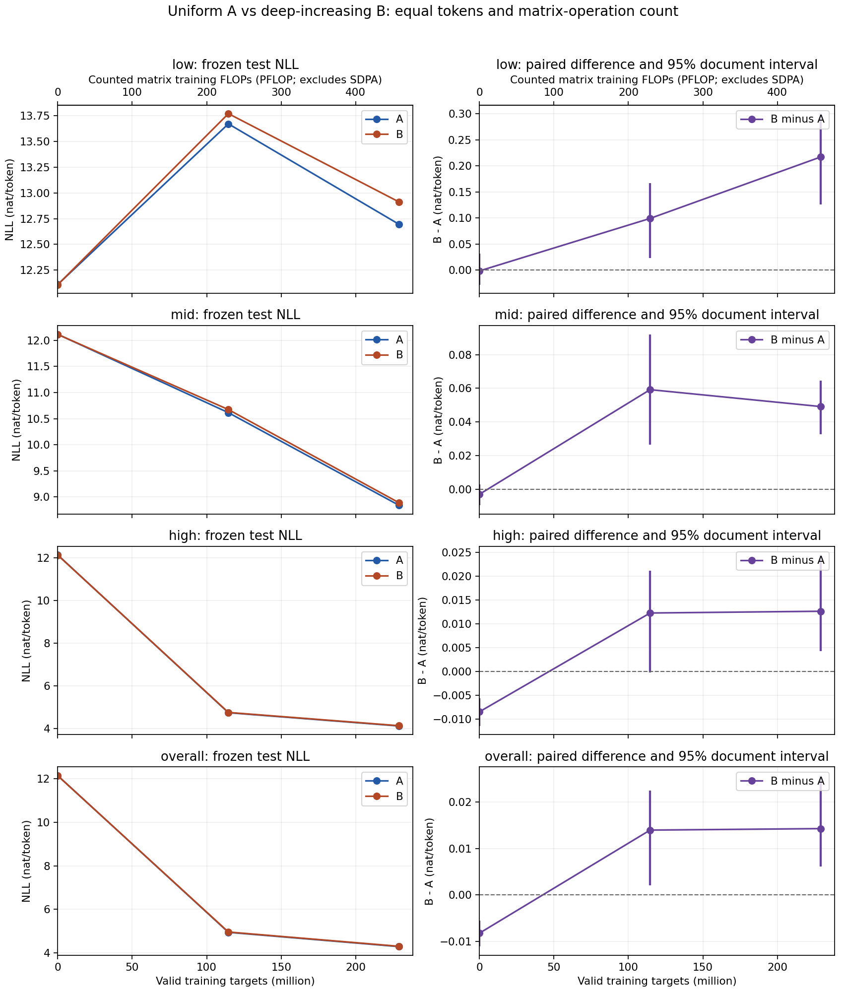

派生阅读副本；原件位置：`Projects/from-attention-to-search/main/experiments/A15/15_31_depth_expert_allocation/R01_paired_token_frequency/summary.md`。
[精确原始文件](../../../../../../../../sources/Projects/from-attention-to-search/main/experiments/A15/15_31_depth_expert_allocation/R01_paired_token_frequency/summary.md)；研究修改仍回到原件。

---

# R01: moving fixed expert capacity deeper did not improve low-frequency learning

**In this single-seed pair at 229,113,856 training targets per arm, increasing-depth B has 0.2172 higher low-frequency NLL and 0.01426 higher overall NLL than uniform A. No low-frequency benefit was observed, and overall performance was worse.** This bounds this allocation/data/budget rather than every hierarchical architecture. Scientific acceptance and mechanism judgment remain Unknown.

[中文](summary_cn.md) · [Full methods/evidence](detailed.md) · [Protocol](protocol.md) · [Joint freeze](joint_freeze.md) · [Coverage](coverage_ledger.md)

The factual reading has three paths: (1) behavior and factor controls compare the same held-out frequency-bucket and overall losses; (2) representations and layerwise organization contain routing observations only, not representation evidence; (3) functional interventions and quality include no causal intervention, while numerical/save/recovery/evaluation replay checks qualify measurement.

## Purpose and matched comparison

The advisor's shallow/few-expert and deep/many-expert intuition becomes a fair allocation question: can the same expert capacity placed deeper improve relatively infrequent-token prediction while retaining overall language modeling? H1 permits benefit, H2 preserves no advantage or trade-offs, and H3 measures routing without assuming causation. Oral prior reports and existing SAE results do not establish this architecture's benefit or a depth-to-long-tail mechanism.[Sources](source_review.md)

Both models are eight-layer causal decoders, residual width 1024, SwiGLU expert width 1536, top-2, no shared experts and tied embedding/output. A uses `[8,8,8,8,8,8,8,8]`; B `[6,6,6,8,8,10,10,10]`. Each has 507,988,992 unique/trainable and 281,496,576 conventional active parameters. Both actually completed 874 updates/229,113,856 targets, with full saves/evaluations at 0/437/874. Actual batch hashes match across every update. Saved seed 20261106 common weights and overlapping router rows match exactly; different routing choice sets still produce different initial functions. Equal parameters/exposure do not prove equal real execution cost.[Full ledger](detailed.md)

## Endpoint measurements

NLL is negative log probability, lower is better. B−A is positive when B is worse. The following values come from the[raw result table](../../../../../../../../sources/Projects/from-attention-to-search/main/experiments/A15/15_31_depth_expert_allocation/R01_paired_token_frequency/supporting_sources/frequency_results.csv); 95% intervals use 2,000 paired document resamples, not training-seed uncertainty.

| Bucket | Targets | A NLL | B NLL | B−A | Paired 95% interval |
| --- | --- | --- | --- | --- | --- |
| Low seen, primary | 1,481 | 12.694702 | 12.911912 | +0.217210 | [+0.125969, +0.300351] |
| Mid seen | 20,752 | 8.837688 | 8.886862 | +0.049174 | [+0.032819, +0.064679] |
| High seen | 677,902 | 4.129341 | 4.142017 | +0.012677 | [+0.004328, +0.024499] |
| Unseen | 172 | 15.847674 | 16.134700 | +0.287026 | [+0.027684, +0.433047] |
| Overall | 700,307 | 4.289854 | 4.304112 | +0.014258 | [+0.006160, +0.025677] |

Overall perplexity rises from 72.9558 to 74.0035. The primary low-frequency interval [+0.1260,+0.3004] excludes zero; mid/high/overall endpoint differences are also positive. This is not an observed exchange of overall quality for a rare-token gain, because the gain itself is absent. Unseen has only 172 targets and remains separate.

## Learning curves and routing

Left panels show A/B low, mid, high and overall NLL; right panels show paired B−A intervals and the zero reference at common valid-target counts. The upper compute axis counts matrix operations only. **Both low-frequency curves worsen first and partially recover, ending above their own random-initialization NLL:** A 12.1104→13.6704→12.6947, B 12.1088→13.7696→12.9119. Mid/high/overall improve substantially. The reason is unmeasured; do not retrofit signal-to-noise, forgetting or a capacity explanation.[Curve values](../../../../../../../../sources/Projects/from-attention-to-search/main/experiments/A15/15_31_depth_expert_allocation/R01_paired_token_frequency/supporting_sources/learning_curve_coordinates.csv)

Every layer has exactly 458,227,712 valid assignments, zero dropped assignments and zero experts with no receipts over the entire run. Load changes are mixed: layer 2 assignment CV decreases 0.1086→0.0509, while layer 8 rises 0.1426→0.1628. CV is receipt standard deviation/mean, not a functional-quality score. Raw and normalized entropy and every expert's receipts are in[Detailed](detailed.md) and[routing.json](../../../../../../../../sources/Projects/from-attention-to-search/main/experiments/A15/15_31_depth_expert_allocation/R01_paired_token_frequency/supporting_sources/routing.json). These observations do not identify the cause of the low-frequency difference.

## Costs and boundary

| Measured systems quantity | A | B |
| --- | ---: | ---: |
| Training-step targets/s | 131,723.8 | 130,933.4 |
| Training-step total seconds | 1,739.35 | 1,749.85 |
| Process seconds, initialization/all evaluation/saves | 1,893.53 | 1,898.45 |
| Peak allocated GiB | 37.5686 | 37.5738 |
| Gradient reduction seconds | 15.3512 | 15.4333 |

B's step throughput is about 0.60% lower, with 4.92 more process seconds. These are descriptive sequential-run timings: external sequential SHA reads of 34.5456 GB smoke states overlap early A, with unmeasured effect. Profiler-counted executed `aten::mm` matrix shapes give 2,000,027,648 FLOPs/token for both; fused SDPA and other kernels prevent a complete hardware-FLOP measurement. Graph estimates disclose assumptions in Detailed. Experts are local, so expert all-to-all is zero while gradient communication remains.

Frequency counts the actual supervised targets: low≤49, mid50–447, high>447, zero unseen. The deterministic 67,108,864-token source prefix becomes a 65,766,910-token stream cycled about 3.48 times. The final test has 544 documents/700,307 targets, only 1,481 low targets (0.2115%) across 246 documents. Near duplicates are unchecked, packed contexts can cross documents and only one seed is used. Automatic bucket examples precede formal training; explicit Codex bucket reading follows formal A's start, without rule changes or external human review. The original 115M holdout is not evaluated.[Deviations](detailed.md#protocol-conformance-and-deviations)

Reliable entity/fact tasks, representation/causal-routing interventions, decreasing C and seed 2 are NOT RUN. The[393,283,584-parameter width sketch](next_width_sketch.md) counts projections/tied head but is formula-only. AI suggestion: review this negative result and the proxy's relevance before the researcher chooses any follow-up; no automatic expansion. UI-renaming capability is unavailable and the interface title was not changed; the user-supplied task name is preserved in working memory. Final independent audit/asset metadata: Independent final numeric, frozen/legacy-source, paired-statistics and actual formal-initial-state audits PASS. All 30 NLL/difference values reproduce exactly; alternative interval reduction differs by at most 6.94e-18, with low/overall intervals identical. Formal A/B checkpoint families and analysis assets are registered and strict-access PASS; see Detailed.
