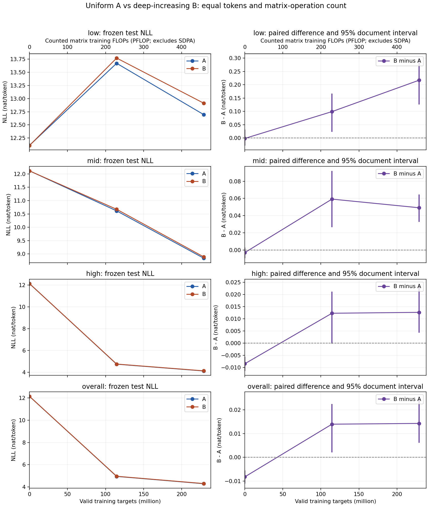

派生阅读副本；原件位置：`Projects/from-attention-to-search/main/experiments/A15/15_31_depth_expert_allocation/R01_paired_token_frequency/summary_cn.md`。
[精确原始文件](../../../../../../../../sources/Projects/from-attention-to-search/main/experiments/A15/15_31_depth_expert_allocation/R01_paired_token_frequency/summary_cn.md)；研究修改仍回到原件。

---

# R01：同量专家向深层移动，本轮未改善低频学习

**在本次单种子、每组2.291亿训练目标的成对实验中，深层递增B的低频NLL比均匀A高0.2172，整体NLL也高0.01426；没有观察到低频收益，且整体表现更差。**这只约束本轮分配、数据和预算，不能否定所有分层架构；科学接受与机制判断仍为Unknown。

[English](summary.md) · [完整方法与证据](detailed_cn.md) · [冻结合同](protocol_cn.md) · [共同预算](joint_freeze_cn.md) · [覆盖台账](coverage_ledger_cn.md)

本轮事实按三条阅读路径展开：①行为与因素控制：比较同一测试位置的低／中／高频和整体损失；②表征与逐层组织：只观察路由负载，不将其当作表征证据；③功能干预与质量：本轮未做因果干预，数值、保存／恢复与评估复算检查保障测量可信。

## 为什么做这个比较

导师提出浅层少专家、深层多专家的直觉。研究者把它收紧为一个公平问题：同量专家换个深度分配，能否提高相对低频token的预测能力，并保持整体语言建模？H1允许低频收益，H2保留无收益与权衡，H3测量路由变化但不预认定原因。会议口头报告与既有SAE结果未证明本轮架构的收益或深度到长尾表征的机制。[来源审查](source_review_cn.md)

两组都是8层因果语言模型，hidden1024、每个SwiGLU专家中间宽度1536、每token每层选top-2，无共享专家，embedding／输出头绑定。A每层8专家；B把3／2／3层阶段设为6／8／10专家。训练从共同随机规则开始，实际seed20261106的共有参数和router重叠行已逐位核验；候选集合不同，初始预测仍可不同。

| 项目 | A均匀 | B递增 |
| --- | --- | --- |
| 逐层专家数 | 8,8,8,8,8,8,8,8 | 6,6,6,8,8,10,10,10 |
| 总参数／可训练 | 507,988,992 | 507,988,992 |
| 理论激活参数 | 281,496,576 | 281,496,576 |
| 实际训练目标／更新 | 229,113,856／874 | 229,113,856／874 |
| 起点／中点／终点 | 0／437／874步 | 0／437／874步 |

全部874更新的实际batch hash两组一致；两组冻结预算和所有规定评估均完成。参数相同排除额外容量，曝光相同排除多见训练数据；理论激活参数不保证执行开销完全一致。完整逐层账本与超参见[Detailed](detailed_cn.md)。

## 终点结果

负对数似然NLL表示正确下一token有多难预测，越低越好。差值B−A为正表示B更差。下表来自[原始结果表](../../../../../../../../sources/Projects/from-attention-to-search/main/experiments/A15/15_31_depth_expert_allocation/R01_paired_token_frequency/supporting_sources/frequency_results.csv)，区间是2,000次成对文档重采样的95%百分位区间，只描述评估采样，不能代替多训练种子。

| 桶 | 测试token | A NLL | B NLL | B−A | 成对95%区间 |
| --- | --- | --- | --- | --- | --- |
| 低频已见（主指标） | 1,481 | 12.694702 | 12.911912 | +0.217210 | [+0.125969, +0.300351] |
| 中频已见 | 20,752 | 8.837688 | 8.886862 | +0.049174 | [+0.032819, +0.064679] |
| 高频已见 | 677,902 | 4.129341 | 4.142017 | +0.012677 | [+0.004328, +0.024499] |
| 训练未见 | 172 | 15.847674 | 16.134700 | +0.287026 | [+0.027684, +0.433047] |
| 整体 | 700,307 | 4.289854 | 4.304112 | +0.014258 | [+0.006160, +0.025677] |

整体困惑度PPL从A的72.9558升至B的74.0035。主指标低频差区间[+0.1260,+0.3004]没有跨零；中频、高频与整体终点差也为正。这一轮不是“以整体代价换到低频收益”，因为低频收益本身没有出现。未见桶仅172token，独立列出，不当成长尾知识结论。

## 学习过程中发生了什么

图左列是A／B的低频、中频、高频和整体NLL，横轴为共同有效训练token；右列是相同位置的B−A及文档区间，零线表示无差异。上方算力轴仅计矩阵操作，不是完整硬件FLOPs。**低频两组都先变差、后回落，但终点仍差于各自随机起点**：A为12.1104→13.6704→12.6947，B为12.1088→13.7696→12.9119。中频、高频和整体则明显改善。因此不能把这轮描述为“两组均学好低频，B只是少获益”。具体原因未被本轮测量，不能事后补为信噪比、遗忘或容量瓶颈。[曲线原数](../../../../../../../../sources/Projects/from-attention-to-search/main/experiments/A15/15_31_depth_expert_allocation/R01_paired_token_frequency/supporting_sources/learning_curve_coordinates.csv)

## 路由与实际开销

每层累计458,227,712次有效专家assignment，两组全部层drop0、整轮零接收的死专家0。B的负载变化并非所有层同向：第2层负载变异系数CV从A的0.1086降到0.0509，第8层却从0.1426升到0.1628。CV是专家接收量的标准差／均值，不是功能好坏指标。完整逐专家接收量、路由熵与归一化熵见[Detailed](detailed_cn.md)和[routing.json](../../../../../../../../sources/Projects/from-attention-to-search/main/experiments/A15/15_31_depth_expert_allocation/R01_paired_token_frequency/supporting_sources/routing.json)。这些相关观察不能解释低频差的因果来源。

| 实测系统量 | A | B |
| --- | ---: | ---: |
| 训练step吞吐，token/s | 131,723.8 | 130,933.4 |
| 训练step合计秒 | 1,739.35 | 1,749.85 |
| 含初始化／全部评估／保存的进程秒 | 1,893.53 | 1,898.45 |
| 峰值allocated显存，GiB | 37.5686 | 37.5738 |
| 梯度归约累计秒 | 15.3512 | 15.4333 |

B的step吞吐约低0.60%，全流程约多4.92秒，仅作本次顺序运行的描述，不能推出稳定速度差。formalA初期外部顺序读取34.5456GB短测文件用于SHA注册，时间影响未量化。两组profiler按已执行`aten::mm`算子形状计数均每token2,000,027,648FLOPs；融合SDPA等未全量计，完整硬件训练FLOPs为NOT_MEASURED，明确假设的全图估计见Detailed。专家本地执行，无expert all-to-all；数据并行梯度通信并非零。

## 结果边界与交付

频率按本轮真实229,113,856个监督目标统计，低≤49、中50–447、高>447、0为未见。训练只来自既有DCLM一个67,108,864token前缀，去重后65,766,910token循环约3.48遍；最终测试544文档700,307目标，低频仅1,481（0.2115%），实际分布于246篇文档。近重复未查，packed上下文可能跨文档；只做一个训练种子。自动分桶样例在正式前生成，Codex明确逐例阅读发生formalA开始后，外部人类review未进行，阅读后未改规则。原115M holdout本轮未用。[全部偏差](detailed_cn.md#协议符合性与偏差)

可靠实体／事实任务、表征或因果路由干预、递减组C和第二种子均NOT RUN。浅窄深宽的[393,283,584参数草图](next_width_sketch_cn.md)含跨层投影并保留绑定头，只是公式账本，未训练。**AI建议**先审阅该负结果与低频桶是否对应关心的问题，再由研究者决定是否值得下一验证；不自动扩展训练。界面改名工具不可用，UI名称未修改；用户指定名称已用于本任务记忆。[单一组会稿](../../../../../../../../UNAVAILABLE.md)；[完整覆盖与缺项](coverage_ledger_cn.md)。

最终独立数值／来源审计与正式资产登记：独立最终数值、source／旧源哈希、成对统计及正式初态审计均PASS；30项NLL／差精确复算，区间独立归约最大差6.94e-18，低频／整体区间逐值一致。正式A／B家族与分析资产已注册且strict PASS，具体入口见Detailed。工程完成不替代科学接受。
