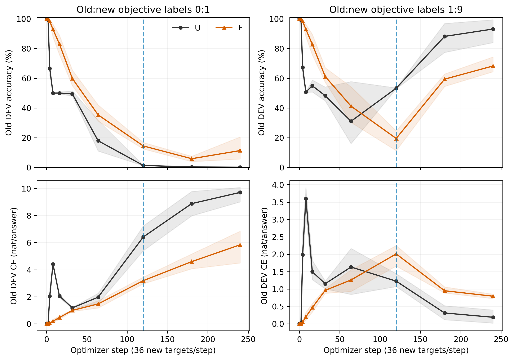
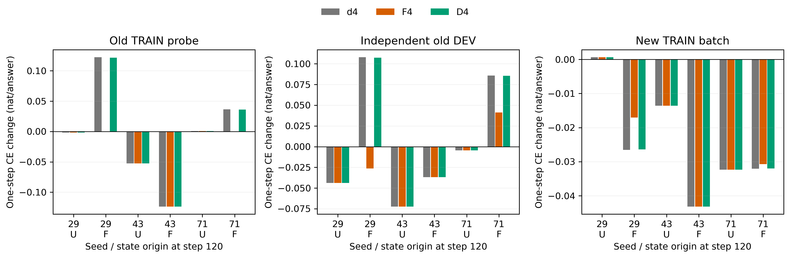

派生阅读副本；原件位置：`Projects/from-attention-to-search/main/experiments/A17/17_04_conditional_mapping_transfer/rounds/R06_functional_protection_20261025/local_dynamics_20261026/figures_cn.md`。
[精确原始文件](../../../../../../../../../../sources/Projects/from-attention-to-search/main/experiments/A17/17_04_conditional_mapping_transfer/rounds/R06_functional_protection_20261025/local_dynamics_20261026/figures_cn.md)；研究修改仍回到原件。

---

# 两张图与解释

## 图1：不同轨迹的学习过程

问题：旧行为何时下降、恢复，以及U/F何时分离？
观察：原1:9轨迹中U在中后期恢复旧表现，而F的120步状态和最终表现更差。
判断更新：固定120步可以检查已分离历史下的当步作用，不能把曲线相关直接称为投影造成当步有害。
边界：线为共用一个旧模型的三续训顺序均值，色带为最小到最大值而非置信区间，虚线120是事前指定局部诊断点。

## 图2：同状态单步反事实

问题：恢复同一θ和Adam后，F4相对普通d4及幅度控制D4怎样影响旧新损失？
观察：三个U来源和F来源43三候选相同，F来源29/71的F4改善旧损失但新损失下降较少，D4更接近d4。
判断更新：当前当步对照没有支持F4伤旧，历史状态束差异应优先分解，两个活跃状态也显示局部方向作用超过单纯缩步。
边界：每个柱是一个固定状态和固定批次的真实CE变化，单位nat/答案且负值改善，不是独立模型统计，也不能解释240步长期结果。
