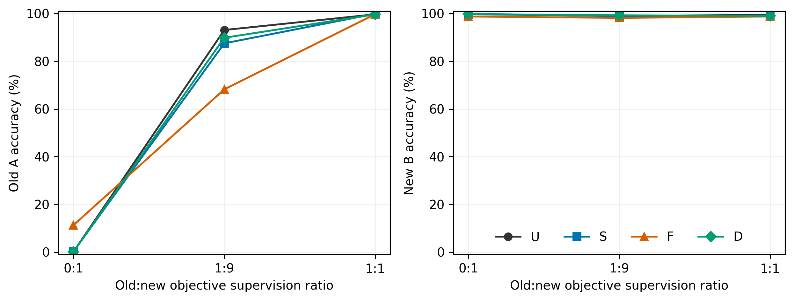
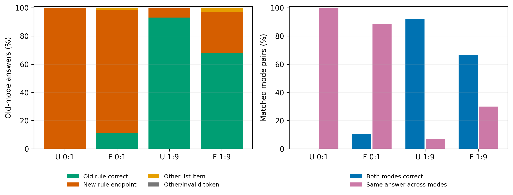
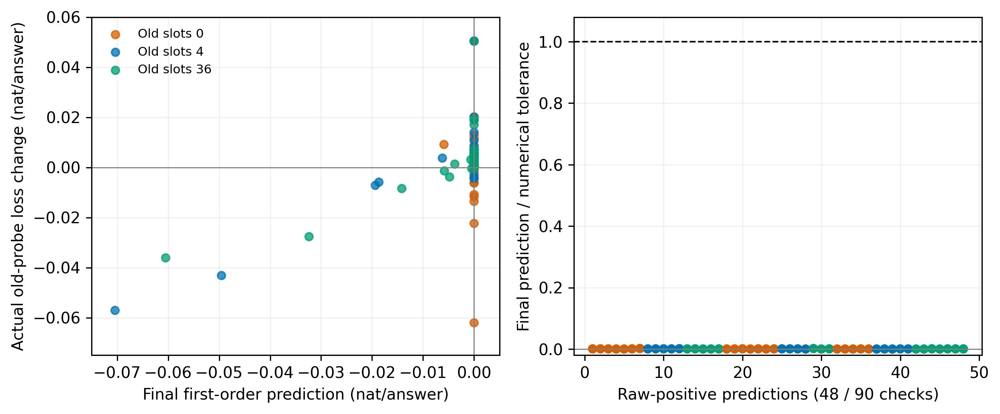

派生阅读副本；原件位置：`Projects/from-attention-to-search/main/experiments/A17/17_04_conditional_mapping_transfer/rounds/R06_functional_protection_20261025/meeting_analysis_20261026/figures_and_captions_cn.md`。
[精确原始文件](../../../../../../../../../../sources/Projects/from-attention-to-search/main/experiments/A17/17_04_conditional_mapping_transfer/rounds/R06_functional_protection_20261025/meeting_analysis_20261026/figures_and_captions_cn.md)；研究修改仍回到原件。

---

# 三张主图与四句说明

## 图1：旧监督与更新方式

问题：新题曝光与新损失系数相同时，旧监督和更新方式怎样改变旧新表现？
观察：U旧准确率随监督从0.125%升到93.125%和99.708%，F相对U的旧收益依次+11.167、−24.875、+0.042个百分点，新准确率总体约99%。
判断更新：正确旧监督组织有明确作用，而当前F只在零旧重放目标档有有限相对收益，未形成单调频率规律。
边界：这是共享同一旧模型的三个续训顺序均值，旧监督次数和目标权重同时改变，不能外推为自然feature频率规律。

## 图2：旧规则错误与模式切换

问题：失败主要是不能输出列表词，还是在旧模式选择了新规则？
观察：U0有99.833%旧题选择新规则端点，U1:9降至6.792%，F1:9仍为28.708%，四条件列表外输出均为0。
判断更新：输出证据支持具体的条件规则混淆描述，正确旧监督显著改善模式与答案的对应。
边界：每条件每顺序800对、旧新同目标排除0题，右侧成对均正确与两模式同答是两个独立统计，不能由此证明内部旧计算被删除或不同条件采用不同电路。

## 图3：局部预测与有限步结果

问题：F对最终实际位移的一阶约束是否落实，落实后是否保证旧探针损失不升？
观察：左图保留全部90个F检查点且实际loss原始上升69次，右图的48个原始正内积均远低于各自数值容差。
判断更新：没有发现超出当前数值审计范围的约束违背，但局部一阶条件不足以保证有限步loss或长期旧行为。
边界：横纵轴分别是最终实际一阶预测与同批探针真实损失差，单位nat/答案，容差是事后审计且缺少重复loss噪声标定，差额不能唯一归因于曲率。
