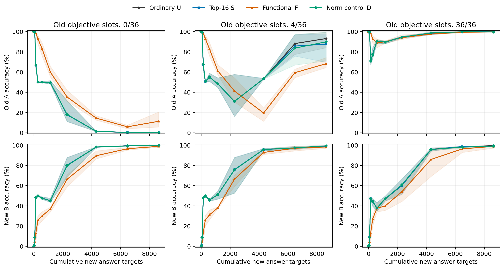

派生阅读副本；原件位置：`Projects/from-attention-to-search/main/experiments/A17/17_04_conditional_mapping_transfer/rounds/R06_functional_protection_20261025/summary_cn.md`。
[精确原始文件](../../../../../../../../../sources/Projects/from-attention-to-search/main/experiments/A17/17_04_conditional_mapping_transfer/rounds/R06_functional_protection_20261025/summary_cn.md)；研究修改仍回到原件。

---

# R06：固定新任务曝光的保护方法与监督配比

三条阅读路径：①行为与因素对照，看各档F相对U/S/D的旧新表现；②表示与层间组织，本轮未新增此类测量；③功能干预与测量质量，看实际Adam位移、探针损失与数值核验。

本轮目的：在新任务曝光不变时，区分功能方向选择、整体减速和旧监督本身的作用。全部条件共用同一个合格旧模型；每步36新答案、36旧输入槽，旧有效监督0/4/36，统一分母72。四方法均另读64条旧TRAIN探针，F/D用其标签约束位移。TEST本轮未读取。

已完成 36/36 条240步轨迹。每条完整轨迹8640次新答案曝光，旧有效曝光0/960/8640，另有15360次旧探针梯度标签使用，以及10个检查步共640次更新后诊断标签复用，合计16000次探针标签使用。主结果保持240步；下表按三个续训顺序等权平均，若未齐全则明确显示完成数。答案损失用交叉熵（Cross Entropy，CE），即正确答案概率的负自然对数，单位nat/答案，越低越好；表内保留三位小数，完整精度在CSV。

| 旧有效槽 | 方法 | 完成顺序数 | 旧准确率 % | 新准确率 % | 旧CE | 新CE |
| --- | --- | --- | --- | --- | --- | --- |
| 0 | U | 3 | 0.125 | 99.833 | 9.711 | 0.010 |
| 0 | S | 3 | 0.208 | 99.750 | 9.925 | 0.010 |
| 0 | F | 3 | 11.292 | 98.792 | 5.839 | 0.038 |
| 0 | D | 3 | 0.125 | 99.792 | 9.836 | 0.010 |
| 4 | U | 3 | 93.125 | 99.042 | 0.189 | 0.036 |
| 4 | S | 3 | 87.542 | 98.958 | 0.331 | 0.038 |
| 4 | F | 3 | 68.250 | 98.208 | 0.795 | 0.054 |
| 4 | D | 3 | 89.875 | 99.292 | 0.241 | 0.032 |
| 36 | U | 3 | 99.708 | 99.458 | 0.009 | 0.019 |
| 36 | S | 3 | 99.917 | 99.167 | 0.005 | 0.029 |
| 36 | F | 3 | 99.750 | 98.792 | 0.009 | 0.039 |
| 36 | D | 3 | 99.667 | 99.042 | 0.009 | 0.023 |

U=普通更新；S=原Top-16系数衰减；F=避免旧TRAIN探针损失一阶预测上升的位移投影；D=保留原位移方向、在自身轨迹上匹配F候选长度。S保留原1200步调度，只运行前240步，因此与R05终点强度不是同一阶段。

## 冻结判据与配对比较

| 旧有效槽 | 比较 | 配对数 | 平均旧差 pp | 平均新差 pp | 旧改善均为正 | 各顺序新下降≤5pp | 操作性门槛 |
| --- | --- | --- | --- | --- | --- | --- | --- |
| 0 | F-U | 3 | 11.167 | -1.042 | True | True | True |
| 0 | F-S | 3 | 11.083 | -0.958 | True | True | True |
| 0 | F-D | 3 | 11.167 | -1.000 | True | True | True |
| 4 | F-U | 3 | -24.875 | -0.833 | False | True | False |
| 4 | F-S | 3 | -19.292 | -0.750 | False | True | False |
| 4 | F-D | 3 | -21.625 | -1.083 | False | True | False |
| 36 | F-U | 3 | 0.042 | -0.667 | False | True | False |
| 36 | F-S | 3 | -0.167 | -0.375 | False | True | False |
| 36 | F-D | 3 | 0.083 | -0.250 | False | True | False |

操作性门槛要求旧改善平均至少5个百分点、三顺序均为正、各顺序新下降不超过5个百分点。对S/D的同门槛读数是补充比较，主要预定判据是F−U；不称为统计证明。

## 旧监督减少时的相对收益

| 续训顺序 | 0槽 F−U pp | 4槽 F−U pp | 36槽 F−U pp | 随监督减少严格增大 |
| --- | --- | --- | --- | --- |
| 29 | 7.750 | -30.000 | 0.000 | False |
| 43 | 5.500 | -9.625 | -0.125 | False |
| 71 | 20.250 | -35.000 | 0.250 | False |

## 固定新学习水平与成本

| 顺序 | 旧槽 | 方法 | 90%状态 | 连续两点评价确认步 | 确认时旧 % | 确认时新 % | 新曝光 | 探针梯度标签 | 探针诊断标签 | 更新计算秒 |
| --- | --- | --- | --- | --- | --- | --- | --- | --- | --- | --- |
| 29 | 0 | U | REACHED | 180 | 0.125 | 99.125 | 6480 | 11520 | 576 | 10.330 |
| 29 | 0 | S | REACHED | 180 | 0.125 | 99.125 | 6480 | 11520 | 576 | 10.768 |
| 29 | 0 | F | REACHED | 240 | 7.750 | 98.000 | 8640 | 15360 | 640 | 14.118 |
| 29 | 0 | D | REACHED | 180 | 0.125 | 99.125 | 6480 | 11520 | 576 | 10.636 |
| 29 | 4 | U | REACHED | 180 | 96.875 | 97.375 | 6480 | 11520 | 576 | 10.644 |
| 29 | 4 | S | REACHED | 180 | 97.000 | 97.500 | 6480 | 11520 | 576 | 10.965 |
| 29 | 4 | F | REACHED | 180 | 54.500 | 94.250 | 6480 | 11520 | 576 | 10.774 |
| 29 | 4 | D | REACHED | 180 | 97.250 | 96.000 | 6480 | 11520 | 576 | 10.490 |
| 29 | 36 | U | REACHED | 180 | 100.000 | 98.375 | 6480 | 11520 | 576 | 10.915 |
| 29 | 36 | S | REACHED | 180 | 99.875 | 98.250 | 6480 | 11520 | 576 | 11.173 |
| 29 | 36 | F | REACHED | 180 | 99.875 | 97.625 | 6480 | 11520 | 576 | 10.509 |
| 29 | 36 | D | REACHED | 180 | 100.000 | 97.000 | 6480 | 11520 | 576 | 10.792 |
| 43 | 0 | U | REACHED | 180 | 0.500 | 99.500 | 6480 | 11520 | 576 | 10.549 |
| 43 | 0 | S | REACHED | 180 | 0.500 | 99.375 | 6480 | 11520 | 576 | 10.923 |
| 43 | 0 | F | REACHED | 180 | 6.125 | 96.625 | 6480 | 11520 | 576 | 11.233 |
| 43 | 0 | D | REACHED | 180 | 0.625 | 99.125 | 6480 | 11520 | 576 | 10.987 |
| 43 | 4 | U | REACHED | 180 | 77.375 | 95.500 | 6480 | 11520 | 576 | 10.759 |
| 43 | 4 | S | REACHED | 180 | 75.750 | 96.375 | 6480 | 11520 | 576 | 10.495 |
| 43 | 4 | F | REACHED | 180 | 62.875 | 97.500 | 6480 | 11520 | 576 | 11.157 |
| 43 | 4 | D | REACHED | 180 | 66.875 | 97.375 | 6480 | 11520 | 576 | 10.432 |
| 43 | 36 | U | REACHED | 180 | 99.375 | 98.875 | 6480 | 11520 | 576 | 10.885 |
| 43 | 36 | S | REACHED | 180 | 99.500 | 99.000 | 6480 | 11520 | 576 | 11.344 |
| 43 | 36 | F | REACHED | 180 | 99.250 | 98.500 | 6480 | 11520 | 576 | 10.721 |
| 43 | 36 | D | REACHED | 180 | 99.875 | 98.750 | 6480 | 11520 | 576 | 10.808 |
| 71 | 0 | U | REACHED | 180 | 0.125 | 99.500 | 6480 | 11520 | 576 | 10.829 |
| 71 | 0 | S | REACHED | 180 | 0.250 | 99.500 | 6480 | 11520 | 576 | 10.931 |
| 71 | 0 | F | REACHED | 240 | 20.500 | 99.750 | 8640 | 15360 | 640 | 14.356 |
| 71 | 0 | D | REACHED | 180 | 0.250 | 99.375 | 6480 | 11520 | 576 | 11.091 |
| 71 | 4 | U | REACHED | 180 | 90.250 | 99.000 | 6480 | 11520 | 576 | 10.900 |
| 71 | 4 | S | REACHED | 180 | 84.375 | 97.750 | 6480 | 11520 | 576 | 11.396 |
| 71 | 4 | F | REACHED | 180 | 60.750 | 99.000 | 6480 | 11520 | 576 | 10.551 |
| 71 | 4 | D | REACHED | 180 | 86.875 | 98.625 | 6480 | 11520 | 576 | 10.698 |
| 71 | 36 | U | REACHED | 180 | 99.500 | 98.125 | 6480 | 11520 | 576 | 10.945 |
| 71 | 36 | S | REACHED | 180 | 99.500 | 98.500 | 6480 | 11520 | 576 | 10.929 |
| 71 | 36 | F | REACHED | 240 | 99.875 | 97.000 | 8640 | 15360 | 640 | 14.422 |
| 71 | 36 | D | REACHED | 180 | 99.500 | 98.250 | 6480 | 11520 | 576 | 10.652 |

连续两次新平均准确率≥90%的第二个评价点为预定次要读数；未达到的保留。更新计算秒为各步测量之和，排除DEV评价、存盘和一次性外进程恢复检查；首次U运行的总耗时含工程检查，不能直接作为方法速度差。探针梯度与更新后诊断的标签使用、输入token和计算开销在diagnostic_overview.csv中分列；运行时old_probe_targets计数专指梯度探针，诊断复用按固定检查步另行补计。

## 观察、解释与边界

- 旧槽0：F−U旧准确率均差11.166666666666666pp，新均差-1.0416666666666667pp；预定操作性判据=True。
- 旧槽4：F−U旧准确率均差-24.875pp，新均差-0.8333333333333334pp；预定操作性判据=False。
- 旧槽36：F−U旧准确率均差0.041666666666666664pp，新均差-0.6666666666666666pp；预定操作性判据=False。

这些是冻结规则的计算结果；AI解释需同时看D与新学习资格。F即使满足局部一阶约束，也可能因有限步余项或探针泛化而遗忘。旧频率同时改变旧目标总权重，不是纯频率实验；三个顺序共用旧模型，不能外推到独立模型总体。没有新增MoE、路由或自然语言任务，加法证据未混入。研究者机制接受与主问题关闭仍Unknown。

完整证据：[逐顺序终点](../../../../../../../../../sources/Projects/from-attention-to-search/main/experiments/A17/17_04_conditional_mapping_transfer/rounds/R06_functional_protection_20261025/tables/endpoints_36.csv)、[全部曲线](../../../../../../../../../sources/Projects/from-attention-to-search/main/experiments/A17/17_04_conditional_mapping_transfer/rounds/R06_functional_protection_20261025/tables/curves.csv)、[局部诊断](../../../../../../../../../sources/Projects/from-attention-to-search/main/experiments/A17/17_04_conditional_mapping_transfer/rounds/R06_functional_protection_20261025/tables/diagnostic_overview.csv)、[核验](../../../../../../../../../sources/Projects/from-attention-to-search/main/experiments/A17/17_04_conditional_mapping_transfer/rounds/R06_functional_protection_20261025/tables/verification.json)、[执行细节](detailed_cn.md)。

## 曲线与读取方式

横轴是累计新答案曝光，纵轴分别是旧/新准确率（%）；每列对应一个旧监督档。线为三个续训顺序等权平均，色带只表示三者最小到最大值，不是置信区间；保存点之间连线辅助阅读，没有平滑。

[旧新答案损失曲线](../../../../../../../../../sources/Projects/from-attention-to-search/main/experiments/A17/17_04_conditional_mapping_transfer/rounds/R06_functional_protection_20261025/figures/answer_loss_curves.png)的纵轴为每答案自然对数损失，越低越好；[顺序29](../../../../../../../../../sources/Projects/from-attention-to-search/main/experiments/A17/17_04_conditional_mapping_transfer/rounds/R06_functional_protection_20261025/figures/order_29_accuracy.png)、[顺序43](../../../../../../../../../sources/Projects/from-attention-to-search/main/experiments/A17/17_04_conditional_mapping_transfer/rounds/R06_functional_protection_20261025/figures/order_43_accuracy.png)、[顺序71](../../../../../../../../../sources/Projects/from-attention-to-search/main/experiments/A17/17_04_conditional_mapping_transfer/rounds/R06_functional_protection_20261025/figures/order_71_accuracy.png)保留逐顺序曲线。

## AI解读：有条件收益，频率关系不单调

**H1在零旧重放目标档得到有限支持。** F的平均旧准确率11.292%，U与D均0.125%，S为0.208%；F新准确率98.792%，比U低1.042个百分点。F对U/S/D的旧改善在三个顺序均为正，且新下降均在5个百分点内，达到事前操作门槛。当前幅度控制D没有复现收益，说明结果不只体现该局部幅度控制的作用。但旧能力仍从起点100%掉到约11%，不能称为已保持旧规则。F每步使用64条旧标签，收益属于旧标签辅助的局部保护规则，不能归于无需旧信息的参数分解。

**H3在有旧重放时更符合结果。** 每步只增加4条旧目标，U旧准确率已达93.125%，F反而降到68.250%，三个顺序F−U均为负；新准确率分别99.042%和98.208%。36条旧目标时U已达旧99.708%、新99.458%，F旧99.750%、新98.792%，没有稳定额外保留。共享参数加正确旧监督已能兼顾当前两规则，当前结果不要求分专家。

**未支持“监督越少，F优势越大”的三档单调关系。** F−U旧收益依次为+11.167、−24.875、+0.042个百分点；三个顺序都不满足0槽>4槽>36槽的冻结趋势判据。可以说零旧重放目标时存在相对收益，不能把非单调的三点概括成普适频率规律。

**一阶约束没有变成有限步保证。** 预定90个F有限步检查中，69次同一旧探针实际损失上升；一阶项与有限变化及余项完整分列。作为事后说明性样本，顺序29、零旧目标、F第1步，探针CE从1.91465e−5升到3.44467e−5 nat/答案，而实际位移的一阶预测约7.87e−13。这个小量样本只说明“预测近零不等于有限变化为零”，不能解释全部终点退化。探针代表性、有限步余项与优化轨迹的相对作用仍未区分；当前不新增实验。

次要学习水平比较也显示F有学习成本：U在三个顺序均于第180步完成连续两次90%的确认；零旧目标的F为第240、180、240步。它不替代固定240步的主结论，且实际确认时的新准确率与样本成本分别列出，不假装相同精确学习水平。

下一项建议是优先审视“旧目标为何比当前局部投影更有效，以及局部预测何时失效”，而非直接推进新MoE或不断换大奇异方向。本轮具体矩阵执行与记录已完成并停止训练；研究者的机制接受、后续实验选择和整个主问题关闭仍Unknown。

**交付时限偏差：** 训练25.18分钟，核心分析、登记及检查在起点后38分钟内完成；最终打包与归档在后续续接时完成，超过原定4小时墙钟交付窗口。不能称端到端预算内完成；期间没有新增训练或资源。时间依据见[回执](../../../../../../../../../sources/Projects/from-attention-to-search/main/experiments/A17/17_04_conditional_mapping_transfer/rounds/R06_functional_protection_20261025/reproduce/report_budget_deviation.json)。
