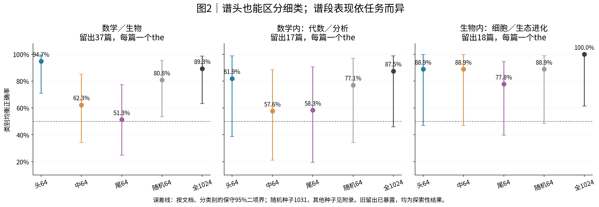
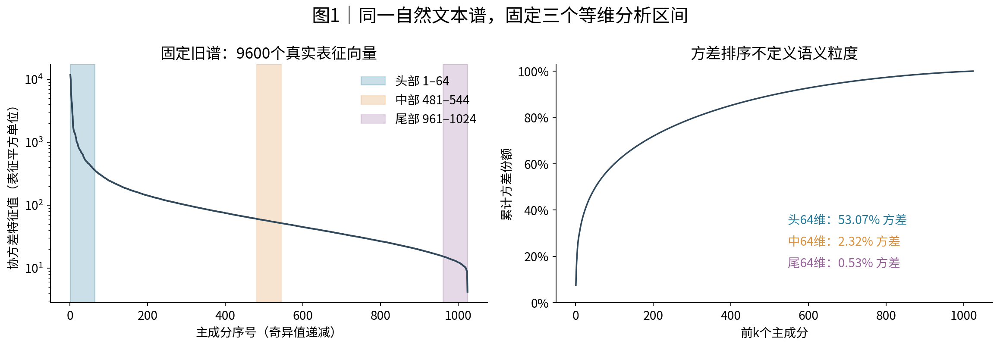
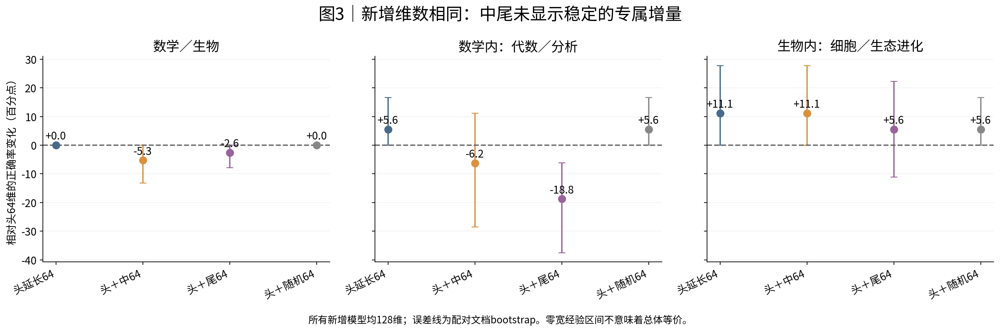
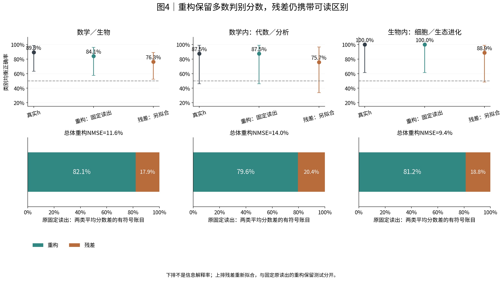
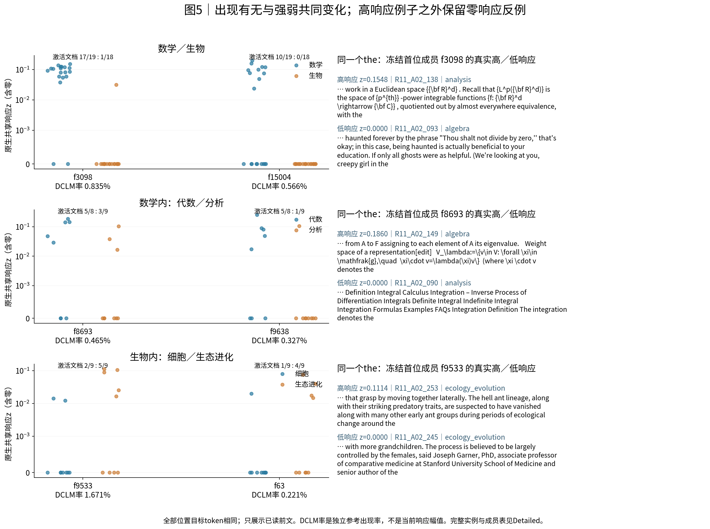

派生阅读副本；原件位置：`Projects/from-attention-to-search/main/experiments/A15/15_27_natural_language_feature_response/R12_spectral_semantic_granularity_20261031/summary_cn.md`。
[精确原始文件](../../../../../../../../sources/Projects/from-attention-to-search/main/experiments/A15/15_27_natural_language_feature_response/R12_spectral_semantic_granularity_20261031/summary_cn.md)；研究修改仍回到原件。

---

# R12：谱位置与语义粒度

[English](summary.md) · [协议](../../../../../../../../UNAVAILABLE.md) · [完整证据、控制与不足](../../../../../../../../UNAVAILABLE.md) · [真实文本实例](../../../../../../../../UNAVAILABLE.md) · [资产与数据口径](../../../../../../../../UNAVAILABLE.md)

**认识更新：这份小样本自然文本面板没有建立“大奇异值对应粗类别、中小奇异值补充细类别”的稳定排序。谱头同时能读出粗、细类别，生物细分类在中段也有信号；中尾相对谱头的专属新增收益未超过同维数对照。CrossCoder保留了约80%–82%的当前类别平均判别分数差，残差仍携带可读类别关联。这个百分比不是信息解释率。**

这是实测后的AI认识更新，供研究者审阅；科研接受、机制判断与问题关闭仍为Unknown。结论限于当前面板和线性读出。原留出曾在R11使用，本轮虽在新选型冻结后才读其数值，也只能算探索性评估。

阅读分三条：①分类读出及因素对照；②表征谱组织；③测量质量。这里的“预测”是读出分类，不是语言模型原生回答；功能干预未运行。

## 先定义研究对象

我们研究同一Qwen3-0.6B-Base最后block27输出、最终归一化之前的1024维向量。把旧R04发现自然文本的9600个向量共同中心化并做PCA，得到按方差递减的正交方向。固定头1–64、中481–544、尾961–1024，三段各64维。R07／R10用的是同一个谱，复用不是独立复现。

类别在表征之外定义：数学下的代数／分析，生物下的细胞／生态进化。每篇固定选择位置96–191中最后一个前导空格the，只用该位置之前已读文本核查标签。100个四叶候选文档中96篇有此目标，发现／开发／留出39／20／37，每篇一处；含混细标签保留在粗任务、从主细任务排除。三个任务均以每类8篇发现、4篇开发训练和选参。数学与生物细任务留出分别17、18篇，不能把多个任务中的重复文档相加。

## 认识更新一：类别信息没有整齐地按粗细分到不同谱段

目的不是比较哪个任务更容易，而是对同一任务换谱段，再比较这种差值是否随类别层级改变。下表是训练集逐坐标标准化、同流程线性读出的平衡正确率，即两个类别正确率的平均；机会水平50%。

| 任务｜留出独立文档 | 头64 | 中64 | 尾64 | 全1024 |
|---|---:|---:|---:|---:|
| 数学／生物 · n=37 | 94.7% | 62.3% | 51.3% | 89.3% |
| 代数／分析 · n=17 | 81.9% | 57.6% | 58.3% | 87.5% |
| 细胞／生态进化 · n=18 | 88.9% | 88.9% | 77.8% | 100.0% |

图2横轴是输入空间，纵轴是类别均衡正确率。三图分别固定同一任务及同一组留出文档；全空间和预定随机64维也有参照。误差线使用按类别的保守文档二项界，避免18篇全对时把经验bootstrap的[100%,100%]当作高精度证据。数学细任务的全空间点估计87.5%，但保守界约46.0%–98.9%，其强结论仍受小样本限制。全空间没有胜过头部不表示它数学上含有更少信息，而是有限样本和正则化下的拟合表现。

更直接的粒度检验是“中／尾减谱头”的细任务差值，再减粗任务同一差值。生物的中、尾交互点值为+32.5、+32.3个百分点，配对区间为[+7.6,+57.2]、[+2.2,+65.2]；四个交互检验Holm校正后p为0.076、0.117，尚未确认。数学两项区间跨零。因而不能用这张表宣布由粗到细的规律。当前尾段粗分类较弱也不推翻R07：R07使用构造前文和example／explanation，本轮是自然前文中的the，训练样本量和维数也不同；这不是只改变粒度的一次独立复现。

图1展示参考协方差特征值（与奇异值平方成比例）和累计方差。三段分别占53.07%、2.32%、0.53%参考方差；低方差不等于无类别信息。1024个特征值全正，但924个相邻相对谱隙小于1%，因此解释固定子空间及其读出轴，不给单根方向强贴语义。

## 认识更新二：增加中尾方向没有显示稳定的专属增量

图3固定头64，新增64维后比较头延长、中、尾和与头正交的随机方向；四个条件都128维，纵轴是相对头64的百分点变化。生物“头+中”由88.9%到100%，但“头延长”同样100%，不能把+11.1点归为中段独有贡献。数学“头+中／尾”分别比头部低6.2／18.8点，而头延长提高5.6点。所有主增量相对同维参照的检验均未建立正收益。

这只说明当前线性读出没有确认中尾的独立增益，不证明这些谱段没有信息。10个固定训练子集种子显示，数学头／中正确率中位数约70.5%／69.8%，主次会随取样变化；生物头部、中段相对稳定。完整标准化、原尺度、所有随机种子、邻近区间和量化敏感性保留于附录，未选择新赢家替换主结果。

## 认识更新三：CrossCoder保留多数当前判别分数，却没有吞掉全部区别

先在真实h上拟合一次谱投影、尺度和读出，再原样施加于完整重构。粗任务正确率89.3%→84.1%，数学细任务87.5%→87.5%，生物细任务100%→100%。但正确率不变不意味着分数不变：重构分别保留82.1%、79.6%、81.2%的两类平均固定分数差，余下17.9%、20.4%、18.8%落在残差。总体归一化平方重构误差为11.6%、14.0%、9.4%，不能换写成信息解释比例。

数学细任务正确率虽然同为87.5%，实际有1例被修正、1例新错，不能称保留了相同判断。例如R11_A02_136的高次多项式求解前文，真实h的固定读出在领域和代数类别上原本均正确，重构后两者均错；完整分数和前文保留在实例页。

残差另拟合读出的正确率为76.3%、75.7%、88.9%，与上面的固定保留测试单列。A22的z来自14层联合编码，因此重构重新拟合后偶尔更好，也不代表仅从最后层创造了新信息。完整有符号成员贡献加上常数和残差，逐样本重现原固定分数，最大误差约1.8e−15。

## 认识更新四：成员使用可分解，精确语义与功能关系仍不能跳步

图5每个点是一篇留出文档在同一the处的原生共享z，零也保留。f3098在数学17/19篇、生物1/18篇激活；但数学内部仍有高、零响应反例。f8693在代数5/8、分析3/9篇激活，正值均值约0.110／0.053，说明出现比例和正值强度都可参与同一份差异。只有两类各≥3个正文档时才解释条件幅值；单侧零或支持少时不强分幅值效应。

独立DCLM参考发生率分别为f3098 0.835%、f8693 0.465%、f9533 1.671%、f63 0.221%，原分组属于中、中、高、低；不是当前样本发生率，更不是谱段标签。完整16384成员全部进入有符号账目，包含增强和抵消，没有只分析旧16个严格成员。

发现集冻结的每任务12名中，留出均值偏向点估计同向为11／12、9／12、12／12；36名统一Holm校正后，仅粗任务4名通过探索性规则，两项细任务均0名。词汇解释也有正反面：发现集提出的词项与粗任务头部、生物头／中段分数在留出保持关联（Holm9 p≈0.0007／0.022／0.035），数学三段未通过。它支持特定词汇／对象关联，不足以给整段或每个feature贴单一语义名。

反例很具体：f9533在古蚂蚁捕食、形态和生态变化的前文中z≈0.1114，在同属生态进化标签、讨论哺乳动物后代性别策略的前文中z=0。同一细类不保证同一成员响应。完整高／居中／低文本、当前词面、位置和后续文字的独立标记见实例页。

18个预定成员对在控制基础发生频率及来源后，没有BH q<0.05关系（最小约0.782）。加入成对出现乘积，相比同参数数目的单成员新增，三个任务差值−7.9／0／−11.1点，没有组合增益证据。共同响应因此只保留统计含义。

## 竞争解释与结论边界

同token控制排除了纯目标身份解释，但不同前文的词汇、格式、长度和来源仍会变化。严格同平台、同文体且位置差≤32时，仅粗任务5对、数学细任务1对、生物细任务3对；两个细任务不足，不能认证纯语义差异。来源／格式基线在数学细任务也达到69.4%，竞争解释仍然强。旧留出暴露、每类少量文档和标签体系的领域交叉共同限制推广。

**假设状态：**谱头能读出细类，但这本身不反驳“头部相对更偏粗类”。真正对应原假设的细减粗交互和同维新增比较仍未建立，不能宣布假设被证伪。“字典已解释全部类别区别”被残差账目及残差读出削弱。没有因果、训练动态或MoE收益结论。

**AI建议的唯一下一步：**若继续检验粒度规律，优先建立全新、来源与文体交叉均衡、常见token覆盖充分的四叶确认面板；先提高独立文档支持，而不是增加层数、分类器或换谱段。当前不自动启动该新面板。

本轮计算全部在CPU完成：新增模型前向0、语言模型／字典训练0、GPU使用0。5组主图和1组敏感性图、全部要求的适用分析及不足记录已交付；科学接受仍Unknown。
