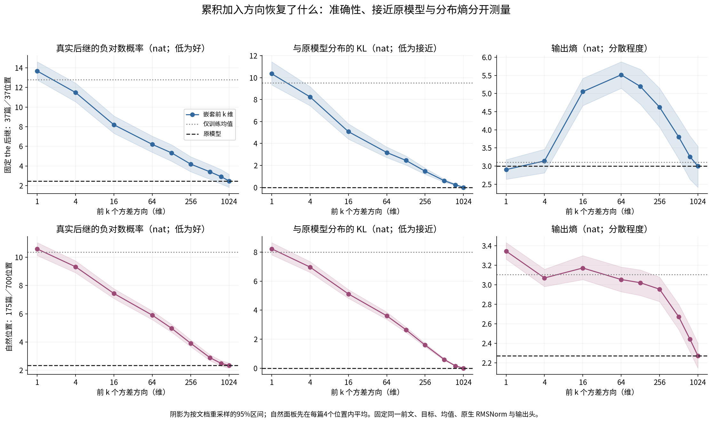
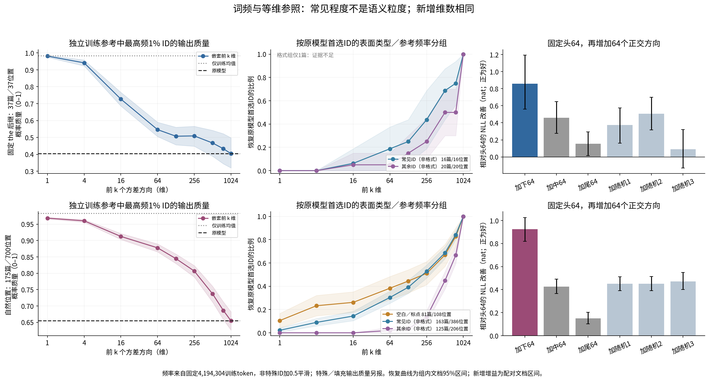
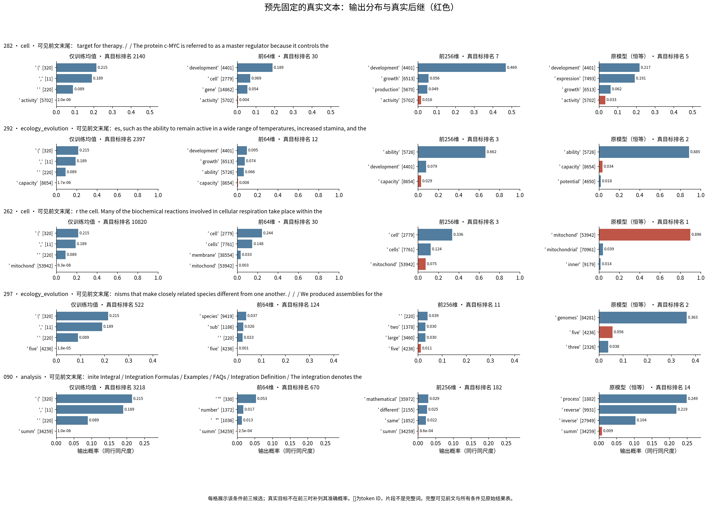

派生阅读副本；原件位置：`Projects/from-attention-to-search/main/experiments/A15/15_27_natural_language_feature_response/R13_20261101_native_spectral_decoding/summary.md`。
[精确原始文件](../../../../../../../../sources/Projects/from-attention-to-search/main/experiments/A15/15_27_natural_language_feature_response/R13_20261101_native_spectral_decoding/summary.md)；研究修改仍回到原件。

---

# Cumulative spectral projection and native decoding

Behavior and factor controls hold prefix/head fixed; representation analysis uses the fixed TRAIN spectrum; intervention quality is checked by native decoding, identity and cache replay. All applicable measurements are complete. These results establish bounded prediction-recovery observations, not a coarse-to-fine semantic hierarchy.

We use the exact R12 official Qwen3-0.6B-Base weights/tokenizer and block27 residual-post before final RMSNorm. Projections add the inherited TRAIN mean, apply the original final norm, then the tied frozen lm_head. No model/classifier/dictionary is trained. The1024-dimensional PCA basis was fit to9600 positions from60 R04 discovery documents and is reused, not independently replicated. All37 fixed R12/the documents and175 natural-position documents/700 positions are evaluated separately;32 documents overlap,180 physical documents total. All are exploratory exposed-document reuse.

The old cache failed the unchanged5090 native replay gate; all180 documents were refreshed using the same weights/hook/input and original fixed shape. Fresh replay and same-shape causal-prefix NLL differences are zero on three smoke documents. Full-PC and direct identity logits/NLL differences are zero on all737 positions. The legacy failure, zero-roundoff guard repair and BF16 top-k tie correction are retained in Detailed. The reference PCA is unchanged.

For the/the natural panels, head64 target NLL is6.196/5.901 nats, head2564.188/3.914, and unprojected2.471/2.342. KL falls3.180/3.612 at64 to1.470/1.593 at256. First-PC NLL is worse than mean-only in both panels; entropy is nonmonotonic. Fidelity and target probability are distinct.

In the natural panel, original-top1 predictions on non-format common reference IDs (386positions/163documents), other non-format IDs(206/125), and whitespace/punctuation(108/81) recover at64 dimensions at30.3%,2.0%,38.3% respectively (within-group document means); at256,52.8%,13.6%,51.0%. Mean full-model top1 probabilities are0.500 vs0.519 for the two non-format groups; this does not replace a matched confidence control. The/the common/other groups have16/20 documents and broad intervals; format has only one document. Masks/reference frequency were frozen before outputs; this stratification was added descriptively after outputs.

Mean-only already puts55.5% mass on whitespace/punctuation and98.3% on the most-common1% of reference IDs; its top outputs are ` (`, comma and space. Unprojected/the format mass is only2.0%. Thus early format mass contains a substantial background bias and cannot all be called correct format recovery. Reference commonness comes from a fixed4,194,304-token DCLM TRAIN slice with alpha0.5 smoothing, not Qwen's actual pretraining exposure or CrossCoder feature frequency. Original bin-generation provenance remains incomplete.

Adding64 middle/tail directions to head64 improves NLL by0.458/0.155 nats on/the and0.427/0.151 on natural positions. Adding the next64 head directions improves0.859/0.924. Middle additions do not consistently outperform the three equal-rank orthogonal random additions; all three natural middle-minus-random intervals cross zero. Tail gains are smaller than all three random gains on natural positions. Rank controls rule out unequal added dimension; retained energy, direction/head alignment and out-of-distribution projection remain rivals.

The fixed262 case increases ` mitochond` probability from0.27% at64 to7.50% at256,67.81% at512 and89.64% unprojected. Yet the ordinary283 context already predicts the concrete noun ` cell` at64. In fixed292, adding middle reduces KL2.373→2.171 while worsening true ` capacity` NLL4.849→5.604; the original model prefers ` ability`. Original090 itself ranks true ` summ`14th. Twelve output-blind selected other natural documents provide raw checks and counterexamples, not semantic-classification prevalence. A common relational ` same` can also require many directions.

Three primary figure groups and all raw selected cases are linked below. Document bootstrap2000 draws gives pointwise95% intervals; within-document positions are not independent samples. First/continued recovery is not assumed monotone. CrossCoder attribution, unknown T5 replication, semantic mechanism and architecture benefits are not established by this round. Researcher acceptance/closure remain Unknown.

The sole proposed next decision is one frequency-matched, same-token minimal context comparison with externally specified object/relation alternatives, not additional layers/classifiers/generations.

See [Chinese factual reading](summary_cn.md), [full statistics](../../../../../../../../sources/Projects/from-attention-to-search/main/experiments/A15/15_27_natural_language_feature_response/R13_20261101_native_spectral_decoding/evidence/summary_metrics.csv), [paired document metrics](../../../../../../../../sources/Projects/from-attention-to-search/main/experiments/A15/15_27_natural_language_feature_response/R13_20261101_native_spectral_decoding/evidence/document_metrics.csv), [fixed full prefixes and outputs](../../../../../../../../UNAVAILABLE.md), [Detailed](../../../../../../../../UNAVAILABLE.md), and [Protocol](../../../../../../../../UNAVAILABLE.md).

2026-11-02 supplement: [PC1/PC2alone,first8/16 andliteralIDmemberships](supplements/20261102_pc1_pc2_pc8_pc16/summary.md)。Onlytwo new conditions; originalR13results preserved.

2026-11-02 isolated-band/tail supplement: [fullcontexts,tokenlocationsandnativeoutputs](supplements/20261102_disjoint_bands_and_tail/summary.md)。700naturalpositions,11isolatedbands,312same-tokenother-documentcontrols;priorresultspreserved,semanticsmechanismUnknown.
