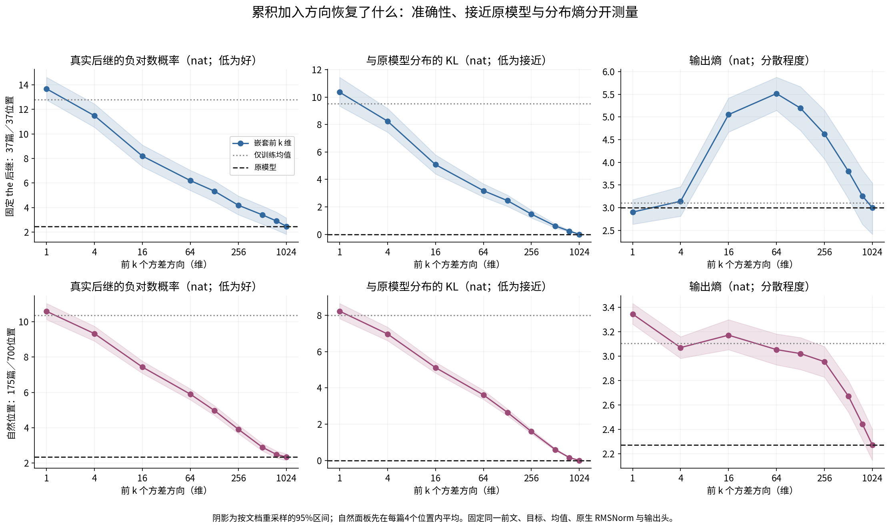
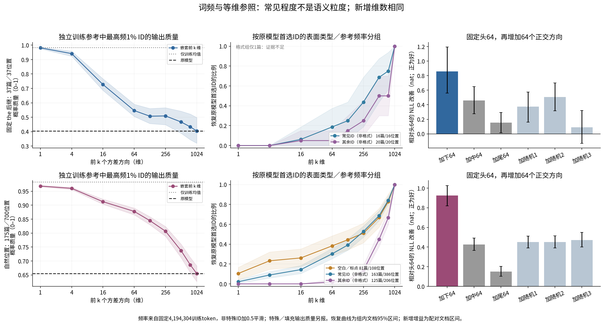
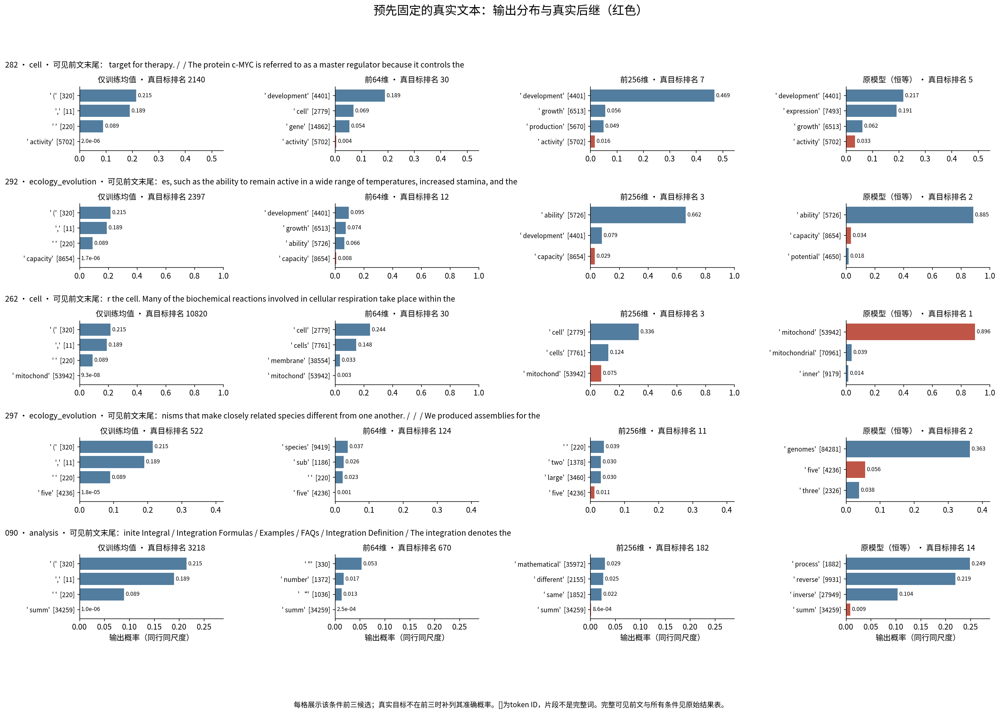

派生阅读副本；原件位置：`Projects/from-attention-to-search/main/experiments/A15/15_27_natural_language_feature_response/R13_20261101_native_spectral_decoding/summary_cn.md`。
[精确原始文件](../../../../../../../../sources/Projects/from-attention-to-search/main/experiments/A15/15_27_natural_language_feature_response/R13_20261101_native_spectral_decoding/summary_cn.md)；研究修改仍回到原件。

---

# 累积谱投影与原生解码：先看观察，不下语义层级结论

本轮按三条线阅读：**行为与因素对照**（同一前文只改投影）；**表征与谱位置**（固定训练侧谱）；**输出干预与可信度**（原生输出头、恒等与缓存重放）。

本轮已完成全部冻结条件。观察到累计的预测恢复和按参考频率分组的恢复速度差异；**尚未测出一个外部定义的“由粗到细语义顺序”**。尤其要区分：低维输出偏常见标点，和原模型原有的常见预测先恢复，是两个不同现象。

## 对象、样本和先决检查

沿用 R12 的官方 Qwen3-0.6B-Base 权重、tokenizer 和最后 block27 的 residual-post（最终全局 RMSNorm 之前）。每个投影都先加回原训练均值，再接原生 RMSNorm 与绑定的冻结输出头；没有训练模型、分类器或字典。沿用“逐步加回成分并观察输出”的逻辑，不宣称复现未知设置的T5实验。

“前 k 维”指训练表征协方差按方差排序的前 k 个主成分，不是词频排序。谱来自 R04 的60篇发现文档、9,600个位置，1024维全部非零，复用它不构成独立复现。主面板为 R12 的37篇固定文档，读完同一个输入ID279（` the`）后预测真实后继；补充面板为175篇、700个预先随机固定的自然位置。两面板分别报告，有32篇文档重合，合计180篇物理文档。文档已暴露，全部为探索性。

旧缓存未通过当前5090的预设重放阈值，因此用相同模型／测点／固定文本重提取180篇，未重拟合谱。新缓存三篇重放与同形状因果前文检查的NLL误差均为0；全部PC与真正恒等的logits、NLL误差均为0。失败记录、修订与原缓存都保留在[详细记录](../../../../../../../../UNAVAILABLE.md)。

## 1. 随 k 恢复的是预测，而不是已标注的语义层级

NLL是模型给真实后继的负对数概率，越低越好；KL衡量投影分布偏离未投影原生头分布的程度，越低越接近原模型。两者不能替代。

**固定 the：37篇／37位置。**

|保留条件|真实后继NLL，nat [95%区间]|与原模型KL，nat|首选ID一致率|常见1% ID概率质量|空白／标点质量|
|---|---:|---:|---:|---:|---:|
|仅训练均值|12.794 [12.014, 13.472]|9.524|0.0%|98.3%|55.5%|
|前1维|13.677 [12.773, 14.621]|10.362|0.0%|98.1%|60.8%|
|前64维|6.196 [5.389, 7.037]|3.180|10.8%|54.6%|14.8%|
|前128维|5.337 [4.488, 6.165]|2.456|18.9%|50.7%|11.5%|
|前256维|4.188 [3.417, 4.942]|1.470|32.4%|50.9%|9.3%|
|前512维|3.405 [2.645, 4.134]|0.606|56.8%|46.7%|3.4%|
|原表征／原生头|2.471 [1.818, 3.153]|0.000|100.0%|40.4%|2.0%|

**自然位置：175篇／700位置，先在每篇4个位置内平均。**

|保留条件|真实后继NLL，nat [95%区间]|与原模型KL，nat|首选ID一致率|常见1% ID概率质量|空白／标点质量|
|---|---:|---:|---:|---:|---:|
|仅训练均值|10.377 [9.961, 10.763]|8.008|0.1%|98.3%|55.5%|
|前1维|10.594 [10.130, 11.041]|8.230|2.4%|96.8%|51.8%|
|前64维|5.901 [5.582, 6.200]|3.612|23.0%|87.8%|25.6%|
|前128维|4.977 [4.704, 5.251]|2.650|29.9%|84.5%|22.3%|
|前256维|3.914 [3.674, 4.152]|1.593|40.9%|80.7%|19.3%|
|前512维|2.897 [2.690, 3.101]|0.597|61.4%|73.7%|15.5%|
|原表征／原生头|2.342 [2.147, 2.525]|0.000|100.0%|65.5%|13.7%|

- **实际测量：**相同前文和目标，在固定原生头下保留不同累积子空间的目标概率、分布接近程度与输出熵。阴影是按文档重采样的95%区间。
- **排除的解释：**结果不依赖另训分类器的容量或调参。恒等与全PC检查排除了测点／少接或多接norm造成的假恢复。它未排除保留能量和分布外投影的解释。
- **对下一步设计的影响：**必须分开预测保真与真实后继成绩，不能把平均恢复曲线直接命名为语义粒度。

从仅均值到前1维，NLL反而上升（the：12.794→13.677；自然：10.377→10.594）。the面板的熵从均值3.104升至前64维5.515，再降至原模型3.000；这不是单向的“越来越确定”。

## 2. 常见预测较早恢复；中尾部的平均增益并不特殊

“常见”只指独立DCLM训练片段中频率最高1%的非特殊token ID。参考共4,194,304个token，采用加0.5平滑。它不是Qwen真实预训练曝光次数，更不是CrossCoder feature的频率。“格式”仅指解码完全由空白或Unicode标点构成的ID，不是句法或语义标签。

自然面板按原模型的首选ID分组：非格式常见ID为386位置／163篇，其余非格式ID为206位置／125篇，空白标点为108位置／81篇。前64维恢复原模型首选的组内文档均值分别为30.3%、2.0%、38.3%；前256维分别为52.8%、13.6%、51.0%。前述两个非格式组的原模型首选平均概率为0.500与0.519；后者的平均首选概率反而略高；这仍不是完整的置信度或语义匹配对照。the面板常见／其余组为16／20篇，前64维恢复率18.8%／5.0%，区间较宽；格式组只有1篇，不能判断格式恢复次序。

与此同时，**mean-only本来就把55.5%概率放在空白／标点上**，前三候选为 ` (`、`,`、空格；原模型在the后只有2.0%格式质量。低维大量输出标点主要包含过量背景偏置，不能都叫“恢复了正确格式”。

- **实际测量：**左列是常见ID概率质量，中列是按原模型首选ID类型分组的恢复率；右列固定头64，再加等量64维，比较配对NLL改善。中列分层是在看输出后补作的描述性分析，频率及格式掩码已于输出前固定，未换阈值或筛结果。
- **排除的解释：**自然面板的方向与the面板相似，现象不限于在the后预测；分开非格式ID后仍有频率差异。等维比较排除了新增维数不等，但不能把差异都归因于语义内容。
- **对下一步设计的影响：**需要在词频之外定义对象或关系区别；中尾部不能因为有正增益就被指定为细语义载体。

|加入的64维|the面板NLL改善，nat [95%区间]|自然面板NLL改善，nat [95%区间]|
|---|---:|---:|
|紧接头部的下一64维|0.860 [0.559, 1.193]|0.924 [0.818, 1.025]|
|中64维|0.458 [0.276, 0.649]|0.427 [0.366, 0.490]|
|尾64维|0.155 [0.017, 0.293]|0.151 [0.102, 0.202]|
|正交随机1|0.373 [0.160, 0.574]|0.452 [0.391, 0.512]|
|正交随机2|0.507 [0.318, 0.700]|0.451 [0.390, 0.515]|
|正交随机3|0.092 [-0.129, 0.319]|0.471 [0.402, 0.548]|

中部新增相对三个随机新增参照，在自然面板的NLL差为+0.025、+0.024、+0.044 nat，95%区间均跨0；the面板只优于其中一个种子，没有稳定的随机参照优势。直接加下一段前部64维，在两面板均优于加中部（配对差约0.402、0.497 nat）。尾部也有平均增益，但比自然面板的三个随机新增更小。因此这些数据支持“后部加入能改变并改善部分预测”，尚不支持“后部具有特殊的细语义增益”。

相同64维的头／中／尾／随机解码参见[等维附图](../../../../../../../../sources/Projects/from-attention-to-search/main/experiments/A15/15_27_natural_language_feature_response/R13_20261101_native_spectral_decoding/figures/A02_equal_rank64_controls.png)。训练参考中头／中／尾保留方差为53.07%／2.32%／0.53%；实际自然位置的平均中心化能量为41.44%／对应增量约3.55%／1.86%。训练方差、单次输入能量和预测增益不是同一个量。

## 3. 真正的上下文例子与反例

- **实际测量：**预先固定的四篇生物错例与数学090，在每个投影条件下的前三候选ID／片段／概率，并另列真实后继概率与排名。同行使用相同横轴尺度。完整可见前文和全部条件见[原始文本表](../../../../../../../../UNAVAILABLE.md)。
- **排除的解释：**样例不是按本轮漂亮输出选择。原模型在五例中只有262把真实目标列为首选，因此“接近原模型”本身不能代表恢复真实语义答案。
- **对下一步设计的影响：**未来必须预先定义可裁决的候选区别，不能只用几个从通用词变成领域词的例子命名语义层级。

**262（cell）：**可见末句是 `Many of the biochemical reactions involved in cellular respiration take place within the`。真实后继ID53942为 ` mitochond`，在原文中拼成mitochondria。其概率从头64的0.27%升到前256维7.50%、前512维67.81%、原模型89.64%。但头64已经以24.41%预测 ` cell`；在另一个预先随机固定的普通样本283，`out of the` 后的 ` cell` 在头64已经是首选（24.11%，原模型78.59%）。这是具体对象词的不同恢复速度，不能仅凭这两例建立粗细关系。

**292（ecology/evolution，反例）：**真实目标为 ` capacity`，原模型首选却是 ` ability`（88.51%）。加入中部后，KL由2.373降为2.171，更接近原模型；真实capacity的NLL却从4.849恶化到5.604，概率由0.784%降至0.368%。加入尾部反过来改善目标NLL至4.416，却使KL略升到2.408。准确性与保真在同一个固定样例中分离。

**090（数学定义）：**原模型本身把真实 ` summ`（summation开头）排在第14，首选为 ` process`；不能要求投影恢复一个原模型本来未命中的首选。另一个普通数学样本123从前256到512维，KL下降1.440→1.014，但目标NLL变坏6.233→6.359。

另按输出无关哈希规则，检查12篇未参与命名的自然文本（每域4篇，排除全部7篇固定展示文档）。其原始前文／输出保存于[验证样例](../../../../../../../../sources/Projects/from-attention-to-search/main/experiments/A15/15_27_natural_language_feature_response/R13_20261101_native_spectral_decoding/evidence/unselected_text_validation.json)。其中段落起始的 `The` 在64维已恢复；`polygons` 到256维仍未成为首选；但表示关系的常见 ` same` 也要更多方向才接近原模型。低维并非只含格式，高维也并非只补低频对象。所有12例逐一记录，不把这次阅读当作语义分类统计。

## 竞争解释与边界

1. **均值与输出头偏置：**已观察到，mean-only足以产生强常见／标点偏置；“先出现”不等于“正确恢复”。
2. **维数／能量恢复：**头部高效，下一前部64维优于中尾部；等维随机控制不支持中部特殊优势。尚未进行严格逐位置等能量比较。
3. **词频、置信度与语义混杂：**分组恢复是token-ID频率关系，不是外部粗细类别检验。参考词频是一个固定DCLM片段的代理，原始bin生成版本追溯仍不完整。标点也可能承担关系或格式作用；非格式不等于内容语义。
4. **预测不等于唯一正确续写：**原文后继只是一个真实参考答案。投影有时偏离原模型却改善其NLL；自然面板前256维有183/700位置的目标NLL优于原模型。256→512时有147/700位置出现KL改善但目标NLL恶化，不能把每个token当独立复现。
5. **探索与参考谱：**两面板旧文档已暴露，共用权重／谱基且共享32篇。924/1023个相邻相对谱间隙<1%，本轮不命名单根方向。尾部非数值零空间，但稳定的单根语义解释仍无依据。

## 唯一下一步（AI建议，未执行）

只补一组**词频匹配、同token不同可见前文的对象／关系最小对照**，固定候选后继，检查恢复的是哪一种已外部定义的语义区别。本轮不继续增加层、分类器或生成样例。

**我们观察到：常见ID／表面格式预测较早接近原模型，更多方向继续恢复分布；这支持有限的预测恢复与词频相关偏置，但还不能说明由粗到细的语义排序；最值得补的是频率匹配的语义最小对照。** 研究者的机制判断与问题闭合仍为Unknown。

[完整统计](../../../../../../../../sources/Projects/from-attention-to-search/main/experiments/A15/15_27_natural_language_feature_response/R13_20261101_native_spectral_decoding/evidence/summary_metrics.csv) · [逐文档配对结果](../../../../../../../../sources/Projects/from-attention-to-search/main/experiments/A15/15_27_natural_language_feature_response/R13_20261101_native_spectral_decoding/evidence/document_metrics.csv) · [新增参照配对差](../../../../../../../../sources/Projects/from-attention-to-search/main/experiments/A15/15_27_natural_language_feature_response/R13_20261101_native_spectral_decoding/evidence/addition_control_contrasts.csv) · [协议](../../../../../../../../UNAVAILABLE.md) · [详细记录](../../../../../../../../UNAVAILABLE.md)

2026-11-02补充：[PC1／PC2单独、前8／16维及逐ID名单](supplements/20261102_pc1_pc2_pc8_pc16/summary_cn.md)。仅新增两个条件，其余精确复用；原R13结果保留。

2026-11-02继续补充：[分段与尾部单独解码、完整输入与token位置](supplements/20261102_disjoint_bands_and_tail/summary_cn.md)。700自然位置、11个独立谱段、同token异文档对照312位置；原结果保留，语义机制Unknown。
