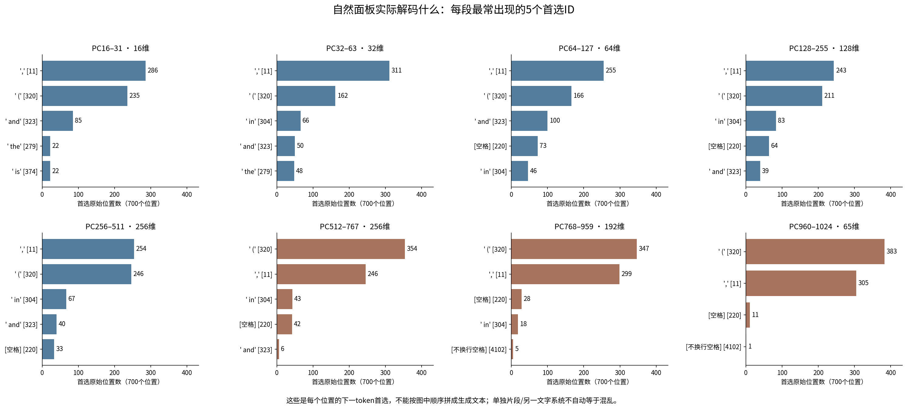
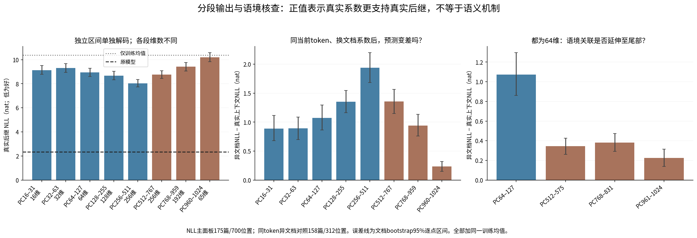
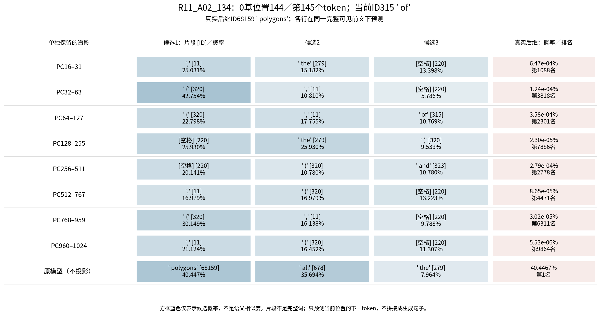
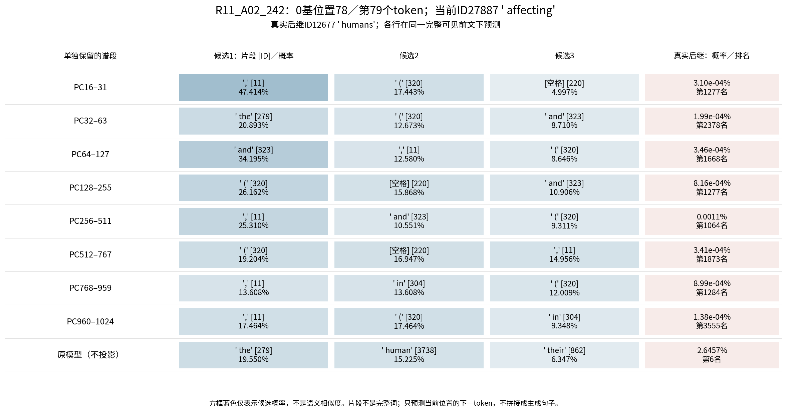
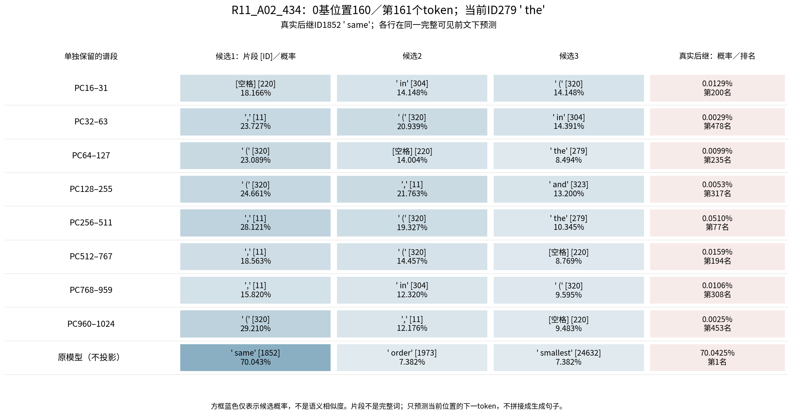

派生阅读副本；原件位置：`Projects/from-attention-to-search/main/experiments/A15/15_27_natural_language_feature_response/R13_20261101_native_spectral_decoding/supplements/20261102_disjoint_bands_and_tail/summary_cn.md`。
[精确原始文件](../../../../../../../../../../sources/Projects/from-attention-to-search/main/experiments/A15/15_27_natural_language_feature_response/R13_20261101_native_spectral_decoding/supplements/20261102_disjoint_bands_and_tail/summary_cn.md)；研究修改仍回到原件。

---

# 分段与尾部单独解码：完整语境、实际输出及语境核查


本轮关注三条线：行为和因素对照（只换谱段）、表征的谱位置（同一训练基底）、原生输出干预及可信度（恒等／旧条件重放）。所有指定区间及尾部已完成，不训练新模型、分类器或谱基。科学机制与语义层级判断仍Unknown。


## 这轮能更新到哪一步

**单独解码的尾部主要显示背景格式偏置，但不是完全不随上下文变化的随机噪声；本轮没有直接解码出稳定的具体语义词，也没有看到由前到后逐段变得更具体的顺序。**

- PC960–1024的700个首选只有四个ID：左括号ID320有383次、逗号ID11有305次、普通空格ID220有11次、不换行空格ID4102有1次。不是“乱码很多”，而是输出高度集中在背景格式。PC768–959与PC512–767也主要如此。
- 然而，最末64维PC961–1024在312个可匹配位置、158篇文档上，真实系数相对同token异文档系数的后继NLL增益为0.226nat，逐点95%区间[0.138,0.315]；65维末段为0.235[0.151,0.323]。这说明它不是与当前前文完全无关的常量，仍有可测的预测关联。
- 该关联不限于真实后继为标点：最后64维在“非格式且非参考常见”的109位置／90篇上增益0.385nat，[0.208,0.572]。但这个ID类别仍不是外部定义的语义粒度，不能据此命名“细语义方向”。
- 等64维比较中，PC64–127的语境增益约1.073nat，尾段512–575／768–831／961–1024分别约0.345／0.382／0.226。维数已相同，但能量、归一化及输出头对齐仍不同，不能把这直接当语义重要性排名。

以下先给实际输出和完整输入，再分开解释“可见的词”“目标概率修正”和“语境对照”。


## 先定义本轮究竟解码什么

175篇自然文档、700个固定位置。在0基位置t，模型已经读到x_t，解码预测x_(t+1)。这里比较的是同一可见前文下的下一token分布，不是把各位置首选拼成一段生成文本。PCA区间独立保留，不加入头部；每个条件加回同一训练均值，再接原生最终RMSNorm与冻结输出头。模型仍为原Qwen3-0.6B-Base、block27 residual-post（norm前）。

PC编号从1开始，区间采用左闭右开：用户的16到32对应PC16–31；其余依次32–63、64–127、128–255、256–511。另看512–767、768–959和960–1024。宽度分别16／32／64／128／256／256／192／65，不把维数差异冒称谱位置或语义差异；另有三个等64维尾段作参照。

所有完整可见输入已逐一用原token IDs重解码核对，700/700与原窗口前缀一致。当前句子是截至所选token已见部分，常常未结束；“原文整句／后续”标为参考，不能用来解释模型当时看到了什么。原语料已暴露，结果为探索性。


## 实际输出图：每段倾向解码什么




图中是700个位置各自的首选ID频数；每段列5个最常见输出，**不代表正确率或语义相似度**。完整逐位置概率和目标排名见casebook与原始表。片段中的前导空格、子词和符号保留原样。


|单独保留区间|维数|训练参考方差|目标NLL↓|与原模型KL↓|原首选一致率|真实系数相对同token异文档的NLL增益 [95%区间]|
|---|---:|---:|---:|---:|---:|---:|
|PC16–31|16|8.64%|9.139|6.786|5.00%|0.889 [0.681, 1.113]|
|PC32–63|32|9.80%|9.299|6.951|6.71%|0.893 [0.699, 1.089]|
|PC64–127|64|11.03%|8.956|6.539|7.14%|1.073 [0.862, 1.296]|
|PC128–255|128|12.55%|8.662|6.304|7.71%|1.350 [1.161, 1.548]|
|PC256–511|256|13.41%|8.037|5.698|5.86%|1.941 [1.682, 2.200]|
|PC512–767|256|6.87%|8.769|6.368|3.00%|1.358 [1.151, 1.567]|
|PC768–959|192|2.77%|9.416|7.038|2.57%|0.942 [0.758, 1.132]|
|PC960–1024|65|0.54%|10.203|7.824|2.29%|0.235 [0.152, 0.323]|


原模型目标NLL为2.342 nat；仅训练均值为10.377 nat。NLL越低越支持真实后继；KL越低越接近原模型，两者分开。高熵只表示分布更分散，不直接定义“混乱”。


## 是否随上下文变化，而不是只输出背景

在相同当前tokenID内，将另一篇文档的该段系数替换过来，保留原位置目标。输出前固定一组置换，312位置／158篇可匹配；不匹配的位置仍保留在700主面板。正NLL增益表示真实系数比异文档系数更支持真实后继。误差区间按文档重采样2000次，条件于这一次固定置换，不是独立重复或多重比较校正后的确认。





|单独保留区间|维数|训练参考方差|目标NLL↓|与原模型KL↓|原首选一致率|真实系数相对同token异文档的NLL增益 [95%区间]|
|---|---:|---:|---:|---:|---:|---:|
|PC64–127|64|11.03%|8.956|6.539|7.14%|1.073 [0.862, 1.296]|
|PC512–575|64|2.15%|9.861|7.488|2.14%|0.345 [0.262, 0.426]|
|PC768–831|64|1.11%|9.982|7.606|2.14%|0.382 [0.291, 0.473]|
|PC961–1024|64|0.53%|10.209|7.829|2.14%|0.226 [0.138, 0.315]|


对照排除了当前token词面完全不同这一解释，并在匹配位置集合上保持系数／能量边际。它仍可能反映来源、格式、句法或词频信息，不能单凭NLL差命名对象／关系语义。区间跨0是不确定，不证明尾部没有信息。


## 三个固定例子：完整输入、当前位置和解码

三例在本轮输出前固定，来自原先输出无关挑选的12篇自然文本，没有按新结果挑案例。红色目标概率另报，原模型自己的首选也未必等于原文后继。


### R11_A02_134

当前位置：**0基144，即第145个token**；当前ID315，片段 `' of'`。真实后继ID68159，片段 `' polygons'`。

已经可见的当前句子／段落：

> Even triangles, the simplest of

此前全部可见输入：

```text
In Disney’s 1959 film
Donald in Mathmagic Land
, Donald Duck, inspired by the narrator’s descriptions of the geometry of billiards,
energetically strikes the cue ball
, sending it ricocheting around the table before it finally hits the intended balls. Donald asks, “How do you like that for mathematics?”
Because rectangular billiard tables have four walls meeting at right angles, billiard trajectories like Donald’s are predictable and well understood — even if they’re difficult to carry out in practice. However, research mathematicians still cannot answer basic questions about the possible trajectories of billiard balls on tables in the shape of other polygons (shapes with flat sides). Even triangles, the simplest of
```




下表把真实后继在各段中的变化单独列出，避免仅凭前三候选是否“像词”来判断：

|谱段|真实后继概率|排名|NLL相对仅均值的改善，nat|

|---|---:|---:|---:|

|PC16–31|6.47e-04%|1088|4.623|

|PC32–63|1.24e-04%|3818|2.971|

|PC64–127|3.58e-04%|2301|4.030|

|PC128–255|2.30e-05%|7886|1.283|

|PC256–511|2.79e-04%|2778|3.781|

|PC512–767|8.65e-05%|4471|2.610|

|PC768–959|3.02e-05%|6311|1.559|

|PC960–1024|5.53e-06%|9864|-0.140|


**语境阅读：**这段前文已明确讨论台球桌的多边形边界，并且前一句已经出现polygons。“Even triangles, the simplest of”之后，polygons或原模型第二候选all都能接上语境。五个指定区间及尾部的前三却主要是逗号、括号、空格和the，未形成这个具体类别补全。PC16–31把polygons相对仅均值提高约102倍，但绝对概率仍只有0.000647%，排名1088；PC256–511为0.000279%，排名2778。最末PC960–1024仅0.00000553%，排名9864，比仅均值还低。原模型为40.4467%、首选。这里看不到尾部直接解出“多边形”语义；即使将来出现polygons，也还需排除前文词面重复／复制的解释。


### R11_A02_242

当前位置：**0基78，即第79个token**；当前ID27887，片段 `' affecting'`。真实后继ID12677，片段 `' humans'`。

已经可见的当前句子／段落：

> The authors argue that this reversal could allow such organisms to evade existing biological controls and immune defenses, potentially affecting

此前全部可见输入：

```text
In December 2024, a comprehensive analysis published in Science by Adamala et al. highlighted unprecedented risks associated with mirror bacteria research. These artificially created organisms would represent a fundamental departure from all known life, utilizing reversed versions of the molecular building blocks found in natural organisms. The authors argue that this reversal could allow such organisms to evade existing biological controls and immune defenses, potentially affecting
```




下表把真实后继在各段中的变化单独列出，避免仅凭前三候选是否“像词”来判断：

|谱段|真实后继概率|排名|NLL相对仅均值的改善，nat|

|---|---:|---:|---:|

|PC16–31|3.10e-04%|1277|0.918|

|PC32–63|1.99e-04%|2378|0.474|

|PC64–127|3.46e-04%|1668|1.029|

|PC128–255|8.16e-04%|1277|1.886|

|PC256–511|0.00108%|1064|2.165|

|PC512–767|3.41e-04%|1873|1.014|

|PC768–959|8.99e-04%|1284|1.982|

|PC960–1024|1.38e-04%|3555|0.107|


**语境阅读：**当前句子是“可能影响……”但尚未出现受影响对象。humans、human相关片段或the开头的名词短语都可能合理；原模型自己也只把真实humans排第6，首选the，因此不能把真实后继未排首位一概说成无语义。单独PC32–63的the在语法上能继续，却只是通用冠词；其它段的逗号、and、括号缺少这个位置需要的对象指向。PC256–511给humans约0.001079%、排名1064；最末段约0.000138%、排名3555，而原模型约2.6457%。这些概率修正确有变化，但没有直接读出稳定的“影响人类”内容。本例当前ID27887在匹配面板中没有合格同token异文档对照，不用总体对照结论冒充本例的直接验证。


### R11_A02_434

当前位置：**0基160，即第161个token**；当前ID279，片段 `' the'`。真实后继ID1852，片段 `' same'`。

已经可见的当前句子／段落：

> X-rays produce a diffraction pattern because their wavelength is typically the

此前全部可见输入：

```text
The ratio of reflected intensity to incident intensity is the X-ray reflectivity for the surface. If the interface is not perfectly sharp and smooth, the reflected intensity will deviate from that predicted by the law of Fresnel reflectivity. The deviations can then be analyzed to obtain the density profile of the interface normal to the surface. For films with multiple layers, X-ray reflectivity may show oscillations with wavelength, analogous to the Fabry-Pérot effect. These oscillations can be used to infer layer thicknesses and other properties.


In X-ray diffraction a beam strikes a crystal and diffracts into many specific directions. The angles and intensities of the diffracted beams indicate a three-dimensional density of electrons within the crystal. X-rays produce a diffraction pattern because their wavelength is typically the
```




下表把真实后继在各段中的变化单独列出，避免仅凭前三候选是否“像词”来判断：

|谱段|真实后继概率|排名|NLL相对仅均值的改善，nat|

|---|---:|---:|---:|

|PC16–31|0.01290%|200|2.146|

|PC32–63|0.00293%|478|0.663|

|PC64–127|0.00995%|235|1.886|

|PC128–255|0.00534%|317|1.264|

|PC256–511|0.05100%|77|3.521|

|PC512–767|0.01590%|194|2.355|

|PC768–959|0.01055%|308|1.945|

|PC960–1024|0.00248%|453|0.496|


**语境阅读：**这里是X射线波长与晶体尺度的叙述，“their wavelength is typically the”后接same表达关系，而不是新的领域对象名称。原模型给same约70.0425%、首选。单独PC256–511把same从仅均值0.001508%提高至0.050997%，约34倍，但仍仅排77；PC512–767约0.015902%、排194。最末PC960–1024约0.002478%、排453，前三仍是括号、逗号、空格。可观察到对正确关系片段概率的支持，却没有直接恢复出该关系作为首选。并且本例最末段真实系数比异文档同token系数更差，说明总体正增益不保证每个例子都更贴切。


## 其余固定文本：保留正例和反例

12例没有按本轮输出重选。最末64维在“quantum waves, the”例410中，把waves的概率相对仅均值提高约5.76倍，并在同token对照下有正增益；但绝对概率仅0.0000752%、排名5338，不能称为已经直接解出waves。例255的“In light of”后，that为0.9758%、排名14，较仅均值提高；然而例281段落开头The和例419的What反而较仅均值下降。数字例096的5也仅0.001954%、排名569，远低于原模型99.8784%。这些失败与部分改善一并保留在固定12例记录，避免将少量被挑出的词包装为尾部语义。

**最准确的描述是：背景输出占主导，语境相关的概率变化仍然存在。** “有预测关联”比“随机无关”更有依据；“可独立读出具体概念／关系”则仍未得到本轮支持。这是当前冻结原生头与独立投影口径的边界，不是对所有可能读出方式或方向组合的否定。


## 完整材料与界限

[固定12例完整前文、token邻域及所有谱段](../../../../../../../../../../UNAVAILABLE.md)；[全部700自然位置入口](../../../../../../../../../../UNAVAILABLE.md)；[位置与token索引](../../../../../../../../../../sources/Projects/from-attention-to-search/main/experiments/A15/15_27_natural_language_feature_response/R13_20261101_native_spectral_decoding/supplements/20261102_disjoint_bands_and_tail/evidence/input_position_index.csv)；[总体指标](../../../../../../../../../../sources/Projects/from-attention-to-search/main/experiments/A15/15_27_natural_language_feature_response/R13_20261101_native_spectral_decoding/supplements/20261102_disjoint_bands_and_tail/evidence/summary_metrics.csv)；[同token异文档对照及后继类型分层](../../../../../../../../../../sources/Projects/from-attention-to-search/main/experiments/A15/15_27_natural_language_feature_response/R13_20261101_native_spectral_decoding/supplements/20261102_disjoint_bands_and_tail/evidence/context_controls.csv)。全量原始top20和每个位置指标在执行目录analysis中，未截断或筛掉失败位置。

尾部原始参考特征值仍为正，最小4.21，不是由样本不足形成的数值零空间。复用同一谱不是独立复现；大部分单根相邻谱间隙很小，不给单根命名语义。

孤立谱段经原生头的输出可能离开训练时的全表征分布。单独解码不贴切，只说明在此原生读出口径下未直接恢复上下文预测，不等于没有可读信息、没有与其他方向组合的作用，或模型储存了随机噪声。反之，出现一个具体词也不能自动当成它对应语义的证据。

本轮没有继续扩展模型、层或训练任务。
