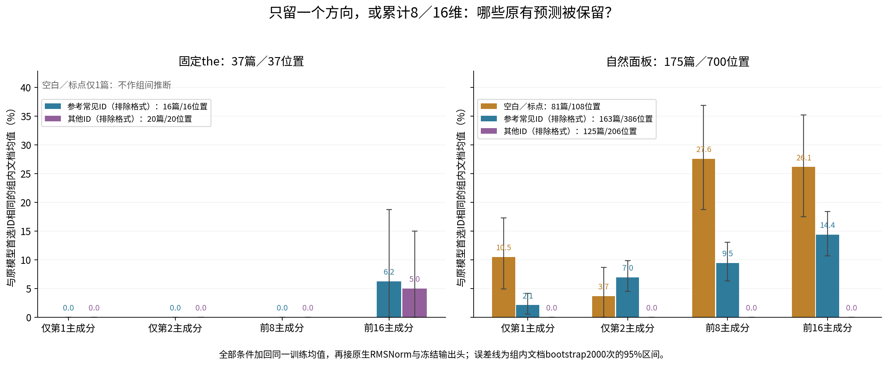
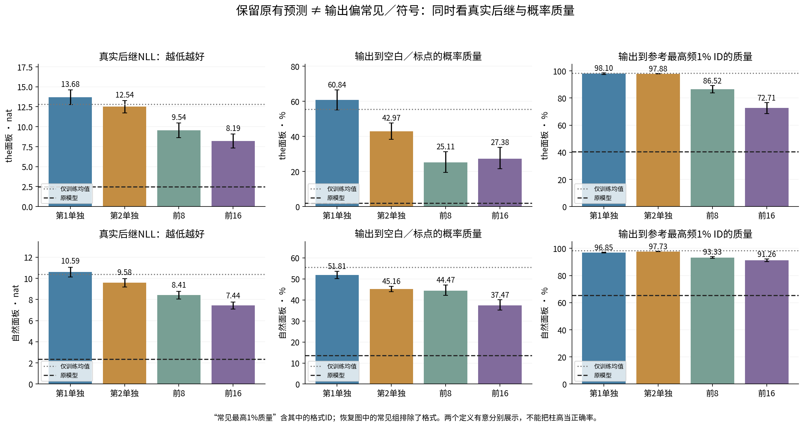
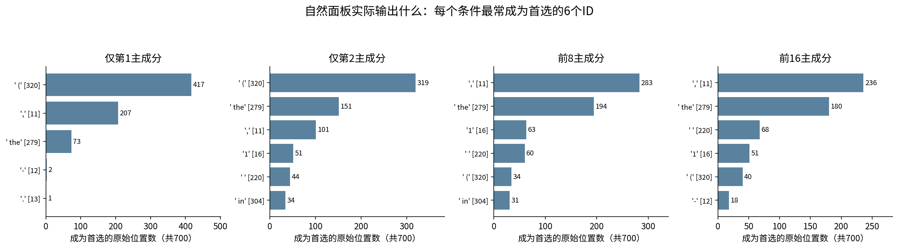

派生阅读副本；原件位置：`Projects/from-attention-to-search/main/experiments/A15/15_27_natural_language_feature_response/R13_20261101_native_spectral_decoding/supplements/20261102_pc1_pc2_pc8_pc16/summary_cn.md`。
[精确原始文件](../../../../../../../../../../sources/Projects/from-attention-to-search/main/experiments/A15/15_27_natural_language_feature_response/R13_20261101_native_spectral_decoding/supplements/20261102_pc1_pc2_pc8_pc16/summary_cn.md)；研究修改仍回到原件。

---

# 第1、第2主成分单独，与前8／16维：补充实验结果

本轮只比较原生预测；PCA主成分不是CrossCoder feature。四个条件保留同一训练均值，经原生最终RMSNorm和冻结输出头。相同模型、谱基、37个the位置及175篇700自然位置；仅新增PC2单独和前8维，PC1／前16维复用旧结果，重放核对通过。所有结果探索性；没有训练或新激活提取。

## 常见与符号分别是什么
原图的分组实际是：参考训练频率最高1%的非特殊ID，排除“完全由Unicode标点／空白构成”的ID。它不是纯英文单词表。参考全集有1412个常见非格式ID、4547个格式ID；本图实际原模型首选仅用到其中一部分。前导空格、大小写及子词的不同保留为不同ID。完整名单见[逐ID清单](../../../../../../../../../../UNAVAILABLE.md)及[机器可读名单](../../../../../../../../../../sources/Projects/from-attention-to-search/main/experiments/A15/15_27_natural_language_feature_response/R13_20261101_native_spectral_decoding/supplements/20261102_pc1_pc2_pc8_pc16/evidence/observed_original_top1_IDs_complete.csv)。

自然面板：**165个常见组ID／386位置／163篇；31个空白标点ID／108位置／81篇**。其余206位置／125篇。the面板：14个常见组ID／16篇；格式只有换行ID198／1篇；其他20篇。不同组的文档数不能相加。

自然面板常见组中出现最多的20个ID（括号为位置数）：

`' the'` [279]（39）、`' of'` [315]（26）、`' is'` [374]（17）、`' to'` [311]（15）、`' a'` [264]（12）、`' and'` [323]（12）、`' in'` [304]（10）、`'The'` [785]（10）、`'0'` [15]（9）、`'1'` [16]（8）、`' are'` [525]（8）、`' that'` [429]（6）、`' by'` [553]（6）、`"'s"` [594]（5）、`'2'` [17]（4）、`' as'` [438]（4）、`' with'` [448]（4）、`' not'` [537]（4）、`' have'` [614]（4）、`' do'` [653]（4）。

31个标点／空白ID，完整列举：

`','` [11]（28）、`'.'` [13]（23）、`'\n'` [198]（10）、`' '` [220]（8）、`'.\n'` [624]（4）、`'.\n\n'` [382]（3）、`' \\'` [1124]（3）、`'%'` [4]（2）、`'\n\n'` [271]（2）、`' "'` [330]（2）、`',”'` [2419]（2）、`'–'` [4142]（2）、`')'` [8]（1）、`'-'` [12]（1）、`':'` [25]（1）、`'?'` [30]（1）、`'\\'` [59]（1）、`'{'` [90]（1）、`'}'` [92]（1）、`' ('` [320]（1）、`" '"` [364]（1）、`' -'` [481]（1）、`':\n'` [510]（1）、`'),'` [701]（1）、`'”'` [854]（1）、`' —'` [1959]（1）、`'\xa0'` [4102]（1）、`'.)'` [6138]（1）、`')\\'` [10699]（1）、`'}\\'` [11035]（1）、`'}}\n'` [11248]（1）。

the面板14个常见组ID：

`' cell'` [2779]、`' development'` [4401]、`' time'` [882]、`' form'` [1352]、`' two'` [1378]、`' world'` [1879]、`' process'` [1882]、`' action'` [1917]、`' fact'` [2097]、`' question'` [3405]、`' paper'` [5567]、`' movie'` [5700]、`' ability'` [5726]、`' modern'` [6481]。

需要更正读法：`$`、` $`、`=`、` =`归在原“常见非格式ID”组，因为Unicode将其视为符号而非标点。数字0–7及9、单字母和ing/er等子词也在此组。因此主图沿用旧分组以便比较，不把它重新命名成“常见词vs所有符号”。

## 四种条件的原有首选恢复率
原有首选恢复率：先记录原模型概率最大的ID，再问投影后首选是否仍是这个ID；每篇先在该组位置内平均，再跨支持文档平均。不是对真实后继的准确率。区间为文档bootstrap2000次的逐点95%区间。

### 175篇／700自然位置
|条件|常见组，排除格式|空白／标点|其他ID，排除格式|
|---|---:|---:|---:|
|仅第1主成分|2.15% [0.56, 4.14]|10.49% [4.94, 17.28]|0.00% [0.00, 0.00]|
|仅第2主成分|6.95% [4.50, 9.87]|3.70% [0.00, 8.64]|0.00% [0.00, 0.00]|
|前8个主成分|9.46% [6.29, 13.04]|27.57% [18.72, 36.83]|0.00% [0.00, 0.00]|
|前16个主成分|14.37% [10.69, 18.40]|26.13% [17.49, 35.19]|0.00% [0.00, 0.00]|

### 37篇固定the
|条件|常见组，排除格式|空白／标点|其他ID，排除格式|
|---|---:|---:|---:|
|仅第1主成分|0.00% [0.00, 0.00]|仅1篇，不作推断|0.00% [0.00, 0.00]|
|仅第2主成分|0.00% [0.00, 0.00]|仅1篇，不作推断|0.00% [0.00, 0.00]|
|前8个主成分|0.00% [0.00, 0.00]|仅1篇，不作推断|0.00% [0.00, 0.00]|
|前16个主成分|6.25% [0.00, 18.75]|仅1篇，不作推断|5.00% [0.00, 15.00]|

**实际测量：**同一原模型首选在四个投影下保留多少。**排除：**PC1对PC2同为一维，结果差异不能只归因于维数；仍有保留能量差异。**改变的判断：**按具体恢复ID检查方向差别，不将组名当语义结论。

## 这次最直接的差别

- 同为一维，PC2相比PC1：常见组恢复率增加4.81个百分点（配对95%区间1.64–8.08），标点／空白减少6.79个百分点（区间−12.96至−1.23）。PC1／PC2保留的预测类型确实不同；这是当前面板的方向差别，不是已命名的语义功能。
- 前8到前16维：常见组增加4.91个百分点（区间2.97–7.00）；标点组点估计减少1.44个百分点，但区间为−7.00至3.91，不能认定发生稳定下降。其余206个原模型首选位置在这四条件中均未保持首选；这不等于这些方向完全没有相关信息。
- 固定the面板在PC1、PC2和前8维均没有保持原模型首选；前16维仅有两篇保持。自然面板中可恢复的许多预测是词面／格式条件依赖的，不能推广为所有输入都能恢复常见词。
- PC1在700个位置中417次首选带空格左括号、207次首选逗号，但其中与原模型相同的只有左括号1次、逗号9次。高符号输出明显包含背景偏置，不能等同“恢复正确符号”。PC2主要额外保持了the（22位置）、数字1（2位置）和in（2位置）。

## 实际输出的偏置与目标概率
|条件|训练参考保留方差|自然面板目标NLL|自然面板与原模型KL|自然面板格式概率质量|
|---|---:|---:|---:|---:|
|仅第1主成分|7.56%|10.5938|8.2299|51.81%|
|仅第2主成分|6.30%|9.5771|7.1800|45.16%|
|前8个主成分|28.01%|8.4107|6.0992|44.47%|
|前16个主成分|35.14%|7.4357|5.1193|37.47%|

**实际测量：**真实后继负对数概率、符号／空白质量、常见参考ID概率质量；主图常见恢复组排除了格式，而此处常见质量包含其中的格式ID。**排除：**将高格式概率误当作正确格式恢复。**改变的判断：**同时核对保真、目标概率与输出偏置，不以单个首选一致率概括。

## 每个条件究竟恢复／输出什么
|条件|自然面板最常输出的前三ID（位置数／700）|恢复保持不变的ID示例（原始位置数）|
|---|---|---|
|仅第1主成分|' (' [320] 417；',' [11] 207；' the' [279] 73|',' [11] 9；' the' [279] 7；' (' [320] 1|
|仅第2主成分|' (' [320] 319；' the' [279] 151；',' [11] 101|' the' [279] 22；',' [11] 2；'1' [16] 2；' in' [304] 2；' (' [320] 1|
|前8个主成分|',' [11] 283；' the' [279] 194；'1' [16] 63|' the' [279] 30；',' [11] 26；'1' [16] 4；' ' [220] 4|
|前16个主成分|',' [11] 236；' the' [279] 180；' ' [220] 68|' the' [279] 37；',' [11] 22；' ' [220] 6；' is' [374] 5；'1' [16] 4；'The' [785] 3；' in' [304] 2；' have' [614] 2|

完整首选频数与恢复ID见[实际输出表](../../../../../../../../../../sources/Projects/from-attention-to-search/main/experiments/A15/15_27_natural_language_feature_response/R13_20261101_native_spectral_decoding/supplements/20261102_pc1_pc2_pc8_pc16/evidence/output_top1_ID_counts.csv)、[保持不变的ID表](../../../../../../../../../../sources/Projects/from-attention-to-search/main/experiments/A15/15_27_natural_language_feature_response/R13_20261101_native_spectral_decoding/supplements/20261102_pc1_pc2_pc8_pc16/evidence/retained_ID_counts.csv)；固定7篇的完整前文及各条件前三输出见[真实文本](../../../../../../../../../../UNAVAILABLE.md)。位置数用于解释具体成员，不替代文档加权恢复率。

## 边界
PC1／PC2保留训练参考方差分别7.56%／6.30%，等维不等能量；前8／16维保留28.01%／35.14%，维数与能量同时增加。mean-only偏置、固定输出头及上下文难度仍是解释。the的格式组仅1篇；自然文档分组重叠。组名包含数字／符号／子词，不能把图直接解读成语义粗细层级。本轮没有扩展模型、层、数据或实验清单。

[主指标全表](../../../../../../../../../../sources/Projects/from-attention-to-search/main/experiments/A15/15_27_natural_language_feature_response/R13_20261101_native_spectral_decoding/supplements/20261102_pc1_pc2_pc8_pc16/evidence/summary_metrics.csv) · [组内配对差](../../../../../../../../../../sources/Projects/from-attention-to-search/main/experiments/A15/15_27_natural_language_feature_response/R13_20261101_native_spectral_decoding/supplements/20261102_pc1_pc2_pc8_pc16/evidence/group_paired_contrasts.csv) · [协议](../../../../../../../../../../UNAVAILABLE.md)。
