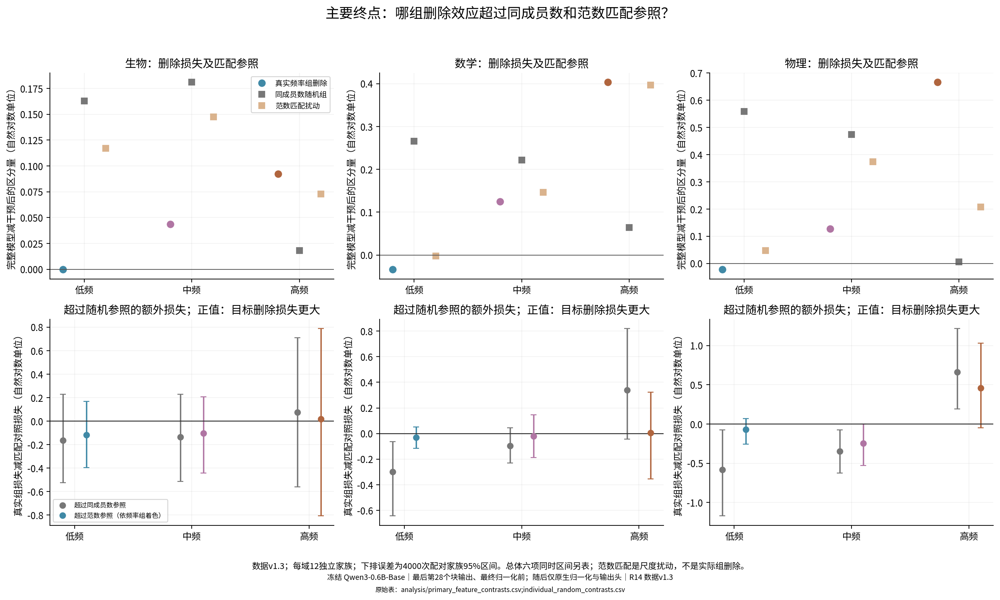

派生阅读副本；原件位置：`Projects/from-attention-to-search/main/experiments/A15/15_27_natural_language_feature_response/R14_20261102_concept_specificity_v1/summary_cn.md`。
[精确原始文件](../../../../../../../../sources/Projects/from-attention-to-search/main/experiments/A15/15_27_natural_language_feature_response/R14_20261102_concept_specificity_v1/summary_cn.md)；研究修改仍回到原件。

---

# R14：频率组对具体概念区分的即时贡献

[完整报告](../../../../../../../../UNAVAILABLE.md) · [协议](../../../../../../../../UNAVAILABLE.md) · [实际执行与修订](../../../../../../../../UNAVAILABLE.md) · [完整文本与原始分数](../../../../../../../../UNAVAILABLE.md) · [复算](../../../../../../../../UNAVAILABLE.md)

目的：在生物、数学、物理的具体概念配对上，检验删除低／中／高参考频率成员组后，区分损失能否超过同成员数和范数匹配对照。模型、字典、输出头全部冻结，没有新分类器或训练。操作对象是Qwen3-0.6B-Base最后块、最终归一化前的状态；A22系数来自14层联合编码，删组保留原始残差。

**本轮尚未建立高／中／低激活频率的稳定语义分工。高频组删除的平均影响较大，但超过范数匹配对照的额外损失尚不确定，上位判断和整体预测也同时受损。这里的“重要性”只限定于当前36个评估家族和最后层的即时贡献删除。** 以下是实测后AI的有边界认识更新；研究者科学接受与问题关闭仍为Unknown。

1. **“删得更多”不能直接更新为“更难替代”。** 原先的读出只能说明信息可被取出。本轮从真实表征扣除组贡献、保留残差后，高频组使平均线索分数由1.539降至1.152；低／中频分别为1.558／1.441。高频超过同成员数随机组的平均损失为0.358，点式95%区间[0.049,0.675]，但六个主比较的同时区间为[-0.031,0.778]；超过范数匹配扰动仅0.161，95%区间[-0.172,0.499]。三个领域的范数匹配额外损失区间也都跨零。高频组上位判断204/216→173/216，整体预测分布偏离4.658，而其范数匹配对照为1.558–1.861。因而当前保留“高频组有较大即时输出影响”的观察，收窄“有任务特异且更难替代的贡献”为尚未建立。低／中频负结果不等于没有信息：它们在各域全部12家族、全部72个首答案位置都有响应；冗余、抵消、小效应和检验能力不足仍未分开。

2. **线索响应、最终选对概念和重建保留必须分开。** 完整模型具体判断为102/144，但72组双侧配对只有31组两侧都对，只有10/36家族在两措辞的四个具体判断上全对。固定的核糖体／溶酶体第一措辞中，高频删除把线索分数4.123提高至4.720，却把溶酶体前文的“核糖体减溶酶体”从-2.823推到+1.319，造成新错；宽泛候选偏好同时由+0.643移到+5.371。这里线索拉开的幅度与候选偏置是不同量。偏置能解释这种正确性变化，不能单独解释主线索分数的损失，因为后者已抵消宽泛基线。数学固定家族还包括完整模型本来就选错的情况。CrossCoder线性求和重建的平均线索分数为0.956、具体正确89/144，低于真实表征的1.539、102/144；0.956/1.539不是“信息保留率”。因此旧线性读出的保留比例不能直接移用到本轮原生输出，成员解释也不能吞掉残差和字典失真。

**审计更正会改变局部判断。** 数据1.2的20个前缀直接写出上位名称，现已按文字规则全部更正为1.3，并保留旧版本。高频相对同人数控制的同时区间下界从+0.025变为-0.031，原版的这个局部阳性判断不能沿用；两版的范数匹配主判据都未通过。另修正了成员反例导出：全零响应成员不能叫“高响应反例”，原规则找不到合格非零成员时明确记未找到，不另调阈值找故事。

**唯一优先的未决问题（AI建议，未运行）：在整体预测损伤相近的对照下，高频组是否仍有额外的具体线索区分损失？** 这将区分任务线索贡献与广泛预测破坏；本轮不继续增加模型、层、训练或实验条件。

三域各12独立评估家族，共36；216评估前缀来自两措辞×三前文，不当作216独立样本。完整模型具体判断102/144，上位判断204/216；删低／中／高组分别为99/102/91次具体正确、203/193/173次上位正确。两个任务量尺不同，不比较绝对降幅来宣称细语义专属性。每个指标按家族配对重采样4000次，主六比较另给同时区间。

全部167独立条件与19别名已交付。最终数据1.3，CPU两线程，GPU0；原5090排队任务未分配设备后停止。新CPU路径在开发样本上原生／缓存／因果／恒等差异均0，全部2640位置的完整方向重建评分一致。独立汇总最大误差1.78e-15。修正的20前缀、80模型分支与166评分位置重算，其余2474位置的表征与系数逐值一致；旧数据1.2及全部原始分数保留。
