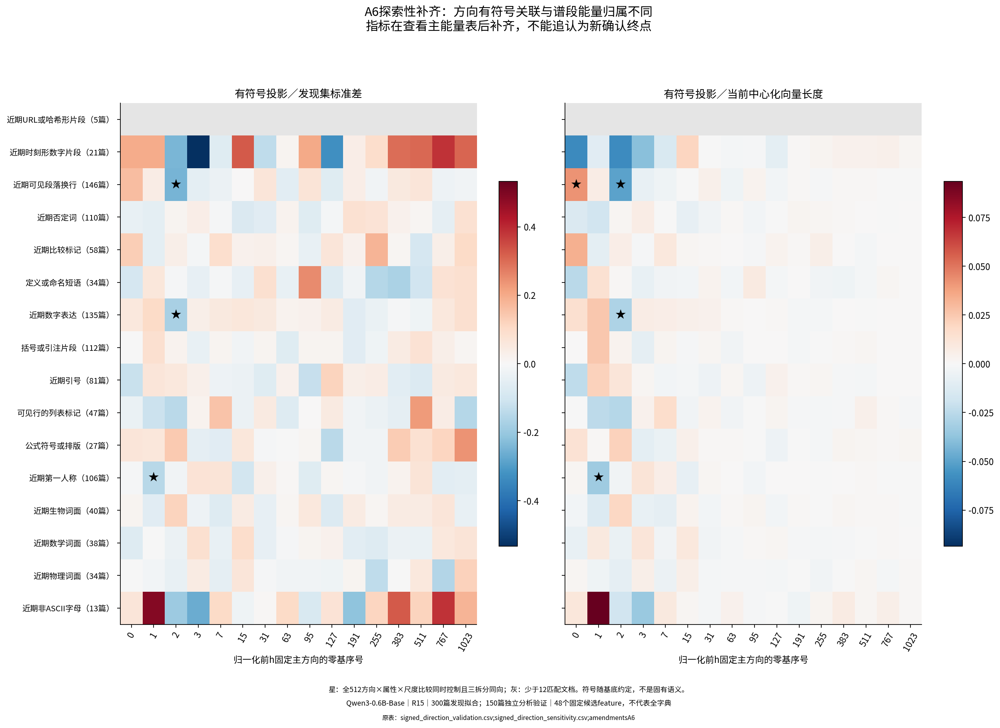

派生阅读副本；原件位置：`Projects/from-attention-to-search/main/experiments/A15/15_27_natural_language_feature_response/R15_20261102_natural_phenomena_output_geometry_v1/summary_cn.md`。
[精确原始文件](../../../../../../../../sources/Projects/from-attention-to-search/main/experiments/A15/15_27_natural_language_feature_response/R15_20261102_natural_phenomena_output_geometry_v1/summary_cn.md)；研究修改仍回到原件。

---

# R15：形式属性的谱关联与实际输出增益

[完整报告](../../../../../../../../UNAVAILABLE.md) · [按输入规则固定的真实配对](../../../../../../../../UNAVAILABLE.md) · [成员响应与未解释例](../../../../../../../../UNAVAILABLE.md) · [实际执行与审计](../../../../../../../../UNAVAILABLE.md) · [复算](../../../../../../../../UNAVAILABLE.md)

目的：在真实自然网页文本中识别可复查的语言现象，再检验其表征变化与输出头的联系。不预设头粗、中尾细。模型固定为Qwen3-0.6B-Base；A22共同读取14选层；新h/y谱只用300发现文档拟合，150开发、150验证。600页面来自557网站，共76800位置；来源分组是技术词候选组，不是学科金标。

**这轮没有建立按谱段划分语言功能的确认性分界；较强的发现是形式属性的方向关联，而不是“某段专属某种语义”。** 必须按证据等级读：预先冻结的能量分布检验未通过；有符号方向补充发现了可继续检验的空行／数字等候选；输出头对这些实际变化的单位增益差异很小；48个候选成员没有产生通过本轮验证的解释。

1. **描述性词面／格式观察。** 同文档、同位置四分位下，当前纯空白片段在h谱[1,16)的能量占比，比其它片段高17.293个百分点，138篇、670对，逐项95%区间[15.933,18.489]；当前数字片段在第一方向高5.968个百分点，125篇、774对，[4.038,7.825]。这里当前token身份按定义不同，不能称为上下文语义选择性，但说明发现端的强投影确实有可复查的词面／排版成分，不应硬命名为粗细语义。原表：`descriptive_token_category_summary.csv`。

2. **预先冻结的主检验没有确认谱段专属。** 对16个有同token匹配支持的文本属性×8谱段，共128项比较，0项同时通过全族控制、三拆分同向和支持规则。23项逐项95%区间不含零，不能挑其中几项升级为分工。例：近期数字字符在h谱[16,64)的能量占比差是−0.640个百分点，135篇、1190对，逐项95%区间[−1.027,−0.260]，全族同时区间[−1.357,+0.076]。这不证明没有信息；当前属性可能跨段、效应较小，也可能是位置／词面与统计分辨率共同限制。原表：`validation_band_map.csv`。

3. **有符号补充出现共享谱头方向的探索性候选。** 能量检验不能替代投影正负号。补齐的512项固定方向×属性×尺度比较中，7个尺度条目对应4个属性—方向对、3种属性；不是7个独立功能。近期空行与零基方向2（第三方向）的差为−0.249个发现集标准差，146篇、141网站、1029对，同时区间[−0.389,−0.109]；余弦归一化后同向。近期数字也沿该方向负移，第一人称词形则关联零基方向1。**这些是A6在查看主能量表后补齐的探索性结果，不追认为新确认终点。** 空行候选较稳：同位置四分位仍为−0.163[−0.241,−0.078]，135篇472对；再要求数字属性相同，为−0.149[−0.239,−0.057]，124篇343对。后两组是探索性逐项区间。相反，第一人称候选在位置匹配后区间跨零，数字候选的同位置四分位区间也跨零。不能一并包装成稳定分工。第三方向发现文档重抽样后的平方重合度均值0.992、最小0.987，减弱了该方向纯由抽样旋转产生的解释，但没有消除其它文字／句法共变。原表：`signed_direction_validation.csv`、`signed_direction_sensitivity.csv`、`h_direction_document_bootstrap_stability.csv`。

4. **真实文本变化没有出现强的现象专属输出放大。** 固定参数确实存在不同敏感方向：y主方向单位增益从0.02329到0.05881，后者为各向同性参照的2.045倍。但实际同token前文配对的各现象平均增益，多在参照附近：空行1.0057倍，146篇，逐项95%区间[1.0021,1.0092]；近期数字1.0046倍，135篇；时刻形数字0.9748倍，21篇，[0.9541,0.9969]。时刻形前文配对的平均Δh长度510、Δy长度88.9，输出logit均方根2.472；定义／命名短语对应322、66.0、1.914。较大的表征变化有较大的输出幅度，却未有较高的单位方向增益。这里是实际上下文变化的读出几何，不是属性的因果效应、概率改善或语义重要性排名。原表：`phenomenon_output_gain_summary.csv`、`postnorm_band_readout_geometry.csv`。

5. **CrossCoder解释仍未获支持。** 开发阶段固定的4项成员解释在验证中全部未通过，按门槛未触发任何确认干预。非ASCII字母—成员11424在13篇42对里差值为0，实际没有非零差异支持；定义／命名—成员7007反向，34篇中只有5篇有非零差；近期数字—成员10064为+0.014标准差，95%[−0.033,+0.064]，135篇中22篇有非零差；公式排版—成员6723为+0.456[−0.065,+1.120]，27篇中11篇有非零差。匹配文档多不等于该成员响应支持充分。不能把它们写成这些语言现象的功能成员，也不能外推48个候选为整个字典无解释。没有可靠开发解释时，本轮按协议不补自编题、不换成员寻阳性。原表：`validation_selected_verdicts.csv`、`selected_feature_document_support.csv`。

**保留、收窄与修改：** 保留“不同自然文本变化占据重叠谱空间”的观察；将“明显高投影即可给谱段命名功能”收窄为词面／排版描述；将本轮较有希望的解释限定为“空行与固定谱头有符号方向的探索性关联”。本轮没有测试外部粗细语义层级，也没有建立任何频率组的普遍分工、成员唯一编码或因果机制。

**唯一优先的下一步（AI建议，未执行）：** 预先冻结“近期空行→第三方向负向偏移”的有符号指标，在另一批未查看的真实文本上复核，同时固定当前token、位置区间和数字属性，并纳入同秩随机方向参照。这将区分可转移的排版关联与本轮后补指标／上下文共变造成的模式。新面板通过前，不扩大成员、层或模型，也不将这一探索性结果称为谱段功能机制。

科学接受和问题关闭Unknown。A6有符号指标补齐发生在主能量结果查看之后，只作探索；没有重新包装为前置确认。条件性干预因开发未通过门槛而NOT_RUN_BY_PROTOCOL。CPU两线程、GPU0、无训练。

