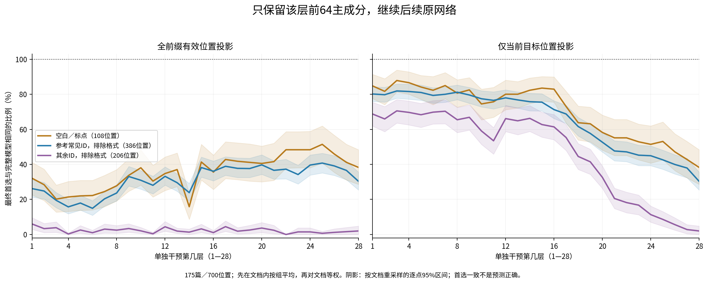
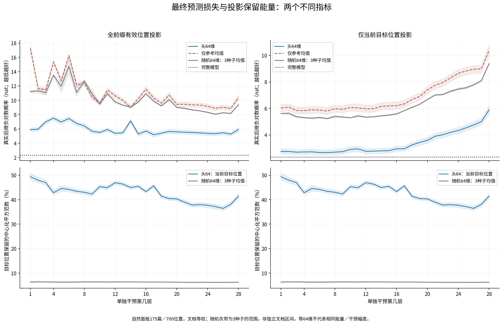
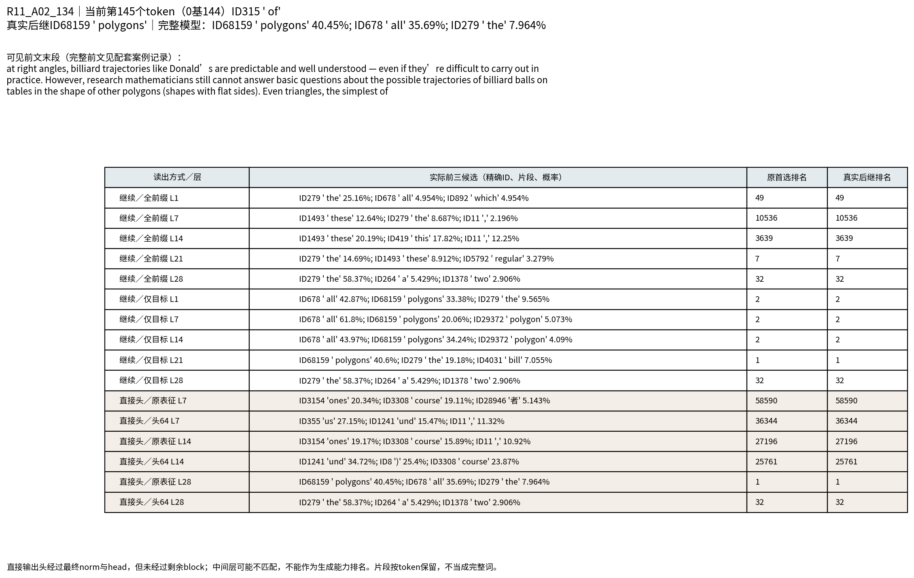
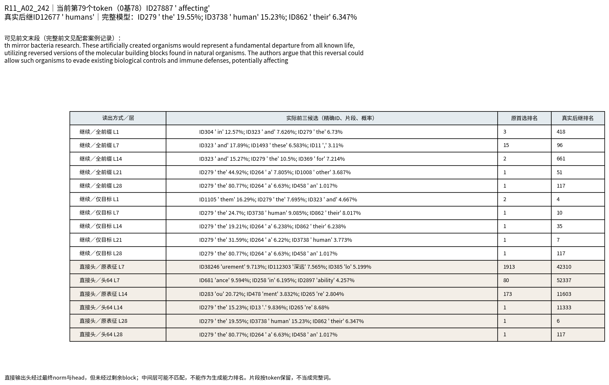
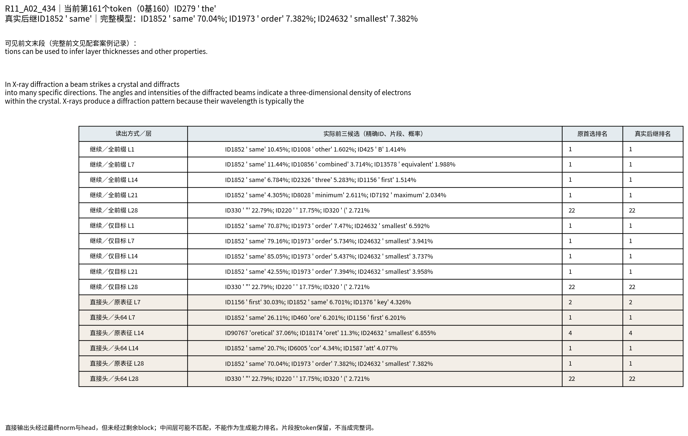

派生阅读副本；原件位置：`Projects/from-attention-to-search/main/experiments/A15/15_27_natural_language_feature_response/R16_20261102_layerwise_head64_intervention/summary_cn.md`。
[精确原始文件](../../../../../../../../sources/Projects/from-attention-to-search/main/experiments/A15/15_27_natural_language_feature_response/R16_20261102_layerwise_head64_intervention/summary_cn.md)；研究修改仍回到原件。

---

# 逐层只保留前64主成分：最终预测保持与改变

## 目的

固定Qwen3-0.6B Base及R13自然175篇/700位置，逐层单独去除中心化表征的其余960个方向，只保留该层自己参考PCA的前64维，然后继续原有剩余网络。主测量是最终概率最高token的ID是否保持，不是原文预测正确率，也不是层的独立重要性。

本报告沿三条线呈现：行为与因素对照；表征的逐层谱与能量；原生输出干预及数值可信度。先展示观察，机制与科学接受待研究者阅读。

## 观察与关键数据

本轮最清楚的观察是**干预范围带来的差异，而不是一条简单的深浅排序**。

- 第1层：仅目标位置首选保持77.43%[74.29,80.57]，全前缀21.00%[18.00,24.00]。第7层分别78.00%和15.86%；第14层74.71%和16.00%；第21层41.00%和27.29%；第28层两者均23.00%[19.86,26.29]。百分数为全部自然位置的文档等权汇总。
- 仅目标干预时，参考常见/格式首选在早中层多数保持，其余非格式也保留约三分之二至七成；后部下降。全前缀时其余非格式在各层多数不保持，且整体曲线明显非单调。不能把这种ID分组改称粗/细语义。
- 头64明显好于三个随机64维，但前者目标位置保留约37%—49%的中心化能量，随机约6%—6.5%；没有排除能量解释。早层保留同样不能排除后续网络利用未改前文进行补偿。



图测量每个原首选类别在单层头64干预后，最终首选仍为原ID的比例。每篇先在该类位置内平均，再对含该类的文档等权；阴影为文档重采样逐点95%区间。左右分别为全前缀和仅当前目标位置，不能混成一条曲线。图提供深度响应描述，不能单独排除能量变化或后续补偿。

|原首选类别|自然位置数|独立文档数|
|---|---:|---:|
|空白／标点|108|81|
|参考常见ID，排除格式|386|163|
|其余ID，排除格式|206|125|

下表是同一自然面板的原始汇总摘录，百分数及文档95%区间：

|干预层|范围|空白/标点保持%|参考常见非格式保持%|其余非格式保持%|真实后继NLL，nat|
|---|---|---:|---:|---:|---:|
|1|全前缀|32.10 [22.63, 41.15]|26.18 [21.32, 31.34]|6.00 [2.93, 9.60]|5.89 [5.61, 6.17]|
|1|仅目标|84.77 [77.57, 91.36]|80.16 [75.92, 84.41]|68.73 [61.87, 75.40]|2.76 [2.56, 2.95]|
|4|全前缀|21.40 [13.17, 30.25]|15.75 [11.81, 19.99]|0.27 [0.00, 0.80]|7.50 [7.17, 7.82]|
|4|仅目标|86.63 [80.04, 92.80]|81.60 [77.20, 85.74]|69.67 [62.53, 76.13]|2.72 [2.53, 2.92]|
|7|全前缀|24.49 [15.84, 33.74]|20.35 [16.26, 24.59]|3.07 [0.80, 6.00]|6.76 [6.43, 7.08]|
|7|仅目标|84.98 [77.57, 92.39]|80.01 [75.46, 84.25]|70.33 [63.20, 76.80]|2.67 [2.49, 2.87]|
|10|全前缀|38.07 [28.19, 48.15]|30.93 [25.87, 36.45]|2.07 [0.60, 4.00]|5.50 [5.24, 5.74]|
|10|仅目标|74.49 [65.43, 82.93]|77.45 [72.80, 82.00]|59.07 [51.40, 66.87]|2.91 [2.71, 3.13]|
|14|全前缀|15.84 [8.64, 23.46]|23.88 [19.07, 29.09]|1.33 [0.00, 3.07]|7.11 [6.78, 7.45]|
|14|仅目标|82.30 [74.69, 89.30]|75.77 [70.55, 80.63]|66.27 [58.80, 73.53]|2.80 [2.61, 3.00]|
|18|全前缀|41.77 [31.28, 52.26]|37.73 [32.52, 43.66]|1.87 [0.27, 3.87]|5.40 [5.13, 5.68]|
|18|仅目标|63.79 [53.90, 73.25]|61.61 [56.24, 66.77]|44.53 [37.13, 51.87]|3.25 [3.06, 3.45]|
|21|全前缀|41.56 [30.86, 52.06]|36.61 [31.60, 42.02]|2.40 [0.40, 5.20]|5.54 [5.25, 5.82]|
|21|仅目标|55.14 [45.06, 65.64]|47.65 [42.02, 53.48]|20.53 [14.80, 26.40]|3.91 [3.68, 4.13]|
|24|全前缀|48.35 [38.06, 58.85]|39.62 [33.90, 45.35]|1.47 [0.00, 3.73]|5.37 [5.10, 5.64]|
|24|仅目标|51.44 [40.74, 61.93]|44.94 [39.26, 50.51]|11.33 [7.00, 16.20]|4.34 [4.12, 4.56]|
|28|全前缀|38.27 [28.60, 48.36]|30.32 [25.36, 35.53]|2.00 [0.00, 4.80]|5.90 [5.61, 6.19]|
|28|仅目标|38.27 [28.60, 48.36]|30.32 [25.36, 35.53]|2.00 [0.00, 4.80]|5.90 [5.61, 6.19]|

完整模型真实后继NLL为2.3418 nat。不是所有原首选都等于原文后继，首选保持与目标NLL必须分开读。



上排是真实后继负对数概率，越低越好；下排是中心化表征平方范数保留比例。灰线/带是三个随机64维种子的均值/范围，不是文档置信区间。两排没有混用单位。相同64维仍未匹配扰动能量，因此不据此将变化归因于纯谱位置。前缀总体扰动和相对范数另存逐位置表。

### 与旧最后层结果的关系

28层主实验均在同一60篇参考文本上重新原生前向、独立拟合各层均值/PCA。旧R13最后层均值和谱另列legacy_head64，不能和新基底混为同一数值复现。最后层没有后续注意力层，因此当前目标的全前缀/仅目标条件应一致；代码对每篇每个最后层条件断言logits完全相同。

- 自然面板最后层head64：首选保持23.00 [19.86, 26.29]%；NLL 5.90 [5.61, 6.19]。
- 自然面板最后层legacy_head64：首选保持23.00 [19.86, 26.29]%；NLL 5.90 [5.61, 6.19]。

旧谱重放737位置：与R13目标NLL最大差0.000201225 nat；首选变化0个。当前无干预与旧记录首选差异0个，详情保留审计。

### 37篇读到the后的固定位置对照

与700自然位置分别报告，不混合平均。格式类只有1篇，不能当成有稳定组间曲线。

|层|范围|全组首选保持%|真实后继NLL，nat|
|---|---|---:|---:|
|1|全前缀|8.11 [0.00, 18.92]|7.15 [6.38, 7.90]|
|1|仅目标|97.30 [91.89, 100.00]|2.45 [1.79, 3.17]|
|7|全前缀|2.70 [0.00, 8.11]|8.36 [7.62, 9.10]|
|7|仅目标|86.49 [75.68, 97.30]|2.51 [1.86, 3.23]|
|14|全前缀|16.22 [5.41, 29.73]|7.12 [6.33, 7.99]|
|14|仅目标|89.19 [78.38, 97.30]|2.51 [1.86, 3.22]|
|21|全前缀|10.81 [2.70, 21.62]|5.94 [5.20, 6.70]|
|21|仅目标|59.46 [43.24, 75.68]|3.38 [2.71, 4.08]|
|28|全前缀|10.81 [2.70, 21.62]|6.21 [5.44, 7.07]|
|28|仅目标|10.81 [2.70, 21.62]|6.21 [5.44, 7.07]|

### 真实输入和改变后的实际token

[固定及另标后选案例的完整前文/逐层输出](../../../../../../../../UNAVAILABLE.md)保留当前tokenID、0基/1基位置、真实后继、原模型前10及28层的前3候选。主卡对若干层展示继续原网络和直接输出头诊断；完整28层和所有逐位置前10仍可复算。


#### R11_A02_134：第145个token

当前ID315 ' of'，真实后继ID68159 ' polygons'。完整可见输入：

```text
In Disney’s 1959 film
Donald in Mathmagic Land
, Donald Duck, inspired by the narrator’s descriptions of the geometry of billiards,
energetically strikes the cue ball
, sending it ricocheting around the table before it finally hits the intended balls. Donald asks, “How do you like that for mathematics?”
Because rectangular billiard tables have four walls meeting at right angles, billiard trajectories like Donald’s are predictable and well understood — even if they’re difficult to carry out in practice. However, research mathematicians still cannot answer basic questions about the possible trajectories of billiard balls on tables in the shape of other polygons (shapes with flat sides). Even triangles, the simplest of
```



**逐例阅读：**“Even triangles, the simplest of”需要类别补全。完整模型给polygons40.4467%。只改目标位置：第1/7/14层转成all，但polygons仍有33.38/20.06/34.24%，不能把首选改变等同于语境全失；第21层polygons40.60%又回到首选。全前缀第7/14层则转成these，polygons分别排10536/3639，具体类别补全显著受损。第28层两范围均首选the，polygons仅0.2386%、排名32。此例既有保持、改变，也有非单调回返。中间层直接读出的ones/course/und等片段在未投影时也出现，因此不能把它们归罪于投影，更不能据此说中间层无语义。原文此前已出现polygons，仍有词面重复解释。


#### R11_A02_242：第79个token

当前ID27887 ' affecting'，真实后继ID12677 ' humans'。完整可见输入：

```text
In December 2024, a comprehensive analysis published in Science by Adamala et al. highlighted unprecedented risks associated with mirror bacteria research. These artificially created organisms would represent a fundamental departure from all known life, utilizing reversed versions of the molecular building blocks found in natural organisms. The authors argue that this reversal could allow such organisms to evade existing biological controls and immune defenses, potentially affecting
```



**逐例阅读：**“potentially affecting”后尚未给出受影响对象，the和human类名词短语都可能合理；完整模型首选the19.55%，真实humans2.6457%、第6。第1层仅目标首选变成them，但humans提高到3.6349%、第4，显示“偏离原首选”可以同时更支持原文后继。相反第28层仍首选the80.77%，humans却降到0.01129%、第117。这是首选保持但内容候选支持下降的固定反例；不能仅凭相同冠词宣称上下文判别信息完整。


#### R11_A02_434：第161个token

当前ID279 ' the'，真实后继ID1852 ' same'。完整可见输入：

```text
The ratio of reflected intensity to incident intensity is the X-ray reflectivity for the surface. If the interface is not perfectly sharp and smooth, the reflected intensity will deviate from that predicted by the law of Fresnel reflectivity. The deviations can then be analyzed to obtain the density profile of the interface normal to the surface. For films with multiple layers, X-ray reflectivity may show oscillations with wavelength, analogous to the Fabry-Pérot effect. These oscillations can be used to infer layer thicknesses and other properties.


In X-ray diffraction a beam strikes a crystal and diffracts into many specific directions. The angles and intensities of the diffracted beams indicate a three-dimensional density of electrons within the crystal. X-rays produce a diffraction pattern because their wavelength is typically the
```



**逐例阅读：**“their wavelength is typically the”后same表达关系。完整模型70.04%；只改目标第1/7/14层仍首选same，概率70.87/79.16/85.05%，目标NLL甚至改善，但这不证明整体分布更接近原模型，第14层KL约0.130nat。全前缀在第1/7/14/21层也保持same，却分别只给10.45/11.44/6.78/4.31%，原首选保持掩盖了概率下降。第28层变成引号/空格，same仅0.4729%、第22。保留一个关系词不等于普遍保留关系语义；失败也不能反推其所在方向存储混乱。

### 另标的结果后选例子

按事先声明的规则从完成表中选择“跨层保持最多/最少”和范围相反/深度反向的首个位置，均标为结果后选，不充当确认样例。R11_A02_098第163个token后，原首选the在28层全前缀条件都保持，但真实prime从完整模型24.51%降至第28层0.01228%、排名212。另一个Fα-calculus文本第186个token后，第1层全前缀首选which，第28层却是原首选the；它反驳“每个具体位置都越深越易改变”的过度概括。这些完整上下文和候选均在casebook，不用于命名新的普遍规律。

## 假设与竞争解释

本轮不预设浅粗深细。可观察的只是冻结三类原首选在逐层压缩后的保持差异。常见类可能包含数字、子词和数学符号；其余非格式不是外部语义细类。后续网络补偿、参考位置分布、剩余能量、随机投影尺度和来源模板都仍是竞争解释。直接输出头的未投影/投影中间层读出是诊断，不能单凭怪词说该层没有语义，也不能据它排名真实生成能力。

## 具体做法

审计修正：原GPU序列化topk与argmax的并列规则不一致，造成19个“原首选”显示差异；原始chunk和首次不合格汇总均保留。统一“最高概率并列时ID最小”后，无干预和旧R13的737个目标表征/NLL完全一致，类别成员变化0；全部最大并列最多7个，都包含在前10中，因此CPU可精确修正，无额外模型前向。参见[修订A1](../../../../../../../../UNAVAILABLE.md)。旧谱737位置首选完全重放，最大NLL差0.000201nat。完整1024维在所有737位置/28层验证表征重建误差；后缀不干预logits为0误差，两者是分别记录的数值检查。

同一模型权重、tokenizer和R13固定192token窗口，固定形状1x256并mask有效192；causal attention保证每位置只能读前文。每层残差block输出，norm之前；其自身60篇R04发现文本第33至192个token共9600位置拟合中心化FP64 PCA。只拟合统计量，不训练模型、分类器或lens。参考文本和评估按文档家族/精确token窗口核对不重合；训练侧不等于预训练未见。

投影是训练均值加中心化向量在64列正交方向上的投影，BF16原生激活，FP32干预，FP32logsoftmax。全前缀改所有有效前文位置；仅目标每位置单独复制序列，只改一个位置。缓存未改的层状态后只运行后缀，先与完整模型实际hook校验。无干预/完整1024维校验、每层均值和三固定随机64维参照，以及旧末层谱均保留。

参考常见使用原4,194,304个TRAIN token频率，151651有效ID的前1516个，按计数降序/ID升序；边界计数275，必须按原集合而不是仅计数判断成员。格式优先：解码后全是Unicode空白或标点P类。特殊ID另列。保留旧阈值/频率分组，不从评估定义common。

## 边界

早层投影后最终预测变化小，既可能表示保留信号够用，也可能是剩余网络补偿；不证明该层独自有完整信息。反之大变化也可能来自更大扰动或较少剩余修复机会。主实验将其余960维删去，未单独回答删除头64的必要性。全前缀还同时改变随后层可用的前文注意力状态；与仅目标的差异可定位范围效应，不能独自识别补偿机制。

评估已暴露，文档有限；区间为逐点探索性95%，不支持挑最极端层后宣布唯一最重要层。参考只含原60篇两域文本，且拟合位置32..191，前缀更早位置受分布外投影；主结果不能冒称广泛语料普遍规律。全维实现一致不等于机制证据。

[精确协议](../../../../../../../../UNAVAILABLE.md) · [输入/资产清单](../../../../../../../../sources/Projects/from-attention-to-search/main/experiments/A15/15_27_natural_language_feature_response/R16_20261102_layerwise_head64_intervention/manifest.json) · [执行记录](../../../../../../../../UNAVAILABLE.md) · [完整原始输出入口](../../../../../../../../UNAVAILABLE.md) · [附录均值/随机参照](../../../../../../../../sources/Projects/from-attention-to-search/main/experiments/A15/15_27_natural_language_feature_response/R16_20261102_layerwise_head64_intervention/figures/A01_classwise_controls.png)。科学机制判断、研究者接受和闭题仍Unknown。本轮不自动扩大实验。

