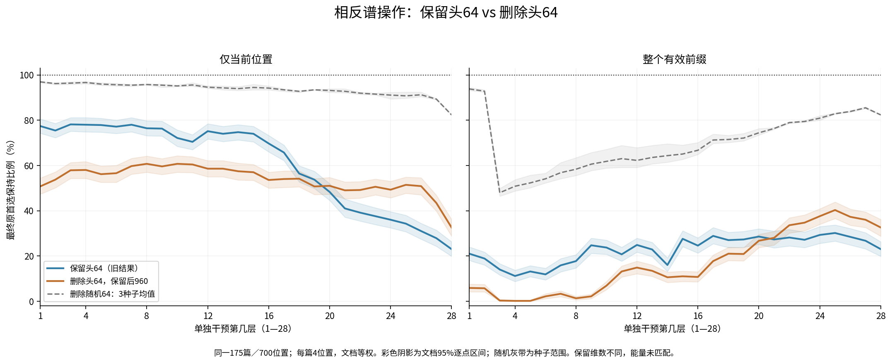
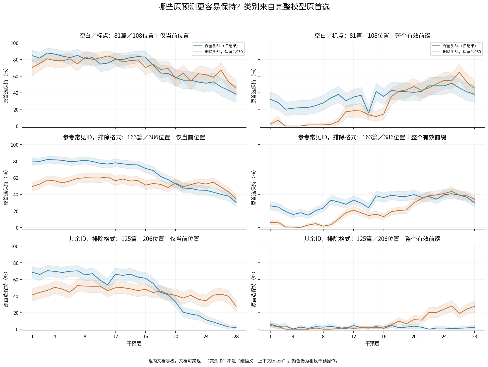
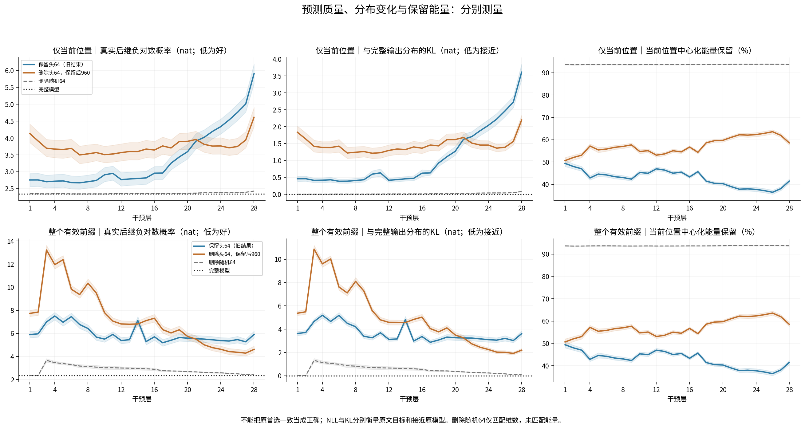
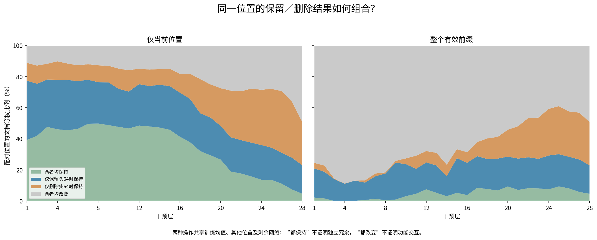
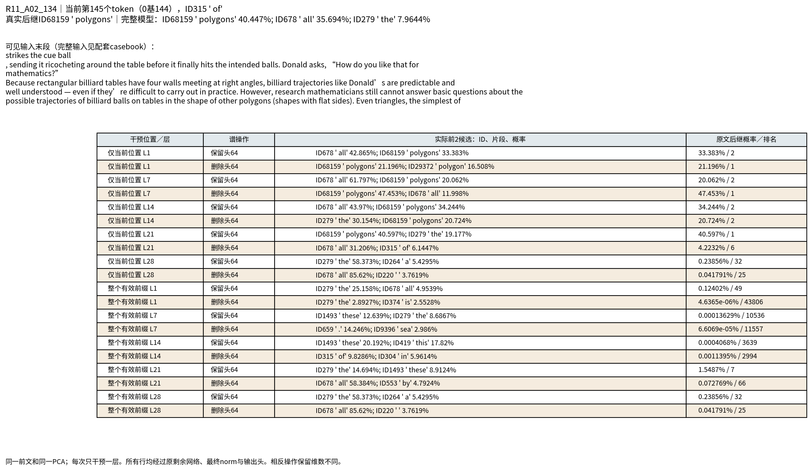
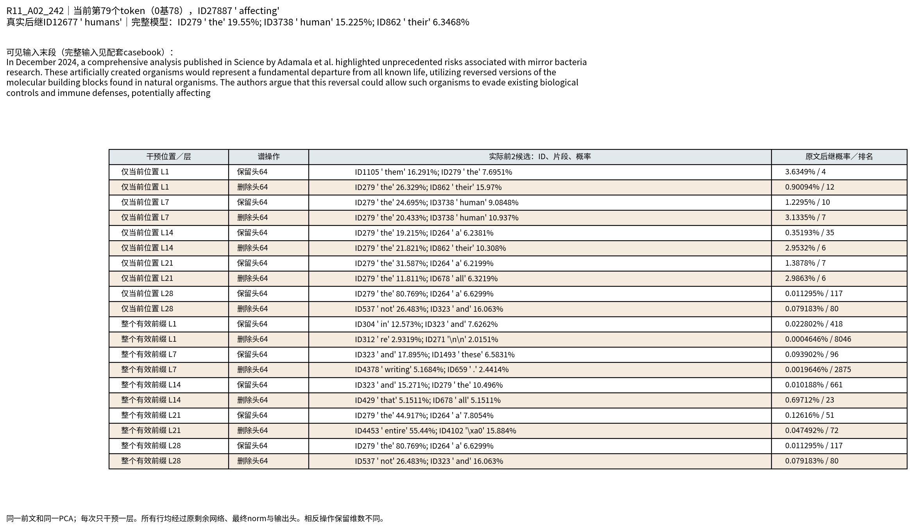
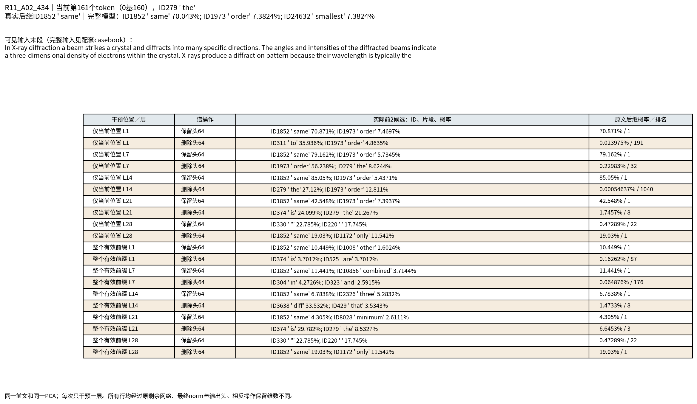

派生阅读副本；原件位置：`Projects/from-attention-to-search/main/experiments/A15/15_27_natural_language_feature_response/R16_20261102_layerwise_head64_intervention/supplements/20261104_delete_head64_keep960/summary_cn.md`。
[精确原始文件](../../../../../../../../../../sources/Projects/from-attention-to-search/main/experiments/A15/15_27_natural_language_feature_response/R16_20261102_layerwise_head64_intervention/supplements/20261104_delete_head64_keep960/summary_cn.md)；研究修改仍回到原件。

---

# 删除头64、保留后960：与保留头64的配对对照

## 目的

固定同一Qwen3-0.6B Base、文本、token位置和每层PCA，比较单层删除头64后正常运行剩余网络的最终预测，与旧保留头64条件逐位置对照。两个范围是仅当前位置与整个有效前缀。探索性面板，未训练或重拟合PCA。

从行为与因素对照、表征的逐层组织、原生干预与可信度三条线阅读。先报告事实，再记录有边界的AI认识更新；研究者科学接受Unknown。

## 观察与关键数据

**最主要的认识更新是：头64与后960对原生预测的相对支撑随层位置改变，不能把旧保留曲线解释成删除曲线，也不能把后960直接命名为细语义。**

- 仅当前位置：第1层保留头64保持77.43%，删除头64保持50.71%；第14层74.71%/57.43%；第25层34.29%/51.43%；最后层23.00%/32.57%。前中层保留头64占优，后部反转。第1/14层删除减保留差为−26.71[−31.43,−21.71]/−17.29[−21.57,−13.14]个百分点；第25层为+17.14[11.43,22.71]，均为175文档配对逐点95%区间，不作事后多层确认排名。
- 全前缀：第4层删除头64只保持1/700=0.14%，保留头64为78/700=11.14%；第25层删除/保留为40.29%/30.14%。因此“删除头64越深影响越大”不符合整体曲线，范围也显著改变结果。
- 最后层其余非格式ID：删除头64保持27.60%，保留头64仅2.00%，差25.60[17.47,32.93]个百分点。格式/参考常见非格式的差为7.41/3.89个百分点，但各自区间跨0。它是固定词频分组的发现，不是粗细粒度效应。
- 同一最后层位置，344/700=49.14%在两个操作下都改变原首选；33/700=4.71%都保持，128/700仅保留时保持，195/700仅删除时保持。单独一块不能普遍替代完整原生状态；四格不能直接解释成存储独立性或功能交互。它表明两种操作保住的位置并不相同，解释时必须保留逐位置配对，不能只比较总体率。




蓝线保留头64，橙线删除头64保留后960，灰线删除三个固定随机64维空间的平均。左右仅当前位置／整个前缀分别报告。彩色阴影按文档重采样95%逐点区间，灰带是随机种子范围。首选保持不是正确率；两种主操作保留维数不同。图排除了把删除曲线由保留曲线直接推出来的解释；后续比较必须显式固定干预方向和范围。

|层|仅当前：保留头64保持%|仅当前：删除头64保持%|整个前缀：保留头64保持%|整个前缀：删除头64保持%|仅当前：删除后真实目标损失|全前缀：删除后真实目标损失|
|---|---:|---:|---:|---:|---:|---:|
|1|77.43|50.71|21.00|5.86|4.1296|7.7284|
|2|75.43|53.71|18.86|5.71|3.9081|7.8430|
|3|78.14|57.86|14.00|0.29|3.6954|13.2162|
|4|78.00|58.00|11.14|0.14|3.6709|11.9463|
|5|77.86|56.14|13.14|0.14|3.6578|12.3781|
|6|77.14|56.57|11.86|2.14|3.6906|9.8161|
|7|78.00|59.71|15.86|3.29|3.4981|9.3588|
|8|76.43|60.71|17.71|1.29|3.5292|10.3432|
|9|76.29|59.57|24.71|2.14|3.5678|9.4907|
|10|72.14|60.71|23.71|6.86|3.5063|7.7878|
|11|70.43|60.43|20.71|13.14|3.5256|7.0598|
|12|75.14|58.57|24.86|14.86|3.5667|6.8114|
|13|74.00|58.57|22.86|13.43|3.5987|6.7932|
|14|74.71|57.43|16.00|10.57|3.5982|6.8124|
|15|74.00|57.00|27.57|11.00|3.6711|7.1025|
|16|69.71|53.57|24.57|10.71|3.6437|7.3104|
|17|65.71|54.00|28.86|17.71|3.7633|6.3245|
|18|56.43|54.14|27.00|21.00|3.7043|6.0360|
|19|53.71|50.71|27.29|20.86|3.8938|6.3149|
|20|48.29|51.00|28.57|26.71|3.8998|5.7339|
|21|41.00|49.00|27.29|28.00|3.9557|5.5032|
|22|39.14|49.14|28.14|33.57|3.8106|5.0066|
|23|37.57|50.57|27.14|34.71|3.7591|4.7633|
|24|36.00|49.29|29.29|37.57|3.7628|4.6219|
|25|34.29|51.43|30.14|40.29|3.7086|4.4222|
|26|31.00|50.86|28.43|37.29|3.7474|4.3642|
|27|27.86|43.43|26.71|36.00|3.9396|4.2908|
|28|23.00|32.57|23.00|32.57|4.6125|4.6125|

数据：175篇不同文档家族、700位置，每篇4位置。主指标先文档内平均再等权汇总；总体恰等于保持数/700，但区间仍以175文档为独立单位。NLL为真实后继负对数概率，单位nat，低为好；原模型2.3418nat。完整精度、文档与位置表在原始入口，未把同文档位置当独立文档。



词类按完整模型原首选固定：格式108位置/81篇，参考常见非格式386/163，其余非格式206/125；文档可出现在多个组。常见来自独立TRAIN频率，不代表粗语义；其余不代表细语义或上下文token。

|层|范围|删除头64：格式保持%|删除头64：参考常见非格式保持%|删除头64：其余非格式保持%|
|---|---|---:|---:|---:|
|1|仅当前|70.37 [60.49, 79.63]|49.28 [43.86, 54.81]|41.27 [33.73, 48.80]|
|1|全前缀|2.26 [0.41, 4.73]|6.03 [3.78, 8.54]|4.27 [1.73, 7.47]|
|7|仅当前|74.69 [66.05, 82.72]|59.25 [53.68, 64.67]|52.53 [45.20, 60.20]|
|7|全前缀|1.23 [0.00, 3.70]|4.75 [2.61, 7.21]|1.47 [0.00, 3.47]|
|14|仅当前|78.81 [70.58, 86.21]|56.03 [50.56, 61.25]|48.67 [41.20, 55.74]|
|14|全前缀|13.37 [7.41, 20.37]|14.52 [10.79, 18.51]|1.73 [0.27, 3.73]|
|21|仅当前|63.58 [53.70, 73.05]|49.18 [43.96, 54.24]|37.53 [30.13, 44.93]|
|21|全前缀|42.80 [33.33, 52.67]|34.76 [29.86, 39.83]|10.93 [6.53, 15.80]|
|28|仅当前|45.68 [36.01, 55.76]|34.20 [29.09, 39.52]|27.60 [20.13, 34.40]|
|28|全前缀|45.68 [36.01, 55.76]|34.20 [29.09, 39.52]|27.60 [20.13, 34.40]|



真实目标损失、与原输出分布的KL、实际保留的中心化能量分列，不能混成一个语义量。删除随机64与删除头64同样保留960维，但不匹配能量/范数；不能将头部特殊性全归于常见信息。前中层头64在更少维数/更少平均能量下仍占优，排除“保留越多就一定越好”的简单解释；但方向与能量仍需分开，当前不追加计算。



同位置配对后，两者均保持、仅保留时保持、仅删除时保持、两者均改变，四类合为100%。它们共享均值、其他位置和剩余网络，因此不能把四格比例叫独立信息量、功能交互或因果冗余。

|层|范围|两者均保持%|仅保留时保持%|仅删除时保持%|两者均改变%|
|---|---|---:|---:|---:|---:|
|1|仅当前|39.29|38.14|11.43|11.14|
|1|全前缀|2.29|18.71|3.57|75.43|
|7|仅当前|49.71|28.29|10.00|12.00|
|7|全前缀|1.43|14.43|1.86|82.29|
|14|仅当前|47.29|27.43|10.14|15.14|
|14|全前缀|3.14|12.86|7.43|76.57|
|21|仅当前|19.00|22.00|30.00|29.00|
|21|全前缀|7.14|20.14|20.86|51.86|
|28|仅当前|4.71|18.29|27.86|49.14|
|28|全前缀|4.71|18.29|27.86|49.14|

### 37篇固定读到the面板

与自然面板分开，不用于重新选参数。

|层|范围|删除头64保持%|保留头64保持%|删除后真实目标损失nat|
|---|---|---:|---:|---:|
|1|仅当前|13.51 [2.70, 24.32]|97.30 [91.89, 100.00]|5.34 [4.41, 6.31]|
|1|全前缀|0.00 [0.00, 0.00]|8.11 [0.00, 18.92]|8.67 [7.79, 9.53]|
|7|仅当前|5.41 [0.00, 13.51]|86.49 [75.68, 97.30]|5.18 [4.34, 6.14]|
|7|全前缀|0.00 [0.00, 0.00]|2.70 [0.00, 8.11]|10.26 [9.32, 11.22]|
|14|仅当前|13.51 [2.70, 24.32]|89.19 [78.38, 97.30]|4.83 [3.92, 5.85]|
|14|全前缀|2.70 [0.00, 8.11]|16.22 [5.41, 29.73]|8.16 [7.53, 8.85]|
|21|仅当前|18.92 [8.11, 32.43]|59.46 [43.24, 75.68]|4.74 [3.94, 5.64]|
|21|全前缀|13.51 [2.70, 24.32]|10.81 [2.70, 21.62]|6.32 [5.26, 7.39]|
|28|仅当前|16.22 [5.41, 29.73]|10.81 [2.70, 21.62]|5.37 [4.49, 6.31]|
|28|全前缀|16.22 [5.41, 29.73]|10.81 [2.70, 21.62]|5.37 [4.49, 6.31]|

## 真实文本与原始候选

[完整案例记录](../../../../../../../../../../UNAVAILABLE.md)含全部28层的两个谱操作/两个范围，含9例原固定和另标结果后选。以下三例沿用旧面板位置。所有预测只能利用当前token及其前文。


### R11_A02_134

当前第145个token（0基144），ID315 ' of'。真实后继ID68159 ' polygons'。完整可见前文：

```text
In Disney’s 1959 film
Donald in Mathmagic Land
, Donald Duck, inspired by the narrator’s descriptions of the geometry of billiards,
energetically strikes the cue ball
, sending it ricocheting around the table before it finally hits the intended balls. Donald asks, “How do you like that for mathematics?”
Because rectangular billiard tables have four walls meeting at right angles, billiard trajectories like Donald’s are predictable and well understood — even if they’re difficult to carry out in practice. However, research mathematicians still cannot answer basic questions about the possible trajectories of billiard balls on tables in the shape of other polygons (shapes with flat sides). Even triangles, the simplest of
```



**逐例阅读：**完整模型在“Even triangles, the simplest of”后首选polygons40.45%。第1/7层仅当前位置删除头64仍首选polygons，概率21.20/47.45%；同层保留头64转为all，但polygons仍有33.38/20.06%，所以原首选改变并不必然失去同一类合理续接。全前缀早层删除则严重削弱目标支持：第1层polygons约0.000005%、排名43806。末层保留头64首选the58.37%，删除头64首选all85.62%；polygons分别0.2386%/0.04179%，都远低于原模型。这是“后960必然解出更具体内容”的反例；all仍可能继续接all polygons，不把它叫完全无语义。此前前文已经出现polygons，早层保持也存在词面重复/重新取得的解释。


### R11_A02_242

当前第79个token（0基78），ID27887 ' affecting'。真实后继ID12677 ' humans'。完整可见前文：

```text
In December 2024, a comprehensive analysis published in Science by Adamala et al. highlighted unprecedented risks associated with mirror bacteria research. These artificially created organisms would represent a fundamental departure from all known life, utilizing reversed versions of the molecular building blocks found in natural organisms. The authors argue that this reversal could allow such organisms to evade existing biological controls and immune defenses, potentially affecting
```



**逐例阅读：**当前位置affecting之后需要继续说明影响对象。原首选the19.55%，human15.23%，真实humans2.6457%、第6。第14层仅当前位置删除头64仍首选the21.82%，humans2.9532%、第6；保留头64虽也首选the，但humans仅0.3519%、第35。两种相同首选下面，具体对象候选支持差异很大。末层删除头64首选not26.48%、and16.06%，humans仅0.07918%、第80；保留头64首选the80.77%，humans0.01129%、第117。删除比保留更支持humans，但两者都远未恢复原分布，not也可能开启not only等续接，不能凭一个片段判整个输出无语义。


### R11_A02_434

当前第161个token（0基160），ID279 ' the'。真实后继ID1852 ' same'。完整可见前文：

```text
The ratio of reflected intensity to incident intensity is the X-ray reflectivity for the surface. If the interface is not perfectly sharp and smooth, the reflected intensity will deviate from that predicted by the law of Fresnel reflectivity. The deviations can then be analyzed to obtain the density profile of the interface normal to the surface. For films with multiple layers, X-ray reflectivity may show oscillations with wavelength, analogous to the Fabry-Pérot effect. These oscillations can be used to infer layer thicknesses and other properties.


In X-ray diffraction a beam strikes a crystal and diffracts into many specific directions. The angles and intensities of the diffracted beams indicate a three-dimensional density of electrons within the crystal. X-rays produce a diffraction pattern because their wavelength is typically the
```



**逐例阅读：**完整模型在“their wavelength is typically the”之后首选same70.04%，它是关系片段而非领域对象名称。第1/7/14层仅当前位置保留头64仍首选same，概率70.87/79.16/85.05%；删除头64时same则排191/32/1040。到最后层，保留头64首选引号22.79%、空格17.75%，same仅0.4729%、第22；删除头64重新首选same19.03%、第1。这是同一位置的操作优势反转，但19.03%仍远低于原70.04%，不能称整个分布已恢复。same属于参考常见ID，却表达上下文关系，直接反驳把常见ID与上下文相关内容对立的简化；也不能从一个token推完整关系语义。


## 假设、认识更新与竞争解释

**AI认识更新一：大方差方向的原生预测优势具有阶段条件。** 前中层保留头64通常优于保留后960，即使前者维数少很多、实际中心化能量也更少：第1层49.37%vs50.63%，第14层44.97%vs55.03%。因此，前中层优势不能用“保留维数更多”或“平均保留能量更多”解释，方向与后续计算的关系有作用。后部反转则仍可能受后960维数/能量更多影响，不能说同一信息已经从谱头移动到谱尾；每层基底不同，也未跟踪内容本身。

**AI认识更新二：局部可替代性依赖完整上下文和剩余计算。** 第1层删除头64仅当前位置保持50.71%，全前缀5.86%；第14层57.43%/10.57%。这与其他位置和后续网络还能提供预测支持相容。全前缀同时改了更多状态、包含未参与参考拟合的早位置0..31，也可能有累积扰动/分布偏移。结果没有识别补偿、重新检索、后续首次形成具体区分这几种机制，不能以最终保持率定位知识存储。

**AI认识更新三：后960确实能支持一些头64不能维持的预测，但它不是专门的细语义仓库。** 末层195/700位置只有删除头64时保持原首选；其余非格式ID保持率提升25.6个百分点，有明确的本面板探索性证据。X射线same片段是可复查正例，多边形polygons和生物humans则保留失败/不充分例。后960涵盖PC65–1024的中间和较后方向，不是窄尾部64维。删除后仍有40.71%的首选为格式、46.71%为参考常见非格式；保留头64时分别33.71%/64.57%。所以删除头64并未消灭常见词或格式。均值、后960和输出网络仍可产生它们；这削弱排他式“头64=常见、其余=具体”的映射。

**关于语义粒度：** 我更倾向阶段依赖、混合支撑的工作解释：某些跨输入复用的变化对前中层正常计算很有用，而后部具体预测也依赖广泛方向。但“常见模式”仍是假设，词频标签不能替代外部粗细关系；same是常见词却有关系含义，polygons也可能来自词面复制。当前不能升级为浅粗深细、头粗尾细或功能交互结论。

**竞争解释与结论边界：** 同维随机删除的保持率远高于删头64，例如第1层仅当前位置约96.6–97.1%vs50.7%，末层约82.3%vs32.6%；这表明效果不是任意删64维都一样。但随机删除保留约94%能量，删头64仅约一半，方向特异性与能量仍未分开。最大并列与基线误差已核查，曲线不能归于重放/坐标不匹配。全模型损失2.3418仍优于末层保留头64的5.9027和保留后960的4.6125；并非任一操作普遍更好。

本轮最值得保留的认识是：原生预测对谱段的依赖随计算阶段和范围而变，单独保留任一块都不能普遍代替完整状态。下一步科学选择待研究者讨论；本轮不自动扩展计算。


## 具体做法与可信度

精确复用R16权重/tokenizer与28套独立PCA，原训练参考60篇/9600位置；原评估175/700自然位置+37/the，共180篇物理文档。每次只改一层residual-post，范数前。删除公式h新=h−(h−训练均值)QQ转置；均值保留，后960维保留。每层四个删除条件、两个范围；随后原后续层/finalnorm/head。没有新PCA或分类器拟合。模型BF16、投影FP32再转BF16、概率FP32；不另做温度/范数校准。

原生状态和旧输出重放、补空间代数、空删除恒等、完整hook/后缀与causal mask检查通过后才运行。最大并列取最小ID，前10边界也稳定处理；原修正词类不变。按文档落盘，源文件哈希冻结，Spot恢复只复用同冻结的完整文档。2000次文档配对重采样，区间为逐点探索性，随机种子不当独立语料。


实际新增165825条记录，其中含737条原生基线；复用保留条件41272条，合计207097条。全部28层目标表征重放最大差0；原模型NLL最大差0；原首选变化0个；复用保留汇总最大差4.54747e-13；最后层两个范围完全相同。


## 边界

保留64与保留960维数/能量不同；删除头64与删除随机64只匹配维数。全前缀额外改变许多位置、总扰动更大；当前位置高恢复可能来自后续补偿或其他状态。删除后输出改变不是参数知识被擦除，保持首选也不代表其他候选完整。参考仅原两域60篇，评估已暴露，不能推为所有语料/模型结论；不把频率分组冒称粗细语义。

[协议](protocol_cn.md) · [配置](../../../../../../../../../../sources/Projects/from-attention-to-search/main/experiments/A15/15_27_natural_language_feature_response/R16_20261102_layerwise_head64_intervention/supplements/20261104_delete_head64_keep960/manifest.json) · [原始数据与复算](../../../../../../../../../../UNAVAILABLE.md) · [执行细节](../../../../../../../../../../UNAVAILABLE.md)。研究者接受与闭题Unknown；没有自动扩大实验。

