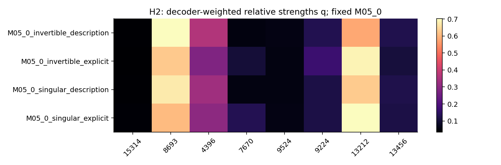
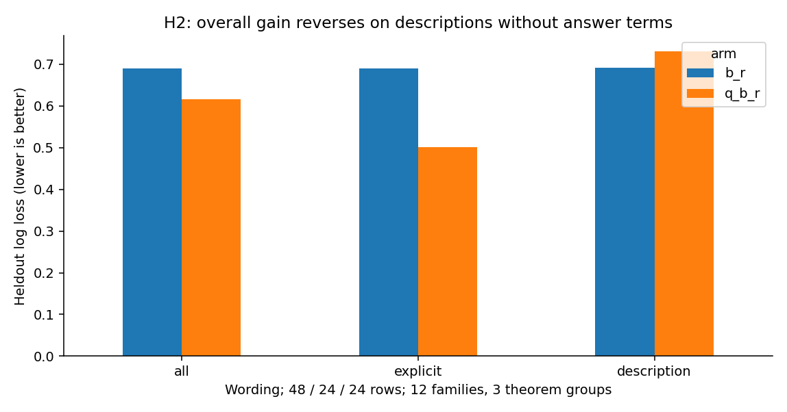
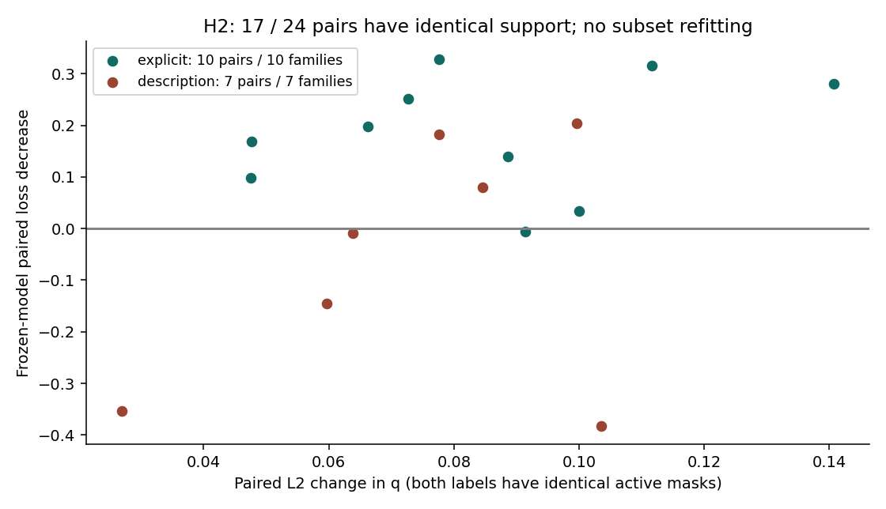

派生阅读副本；原件位置：`Projects/from-attention-to-search/main/experiments/A15/15_27_natural_language_feature_response/R17_20261102_feature_composition_v02/H2/summary_cn.md`。
[精确原始文件](../../../../../../../../../sources/Projects/from-attention-to-search/main/experiments/A15/15_27_natural_language_feature_response/R17_20261102_feature_composition_v02/H2/summary_cn.md)；研究修改仍回到原件。

---

# H2：固定成员相对强度

执行分支：`COMPLETED_INSUFFICIENT`；科学接受及下一研究决策：`Unknown`。修订版留出已暴露。

## 1. 一句话更新

固定成员强度在混合面板有增量，但当前证据不能把它解释为跨表达保持的可逆性编码。

## 2. 观察

主比较[b,r]0.690265→[q,b,r]0.616439，改善0.073825，95%家族[0.009994,0.129799]；3定理组敏感性[−0.010718,0.173821]。显式版改善0.188398，描述版−0.040747。17／24留出对同支持，10家族；显式10对、描述7对。描述同支持冻结模型改善−0.060363，95%[−0.225542,0.096753]。

## 3. 完整性

原始z、末层decoder列范数d、u=z*d、b、r和q均保存；C的d范围195.0443–991.2906，非单位列，不能把z与u混称。384条C向量无零向量，q均有限。两主模型序列化重放误差小于1e−10。加入全字典活跃数和范数的对照、词面与分层诊断完成；可选置乱依协议省略，不声称严格保持正值边际。

## 4. 竞争解释

显式术语依然解释大部分增量。长度、活跃数和范数分层并非每层均正：全字典活跃数最高层改善−0.0352。整体附加控制没有修复描述版。固定候选集合不等于所有文本有同一支持。

## 5. 结论与边界

相对强度可变化，并有受措辞限制的可读信号；跨表述强度语义对应未裁定。主模型不是条件互信息估计，也没有证明底模用这种比值。

## 6. 假设更新

AI修正倾向：从“同一批成员的相对强弱编码细节”收缩为“在固定集合及部分同支持文本对中，相对强度与特定表达共同变化；需要先证明方向跨表达稳定”。

## 7. 下一决策

AI建议下一步采用同词面、受控关系变化的配对材料，优先区分关系信号与答案术语。是否启动仍由研究者决定。

## 图与原始证据

The same support can change strength; direction depends on wording.

H2: overall gain reverses on descriptions without answer terms

A strength change alone does not guarantee improved semantic readout.

[指标原表](../../../../../../../../../sources/Projects/from-attention-to-search/main/experiments/A15/15_27_natural_language_feature_response/R17_20261102_feature_composition_v02/tables/H2_readout_metrics.csv) · [全部响应、预测、调参与失败](../../../../../../../../../UNAVAILABLE.md) · [方法和修订](../../../../../../../../../UNAVAILABLE.md) · [具体案例](../../../../../../../../../UNAVAILABLE.md)
