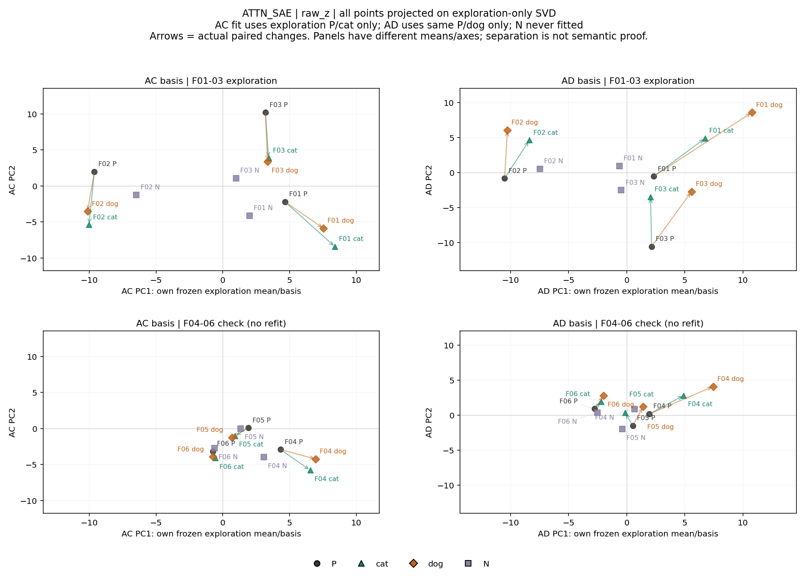
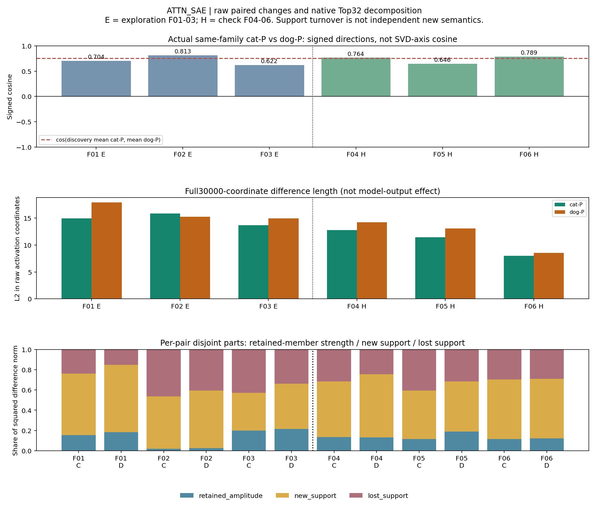
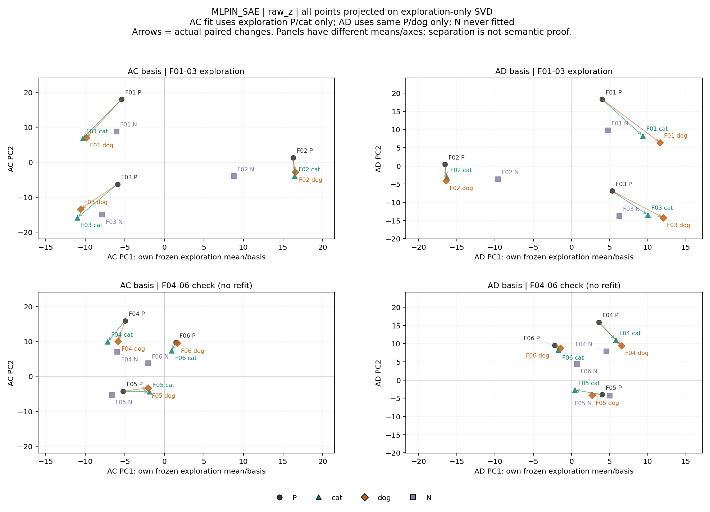
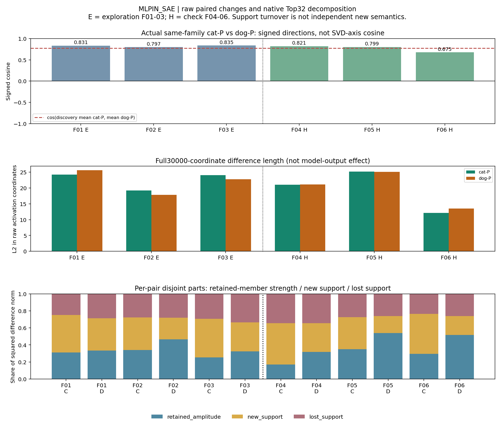

派生阅读副本；原件位置：`Projects/from-attention-to-search/main/experiments/A15/15_27_natural_language_feature_response/R17_20261102_feature_composition_v02/diagnostics/R17_D1/controlled_steps/S05_AC_AD_svd_paired_geometry_24/summary_cn.md`。
[精确原始文件](../../../../../../../../../../../../sources/Projects/from-attention-to-search/main/experiments/A15/15_27_natural_language_feature_response/R17_20261102_feature_composition_v02/diagnostics/R17_D1/controlled_steps/S05_AC_AD_svd_paired_geometry_24/summary_cn.md)；研究修改仍回到原件。

---

# S05：动物→猫与动物→狗的激活变化几何

**两组总体轴与父类到细类的配对差都呈正向关联，但它们是不同对象。第一轴主要反映家族中点间差异；保留家族只部分沿用探索方向，并存在分量反号。** 下面数值仅描述6个短文本家族，不构成一般语义规律。

先分三条路径阅读：①行为与条件：本轮沿用已完成S04的统一Description:缓存，原生猫狗12/12是前轮结果，没有新行为实验；②表征：分别比较两套SAE的总体SVD及配对差；③功能与质量：没有干预/训练，行对应、谱、分解与投影闭合核验通过，功能判断等待共同审阅。

## 1. 目的与假设

要区分“P/猫与P/狗的总体变化轴接近”和“猫−P与狗−P沿相近有方向变化”。前者是每组中心化样本的总体方差轴，正负任意；后者有父类到细类的明确方向，用有符号余弦。两者相近都只说明本面板和字典坐标里的几何关系，不能认定语义相同或feature因果重要。原H1/H2额外信息命题未改、未在此验证。

## 2. 实验

同一冻结Qwen3-0.6B Base与两套原生SAE产生的S04缓存：24条正文、统一Description:、末尾冒号ID25。Attention读取block27 o_proj残差相加前输出；MLP输入读取block27实际MLP输入，残差及post_attention_layernorm后。两字典各30000坐标，不对齐同号原子。只做缓存分析，没有新模型前向。

F01–03探索，F04–06检查。每个AC矩阵按P01/猫01/P02/猫02/P03/猫03排6行；AD换成对应狗，三个P完全相同。各组分别减自己的探索列均值，拟合前1/前2方向；检查均值/方向不重拟合。6×30000中心化矩阵数值秩均5，不能从它推断30000维概念总体结构。原始z为主，z×decoder列范数为尺度补充，两套完整报告。输入完整前文、Top32及预激活见[24条真实输入](../../../../../../../../../../../../UNAVAILABLE.md)，行ID/完整均值/奇异值见[Detailed](../../../../../../../../../../../../UNAVAILABLE.md)。

## 3. 总体变化轴是否相近

| 接口 | 原始PC1绝对余弦 | 前二维投影重叠（0–1） | 两主角（度） | 猫−P/狗−P探索均值差有向余弦 |
| --- | --- | --- | --- | --- |
| ATTN_SAE | 0.866374 | 0.725714 | 24.369, 37.958 | 0.754333 |
| MLPIN_SAE | 0.963437 | 0.930958 | 11.701, 18.142 | 0.772858 |

绝对余弦只比较无定向第一轴；前二维重叠是两投影算子重叠除以2，1才是同一二维子空间。它们不是语义相似度。AC/AD有一半相同P行，共享句式/词面也会带来总体轴接近，未由本对照排除。

把探索每轴的投影平方和分成“家族中点间”与“家族内父子差”后，第一轴如下：

| 接口 | 矩阵 | 第一轴：家族中点间份额 | 家族内父子份额 |
| --- | --- | --- | --- |
| ATTN_SAE | AC | 97.69% | 2.31% |
| ATTN_SAE | AD | 88.81% | 11.19% |
| MLPIN_SAE | AC | 96.96% | 3.04% |
| MLPIN_SAE | AD | 94.09% | 5.91% |

这里的分解是同一投影平方和的恒等式，不能将中点变化进一步直接认定为句式语义。它说明“总体第一轴”主要不是家族内P→细类差；不能仅凭轴相近回答父子变化问题。

## 4. 配对差、支持变化与复现

逐家族直接计算完整30000维猫−P与狗−P，长度与有向余弦不依赖SVD中心化。

| 家族 | Attention：猫/狗差余弦 | MLP输入：猫/狗差余弦 |
| --- | --- | --- |
| F01 探索 | 0.704123 | 0.830993 |
| F02 探索 | 0.812526 | 0.796999 |
| F03 探索 | 0.621526 | 0.834691 |
| F04 检查 | 0.763945 | 0.821242 |
| F05 检查 | 0.645844 | 0.798725 |
| F06 检查 | 0.789007 | 0.675203 |

六家族均为正，但没有都趋近同一探索均值方向。探索/检查的**均值差**（先平均向量再算余弦，不是平均逐对余弦）如下：

| 接口 | 探索猫/狗均值差L2 | 检查猫/狗均值差L2 | 探索两均值差余弦 | 检查两均值差余弦 | 检查均值相对探索：猫/狗余弦 |
| --- | --- | --- | --- | --- | --- |
| ATTN_SAE | 10.737758/12.113302 | 7.805752/9.130731 | 0.754333 | 0.767532 | 0.480079/0.597865 |
| MLPIN_SAE | 17.765389/17.213297 | 14.795975/15.020464 | 0.772858 | 0.708681 | 0.600516/0.542842 |

因此“每组猫/狗变化彼此有共同方向分量”可作为候选现象；“跨句式沿一条固定父子轴”仍受限制。每条完整坐标、长度和两组投影均保留，不能只看二维图是否分开。

### 来自共同强弱还是Top32更替

每条差分成共同正成员的幅度变化、P零而细类正的换入、P正而细类零的换出。下面按3家族×猫狗6条差的平方范数汇总，分母是这些完整差的平方范数之和，属于几何份额，不是语义/功能份额。

| 接口 | 分组 | 共同成员强弱 | 换入 | 换出 |
| --- | --- | --- | --- | --- |
| ATTN_SAE | 探索 | 13.10% | 54.34% | 32.56% |
| ATTN_SAE | 检查 | 13.98% | 55.16% | 30.86% |
| MLPIN_SAE | 探索 | 32.72% | 38.64% | 28.65% |
| MLPIN_SAE | 检查 | 36.89% | 33.84% | 29.27% |

两种变化都存在；本度量下成员换入/换出合计更大。Top32零值仍可能有正预激活，不能称作“独立新语义出现”。逐家族三部分互斥；跨家族平均后可能重叠，不能把均值分项能量直接相加。均值差比较的3×3交叉点积分项与具体成员事件在[Detailed](../../../../../../../../../../../../UNAVAILABLE.md)及[原始事件表](../../../../../../../../../../../../sources/Projects/from-attention-to-search/main/experiments/A15/15_27_natural_language_feature_response/R17_20261102_feature_composition_v02/diagnostics/R17_D1/controlled_steps/S05_AC_AD_svd_paired_geometry_24/results/difference_member_events.csv)中分别给出。

### 反例与稳定性

按预定规则，两接口都选到F05猫−P的AC第一轴投影反号：Attention探索均值 **+1.191980**，F05 **−1.002533**；MLP输入探索均值 **−3.266106**，F05 **+3.332532**。完整F05文本、固定主要成员数值见[反例段](../../../../../../../../../../../../UNAVAILABLE.md)。完整向量余弦仍为正，一个分量反号不能说整条变化相反。

只用探索家族的27种成组bootstrap中，前二维有24/27可定义，其余3个只剩单一家族、秩1。第一轴相对原全探索轴的对齐范围很宽；这部分也受重采样删去句式家族所影响，不能给方向作可靠总体置信判断。

| 接口 | AC/AD第一轴绝对余弦重采样范围 | 前二维重叠范围（24有效） | AC第一轴对原拟合轴范围 | AD第一轴对原拟合轴范围 |
| --- | --- | --- | --- | --- |
| ATTN_SAE | 0.605502–0.890111 | 0.567017–0.745591 | 0.017335–1.000000 | 0.016087–1.000000 |
| MLPIN_SAE | 0.796999–0.976269 | 0.762925–0.930958 | 0.011761–1.000000 | 0.006488–1.000000 |

这些是27个有序重采样（10个无序多重集）的经验范围，不是置信区间。Attention AD第二/三奇异值相对间隔约0.075，MLP AC第一/二约0.095，需警惕相近根下的轴旋转；完整谱与间隔均报告，二维子空间比较不能替代小样本稳定性判断。

## 5. 回到成员、尺度与认识更新

### ATTN_SAE

| 探索方向 | 前5个有符号系数（本字典ID） |
| --- | --- |
| AC PC1 | #10021:0.3538, #2254:-0.2912, #4647:-0.2546, #22267:-0.2403, #24998:-0.2237 |
| AC PC2 | #3516:0.3485, #9495:0.2689, #22344:-0.2649, #26542:0.2252, #23899:0.2094 |
| AD PC1 | #10021:0.3323, #24256:0.2537, #22267:-0.2316, #2254:-0.2257, #4647:-0.2244 |
| AD PC2 | #24256:0.3279, #23896:0.2827, #3516:-0.2434, #9495:-0.2314, #15920:0.2304 |

[每个方向的全部主要成员、P/猫/狗/椅子原始激活/预激活与完整前文](../../../../../../../../../../../../UNAVAILABLE.md) · [原S03 H2成员额外记录](../../../../../../../../../../../../UNAVAILABLE.md)。

上下是探索与检查，左右是两组各自均值/方向的坐标，不能把左右轴当成同一坐标。箭头为每家族实际P→猫/狗；椅子仅投影，不参与SVD。

上：逐家族两差的有向余弦，虚线是探索均值差余弦；中：原始完整差长度；下：共同强弱/换入/换出的互斥平方范数份额。分组线分开探索/检查。

### MLPIN_SAE

| 探索方向 | 前5个有符号系数（本字典ID） |
| --- | --- |
| AC PC1 | #8856:0.3102, #966:-0.2343, #18809:0.2335, #4127:-0.2322, #20157:-0.2231 |
| AC PC2 | #29342:0.4753, #17390:0.2809, #22309:-0.2319, #29506:0.2182, #16240:-0.2135 |
| AD PC1 | #27880:0.2941, #8856:-0.2827, #20157:0.2390, #18809:-0.2214, #966:0.2134 |
| AD PC2 | #29342:0.4727, #17390:0.2875, #14536:-0.2364, #22309:-0.2302, #16240:-0.1842 |

[每个方向的全部主要成员、P/猫/狗/椅子原始激活/预激活与完整前文](../../../../../../../../../../../../UNAVAILABLE.md) · [原S03 H2成员额外记录](../../../../../../../../../../../../UNAVAILABLE.md)。

上下是探索与检查，左右是两组各自均值/方向的坐标，不能把左右轴当成同一坐标。箭头为每家族实际P→猫/狗；椅子仅投影，不参与SVD。

上：逐家族两差的有向余弦，虚线是探索均值差余弦；中：原始完整差长度；下：共同强弱/换入/换出的互斥平方范数份额。分组线分开探索/检查。

特别记录：Attention #14602在本面板最终激活全为0，非零SVD方向对应系数也为0；#3516是AC第二方向的第一大绝对系数（+0.349），也是AD第二方向前5成员（约−0.243）。后者的正负受整组轴定向/旋转影响，不能解释成猫狗语义相反。它们都按原H2名单保留，未强行排在前面。

原始/decoder范数加权两尺度的三个主要相似度最大差为 **8.372e-08**；各原子decoder范数接近1，所以本轮尺度补充几乎相同，而不是事后选较好的一套。完整补充见[尺度表](../../../../../../../../../../../../sources/Projects/from-attention-to-search/main/experiments/A15/15_27_natural_language_feature_response/R17_20261102_feature_composition_v02/diagnostics/R17_D1/controlled_steps/S05_AC_AD_svd_paired_geometry_24/results/scale_sensitivity.csv)、[Attention加权投影](../../../../../../../../../../../../sources/Projects/from-attention-to-search/main/experiments/A15/15_27_natural_language_feature_response/R17_20261102_feature_composition_v02/diagnostics/R17_D1/controlled_steps/S05_AC_AD_svd_paired_geometry_24/figures/ATTN_SAE_decoder_weighted_projections.png)和[MLP输入加权投影](../../../../../../../../../../../../sources/Projects/from-attention-to-search/main/experiments/A15/15_27_natural_language_feature_response/R17_20261102_feature_composition_v02/diagnostics/R17_D1/controlled_steps/S05_AC_AD_svd_paired_geometry_24/figures/MLPIN_SAE_decoder_weighted_projections.png)。加权坐标仍非decoder线性映射后的1024维几何；未执行该可选比较。

**认识更新：**当前面板中，猫−P与狗−P共享正向变化分量，而总体第一轴的接近大部分对应家族中点间变化；它们不能合成同一个“父子概念方向”结论。细类变化同时包含共同成员强弱和支持更替，后者在本平方范数度量中占较大部分；跨家族固定方向只部分保持，F05分量反号需保留。

共享P本身、相同/相近句式、P中的object与细类中的animal指代、明确的cat/dog词、冠词变化、Top32竞争、非唯一SAE坐标和只有3个探索家族仍是竞争解释。图分开或方向相近都不确定语义、功能或因果作用。原H1/H2假设不修订，下一步等待共同审阅；没有继续扩数据、训练、probe、干预或后续实验。

[Detailed与所有谱/差分/反例](../../../../../../../../../../../../UNAVAILABLE.md) · [24条完整输入](../../../../../../../../../../../../UNAVAILABLE.md) · [核验](../../../../../../../../../../../../sources/Projects/from-attention-to-search/main/experiments/A15/15_27_natural_language_feature_response/R17_20261102_feature_composition_v02/diagnostics/R17_D1/controlled_steps/S05_AC_AD_svd_paired_geometry_24/evidence/verification.json)
