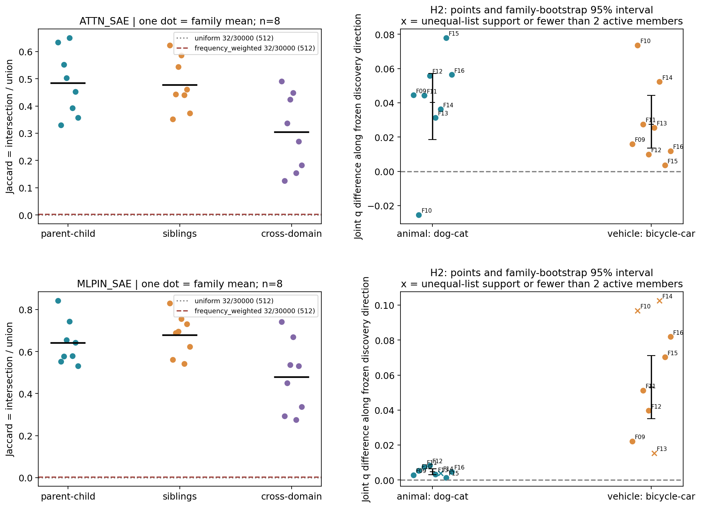
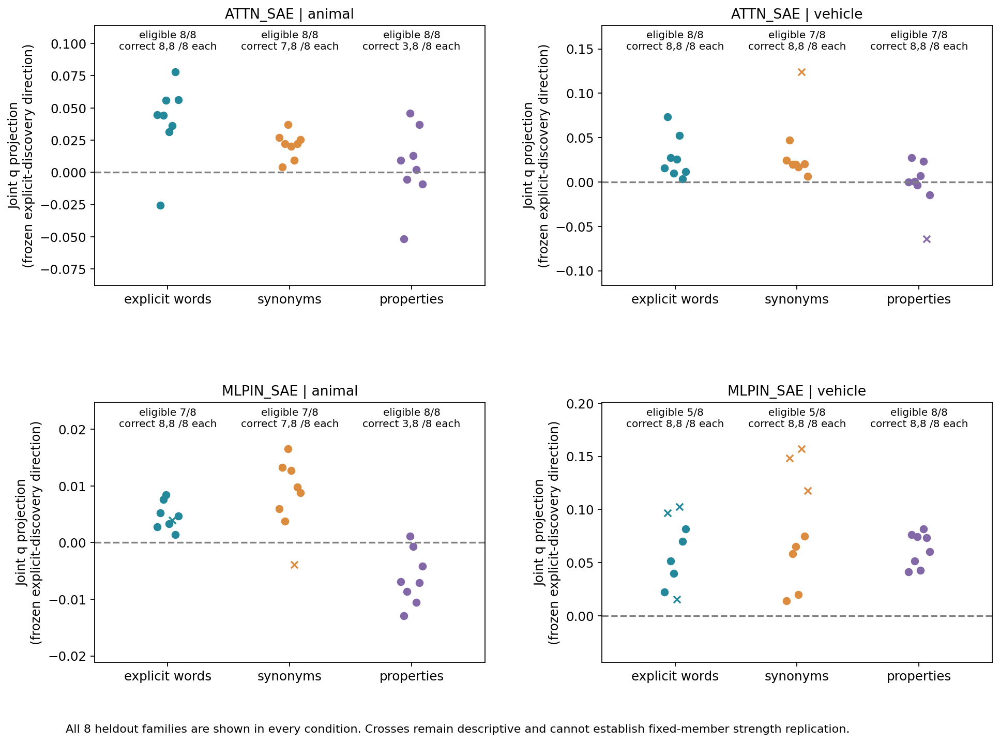

派生阅读副本；原件位置：`Projects/from-attention-to-search/main/experiments/A15/15_27_natural_language_feature_response/R17_20261102_feature_composition_v02/diagnostics/R17_D1/controlled_steps/S06_semantic_hierarchy_1104/summary_cn.md`。
[精确原始文件](../../../../../../../../../../../../sources/Projects/from-attention-to-search/main/experiments/A15/15_27_natural_language_feature_response/R17_20261102_feature_composition_v02/diagnostics/R17_D1/controlled_steps/S06_semantic_hierarchy_1104/summary_cn.md)；研究修改仍回到原件。

---

# SAE组合与语义层级：本轮认识更新

本轮按三条路径阅读：①原模型行为与措辞／家族控制；②SAE成员组合及联合强弱；③功能与质量。本轮未做功能干预；数值和来源检查检验测量可信性。按用户本次要求，以下同时给出原始观察和有边界的AI认识更新，科学接受／机制判断／关闭仍Unknown。

目的：用具体自然文本观察动物→猫／狗与交通工具→汽车／自行车的组合变化。H1看共同使用和成员更替；H2看同一共同列表的相对强弱。上下位关系只是本轮选定语言现象。

## 1. 哪些认识得到更新

本轮多确定了三件事。第一，细类不是把父类32个成员全部保留后再往上添加：它在同一32成员预算内保留部分并更替部分。具体候选有复现也有失败，例如MLP输入猫换入候选#22958为8/8，#11234为0/8；自行车#16830为8/8。因而可重复的是部分组合事件，而不是整份列表稳定不变。

第二，成员重叠与共同成员的强弱复现是两个问题。显式留出中，同域相对跨域的Jaccard差为Attention动物0.2212、交通0.1341，MLP输入0.1884、0.1595；但交通工具H2在MLP输入只有5/8组固定成员资格。不能把更高类内重叠直接改写为稳定强弱规律。Attention交通工具H2在显式词下局部通过，属性改写后联合投影95%区间跨零，跨措辞稳定性未支持。

第三，语义推广首先受原模型行为约束。动物属性文本猫3/8、狗8/8，不能把这些表征差直接当成模型成功完成了隐含猫狗识别。交通工具两子类属性均8/8；H1重叠子预测跨措辞保持，但仍有词面/属性线索和位置差异。所有共同列表的严格频率匹配完整随机名单均0/256，因此这些名单的特异优势还没有匹配参照，不能声称优于任意同频共同成员。

当前最稳妥的更新是：组合的适用范围必须同时带上“类别、措辞、取样位置和字典”。发现集候选可以在新家族保持，也可以在同义词／属性改写中改变、消失或失去固定成员资格。两大类无需服从同一种组织规律。下面按事先固定的分支报告，不把可读性升级为因果或router分发。

| SAE | 大类 | H | 显式条件 | 跨措辞 |
| --- | --- | --- | --- | --- |
| ATTN_SAE | animal | H1 | LOCAL_SUPPORT | INSUFFICIENT |
| ATTN_SAE | animal | H2 | LOCAL_SUPPORT | INSUFFICIENT |
| ATTN_SAE | vehicle | H1 | LOCAL_SUPPORT | SUPPORT_IN_THIS_PANEL |
| ATTN_SAE | vehicle | H2 | LOCAL_SUPPORT | NOT_SUPPORTED |
| MLPIN_SAE | animal | H1 | LOCAL_SUPPORT | INSUFFICIENT |
| MLPIN_SAE | animal | H2 | LOCAL_SUPPORT | INSUFFICIENT |
| MLPIN_SAE | vehicle | H1 | LOCAL_SUPPORT | SUPPORT_IN_THIS_PANEL |
| MLPIN_SAE | vehicle | H2 | INSUFFICIENT | INSUFFICIENT |

这些状态分别判断显式条件下的局部预测和跨措辞预测。H1主统计只裁决“类内组合比跨类更接近”子预测；固定共同／换入／换出列表的实际复现见Detailed，不能由这个统计代替。H2主统计控制固定列表内成员身份；未满足资格的点仍画出，但只作描述。

## 2. 决定性数据紧接结论

| SAE | 大类 | 预测 | 估计 | 95%家族区间 | 可用/8 | Holm p |
| --- | --- | --- | --- | --- | --- | --- |
| ATTN_SAE | animal | H1 | 0.2212 | [0.1868, 0.2500] | 8 | 0.0020 |
| ATTN_SAE | animal | H2 | 0.0401 | [0.0186, 0.0572] | 8 | 0.0234 |
| ATTN_SAE | vehicle | H1 | 0.1341 | [0.0966, 0.1740] | 8 | 0.0020 |
| ATTN_SAE | vehicle | H2 | 0.0275 | [0.0136, 0.0444] | 8 | 0.0156 |
| MLPIN_SAE | animal | H1 | 0.1884 | [0.1508, 0.2254] | 8 | 0.0020 |
| MLPIN_SAE | animal | H2 | 0.0048 | [0.0031, 0.0065] | 7 | 0.0234 |
| MLPIN_SAE | vehicle | H1 | 0.1595 | [0.0884, 0.2416] | 8 | 0.0020 |
| MLPIN_SAE | vehicle | H2 | 0.0530 | [0.0350, 0.0711] | 5 | 0.0312 |

H1的数值是每家族同域P–子1、P–子2、子1–子2三对平均Jaccard，减去同模板跨大类九对平均Jaccard。Jaccard=交集成员数/并集成员数。H2是兄弟类的固定列表L2归一化向量差，沿发现集平均差单位方向的投影；数值为正表示沿候选联合方向变化。8个留出模板簇构成区间；8项显式主检验作Holm校正。跨措辞均为冻结候选检查，不另选成员。


每点是一个留出家族。左图同时给Top32均匀／频率加权随机支持参照；右图展示联合强弱投影和反例，叉号保留不适用点。

## 3. 从原文到真实成员

```text
Asked what the survey was about, the researcher replied that it concerned a cat. The interview then ended.
Description:
```

**ATTN_SAE / animal，F09**：固定成员`[23899, 18691, 9522]`；animal／cat／dog原始激活分别为`[[29.915199279785156, 1.8149000406265259, 2.1656999588012695], [29.234399795532227, 1.8162000179290771, 2.7362000942230225], [29.653900146484375, 3.1851000785827637, 2.513400077819824]]`；同一列表L2归一化后为`[[0.9955999851226807, 0.06040000170469284, 0.07209999859333038], [0.9937000274658203, 0.0617000013589859, 0.09300000220537186], [0.9908000230789185, 0.10639999806880951, 0.08399999886751175]]`。它展示多个成员一起换强弱，不给单个ID命名为概念。完整三条原文和换入／换出ID见[逐例记录](../../../../../../../../../../../../UNAVAILABLE.md)。

**MLPIN_SAE / animal，F09**：固定成员`[14481, 29342, 29506, 17390, 11190, 21902]`；animal／cat／dog原始激活分别为`[[92.14019775390625, 56.114200592041016, 29.172000885009766, 10.6697998046875, 8.385499954223633, 10.570899963378906], [89.72429656982422, 55.3473014831543, 29.16510009765625, 9.631999969482422, 8.803999900817871, 10.571800231933594], [90.90249633789062, 56.3484992980957, 29.34749984741211, 9.717100143432617, 8.71500015258789, 10.695799827575684]]`；同一列表L2归一化后为`[[0.8148999810218811, 0.49630001187324524, 0.257999986410141, 0.09440000355243683, 0.07419999688863754, 0.09350000321865082], [0.8108000159263611, 0.5001000165939331, 0.26350000500679016, 0.08699999749660492, 0.07959999889135361, 0.09549999982118607], [0.8102999925613403, 0.5023000240325928, 0.26159998774528503, 0.08659999817609787, 0.07769999653100967, 0.09529999643564224]]`。它展示多个成员一起换强弱，不给单个ID命名为概念。完整三条原文和换入／换出ID见[逐例记录](../../../../../../../../../../../../UNAVAILABLE.md)。

```text
Asked what the survey was about, the researcher replied that it concerned a car. The interview then ended.
Description:
```

**ATTN_SAE / vehicle，F09**：固定成员`[23899, 9522]`；vehicle／car／bicycle原始激活分别为`[[30.53019905090332, 1.6159000396728516], [31.085800170898438, 2.0899999141693115], [30.924100875854492, 2.578200101852417]]`；同一列表L2归一化后为`[[0.9986000061035156, 0.05290000140666962], [0.9976999759674072, 0.06710000336170197], [0.9965000152587891, 0.08309999853372574]]`。它展示多个成员一起换强弱，不给单个ID命名为概念。完整三条原文和换入／换出ID见[逐例记录](../../../../../../../../../../../../UNAVAILABLE.md)。

**MLPIN_SAE / vehicle，F09**：固定成员`[14481, 29342, 29506, 16240, 20696, 11190, 21902]`；vehicle／car／bicycle原始激活分别为`[[91.1134033203125, 55.66709899902344, 29.452899932861328, 9.37969970703125, 7.4430999755859375, 8.42389965057373, 10.911600112915039], [91.04720306396484, 56.153099060058594, 28.663299560546875, 7.729000091552734, 5.15749979019165, 8.42959976196289, 10.369600296020508], [90.38490295410156, 55.6963005065918, 29.70549964904785, 7.340700149536133, 2.608799934387207, 8.265399932861328, 10.812399864196777]]`；同一列表L2归一化后为`[[0.8116999864578247, 0.4959000051021576, 0.2624000012874603, 0.0835999995470047, 0.06629999727010727, 0.07500000298023224, 0.09719999879598618], [0.8133999705314636, 0.5016999840736389, 0.25609999895095825, 0.0689999982714653, 0.04610000178217888, 0.07530000060796738, 0.09260000288486481], [0.8116999864578247, 0.5001999735832214, 0.2667999863624573, 0.06589999794960022, 0.023399999365210533, 0.07419999688863754, 0.09709999710321426]]`。它展示多个成员一起换强弱，不给单个ID命名为概念。完整三条原文和换入／换出ID见[逐例记录](../../../../../../../../../../../../UNAVAILABLE.md)。

## 4. 竞争解释与语义资格

| 措辞 | 类别 | 同父二选一/8 | 四选一/8 |
| --- | --- | --- | --- |
| explicit | cat | 8 | 8 |
| explicit | dog | 8 | 8 |
| explicit | car | 8 | 8 |
| explicit | bicycle | 8 | 8 |
| synonym | cat | 7 | 7 |
| synonym | dog | 8 | 8 |
| synonym | car | 8 | 8 |
| synonym | bicycle | 8 | 8 |
| property | cat | 3 | 3 |
| property | dog | 8 | 8 |
| property | car | 8 | 8 |
| property | bicycle | 8 | 8 |

父类和负类只有偏好，没有编造猫狗／车骑行正确标签。所有384条均保留；错误文本及完整分数在casebook和原始数据。显式词复制、同义词线索和属性词自身差异仍在；属性描述并不等于只改变抽象类别。固定后缀统一了功能取样位置，绝对位置和长度仍记录，不据此声称位置已独立操控。


三个横坐标分别为显式词、同义词、属性描述；方向始终来自显式发现集，叉号表示固定成员条件不成立。图中同时给行为正确数和可用家族数，区分模式改变与检验资格不足。

## 5. 解释与边界

机制直觉假设（AI）：固定稀疏预算允许编码器的相对排序把一些成员挤出，同时保留成员可以重新分配强弱。这给“语境条件下的组合”提供一个可检验解释；它尚未被因果干预验证。全32支持不相同不妨碍固定小列表相同，但不能从小列表外推全字典身份受控。

| SAE | 大类 | 共同强弱% | 换入% | 换出% | 配对数 |
| --- | --- | --- | --- | --- | --- |
| ATTN_SAE | animal | 22.62 | 38.92 | 38.47 | 16 |
| ATTN_SAE | vehicle | 12.40 | 60.36 | 27.24 | 16 |
| MLPIN_SAE | animal | 34.14 | 32.95 | 32.90 | 16 |
| MLPIN_SAE | vehicle | 27.93 | 46.66 | 25.41 | 16 |

上表分母是16条留出父子差的平方范数之和，只说明激活坐标中的变化来自哪里，不是语义或模型输出贡献。每条32活跃时换入数等于换出数来自Top-K结构。共同成员的变化、支持更替与字典重构残差分别保留。

AI建议：下一项判断应是哪些类别／措辞条件允许稳定共同列表，及其变化能否由词面和位置解释；是否开展该后续由研究者决定。本轮停止，不启动H3/H4或router训练。

[Detailed：全部做法、对照、失败与复现](../../../../../../../../../../../../UNAVAILABLE.md) · [Protocol](../../../../../../../../../../../../UNAVAILABLE.md) · [S02–S05定义核验](../../../../../../../../../../../../UNAVAILABLE.md) · [数据与复算](../../../../../../../../../../../../UNAVAILABLE.md)
