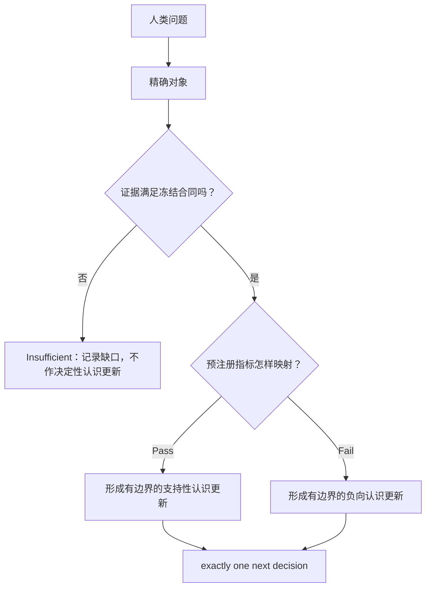

# [具体对象]在[明确边界]下是否呈现[预注册关系]？

```text
type: daily_research_report
status: AI_DRAFT_AWAITING_HUMAN_CONFIRMATION / HUMAN_CONFIRMED
date: YYYY-MM-DD
topic: <稳定英文主题名>
canonical_anchor: <精确路径>
frozen_protocol: <精确路径；非实验型综合可写 N/A 并解释>
canonical_summary: <精确路径>
canonical_detailed: <精确路径>
source_focus: <result_state 为 HUMAN_CONFIRMED 的本周期核心任务 Focus>
```

保存为 `daily_research_reports/MMDD/docs/daily_report_<topic_slug>.md`。

报告引用的每一张图都必须物理存放在 `daily_research_reports/MMDD/figures/` 下，
正文一律用日期目录内的相对路径引用（如 `figures/x.png` 或 `../figures/x.png`），
不得写指向 `Projects/`、工作区或绝对路径的链接。从所属 experiment 的
`figures/` 复制一份是允许且预期的；复制关系逐条记在
`daily_research_reports/MMDD/figures/SOURCES.md`，日期目录内的副本只是阅读副本，
不是独立证据来源。

日报只有在研究者已完成或明确确认 Focus 中的“直接结果—我的结论—仍不能说—
唯一下一决策”之后才创建。它是一篇紧凑的、问题驱动的自包含 story，用于检查
实验逻辑是否自洽；不是前置规划、运行时间线或 `detailed.md` 的重写。正文只走
一遍以下逻辑：

```text
已确认的核心任务 Focus
-> 此前方法为什么不能回答
-> 本轮把问题缩成什么可判定对象
-> 如何测量并排除最强竞争解释
-> 直接结果
-> 有边界认识更新
-> exactly one next decision
```

若 `source_focus` 的 `result_state` 尚未达到 `HUMAN_CONFIRMED`，停止，不创建占位日报。

标题只提问题，不提前写答案。通常使用下面七个主节。摘要负责快速同步；正文负责重建推理；结论负责收缩
claim。三处各有不同职责，不重复粘贴同一段 verdict。正文通常控制在
2,500--5,000 个汉字或其他语言的等价紧凑篇幅（不计 metadata、公式、表格和
来源）；完整定义优先于机械字数限制。

## 摘要

[用一个短段落依次写：问题、方法的核心区分、一个决定性结果、有边界结论、
唯一下一决策。这里是正文前唯一一次提前报告 verdict 的位置。不要使用尚未
解释的 run id 或指标缩写。研究者未确认时使用“本报告的待确认判断”。]

## 1. 从人类问题到本轮唯一问题

### 1.1 核心任务来源与已有缺口

[先点名本周期 Focus，再点名组会记录、上轮日报或其他人类指定来源。用最少前情说明：
原判断是什么；此前代理指标或方法为什么不能回答；哪一个竞争解释仍然存在。
会议没有决定的模型、层或对象，不得写成“会议决定”。]

### 1.2 唯一可判定问题

> [一条可被本轮证据回答的问题。若有门控子问题，写成“先 A；仅当 A 通过，
> 再判断 B”，不要伪装成两个平行实验。]

| 人类先验 | 本轮可检验版本 | 与原先验的边界 |
| --- | --- | --- |
| [H] | [具名对象、关系和读出器族] | [本轮没有裁定的全局部分] |

## 2. 任务、数据与术语

术语必须在第一次进入假设、公式、表格或图之前定义。每个非显然名词至少给出：
普通语言含义、精确对象或计算、决策角色，以及最容易发生的误读。

### 2.1 任务与模型

[说明输入、输出、一个具体样本如何形成、模型看到什么、预测什么。定义 model、
layer、token、condition、episode、record、label、Router、probe/readout 等本文
会用到的词。若条件中只有一个承担 verdict，立即说明。]

### 2.2 数据划分与防泄漏边界

| 划分 | 普通语言含义 | 允许拟合/选择/评价什么 | 实际来源与规模 |
| --- | --- | --- | --- |
| TRAIN | [拟合数据；说明是否训练主模型] | | |
| DEVELOPMENT | [开发/验证数据] | | |
| CONFIRMATION / TEST | [冻结后的最终确认数据] | | |

[若当前 run 没有自己的 TRAIN/DEVELOPMENT，而是复用旧实验冻结资产，必须直接
写清“本 run 训练和选择了什么/没有训练和选择什么”。说明独立统计单位，避免
把共享同一 episode、document 或 subject 的 rows 当成独立样本。]

### 2.3 精确对象与符号

| 名称 | 白话含义 | 精确对象或公式 | 不能代表什么 |
| --- | --- | --- | --- |
| [对象] | | | |

## 3. 方法：为什么每一步都需要

[按逻辑依赖而非执行时间介绍方法。每个环节回答一个白话问题，并说明它只是
诊断、候选构造还是 verdict-bearing test。]

当推理包含三个以上依赖步骤、条件门或分支时，在这里加入一个 Mermaid
流程图。节点使用语义名称，至少显示：问题、对象变换、决定性比较、Pass/Fail
去向和当前停止点。线性的一两步说明不需要流程图；用户明确要求时必须加入。



[公式先给白话，再给计算。每个核心方法写明使用哪一数据划分；候选方向、矩阵
或谱位置只有在留出证据准入后才能被解释为有效对象。]

## 4. 假设、对照与判定规则

### 4.1 决定性比较

| 问题 | Treatment 改变什么 | Comparator / control 保持什么不变 | 排除哪个竞争解释 |
| --- | --- | --- | --- |
| [H] | | | |

### 4.2 指标与 Pass / Fail / Insufficient

| 指标 | 普通语言含义与精确计算 | 单位、方向和判定角色 | 不能证明什么 |
| --- | --- | --- | --- |
| [metric] | | | |

[正文写设计级 uncertainty contract：独立单位、聚合、draw 数、主 seed、区间
构造、control quantile 在哪里重算，以及 Pass/Fail/Insufficient 映射。逐 seed
账本、sampled-index 数组和重试细节留在 `detailed.md`。阈值必须来自 frozen
Protocol，不从结果反推。]

### 4.3 证据资格

[用一个短段落说明本轮证据为何 eligible，或为何只能 bounded/ineligible。
只保留会改变资格、解释或 verdict 的偏差。run timeline、依赖安装、命令、
receipt 和 artifact inventory 留在 `detailed.md`；正文用链接承接。]

## 5. 结果

每个真正改变判断的结果块都按同一顺序写：

```text
做了什么
-> 直接结果
-> 人话换算或正确基线
-> 允许的解释
-> 紧邻的限制
```

### 5.1 [诊断或第一个必要条件的普通语言标题]

[直接结果；必要时嵌入图或紧凑表。诊断结果明确标为非 verdict-bearing。]

### 5.2 [决定性比较的普通语言标题]

| 判断量 | 估计值与区间 | Protocol 映射 / 局部读法 |
| --- | ---: | --- |
| [metric] | | |

[嵌入中央证据图，并在图后解释轴、单位、误差棒、正确基线、允许结论和限制。]

通常使用一张中央结果表、一个推理流程图和不超过两张真正承担不同证据角色的
图。只有另一张图回答不同的必要条件时才增加，不用多图重复同一 verdict。

## 6. 结论、边界与唯一下一决策

### 6.1 确切认识更新

[用一段自然语言连接：原未知 -> 关键比较 -> 直接结果 -> 哪个解释被保留、
削弱或关闭 -> 当前最安全的认识。这里写 human-confirmed wording；未确认则
显式标成待确认草稿。]

### 6.2 不能推出什么

- [对象、任务、模型、层、token、读出器族或统计单位之外的外推。]
- [相关/可读性不能升级成的因果、原生使用、功能或部署结论。]
- [尚未检验的更强先验。]

### 6.3 唯一下一决策与其他开放问题

- **唯一下一决策：** [只写一个会改变主线的问题。]
- **完成判据：** [可检查的返回值与失败时如何记录。]

[其他开放问题只列为 parked / downstream，不把它们伪装成并行 next steps。]

## 7. 证据与来源

- **问题来源：** [人类指定来源]
- **Anchor：** [精确链接]
- **Frozen Protocol：** [精确链接]
- **Canonical Summary：** [精确链接]
- **Canonical Detailed：** [精确链接]
- **决定性图表 lineage：** [精确链接；每张图给出 experiment 侧的原始路径与
  `daily_research_reports/MMDD/figures/` 下的阅读副本路径]

交付前冷读：不了解聊天的读者能否说清“为什么问、每个名词是什么、实验怎样
区分竞争解释、结果允许说什么、下一步为什么只有一个”；审计读者能否把每个
决定性数字回溯到 canonical evidence。任一答案是否定的，报告保持
`AI_DRAFT_AWAITING_HUMAN_CONFIRMATION`。
