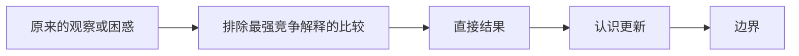

# [用一个完整问句写本日唯一回答的问题]

状态：[未回答 / 已有初步回答 / 已完成认识更新；写明仍需研究者确认的部分。]

## 1. 本日唯一回答的问题

**问题：** [只写一个能够被当前证据直接回答、且会改变研究判断的具体子问题。不要同时列上位议程、其他子问题或实验任务。]

**为什么这个问题重要：** [用一句话说明不同答案会如何改变当前认识或下一决策；不要再引入第二个问题。]

## 2. 认识更新

**一句话回答：** [先用领域外研究者也能复述的语言直接回答。]

[用一至三个连续短段落解释：旧理解是什么；当前证据排除了哪个最强竞争解释；新理解是什么。不要列 run id、实验阶段、护栏清单或完整指标。]

**概念与指标解释：** [任何必须出现的指标先用普通语言说明“它具体比较什么、数值大意味着什么、它排除什么误解”，之后才写名称、符号或最少数值。无需指标即可讲清时删除本项。]

**关键关系（仅在不可缺少时保留一条）：**

$$
[用一条公式表达理解机制所必需的关系]
$$

**机制解释：** [解释对象、方向和中间环节；不要把相关性升级为因果。公式不能推出的结论放到第 5 部分。]

## 3. 关键证据图或表

[优先放一张能教会读者如何得到结论的中心图或一张紧凑表。只有两张证据承担不同判断作用时才保留第二张。图必须本地嵌入；表只保留区分主解释与竞争解释所需的数字。]

| 要区分的解释 | 怎么看 | 最少直接证据 | 认识更新 |
| --- | --- | --- | --- |
| [主解释与竞争解释] | [先用普通语言解释读法] | [最少数值或图中位置] | [它支持什么，不能证明什么] |

**读图 / 表结论：** [不看正文时，读者应从这里得到哪一个回答。]

**完整证据：** [链接到 summary / detailed；不要把完整实验结果复制进 focus。]

## 4. 解释流程图（AI 初稿，研究者修改）

绘制要求：每个节点只写一个普通语言判断，每条箭头表示明确推理。只读流程图的人应能正确回答第 1 部分的问题；内部实验编号、未解释指标名和运行步骤不得成为节点。

## 5. 边界与下一步

- **成立范围：** [对象、条件和证据层级。]
- **仍不能说：** [最容易被误读或过度外推的结论。]
- **最强未决解释：** [若它仍影响判断则写；否则删除。]
- **唯一下一决策：** [只写一个会改变主线的判断。]
- **完成判据：** [出现什么可检查证据后才算关闭。]
- **恢复时第一动作：** [下次可以直接执行的第一个动作。]
